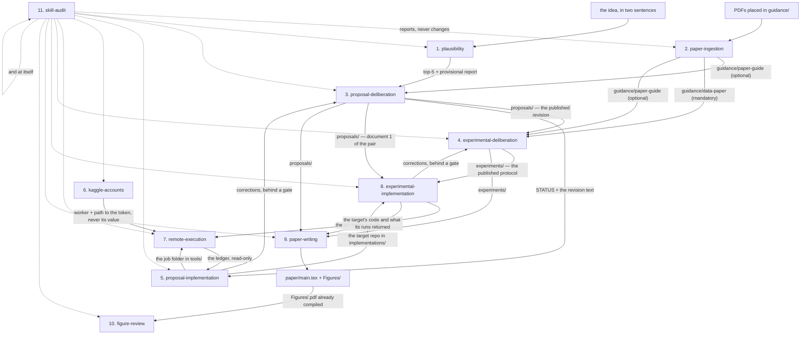
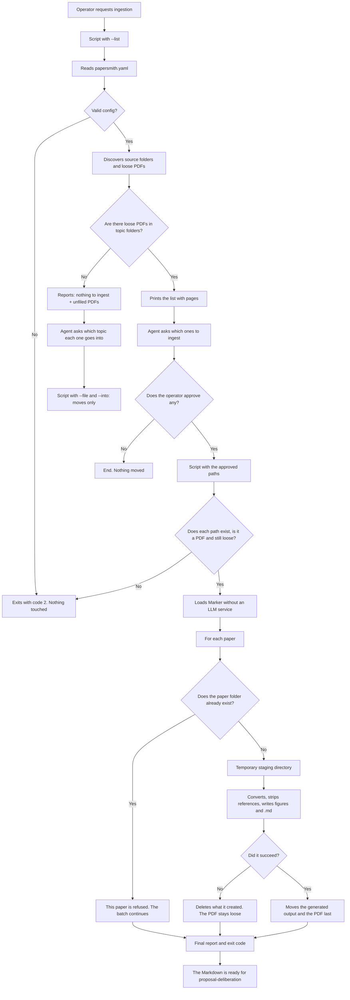
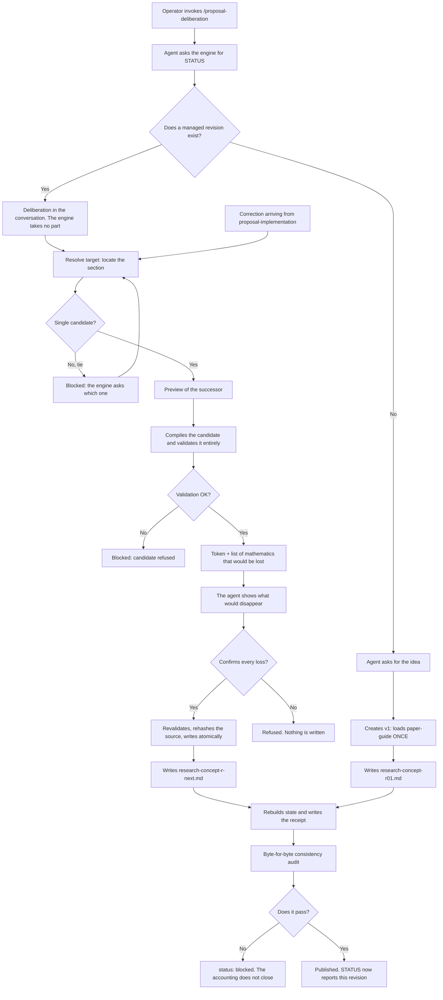
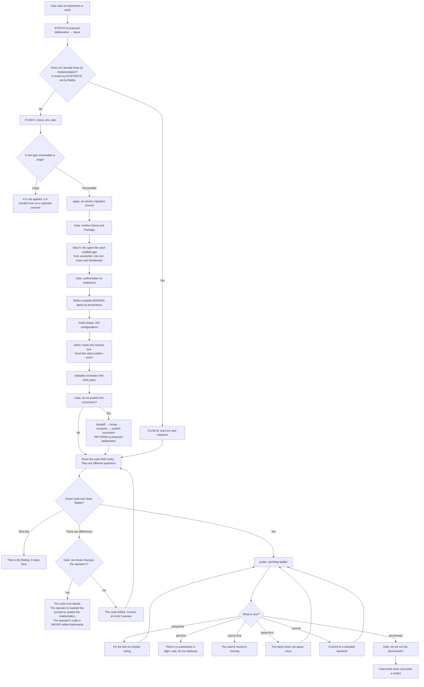
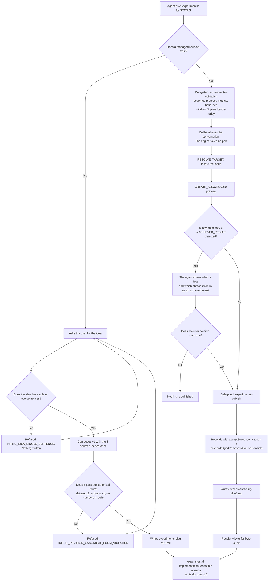
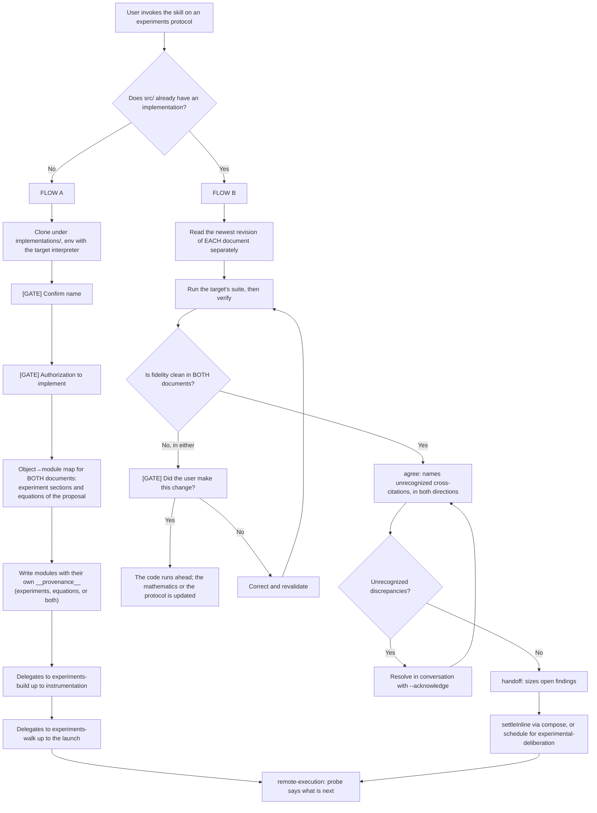
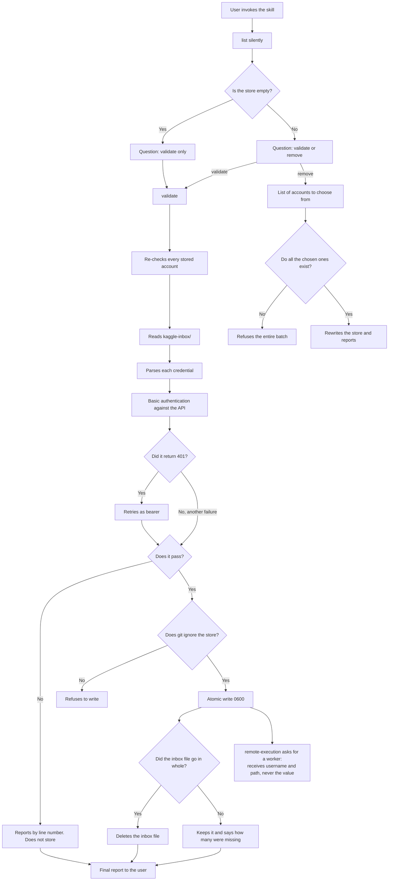
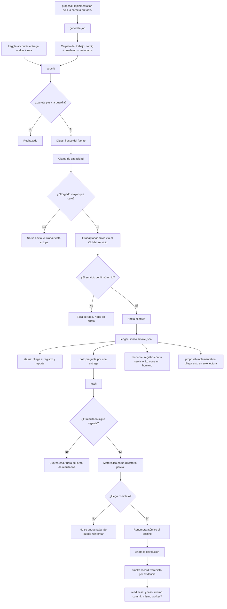
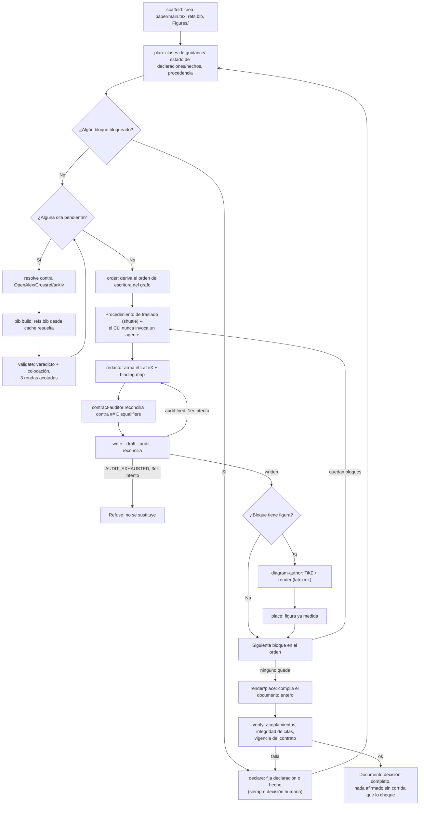
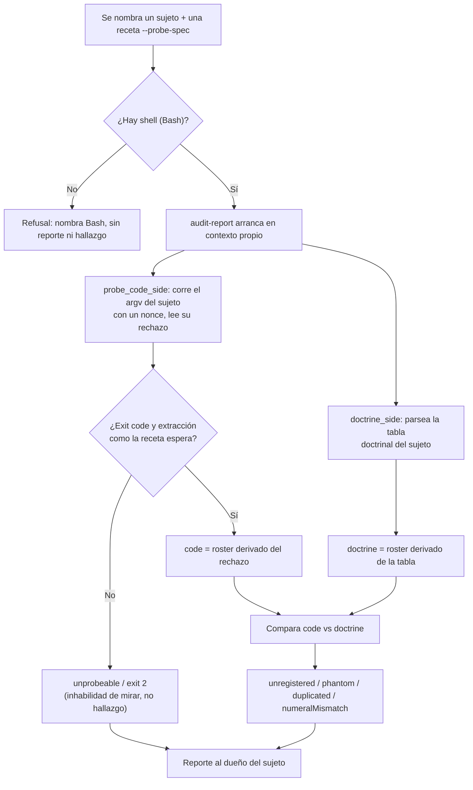

# papersmith-ai

> **A paper forge**: turns reference PDFs into high-fidelity Markdown that an agent can read (equations in LaTeX, tables as tables, figures as files), and drives the formal deliberation —mathematics and experimental design— all the way to the code that tests itself and the compiled paper.

[](https://github.com/LIAUNAL/papersmith-ai/actions/workflows/test.yml)
[](https://nodejs.org/)
[](https://www.python.org/)

<p align="center">
  
</p>

This README is the **complete manual, in English**: installation, the workspace from the
inside, the twelve CLI commands, the twelve skills, the nineteen agents,
remote compute, development and troubleshooting.

## Contents

1. [If this is your first time](#if-this-is-your-first-time)
2. [Use flow — the short path](#use-flow--the-short-path)
3. [Getting started](#getting-started)
4. [How it works — the order](#how-it-works--the-order)
5. [Inside the workspace](#inside-the-workspace)
6. [Harnesses and skill projection](#harnesses-and-skill-projection)
7. [The agents](#the-agents)
8. [Anatomy of each skill](#anatomy-of-each-skill)
9. [The CLI commands](#los-comandos-del-cli)
10. [Remote compute, carefully](#cómputo-remoto-con-cuidado)
11. [Architecture](#arquitectura)
12. [Development and testing](#desarrollo-y-pruebas)
13. [Troubleshooting](#solución-de-problemas)
14. [Related documentation](#documentación-relacionada)
15. [License](#licencia)

## If this is your first time

Welcome. This forge is built so you can go from a PDF to a compiled paper
without guessing the order. The minimum path:

1. **Install the CLI and set up the environment** — see [Getting started](#getting-started).
2. **Create your workspace** — `papersmith init ~/papers/my-paper --title "…" --topic "…"`.
   What it leaves inside, in [Inside the workspace](#inside-the-workspace).
3. **Check that the idea is plausible** — with your idea in two sentences,
   `/plausibility` tracks the SOTA and returns the constellation plus a ranked top 5.
4. **Put a reference PDF** in `guidance/reference-papers/` and run
   `papersmith ingest <pdf>` — or ask for `/paper-ingestion` inside your harness.
5. **Open the deliberation** with `/proposal-deliberation` and discuss the mathematics
   with the agent.

You don't have to use every skill, or in this order: **each one declares what
it needs first and refuses before doing something half-done**. If an input is
missing it doesn't invent it: it exits with a rejection code that names what's missing. A
`PAPER_ABSENT` is not your mistake; it's the skill telling you what it's missing.

The full map is in [Use flow](#use-flow--the-short-path); the
detailed route, in [How it works — the order](#how-it-works--the-order). And if
you're going to use an AI agent as copilot, the ones already defined are in
[The agents](#the-agents).

---

## Use flow — the short path

Twelve skills. You invoke them by name in Claude Code (`/paper-ingestion`) or ask for them in
Spanish (*"ingiere los papers"*). **You don't have to use them all, or in this order**: each
one declares what it needs first and refuses if it's missing, so if you start in the middle it
will tell you.

The full path, from a PDF to a compiled paper:

| # | You invoke | What it does | Where it leaves the result |
|---|---------|----------|-------------------------|
| 1 | `/plausibility` | Explores the idea before any ingestion, in three stretches: it tracks ~25 references through their abstracts, maps the constellation in a single HTML and discusses the plausibility of the hypothesis against that SOTA | `sota-pool/` (ignored, like `guidance/`) |
| 2 | `/paper-ingestion` | Converts the reference PDFs into readable Markdown (equations in LaTeX, tables as tables, figures as files) | `guidance/<folder>/` |
| 3 | `/proposal-deliberation` | Discusses the mathematics with you and publishes each agreement as a managed revision, with the SOTA constellation alongside | `proposals/` (the revision and its `graph.html`) |
| 4 | `/proposal-implementation` | Proof of concept: turns the proposal into Python that verifies itself against the document | `implementations/<repo>/` |
| 5 | `/experimental-deliberation` | Discusses the experimental design that will put that mathematics to the test | `experiments/` |
| 6 | `/experimental-implementation` | Turns the protocol into code and runs its measurements | the same target repo |
| 7 | `/kaggle-accounts` | Proves that the Kaggle credentials really authenticate | `store/` (never leaves the disk) |
| 8 | `/remote-execution` | Sends work to a remote worker and keeps the record of what came back | the target repo's ledger |
| 9 | `/paper-writing` | Writes the paper block by block, with every claim tied to its evidence | `paper/` |
| 10 | `/figure-review` | Looks at the render: rasterizes every `Figures/<id>.pdf` and measures what a raster can support (ink outside the canvas, collisions) | a visual report, never a change |
| 11 | `/skill-audit` | Audits any of the above: what the code accepts versus what its documentation promises | a report, never a change |
| 12 | `/upgrade-project` | Brings the workspace to the version of the CLI you have installed: it syncs the kit files and migrates the artifacts, delegating everything to `papersmith upgrade` | the workspace itself |

**The minimum to start.** If you just want to try the forge, start with step 1
with your idea in two sentences: `/plausibility` tracks the SOTA and returns the
constellation plus the top-5. Only afterwards, if you want, put a PDF in
`guidance/reference-papers/`, run `/paper-ingestion`, and deliberate with
`/proposal-deliberation`. Steps 4 and 6 only make sense once there's a published proposal
and a target repository to implement it in.

**The full flow, drawn.** The diagram shows every stage in this order with
its command, its agents (with the tools each one declares in Pi), its
human gates and what it leaves on disk. The interactive version, with links to
the source of each node, is in
[`docs/diagrams/papersmith-pi-flow.html`](docs/diagrams/papersmith-pi-flow.html)
(opens in the browser; generated with [Archify](https://github.com/tt-a1i/archify),
and its source and its recipe are versioned in
[`docs/diagrams/`](docs/diagrams/README.md)).

[](docs/diagrams/papersmith-pi-flow.html)

**Three things worth knowing before the first run.**

1. **Nothing you produce gets uploaded.** `proposals/`, `experiments/`, `paper/`,
   `implementations/` and `sota-pool/` travel to GitHub **as empty folders** and nothing more; `guidance/`
   versions its folders and never the PDFs or the Markdown inside. The scaffolding gets
   versioned, the content doesn't. A half-written paper is research material, and
   publishing it by accident is a leak.
2. **Each skill refuses before doing something half-done.** If an input is missing, it
   doesn't invent it or skip it: it exits with a rejection code that names what's missing. A
   `PAPER_ABSENT` or a `SECTION_CONTRACTS_UNREADABLE` is not your mistake, it's the skill
   telling you what it's missing.
3. **You close the deliberation.** The two deliberation skills propose, discuss and
   prepare the edit, but neither publishes without your acceptance. That's not a courtesy:
   it's in each one's contract and the engine enforces it.

---

## Getting started

None of this requires keys or external services: the forge runs locally.

### 0. What your machine needs to have

Two runtimes, and both are mandatory. It's not a recommendation: the forge uses
Python for the CLI and Node for the deliberation engine, and without the second
one half the framework won't start.

| Runtime | Version | What for | If it's missing |
| --- | --- | --- | --- |
| **Python** | ≥ 3.11 | the `papersmith` CLI and all the Python skills | there's no possible installation |
| **Node.js** | ≥ 21 | the deliberation engine (`jiti`, `typebox`) and the dashboard | `init` warns and `deliberate` refuses |
| `npm` | whatever Node ships | installing those two dependencies in the workspace | same as above |

Check both at once:

```bash
python3 --version && node --version && npm --version
```

**What exactly happens if Node isn't there.** `papersmith init` doesn't fail: it
warns with `npm was not found; deliberate requires npm install for jiti/typebox`
and moves on, because the rest of the workspace can be created. But
`proposal-deliberation` and `experimental-deliberation` —the two skills that
propose and discuss before writing— don't run without those dependencies. If you
want to create the workspace on purpose without them, `init --no-npm` says so
explicitly instead of leaving it to chance.

The ingestion runtime from step 2 is separate and **is optional**: it's only
needed to extract PDFs with OCR.

### 1. Install the CLI and set up the environment

```bash
# 1a. The CLI, from the latest version published on PyPI
pipx install papersmith-ai
#     the same with pip, if you don't use pipx
pip install papersmith-ai
#     or the tip of `main`, without waiting for a release
pipx install git+https://github.com/LIAUNAL/papersmith-ai.git

# 1b. Or from a clone of `main` (if you're going to develop the framework)
git clone https://github.com/LIAUNAL/papersmith-ai.git && cd papersmith-ai
pipx install .            # with pip: pip install .

# 1c. Update the CLI when a new release comes out
pipx upgrade papersmith-ai
#     if you installed it from a git URL, `upgrade` doesn't see it: reinstall
pipx install --force git+https://github.com/LIAUNAL/papersmith-ai.git
#     with pip, `--upgrade` over a git URL doesn't always re-clone
pip install --upgrade --force-reinstall "papersmith-ai @ git+https://github.com/LIAUNAL/papersmith-ai.git"

# 1d. And bring the workspaces that already exist up to that version
papersmith upgrade --plan-migrations ~/papers/sparse-ae  # which artifacts are missing, without writing anything
papersmith upgrade ~/papers/sparse-ae                    # syncs the files and migrates the artifacts
papersmith status ~/papers/sparse-ae                     # drift and pending migrations

# 2. Isolated ingestion runtime (micromamba: Python 3.12, PyTorch, Surya OCR, llama-server)
python3 scripts/setup_env.py install

# 3. Node dependencies and projection of skills to the harnesses
npm install
npm run setup:harnesses
```

**The package is published on PyPI.** `pipx install papersmith-ai` brings the
latest release, and that's what `pipx upgrade papersmith-ai` in **1c** updates.
The git URL in **1a**, on the other hand, brings the tip of `main`, which is what
you want if you're going to develop the framework. And watch out for the
neighbouring name: `papersmith` —without the `-ai`— is also on PyPI, but it's
**another project** (Word document generation), so `pip install papersmith`
doesn't install this forge.

`main` is the only branch that's maintained, and each release also gets its tag,
so if you need to freeze an exact build, pin it in the URL — for example
`pipx install --force "git+https://github.com/LIAUNAL/papersmith-ai@v0.13.0"`.
**1b** takes the clone as it is, including uncommitted changes, so to reproduce a
build use **1a** or a tag. The changelog is in [CHANGELOG.md](CHANGELOG.md).

Updating is two steps and they're two different objects. **1c** reinstalls the
CLI from `main`; confirm what you got with `papersmith --version`. **1d** moves
each **workspace** that already exists, and it isn't optional: a release can
change the shape of an artifact a workspace has already produced —the graph
pool's `atlas.html`, for example—, so syncing the framework files without
migrating the artifacts leaves the new scaffolding reading old state.

`papersmith upgrade` syncs the workspace with the installed version and applies
that version's artifact migrations. The version the workspace records doesn't
advance until those migrations are done, so `papersmith status` may tell you it
hasn't yet reached the release you just installed. `--plan-migrations` reports
what's pending and finishes without writing anything; it isn't called
`--dry-run` on purpose, because it doesn't preview the kit copy. `--no-migrate`
syncs the files and leaves the artifacts as they are, with the version marker
where it was.

Be careful not to mix up the two `upgrade`s: neither one touches the other.
`papersmith upgrade` refuses to take a workspace to a version older than the one
it records, unless you ask it to with `--allow-downgrade`.

`scripts/setup_env.py install` provisions **the whole** ingestion stack in a
separate micromamba environment (CPU or CUDA, depending on what it detects),
including the `llama-server` binary that the OCR needs — it is **not** Ollama
nor a Homebrew installation. `npm run setup:harnesses` symlinks the canonical
`skills/` tree into `.claude/skills`, `.pi/skills`, `.opencode/skills`
and `.agents/skills`, with relative, idempotent symlinks (see
[Harnesses and skill projection](#harnesses-and-skill-projection)). The first
run of `papersmith ingest` downloads ~1.5 GB of Surya weights if the
environment wasn't pre-provisioned.

### 2. Create a workspace

```bash
papersmith init ~/papers/sparse-ae \
  --title "Sparse Autoencoder Audit" \
  --topic "mechanistic interpretability" \
  --remote kaggle

cd ~/papers/sparse-ae
papersmith status
papersmith status --json          # machine-readable snapshot
```

The workspace stays decoupled from the framework checkout: the scaffolding is
synced with `papersmith upgrade`, and your research artifacts are protected by
contract. What `init` creates exactly —and what gets versioned— in
[Inside the workspace](#inside-the-workspace).

### 3. Ingest literature

```bash
papersmith ingest https://arxiv.org/abs/2309.08600    # arXiv, OpenReview or URL
papersmith ingest ~/Downloads/reference-paper.pdf     # local PDF
papersmith ingest ~/Downloads/scan.pdf --ocr       # scanned: balanced OCR mode
```

Each loose PDF ends up in its own folder, next to its Markdown (text + LaTeX +
tables, with the bibliography stripped) and the images of its figures. The
pipeline's details, in the `paper-ingestion` section of the
[Anatomy](#anatomy-of-each-skill).

### 4. Deliberate, implement and run

```bash
papersmith deliberate . --action status                                   # state of the managed proposal
papersmith implement . --action verify --target implementations/my-repo   # over an already materialized repo
papersmith run smoke_and_invariants --dry-run                             # plans; dispatches nothing
```

Inside a harness, the same capabilities are requested by skill name:
`/paper-ingestion`, `/proposal-deliberation`, `/experimental-deliberation`,
`/proposal-implementation`, `/experimental-implementation`, `/paper-writing`.
And the ones that don't depend on a domain — `/kaggle-accounts`,
`/remote-execution`, `/skill-audit` — act as gatekeeper, memory and auditor of
what you send out.

---

## How it works — the order

### Step 1 — Check that the idea is plausible (`plausibility`)

Before there is anything to ingest there is an idea, and this is the step that
tests it. It needs no PDFs, which is why it comes first: all three stretches work
from the idea and from what can be found about it.

| Stretch | Runs as | Ends at |
| --- | --- | --- |
| **Scout** | the `sota-scout` agent | the pool — 25 candidates with abstracts, in 3 to 5 families, plus the provisional plausibility note |
| **Constellation** | the `sota-grapher` agent | the single `atlas.html` beside `atlas.json`, with the checker's green run |
| **Screen** | the `novelty-screener` agent | the plausibility report — graded claims, a ranked top 5, and one closing paragraph on where the proposal stands |

Everything lands in `sota-pool/`, which is ignored like `guidance/`.
**Nothing here files into `guidance/`**: this step reads the literature, it does
not collect it. The pool it leaves behind is what `proposal-deliberation` shows
alongside the mathematics, and its ranked top 5 is what tells the ingestion step
which PDFs are worth having.

An idea stated in fewer than two sentences is refused before the search starts:
scouting an unstated idea invents its own question. A claim with no abstract
passage behind it does not become a planet — a quoteless planet is a drawing.

### Step 2 — Put each PDF in the folder according to its role

| Folder | What goes here |
|---------|------------|
| `guidance/paper-guide/` | **Guide papers** — the methodological / style references. `proposal-deliberation` loads them as context at the start of each deliberation. |
| `guidance/reference-papers/` | **Reference corpus** — supporting papers, ingested to Markdown for consultation. They aren't loaded automatically into the deliberation. |
| `guidance/data-paper/` | **Data paper — mandatory for `experimental-deliberation`.** It describes the research's database and is the **ceiling**: it bounds what can be claimed. A claim the data doesn't support isn't an experiment. Without this folder populated, `CREATE_INITIAL_REVISION` can't start. |

**All three folders travel empty.** Each one arrives in a clone with its `.gitkeep` and nothing more: `guidance/*/*` is ignored, with `!guidance/*/.gitkeep` as the only escape hatch. The scaffolding is versioned, the PDFs and their Markdown are not. `tests/test_forge_scaffolding.py` derives both halves —what the `profile.ts` declare as source against what git actually tracks— and goes red if a declared folder stops travelling.

### Step 3 — Ingest the PDFs (PDF → Markdown)

In **Claude Code**, invoke the skill:

```
/paper-ingestion
```

(or simply ask: *"ingiere los papers"*). For each **loose** PDF, it creates a
folder with the paper's name, moves the PDF inside and writes a lightweight
`<name>.md` (text + LaTeX + tables, with the bibliography stripped) together
with the images of the figures:

```
guidance/reference-papers/computers-13-00176-v2-1/
├── computers-13-00176-v2-1.pdf
├── computers-13-00176-v2-1.md
└── _page_4_Figure_2.jpeg   (figures that the .md references)
```

A **loose PDF** (directly in a source root folder) is pending; a paper that's
already inside its folder is skipped. To re-ingest, delete the paper's folder
(leaving the PDF loose) and run the skill again. The configuration lives in
`papersmith.yaml` (`source_roots`, `mode`, `strip_references`).

### Step 4 — Deliberate over a proposal (`proposal-deliberation`)

In **Claude Code**, invoke the skill:

```
/proposal-deliberation
```

On the first turn it automatically loads the Markdown from `guidance/paper-guide/`
as context and acts as a mathematics tutor. From there you can:

- describe an idea and ask for a first version,
- ask for edits to a managed proposal,
- run the lifecycle of managed revisions.

Proposals live in `proposals/`, one per managed revision
(`research-concept-rNN.md`).

Each published revision travels with its own constellation: the SOTA's with the
proposal inside, in `proposals/research-concept-rNN.graph.html`, drawn by the
same 3D viewer as the atlas and named from the revision. The deliberation's
publication stretch produces it, from the `proposals/research-concept-rNN.sky.json`
overlay written during the discussion: there the main idea, the topics the
proposal takes from the SOTA papers, its novelty, the problem it would solve and
three to five concepts remain as nodes and edges instead of as sentences. If
that overlay doesn't exist, the stretch reports it as pending instead of drawing
relationships nobody agreed on.

### Step 5 — Take the proposal to code (`proposal-implementation`)

In **Claude Code**, invoke the skill:

```
/proposal-implementation
```

It takes the current revision and materializes it in a target repository, which
lives in `implementations/` with its own git and its own virtual environment. The
flow has two separate phases:

1. **Structure.** If the repo comes with content, it moves it to the layout and
   verifies —without running anything— that notebooks, paths and references
   still resolve. It doesn't audit or validate the code that was already there:
   it's what's there, tidied up.
2. **Materialization.** Only then does it implement the mathematics and subject
   it to the validation ladder.

```
<repo>/
├── <Name>/            Notebooks/  Data/  Results/  Models/
├── src/<Package>/     one implementation per mathematical object
├── tests/             smoke · invariants · synthetic · audit · remedies
└── pyproject.toml
```

The ladder has five levels, from the cheapest to the most expensive: **smoke**,
**invariants** (each claim of the proposal anchored to a test), **synthetic**
(deterministic, fixed seed), **audit** (findings about the mathematics, measured
over 200 random configurations) and **remedies** (each proposed fix validated
with the same rigour). A finding without a validated remedy isn't reported.

That's all it takes to use the forge. If you want to understand **what goes on
inside** each skill —its steps, its pieces, how they connect to each other and
what limitations each one has— read on in [Anatomy of each
skill](#anatomy-of-each-skill). And for the literal contract, each one's
`SKILL.md`.

---

## Inside the workspace

`papersmith init` creates a self-contained directory —with no git initialized and
without touching your checkout— with this shape:

```
my-paper/
├── .papersmith/                 # workspace state (config, manifest, ledger)
│   ├── config.json              #   active target and profile, ledger paths
│   ├── manifest.json            #   hashes of everything the framework generated
│   ├── runs_ledger.jsonl        #   every dispatched run, in order
│   └── version                  #   framework version that created it
├── .claude/agents/              # the nineteen subagents (single source of truth)
├── skills/                      # the kit copy: the twelve skills + _core
│   └── _core/                   #   the two shared engines (deliberation, implementation)
├── sections/                    # the ten section contracts (they travel WITH content, like skills/)
├── guidance/
│   ├── reference-papers/        # drop-zone: leave your reference PDFs here
│   ├── paper-guide/             # guiding papers for method and style (optional but recommended)
│   └── data-paper/              # data paper (mandatory for experimental-deliberation)
├── proposals/                   # managed revisions, flat: research-concept-rNN.md
├── paper/                       # the paper's LaTeX (paper-writing writes it here)
├── experiments/                 # the managed experimental protocol
├── implementations/             # destination repos; each one with its own git
├── kaggle-inbox/                # what comes back from the remote workers
├── CLAUDE.md / OPENCODE.md / .agents/AGENTS.md   # harness routing
├── .pi/APPEND_SYSTEM.md         # harness routing (Pi appends it to the system prompt)
├── papersmith.yaml              # workspace configuration (yours, editable)
├── package.json                 # workspace Node dependencies (jiti, typebox), yours, editable
├── requirements.txt
├── scripts/setup_env.py         # ingestion runtime provisioning
└── README.md                    # brief description of the workspace
```

Every research folder (`guidance/*/`, `proposals/`, `paper/`, `experiments/`,
`implementations/`) arrives empty, with its own `.gitkeep`: the workspace's
`.gitignore` applies the same rule this repository applies to itself —the
folder is versioned, the content never is.

### `papersmith.yaml` — the configuration you will actually touch

The file comes with three example targets and three execution profiles. The
targets declare **where** the work runs; the profiles, **what** runs and how
it is split up:

```yaml
compute_targets:
  default: "kaggle-gpu-pool"
  targets:
    local-workstation: { provider: "local", device: "cuda:0" }
    kaggle-gpu-pool:   { provider: "kaggle", accelerator: "GPU_T4_X2", ... }
    slurm-cluster:     { provider: "remote-ssh", host: "hpc.university.edu", ... }

execution_profiles:
  smoke_and_invariants:  { target: "local-workstation", entrypoint: "pytest …/tests/test_invariants.py" }
  sweep_training:        { target: "kaggle-gpu-pool", sharding: { … }, artifacts: { … } }
  benchmark_evaluation:  { target: "kaggle-gpu-pool", entrypoint: "papermill …/benchmark.ipynb" }

paper_ingestion:
  engine: marker
  mode: fast            # fast (CPU) | balanced (GPU, maximum fidelity)
  strip_references: true
  source_base: guidance
```

The active target and profile live in `.papersmith/config.json`; `papersmith
target set` changes them. The `paper_ingestion` block is owned by the ingestion
skill and the orchestrator treats it as opaque (edit it with the skill, not by
hand).

### What is versioned and what is not

`papersmith upgrade`'s preservation contract is explicit: it never touches
`guidance/`, `proposals/`, `paper/`, `experiments/`, `implementations/`,
`kaggle-inbox/`, `papersmith.yaml`, `package.json`, `README.md`
nor the `.env*` files. Everything else is framework scaffolding and `upgrade`
syncs it —with `--force` if needed— leaving your artifacts intact.

In this repository the same rule holds for Git: the scaffolding is versioned,
the content is not. Research folders travel with their `.gitkeep` and nothing
else; `guidance/` versions the folders and never the PDFs nor the ingested
Markdown. `sota-pool/` follows the same contract: the folder travels, and
`candidates.json`, `atlas.json` and `atlas.html` —which inlines the full 3D
viewer— stay on the machine that produced them.

Preserving, mind you, is not migrating. Not touching an artifact protects it while
its shape does not change; the day a release changes that shape, something is
needed to carry it up to it. That is the job of [artifact
migrations](#migraciones-de-artefactos), and it is also the reason
`.papersmith/version` stopped advancing just because files had been copied.

### The state: `.papersmith/`

- **`manifest.json`** stores the hash of every generated file. `papersmith
  audit --check-drift` compares against the disk and names what drifted; the
  repair is `papersmith upgrade`, never a hand edit.
- **`runs_ledger.jsonl`** is append-only: every `papersmith run` that gets
  dispatched is recorded with its target, its profile and its result.
- **`config.json`** stores the active target, the active profile and the ledger's
  configuration paths.
- **`migrations.json`** records which version-tied artifact migrations have
  already been applied, so that `upgrade` does not repeat them. Convergence
  ones are never recorded: they never end. If the file gets damaged,
  `upgrade` refuses and `status` reports it; do not edit it by hand.
- **`version`** is the version the workspace declares for its **artifacts**,
  not for its files. Of the two markers it is the one that lags behind when
  a migration fails, and that is why `status` can say the workspace has not
  yet reached the installed release.

---

## Harnesses and skill projection

`skills/` at the repository root is the **single source of truth**. Each
harness reads skills from its own folder, so the projection script symlinks
the canonical tree into each one with **relative** and idempotent symlinks:
running it again converges to the same layout and the checkout stays
relocatable.

```bash
npm run setup:harnesses      # = bash scripts/setup-harnesses.sh
```

| Harness | Where it reads skills from | Routing document (workspace) |
|---------|----------------------------|-------------------------------|
| Claude Code | `.claude/skills/` | `CLAUDE.md` |
| Pi | `.pi/skills/` | `.pi/APPEND_SYSTEM.md` |
| OpenCode | `.opencode/skills/` | `OPENCODE.md` |
| Google Antigravity | `.agents/skills/` | `.agents/AGENTS.md` |

### What each harness wires

`papersmith init` and `papersmith upgrade` generate, for each harness the
workspace declares, what this table shows. It is the same matrix as
`HARNESS_CAPABILITIES` in `src/papersmith/generators.py`, and a test
(`tests/test_harness_parity.py`) verifies that both match. `wired` is what
gets generated; `unsupported` is what does not get generated; `opt-in` is
only documented, and you enable it yourself.

<!-- harness-capabilities:start -->
| Harness | Skills | Comandos | Agentes | Plugins / guards |
|---------|--------|----------|---------|------------------|
| Claude Code | wired | wired (`.claude/commands`) | wired (`.claude/agents`) | opt-in (ver [guard-hooks](docs/guard-hooks.md)) |
| OpenCode | wired | wired (`.opencode/commands`) | wired (`.opencode/agents`) | wired (`.opencode/plugins/refuse-offpath-push.js`) |
| Pi | wired | wired (`.pi/prompts`) | wired (`.pi/agents`) | wired (`.pi/extensions/refuse-offpath-push.js`) |
| Google Antigravity | wired | unsupported — vía skills (workflows deprecados) | wired (`.agents/agents`) | unsupported |
<!-- harness-capabilities:end -->

When it finishes, `init` and `upgrade` print one line per active harness with
the state of each capability (`wired`, `unsupported`, `failed` or `blocked`) and
add the `wiring` key to its result. If a skill symlink could not be created, or
there is a real directory where the symlink would go, they report it as a warning
(`failed` / `blocked`) instead of silently omitting it.

What the table does not promise:

- **Pi:** the agents in `.pi/agents` are only read by the third-party package
  `pi-subagents`; the Pi core has no subagents. Without that package, the
  files exist but nobody uses them.
- **Claude Code:** the guard is opt-in. Papersmith never writes or merges
  `.claude/settings.json`; the snippet to enable it is in
  [`docs/guard-hooks.md`](docs/guard-hooks.md).
- **Antigravity:** there is no guard until its hooks' input schema is obtained
  (`.agents/hooks.json`).
- **Antigravity, commands:** no command files are generated. Its only
  slash-command mechanism, workflows, is deprecated in favor of skills
  (retirement 2026-11-01) and the workflows' workspace path is not verified
  (`.agents/workflows` is an assumption). Skills already work as
  `/<skill-name>` through `.agents/skills`, so all of them stay invocable
  as commands.
- **Antigravity, documented locations only:** `.antigravity/rules.md` and
  `.antigravity/skills` are no longer generated. Antigravity uses `.agents/skills`,
  `.agents/agents/` and `.agents/AGENTS.md` (plain text, no frontmatter). Existing
  workspaces are not migrated: run `papersmith init` in a new workspace.

#### Verified support matrix

Summary of [`docs/harness-support-matrix.md`](docs/harness-support-matrix.md),
read against each tool's documentation on 2026-10-02. It is what the
tool documents, not what Papersmith generates (that is the table above).
`unverified` means no primary source was read.

| Harness | Skills | Commands | Agents | Plugins / hooks | MCP / config | Sources (2026-10-02) |
|---------|--------|----------|--------|-----------------|--------------|----------------------|
| OpenCode | supported: `.opencode/skills` | supported: `.opencode/commands` | supported: `.opencode/agents` | supported: `.opencode/plugins/` | supported: `opencode.json` | <https://opencode.ai/docs/skills/>, <https://opencode.ai/docs/commands/>, <https://opencode.ai/docs/agents/>, <https://opencode.ai/docs/plugins/>, <https://opencode.ai/docs/config/> |
| Pi | supported: `.pi/skills`, `.agents/skills` | supported: `.pi/prompts/*.md` | unsupported in the core; third-party only (`.pi/agents`, `pi-subagents`) | supported: `.pi/extensions/` | supported: `.pi/mcp.json` | <https://github.com/badlogic/pi-mono/blob/main/packages/coding-agent/docs/configuration.md>, <https://github.com/badlogic/pi-mono/blob/main/packages/coding-agent/docs/prompt-templates.md>, <https://github.com/badlogic/pi-mono/blob/main/packages/coding-agent/docs/extensions.md>, <https://github.com/badlogic/pi-mono/blob/main/packages/coding-agent/docs/mcp.md>, <https://github.com/nicobailon/pi-subagents/blob/main/docs/agents.md> |
| Google Antigravity | supported: `.agents/skills` | supported but deprecated (workflows); path `.agents/workflows` unverified | supported: `.agents/agents` | supported: `.agents/hooks.json` (input schema unverified) | supported: `.agents/mcp_config.json` | <https://antigravity.google/docs/skills>, <https://antigravity.google/docs/ide/workflows>, <https://antigravity.google/docs/subagents>, <https://antigravity.google/docs/hooks>, <https://antigravity.google/docs/mcp> |
| Claude Code | supported: `.claude/skills` | supported (legacy format): `.claude/commands` | supported: `.claude/agents` | supported: `.claude/settings.json` (Papersmith never writes it) | supported: `.mcp.json` (Papersmith does not generate it) | <https://code.claude.com/docs/en/skills>, <https://code.claude.com/docs/en/sub-agents>, <https://code.claude.com/docs/en/hooks>, <https://code.claude.com/docs/en/mcp> |

- `.antigravity/skills` and `.antigravity/rules.md`: unsupported (no source found)
  and no longer generated; Antigravity uses `.agents/skills`, `.agents/agents/` and
  `.agents/AGENTS.md`.
- Antigravity deprecated workflows in favor of skills (2026-11-01, source:
  <https://antigravity.google/docs/ide/workflows>).
- Pi: the tool names `mcp` and `mcpScript` have no source
  (unsupported, no source found).
- The docs of these tools change fast; re-verify a cell before
  relying on it after that date.

The sources of each cell are in
[`docs/harness-support-matrix.md`](docs/harness-support-matrix.md).

Inside a generated **workspace**, the story is slightly different and
worth knowing: the workspace ships the full `skills/` tree and the agent
tree (`.claude/agents/`), and its routing docs point at the canonical tree
`skills/*/SKILL.md`. The routing documents are generated projections: the
real source of each agent is `.claude/agents/*.md` and the source of each skill is its
`SKILL.md`. Do not edit the projections by hand; they regenerate (and
`papersmith audit --check-drift` warns if one drifted). `init` and `upgrade` generate one slash command per skill
in `.claude/commands/`, `.opencode/commands/` and `.pi/prompts/`; Antigravity does not
receive command files and reads skills through its symlinks. Agents are
projected from `.claude/agents/` to `.opencode/agents/`, `.pi/agents/` and
`.agents/agents/`. For your harness to
list the skills as `/` commands, run `npm run setup:harnesses` inside the
workspace: it symlinks the shipped tree into `.claude/skills`, `.pi/skills`,
`.opencode/skills` and `.agents/skills`, just as relative and idempotent as
in the checkout. In this checkout, the slash command projections
(`.claude/commands/`, `.opencode/commands/`, `.pi/prompts/`), the agent projections
(`.opencode/agents/`, `.pi/agents/`, `.agents/agents/`) and the OpenCode and Pi guards
are synced with `python scripts/sync-repo-harness.py` (`--check` for CI; it
has no script in `package.json` because the kit ships it and the script is
repo-only).

---

## The agents

A workspace ships **nineteen subagents** in `.claude/agents/`. They are not
replacements for the CLI: they are short bursts of work your harness launches (for
example, with the Task tool) when you ask for them. The shape is always the
same — **one burst between two operator gates**: the agent decides
nothing, asks nothing, and ends up reporting what it found and how much it cost
to establish it. You open and close the gates.

| Agent | What it is for | Skill it loads |
|-------|----------------|----------------|
| `implementation-build` | From the approved object→module map to the findings report: materializes the scaffolding, writes one module per object with its provenance and its invariant tests, and validates the admitted remedies. | `proposal-implementation` |
| `implementation-walk` | Walks the declared flow act by act, in order: runs the local steps, records each product and stops at the rehearsal before launch. It has no path to submit a campaign. | `proposal-implementation` |
| `deliberation-publish` | From the moment you accept a change until the successor revision is published and in force — the only way the mathematics travels. The deliberation itself is not here: only you close it. | `proposal-deliberation` |
| `experimental-publish` | The same as `deliberation-publish`, over the experiments document. | `experimental-deliberation` |
| `experimental-validation` | The `validated` stage: it looks for the area's evaluation protocol —metrics, baselines, dataset, seeds, significance test—, verifies each baseline against its repo and its venue, and dates every URL it uses. | `experimental-deliberation` |
| `experiments-build` | From the approved map of protocol steps to executable commands: materializes whatever is needed, wires each step and instruments each measurement so that it can be run and read. | `experimental-implementation` |
| `experiments-walk` | The walk of the protocol, with the same gates and the same stop at the rehearsal. | `experimental-implementation` |
| `paper-ingestion` | Turns a paper into the form in which it can really be used: LaTeX equations, tables as tables, figures as files. Stages: `filed`, `extracted`, `readable`. It asks nobody anything. | `paper-ingestion` |
| `contract-auditor` | Reads the `## Disqualifiers` of a contract, literally, and judges a draft block against each one: `fires`/`clear`/`undecidable`, with the passage quoted in each `fires`. | `paper-writing` |
| `redactor` | Writes the LaTeX of a block from exactly four inputs (the contract's prose, its evidence set, its mode and its style set) and returns a binding map: where each sentence comes from. | `paper-writing` |
| `style-sampler` | Resolves the equivalent block, complete, in each style folder of `guidance/` and returns it verbatim, never trimmed. It is the only material an overlap check can compare. | `paper-writing` |
| `diagram-author` | Writes a standalone TikZ diagram (`<id>.tex` + `<id>.diagram.json`) and compiles it in its own loop, up to the repair budget. It never draws a chart from measured numbers — that is the `place` verb. | `paper-writing` |
| `figure-auditor` | Compares the components declared in the manifest against the section's prose and the pipeline steps; reports a structured verdict. | `paper-writing` |
| `insumos-observer` | Reads the paper's four declared input sources —`proposals/`, `experiments/`, the destination repo's code and its own run outputs— and reports, for each observable fact, whether it holds and with what evidence. It never decides a value nor runs `declare`. | `paper-writing` |
| `novelty-screener` | Discusses the hypothesis against the pool's abstracts, grades novelty and plausibility with an exact citation —all provisional— and ranks the top-5 for later ingestion, closing with a plausibility paragraph. Dialogue with a report at the end; it does not publish, does not write, does not ingest, does not deliberate. | `plausibility` |
| `sota-scout` | Tracks the idea across the open literature —25 references with abstracts, each in its family (3 to 5 in the pool)— as `sota-pool/candidates.json`. It ends in the pool; it does not ingest nor finally grade anything. | `plausibility` |
| `sota-grapher` | Maps the pool to its constellation —one solar system per paper grouped by family, 20 planets maximum, edges between sibling systems— as `atlas.json` plus the single `atlas.html`, running checker and renderer until green. | `plausibility` |
| `audit-report` | Audits a subject that enumerates a closed set —operations, subcommands, codes, assets— looking for the gap between what its code accepts and what its documentation promises. It reports; it never repairs. | `skill-audit` |

Three rules that order everything else:

- **The source of truth is `.claude/agents/`.** Each harness's routing docs
  (`CLAUDE.md`, `.pi/APPEND_SYSTEM.md`, `OPENCODE.md`,
  `.agents/AGENTS.md`) list
  all nineteen, and they are generated: if you want to change an agent, you change it
  there, not in the projection.
- **Each agent declares the skill it loads** (`skills/<name>/SKILL.md`), and that
  binding is verified: an agent that points at a skill the workspace does not
  ship does not get there.
- **Some agents are not invoked by any code path**
  (`contract-auditor`, `redactor`, `style-sampler`): you launch them, and it is the
  `write` verb that judges what they return — it never trusts your account nor the
  draft on their own.

---

## Anatomy of each skill

The sections above describe **what you do**. This one describes **what happens
inside**. It is written for someone who has never seen the project: each skill is
explained from nothing and **in full** — its steps, its parts, its connections to
the others, its known limits and its diagram — without sending the reader
elsewhere in the document.

Two things before the first skill.

**What a skill is here**, because it is not a program that runs once and stops.
Each one has two halves that do different jobs:

| Half | What it is | Who runs it |
| --- | --- | --- |
| `SKILL.md` | A prose contract: when to activate, what to ask, what never to do. It is not code; it is the instruction of conduct. | **The agent** reads it and behaves according to it. |
| The engine (`scripts/`, `engine/`) | Deterministic code: same input, same output. No model, no network, no keys. | **The machine** runs it and returns a verdict the agent cannot negotiate. |

That division is the forge's central idea: **the agent decides, the engine
verifies**. The agent proposes a change; the engine checks that the change broke
nothing and refuses when it did. An agent can be wrong. A deterministic engine does
not change its mind.

**How they chain.** The twelve are not islands: each one receives something
specific from another and hands something specific to the next. This is the map,
and each skill explains its own seam in detail in its own section. The arrows state
**what** crosses the seam rather than merely that a seam exists, and every label
below is read from the declaration of the skill that receives it, not inferred from
the folder name.



**Three things the map states.**

*The two upward loops are the forge's core.* The mathematics goes down to code and
what the code discovers goes back up to the document; the same holds between the
experimental protocol and its implementation. In both cases the return passes
through a gate the operator opens: the code proposes a correction and never
publishes one.

*The four in the middle are two pairs over two engines.* Skills 3 and 5 share a
deliberation engine; 4 and 6 share an implementation engine. The only thing that
differs between the two hosts of a pair is their `profile.ts` or their
`impl_profile.py`, which is why a defect in one engine appears in two skills at once
and why the engine's limits are recorded in both.

*Skill 9 is the only one that reads everything before it at once*, and 11 is not in
the chain: it stands aside and looks at any of them, itself included.

The map draws the eleven skills that take part in the flow. Skill 12,
`upgrade-project`, is not a stage: it operates on the workspace the flow runs
inside, and its own section below explains it.

---

### 1. `plausibility` — map the territory before collecting it

Before any PDF is ingested there is an idea, and this is the skill that tests it.
It needs no PDFs, which is why it runs first: all three of its stretches work from
the idea and from what can be found about it.

**The three stretches.**

| Stretch | Delegated to | Begins after | Ends at |
| --- | --- | --- | --- |
| Scout | `sota-scout` | the idea is stated in at least two sentences | the pool: 25 candidates with abstracts, in 3 to 5 families |
| Constellation | `sota-grapher` | the pool holds its 25 candidates | one `atlas.html` beside `atlas.json`, with the checker green |
| Screen | `novelty-screener` | the hypothesis is stated and the pool holds its candidates | the plausibility report: graded claims, a ranked top 5, and one closing paragraph on where the proposal stands |

What moves between the stretches is execution, never doctrine. The rules for
scouting and mapping live in the skill; the rules for screening live in the
agent's own section; and each agent's first instruction is to load the skill.

**The slot contract.** Every system in the constellation carries exactly these
slots, and the 20-planet limit per system is absolute.

| Slot | Planets | What it holds |
| --- | --- | --- |
| `sun` | exactly 1 | the paper: title at the center |
| `branch` | 0 to 2 | research branches the paper claims |
| `topic_app` | exactly 1 | the topic as the application domain states it |
| `topic_ai` | exactly 1 | the same topic framed as an AI problem |
| `problem` | exactly 1 | the problem the paper faces, in one claim |
| `application` | exactly 1 | where it lands in the world |
| `family` | exactly 1 | the group this system belongs to: one per paper, 3 to 5 families per pool |
| `novelty` | exactly 1 | what the paper adds over those families |
| `contribution` | 0 to 5 | concepts argued beyond the one novelty claim |
| `result` | 1 to 3 | punctual results, one claim per planet |
| `conclusion` | 1 to 2 | conclusions, one claim per node |

**What leaves it.** Nothing is ingested, nothing is filed into `guidance/`, and
nothing is published. Everything lands in `sota-pool/`, which travels gitignored
like `guidance/`. The pool is what `proposal-deliberation` shows beside the
mathematics, and the ranked top 5 is what tells the ingestion step which PDFs are
worth having.

**The acceptance gate.** The report is not handed on until the operator accepts
it. The gate is narrow: it approves the reading and not the idea, it publishes
nothing and it files nothing. Every re-screen is a new reading and carries its own
gate, because an acceptance of a previous report is not an acceptance of this one.

**Its refusals.** An idea under two sentences is refused before the search starts.
Fewer than 25 resolvable candidates is reported short, with what was tried, and is
never padded with unquoted entries. More than 5 families means keeping the 5 the
abstracts lean on hardest and naming the ones left out. A claim with no abstract
passage behind it does not become a planet: a quoteless planet is a drawing.

**What it never does.** It never writes a planet whose quote was not read in the
same pass from the abstract its evidence names, and never grades a claim whose
abstract was not read in the same reply. An invented quote reads as a finding and
is acted on as one.

### 2. `paper-ingestion` — from PDF to Markdown

**What it is for.** Papers arrive as PDFs, and for an agent a PDF is a closed box:
the text is mixed with the layout, the equations are drawings and the tables are
loose lines. This skill turns each PDF into clean Markdown —equations in LaTeX,
tables in Markdown, figures as separate image files— so that the rest of the forge
can **read** the paper instead of trying to decipher it. Everything runs locally:
no keys, no external service.

**What it receives and what it hands on.** It is the start of the chain: the only
thing it receives is the PDFs left in `guidance/`. What it hands on has a
consequence that matters before it is used:

- `guidance/paper-guide/` — what lands here is what `proposal-deliberation` loads
  **automatically**, from the `GUIDE_DIRECTORY = "guidance/paper-guide"` constant in
  its engine. But it loads it **only once in the entire life of the proposal**: at
  the creation of v1, and never again.
- `guidance/reference-papers/` — a consultation corpus. **It is never loaded on its
  own.** It is there for the operator or the agent to read when needed.

> **The order matters.** If a guide paper is ingested **after** the v1 of the
> proposal has been created, that paper no longer enters by that route: the load is
> unrepeatable by design. Ingestion comes first, deliberation after.

**What it needs first.** A single per-machine preparation: running
`./.claude/skills/paper-ingestion/setup.sh`. It is idempotent and does two things:
it installs the `llama-server` binary (the OCR engine; it is not a pip package) and
creates the virtual environment with `marker-pdf` inside. The first real ingestion
downloads the models (~1.5 GB) and caches them; from then on it works offline.

**The stages it declares.** The flow is not the list of commands: it is what each
stage establishes, and when it can be considered passed. This table is read
from `OBJECTIVE_FLOW` in the script, which a test keeps equal to the `SKILL.md`.

| Stage | What it establishes | It is passed when |
|---|---|---|
| `filed` | The PDF sits inside a topic folder of its own — that is what turns it into a paper and not a download | it stops appearing among the loose ones |
| `extracted` | The Markdown exists beside it, with its figures written as files instead of staying inside the page | the paper folder holds the document and its images |
| `readable` | The equations are LaTeX and the tables are Markdown, so a later reader can **cite** a formula instead of describing a photo of one | it is the arrival; it is behind no one |

**Arrival:** a document that a person can read and a later session can cite — which
a PDF is not. Its equations are drawings and its tables are ink.

**A declared tension, not a defect.** The `humanStops` field of this skill is **empty**: no
*stage* stops to wait for a person. But its Activation Contract says
*"Never ingest without asking first"*, and the Phase 2 confirmation is
mandatory. The two things coexist because the confirmation happens
**before** the flow starts, and the script has no consent mechanism of its
own — the rule lives in the `SKILL.md` and the agent enforces it.
`kaggle-accounts`, which also writes, does declare *"consenting to
validate at all"* as a stop that belongs to a person: the two skills do not
describe the same consent in the same way.

**The flow, step by step.** It is **two commands, not one**, and that split exists
so that there is a moment of consent.

*Phase 1 — Discover (free, touches nothing):*

1. The agent runs the script with `--list`. This reads `papersmith.yaml`, validates
   the configuration, discovers the source folders and looks for loose PDFs. **It
   loads no model and moves no file**: the code stops before that.
2. The list is printed: relative path and page count of each PDF.
3. If there are PDFs lying directly in `guidance/` —outside any topic folder— they
   are reported separately, together with the existing topics as options.

*Phase 2 — Confirm (mandatory):*

4. The agent asks **which** ones to ingest, as a multiple selection. This rule lives
   in `SKILL.md`, not in the script: the script has no consent mechanism. The split
   into two commands is what makes the approval step possible.
5. If nothing is approved, it ends there. Nothing moved.

*Phase 3 — Execute:*

6. The agent runs the script again with exactly the approved paths. Each path is
   validated **before** the engine loads: that it exists, that it is a `.pdf`, that
   it is still loose. That way a misspelled argument does not cost a model load.
7. The Marker converter is built explicitly **without an LLM service** — which keeps
   it local and keyless.
8. For each paper, the conversion is **transactional**: everything is staged in a
   temporary directory beside the PDF, and only when the `.md` and the figures are
   complete is the final folder created, the files moved, and **the PDF moved last**.
   Until that happens, the paper stays loose and retrying is simply running again.
9. If a paper fails, it is reported and **the batch continues** with the others. If
   it fails halfway, the folder is deleted only if this run created it.

*Re-ingest:* there is no "force" flag and no state file. Idempotence is purely
structural: a PDF is *loose* when the name of its parent folder does not match its
own name. Once it lives in `<name>/<name>.pdf`, it has stopped being loose and
nobody touches it again. **Re-ingestion means deleting the paper folder** and the
PDF becomes loose again for the next run.

**The modules.**

| File | What it does and why it exists |
|---------|---------------------------|
| `SKILL.md` | The behavioral contract: run `--list` first, ask for approval per paper, how to handle an unfiled PDF. The script says none of this — it only returns exit codes. |
| `setup.sh` | Environment provisioning, idempotent: it installs `llama-server` and builds the `.venv`. It exists because the OCR needs a system binary that pip cannot install. |
| `requirements.txt` | Pins `marker-pdf==2.0.0`. Without that pin, a new version could change the converter API and break extraction silently. |
| `scripts/extract_pdf.py` | The complete engine: config validation, discovery, listing, filing, transactional conversion, reference stripping, figure writing, and the exit-code contract. |

The functions that matter, if the code is going to be read: `is_loose()` —the whole
idempotence check, in one line—, `discover_source_roots()`, `find_loose_pdfs()`,
`resolve_single_target()` (the validation before loading the engine),
`build_converter()`, `ingest_loose()` (the transaction) and `file_into()` (the filing
of a PDF with no topic).

**What it writes to disk.**

```
guidance/reference-papers/<name>/
├── <name>.pdf                the original PDF, moved here at the end
├── <name>.md                 text + LaTeX + tables, no bibliography
└── _page_4_Figure_2.jpeg     the figures that the .md references
```

Keys it honors from `papersmith.yaml`, under the `paper_ingestion:` block: `engine`
(only `marker`), `mode` (`fast` or `balanced`), `strip_references` (bool, default
`true`), `source_base` (default `guidance`) and `source_roots`.

**The safeguards.**

- **It never converts without having been asked.** `SKILL.md` protocol, enabled by
  the split into two commands.
- **It fails closed on invalid configuration.** A malformed `papersmith.yaml` exits
  with code 2 without touching anything — chosen over reporting "there is nothing to
  do", which would be indistinguishable from a healthy case.
- **It never merges with an existing folder.** If content is already there, it refuses.
  The only route to re-ingest is deleting it: explicit, and destructive on purpose.
- **It never guesses the topic of an unfiled PDF.** Converting it where it is would
  permanently turn it into a "topic folder" of its own.
- **It reverts only what it created.** A folder that already existed is never deleted.

**Known limitations.** None open today. The one that used to appear here
—`.claude/agents/paper-ingestion.md` described an interface the script does not have:
`--output-dir`, `--force`, a versioned manifest and extraction with PyMuPDF— **no longer
applies**: that definition was corrected and today it only names the skill and delegates
the contract to it. Measured: the script exposes `--list`, `--file` and `--into`, does not import
PyMuPDF and writes no manifest; the only appearance of the word *manifest* in the agent
definition is the note explaining that it stopped restating the contract. A rule written
twice is two copies that drift apart, and the old one reads as authoritative as the new one.

**Diagram.**



---

### 3. `proposal-deliberation` — discuss the mathematics and publish revisions

**What it is for.** Writing a mathematical paper proposal is a long back-and-forth:
an idea is discussed, an equation is corrected, a section is reordered. The risk is
that during that back-and-forth a model rewrites an equation in passing, without
anyone noticing. This skill does two things at once: it turns the agent into a
mathematical tutor that discusses the proposal, and it places a deterministic engine
between that discussion and the file, so that **nothing changes except what was
approved**.

**What it receives and what it hands on.**

*It receives from `paper-ingestion`:* the Markdown files in `guidance/paper-guide/`,
and **only on the creation of v1**. The engine loads them itself in that single
operation; the agent does not pass them in. For any revision that already exists,
that load **is not repeated** — the `SKILL.md` states it without qualification: that
ingest is spent only once, at the true creation of v1.

*It receives from `proposal-implementation`:* corrections. When the implementation
finds a defect in the mathematics and validates it, it comes back here to publish it.
But **it enters through the normal door**, with no shortcut: it locates the section,
builds the replacement, and passes through the same preview, the same mathematical
integrity gate and the same audit as any other change. That the correction comes from
a measurement exempts it from nothing.

*It hands to everything else:* two things. The published file
(`proposals/research-concept-rNN.md`) and —just as important— the `STATUS` operation,
which is where **the whole forge** gets the answer to which revision is current.
Nobody inspects the directory by eye. That is a hard rule, and it exists because the
directory listing can show files the engine considers invalid.

**What it needs first.** Nothing but Node. It uses no API keys and calls no model:
the engine is keyless. The "model" of this skill is the agent already in the
conversation — which is why the engine needs no model of its own.

**The stages it declares.** Read from the `objective` field of its own
`profile.ts`, which a test keeps equal to the `SKILL.md`. `STATUS` reports them
above the inventory, and both of the engine's error paths carry them too.

| Stage | What it establishes | It is passed when |
|---|---|---|
| `bound` | Which revision is current and which entry of it the change touches | `STATUS` named the latest and the target resolved to an entry |
| `deliberated` | The change was **argued through**, not typed | **the user said so** — nothing here measures it, and nothing may |
| `composed` | The replacement exists written AS mathematics —the equation, with its tag— and not as a description of it | a block exists carrying the equation and the tag it lands on |
| `published` | The successor exists carrying the artifact marker and is the current revision | it is the arrival; it is behind no one |

**Arrival:** the successor revision published and current, which is the only form the
mathematics travels in.

**`deliberated` is a person's stop, and being unmeasurable is deliberate.** The
engine can check that a block exists; it cannot check that the change was argued
through. That is why that stage advances only when the user says so.

**The flow, step by step.**

1. **Start.** The first thing the agent does is ask the engine for `STATUS` —a
   read-only operation— to learn which revision is current. It does not open
   `proposals/` on its own.
2. **Branch.** If no managed revision exists, the path is *create v1*. If one already
   exists (`r01`, `r05`, `r17`…), the path is *edit*.
3. **Create v1.** The agent asks the user for the idea and sends the initial creation.
   **The idea needs at least two sentences**: the engine takes the title from the
   first and the section heading from the second, and with only one the two come out
   byte-identical — which would leave the document impossible to edit afterwards,
   because every query that names a place would be ambiguous. With a single sentence
   it refuses on the spot (`INITIAL_IDEA_SINGLE_SENTENCE`) and writes nothing. A
   sentence ends in `.`, `!` or `?`; a line break is not enough. The engine loads the
   papers from `guidance/paper-guide/` **only once** —here and never again—, renders
   the document from the idea, takes a single project lock (so that two parallel ideas
   cannot create two v1s) and writes `proposals/research-concept-r01.md`. v1 is
   published directly: there is nothing previous to protect.
4. **Deliberate.** With an existing revision, the discussion happens **in the
   conversation**, not in the engine. The agent proposes, refutes, and demands
   mathematical necessity before formalizing. The engine learns nothing of this, and
   that is how it should be: the state of the conversation lives where it can be seen.
5. **Locate the change.** When something is approved, the engine has to be told
   *where* it applies. It is named with words from the heading, and the engine scores
   them against the document's real structure. If the two best candidates are too
   close, **it blocks and asks** instead of choosing. It never guesses.
6. **Preview.** The agent builds the concrete decision —`replace`, `insert`, `delete`,
   `move` or `copy`— and asks for the successor. Here the engine **does not publish**:
   it compiles the candidate document by pasting the approved bytes at the exact
   offset, revalidates the whole of it, and returns a single-use token together with
   —the important part— the list of **what mathematics would disappear**.
7. **The gate.** The agent shows the operator, in plain language, every equation,
   every `\tag` and every `(Ec. N)` citation that would be lost. The operator
   confirms. Only then is the same operation resent with the token and with each loss
   acknowledged by name. If even one is missing, it is refused and nothing is written.
8. **Publish.** The engine reads the source file again, verifies that its hash has not
   changed since step 6, applies the patches, validates the result, verifies the
   source **a second time** just before writing, and only then writes
   `research-concept-r<N+1>.md` atomically.
9. **Accounting.** It rebuilds the derived indexes and writes a **receipt** with the
   document's sha256 before and after.
10. **Audit.** After every publication *all* revisions are reread and each file is
    checked to still match its receipt byte for byte. If something does not add up,
    the result is downgraded to `blocked` even though the bytes are already written —
    and that is intentional: the work is not finished until the accounting closes.

A **revision lifecycle** also exists: withdrawing a revision copies it to an immutable
quarantine, moves the public artifacts, marks the operation as pending audit and
confirms it only if the audit passes; restoring is the exact mirror. `r01` can never
be withdrawn, nor can a revision that has descendants.

**The modules.** The engine is about 50 TypeScript files. Grouped by job:

| Group | Files | What it does and why it exists |
|-------|----------|---------------------------|
| Entry point | `engine/cli.mjs` | The only access point to the engine. It handles `STATUS` and target resolution itself, and dispatches the rest. It starts once per deliberation so as not to pay the startup cost on every call. |
| Public router | `proposal-workspace.ts` | Registers the tool the agent calls and decides which stage each request goes to. It also contains the primitives for safe writes to disk. |
| Coordinator | `orchestrator.ts` | The state machine: resolves, previews, accepts and publishes. Its `publish()` is the **only** place in the system through which a write can pass. |
| Location | `target-resolver.ts`, `ambiguity-gate.ts`, `document-index.ts` | They turn "the normalization section" into an exact byte range. `ambiguity-gate` is the one that refuses when there is a tie. |
| Byte application | `patch-compiler.ts`, `successor-composite-engine.ts`, `ambient-supplied-planner.ts` | They paste the approved text at the exact offset and verify, separately, that everything left outside the change remains identical. |
| Preservation gate | `preservation.ts` (neutral) + `proposal-deliberation/preservation-math.ts` (mathematical extractor) | It enumerates the atoms the domain profile recognizes (for mathematics: equations, `\tag`, macros and citations) before and after. It reports what was lost, and **blocks on its own** on canonical-form violations: unbalanced `$$`, `\(...\)` delimiters, a Unicode math symbol placed inside a `$...$`. |
| Candidate validation | `candidate-validator.ts` | Re-parses the whole resulting document: well-formed Markdown, unique tags, references that resolve, symbols with no conflict, untouched outside bytes. |
| Audit | `consistency-audit.ts`, `self-audit.ts` | They recompute the sha256 of each revision and cross-check it against its manifest and its receipt. `RECEIPT_SHA_MISMATCH`, `ORPHAN_STATE` and company come out of here. |
| Receipts and state | `revision-receipt.ts`, `derived-state-store.ts`, `derived-state-builder.ts` | They write and reread the accounting: what was published, from what, with which hash. |
| Lifecycle | `revision-lifecycle-store.ts`, `revision-lifecycle-transaction.ts` | Transactional withdrawal and restoration, with reverse-order rollback if something fails halfway. |
| Concurrency | `mutation-lock.ts` | Prevents two simultaneous publications on the same file. |
| Acceptance token | `successor-acceptance-registry.ts` | Ties a preview to its acceptance. It lives in memory, is single-use and dies with the process: a preview from today cannot be accepted tomorrow. |
| Delegated agent | `.claude/agents/deliberation-publish.md` | The **terminal** stretch, and it starts only after the change has been accepted: it resolves the entry, composes the replacement substituting **inside** it instead of returning a bare block, and publishes. `Read`, `Bash`, `Glob`, `Grep` — **no `Write` or `Edit`**, because only the engine writes. The deliberation itself is not in its stretch and cannot be: nobody but the operator closes it. |

**What it writes to disk.**

```
proposals/research-concept-rNN.md           the revision, with an artifact marker at the top
.proposal-deliberation/
├── state/research-concept-rNN.md.json      derived indexes + hashes
├── receipts/research-concept-rNN.md.json   the receipt: sha before, sha after, which patches
├── withdrawn/<uuid>/                       immutable quarantine of a withdrawn revision
└── locks/initial-revision.lock             v1 creation lock
```

**The safeguards.**

- **Nothing is lost silently.** An equation that disappears requires the operator to
  acknowledge it by name before publishing.
- **It blocks before guessing.** An ambiguous target asks; it does not pick the most
  likely one.
- **The audit is byte for byte.** Manually editing a published revision breaks its
  receipt, and the engine says so on the next operation.
- **No keys.** No engine operation goes out to the network.
- **It fails closed.** An unknown operation is refused; it does not fall through to
  the default path.

**Known limitations.** They come in three groups, and they are deliberately not
counted here: a number written by hand next to a list ages the first time someone
adds one, and this document has already had three such cases. First those of the
**editing engine** —what happens, what can still be done, what cannot, and how it
would be fixed—; then those of the **scope of the guarantees**, that is, what this
skill, measured, cannot assert; and finally those of the **shared engine**, which
apply equally to the other domain that uses it.

*The query that locates a change is sensitive to how it is written.* To apply a
change, the section it points at has to be named. That query is compared **by
substring against the heading line**, and that has two edges. **Accents count**:
`Normalizacion terminos adaptacion` does not find `## 5. Normalización de los términos
de adaptación`, even though it is the same phrase. It only matters when the accented
word is exactly the one that distinguishes: if other distinctive unaccented words
remain, it still resolves. And the query is **cut at the first punctuation mark**, so
`Sección 3. Formulación…` reduces to `3` before searching for anything. **What can be
done:** write the query as **distinctive words from the heading**, without
punctuation, without the section number, and with the accents exactly as they are
written. `Normalización términos adaptación` works; the full sentence with
punctuation does not. Stopwords (`de`, `los`, `la`) are filtered out on their own.
**How it is fixed:** by comparing without accents on both sides, and by keeping the
full query instead of cutting it at punctuation.

*Moving or copying by naming a section can be ambiguous.* In a `move` or a `copy`,
the section is searched with a different scorer than normal edits: that one looks at
the **whole body** of each entry, not only its heading. Since a section's paragraphs
contain the same words as its title, the section and its own paragraphs tie and the
operation blocks, asking for disambiguation. **What can be done and what cannot:** it
blocks, it does not err — a different piece from the one requested is never moved
without notice. To disambiguate, name the concrete block to be moved instead of the
whole section. **How it is fixed:** by making `move`/`copy` score the heading line,
as normal edits already do.

*A change is applied over the whole section.* The smallest unit that can be targeted
is a `##` section. To correct a single equation, the skill returns the entire
section rewritten. Nothing inside that section is protected byte for byte: the
identical-bytes guarantee covers what remains **outside** the change. **What can be
done and what cannot:** what does protect the inside is the mathematical integrity
gate — before publishing, the skill lists every equation, every symbol, every `\tag`
and every `(Ec. N)` citation that existed before and is now gone, and **does not
publish** until that disappearance is explicitly acknowledged. An equation cannot be
lost silently; prose around it can change with no one pointing it out. **How it is
fixed:** with finer loci — being able to target a paragraph or a concrete equation,
not only the section that contains it.

*Moving content to the wrong place is detected by no one.* The mathematical
integrity gate compares what was there before and what is there after. A `move` that
takes the wrong block **does not lose** mathematics: it relocates it intact. Since
nothing is missing, the gate has nothing to object to. **What can be done and what
cannot:** the real risk dropped considerably —today an ambiguous query blocks instead
of resolving to what it was not— but even so, the result of a `move` should be
reviewed before continuing to build on top of it. **How it is fixed:** by also
comparing **where** each block is, not only whether it still exists.

*Editing a published revision by hand breaks the audit.* Open
`proposals/research-concept-r14.md` in the editor, correct one word, save. The next
operation of the skill reports `auditStatus: FAIL` and does not allow continuing.
**Why:** every publication leaves a receipt in `.proposal-deliberation/receipts/`
with the document's sha256. Before any operation, the audit rereads the file, hashes
it again and requires it to be byte-identical to what the engine published
(`consistency-audit.ts`, `RECEIPT_SHA_MISMATCH`). A different word changes the hash
and the receipt stops backing anything. **It is not a defect: it is the guarantee
working.** Without receipts the engine cannot assert that a revision is what it says
it is, and the byte-exact lineage is left without backing. Removing them is not an
option. **What can be done:** today, either revert the manual edit until the file
matches again, or reconcile the receipt by hand. The second is delicate and is best
avoided: a receipt updated without care leaves the lineage asserting something no one
checked. **How it is fixed:** with an authorized re-base operation —something like
`ADOPT_MANUAL_EDIT`: *"I edited this revision on purpose, adopt the current bytes as
the new baseline"*— that updates the receipt after explicit confirmation. With that,
a manual edit would stop being a break and become a declared act.

*No manual edit is prevented; at best it is detected afterwards.* There is no
barrier in the forge that stops someone —or an agent— from opening a managed file and
writing it outside the engine. `.claude/settings.json` has **a single** `PreToolUse`
hook (`refuse_offpath_push.py`, with matcher `Bash`, and it belongs to
`remote-execution`, not to this skill), and its `permissions` key **has no `deny`
entry**. **What it means:** everything this skill opposes to a manual edit arrives
after the fact — the audit of the previous point warns on the next operation, with
the bytes already written. **What it does not cover:** the moment of the write, nor
anything that happens between that write and the next time someone invokes the
engine. **How it is fixed:** with a `deny` rule over `proposals/` and over
`.proposal-deliberation/`, so that writing outside the engine does not occur.

*The persisted index is a cache that heals itself, not a guard.* It is tempting to
read `.proposal-deliberation/state/<file>.json` —a manifest with the whole document's
`documentSha256` and, for each entry of the structure, its own `textSha256` over a
byte range— as a defense against a manual edit. **It is not.** `loadDocumentState`
**always** rebuilds the state from the bytes on disk, and uses the stored one only if
it validates against that same document; if it does not validate —which is exactly
what happens after a manual edit— it **silently overwrites** it with the fresh
reconstruction. No error, no report, nothing that reaches the caller. **What it
means:** the stored state does not contradict a manual edit; it accommodates to it.
**What it does not cover:** `consistency-audit.ts` has a `MANIFEST_SHA_MISMATCH`, but
there is no operation that can be invoked to ask it, and by the time the audit runs
the cache has already healed. What does notice a manual edit is the **receipt** —the
limitation above—, not the index. **What contains it:** the neighboring skill. The
position block of `proposal-implementation` stores the `sha256` of the revision it
was derived from, so changing a proposal's bytes raises `POSITION_STALE` in `gate`
and in `close` —verified by execution—. The deliberation engine does not detect it;
the implementation does. **How it is fixed:** by making the cache, when it does not
validate, say so before healing.

*State does not survive a clone.* `.proposal-deliberation/` is a `.gitignore` entry
(line 40), so nothing inside it —neither the indexes, nor the receipts, nor the
quarantine— travels in a fresh clone. **What it means:** a fresh clone starts without
accounting and rebuilds it from the bytes it finds in `proposals/`, accepting them as
they are. If those bytes were manually edited, the clone has nothing against which to
notice it: for the clone that is the document, and the audit closes. **What it does
not cover:** byte-for-byte verification is a property **of the machine where the
publication happened**, not of the repository. A lineage verified here does not
arrive verified there. **How it is fixed:** it is not decided. It would be necessary
to separate which half of that accounting is project history and which is machine
state, and to version only the first. For now it is noted, not resolved.

*Nothing proves who decided.* The engine records what was published, against what
base and with which hash. What it does not record —nor can it— is that the gate's
confirmation was given by a person: the acceptance token is single-use and ties a
preview to its approval, but it is consumed by whoever calls the engine, and the
agent that built the preview can call it. **What it means:** a recorded decision
proves that it reached the record, never that someone made it. An agent can open the
question and answer it itself, and no one later in the chain can distinguish that
case from the other. **What it does not cover:** any reading of the record as "this
was approved". What it says is "this was recorded". **How it is fixed:** not with
more record. The confirmation would have to come in through a channel the engine
cannot originate, and today none exists.

**Maintenance debt.** It does not limit whoever uses the skill; it limits whoever
modifies it. *The name of the state directory is repeated.* The
`.proposal-deliberation/` folder holds the accounting —`receipts/` and `state/`— at
the repository root, and its name is written as literal text in **21 places spread
across 7 files** of the engine (`consistency-audit.ts` alone has 7). All 21 say the
same thing, so the folder is always found. **What does work:** two different
proposals coexist without a problem, because both the receipts and the state are
stored in **one file per revision, named with the proposal's file**
(`state/research-concept-r01.md.json`). Different names, different files, zero
collision. **What cannot be done:** having the **same document under two independent
deliberations** —two isolated states over the same files, to explore two paths in
parallel— or moving the state outside the repository root. Both things need the
location to be configurable, and today it is not. **And the failure mode is ugly:**
if someone renames the folder and forgets one of the 21 places, nothing fails — half
of the accounting keeps being written to the old folder, silently, until someone
notices that receipts are missing. **How it is fixed:** with a single
`stateRoot(root)` from which the 21 derive. It is a small refactor and it unblocks
both things above.

*Resolved.* `proseReferenceText` was mandatory at the engine level with no reader in
the core —its only real reader was always the mathematical side
(`preservation-math.ts`)—, and the other host declared it because it had to, without
ever invoking it. It is now optional in `domain-profile.ts`; `preservation-math.ts`
requires its own need locally (it fails with `PROSE_REFERENCE_TEXT_REQUIRED` if
absent), and the experimental profile stopped declaring it. In the same entry file,
`cli.mjs` imported `pathToFileURL` without using it except for a closing
`void pathToFileURL;`; both were deleted.

**Diagram.**



---

### 4. `proposal-implementation` — from the mathematics to code that tests itself

**What it is for.** A published proposal is a document. This skill turns it into a
working Python repository, and then **proves mechanically** —not by assertion— that the
code is faithful to the mathematics: that it runs, that its invariants hold, that the
defects it reports are real, that the corrections it proposes are validated, and that
its reports say what the numbers say.

#### The connection with `proposal-deliberation`

It is the most important seam of the forge, it runs in both directions, and **it behaves
differently in each of the two flows**.

**From deliberation to here, three different things enter:**

1. **Which revision is current.** Step 1 of **both** flows, without exception:
   `node .claude/skills/proposal-deliberation/cli.mjs '{ "operation": "STATUS" }'`
   → `latest` is taken. The skill **never guesses the base and never reads `proposals/`
   by eye**.
2. **The text of the revision.** The engine does read the file: `revision_source()`
   lifts it from the proposals directory. It uses it to judge **admissibility**: each
   finding declares which notation it *uses* —which has to appear verbatim in the
   revision— and which notation it *introduces*. A correction that cites an equation
   that does not exist, or that rests on notation the document never defined, is not a
   defect to validate with a sweep: it is a decision that belongs to deliberation, and
   the skill is forbidden to report it as resolved. (The path is configurable by
   environment with `IMPLEMENTATION_PROPOSALS`, and the reason is written in the code:
   *a paper forge must not have its test suite depend on one paper*.)
3. **The provenance seal.** Each module written declares which revision it was written
   against, and that string has to equal `latest`. That seal is what makes drift
   **measurable** rather than a matter of opinion.

**From here to deliberation, a single route, and gated:** when the audit finds a real
defect in the mathematics and validates it, the correction returns to the document.
Behind an explicit authorization, this session **drives the deliberation engine**:
`handoff` sizes each finding, the entry is located, `compose` assembles the replacement
text by matching on the equation's `\tag{n}`, and the successor is published. It is
gated because **publishing advances the real lineage**. There is no shortcut: the
correction goes through the same preview, the same mathematical-integrity gate and the
same audit as any other change.

**And now what distinguishes the two flows.** The skill routes by **existence, not by
fidelity**: it looks at whether `src/` has an implementation, and nothing more. That is
deliberate — asking about fidelity here would send a repository bound to `r14`, with
`latest` at `r16`, into a full first pass, reimplementing from scratch something that
only needs to be brought up to date. **Drift is the fourth step of flow B, not a reason
to start over.**

| | **Flow A — first pass** | **Flow B — every later pass** |
|---|---|---|
| When | `src/` has no implementation | `src/` already has one, bound to whatever revision |
| What it does with `latest` | **Binds**: it is stamped as provenance in each module written | **Measures**: `verify` crosses what is declared against what is current and reports the distance |
| The return to deliberation | Step 14, gated: the corrections that came out of the audit are published | Step 5, if there are differences, and it first asks whose they are |
| How it ends | Step 16: if it is faithful, **it does not stop** — it continues at step 3 of flow B | In `probe`, which says what is next |

**Flow A leads into flow B.** Ending at A would make the answer depend on how the
operator arrived rather than on what the repository holds.

**And the most important gate of the whole skill is in flow B**, when fidelity does not
hold: the question is **whether those changes are the operator's**.

- **The changes are the operator's** → the code runs *ahead* of the proposal. The
  operator is reminded to update the mathematics and handed the prompt that does it.
  **The operator's code is never edited to match an old proposal.**
- **The changes are not the operator's** → the code drifted. It is corrected and
  revalidated, with a cap of three passes.

A fine distinction avoids invented work: the drift report crosses which sections
actually changed against which sections each module declares. A module bound to an old
revision **whose own sections never moved** needs **re-binding, not rewriting** —
bookkeeping, not mathematics. Saying "nine modules are old" when one equation changed
reports that there is work and nothing about where.

#### The connection with `remote-execution`

Much narrower and one-way: **read only**. The skill imports by path exactly two
modules —the ledger and the entry gate— and **never** the adapter or anything under
`adapters/`, which is the only place in that skill that names a service. With that it
folds the ledger and reports what was sent, what came back and what stayed in
quarantine. **It never sends, never reconciles**: reconciling is the territory of a
human running that skill's command, never of `verify`. And it never names a worker: it
reports only a count. The `poll-first` rung comes out of that fold.

**What it needs beforehand.** A published revision, and a target repository under
`implementations/` that is already a git repository.

**The flow, by stages.** This section had none. The stages are read from
`OBJECTIVE_FLOW`, which a test holds equal to the `SKILL.md`, and they are
deliberately **independent of what is on disk**: they have to read the same in an
empty repository as in one mid-campaign. They exist for the moment something breaks
— a session that hits an error locates itself here, resolves what blocks it and
rejoins, instead of improvising forward.

| Stage | What it establishes | Behind the operator when |
|---|---|---|
| `standing` | A repository to write the mathematics into: isolated under `implementations/`, with an interpreter of its own, laid out the way this skill expects, the kit's destinations materialized, and **the map** from mathematical object to module **approved** | `structure` reports no scaffold gaps and the benchmark declaration carries the revision and the premises with which the map was approved — which is what `materialize --stage objects` refuses to do without them |
| `fidelity` | The code says what the bound revision says, and every claim carries an invariant with its test | `fidelity` is clean and the target's own suite is green under its own interpreter |
| `audit` | What the formulation gets wrong, established over the declared sweep, **each remedy judged admissible before it is measured** and validated afterwards | `audit` is no longer `incomplete` |
| `declaration` | What the experiment compares, over which statistical unit, by which metric, and what it produces | the benchmark declaration is answered rather than sitting at its scaffolded empty value |
| `rehearsal` | The declared flow runs end to end with its own notebooks, and the document a person reads agrees with the run | the pilot is complete and `report` gives `ok` |
| `full-scale` | Every step routed to where it was decided it should run, and executed there at the scale the protocol declares | this is the arrival; it is behind nobody |

**Arrival:** complete runs at the declared scale, local or remote as each step declares,
with the record they leave. **Not** a green verification, **not** a rehearsal that
passed.

**Four stops belong to a person, and none is a defect to repair.** Two stand in the
first stage and a session that starts from zero meets them before anything else:
**authorizing that code be written**, without which nothing below that gate can begin,
and **approving the map** from mathematical object to module, with the revision and the
premises recorded beside it. The other two stand at the end: **publishing the commit** a
worker would clone, and **authorizing a launch**. An agent that reads any of them as a
blocker will stall on it or skip it — both are wrong.

**The commands.** All with the same form:
`python3 .../implementation_cli.py <command> --target implementations/<repo> [--name <Name>] [--revision research-concept-rNN.md]`.
**That `python3` has to be 3.10 or newer** — and it is not enforced: under an older one,
`verify` reaches the `remote-execution` adapter, which evaluates `tuple[int, int] | None`
at import, and the command dies with a `TypeError` instead of refusing. Worse: `main()`
records that exception as an open defect, and an open defect denies eight other commands
until someone closes it. They are not counted here on purpose: a number written by hand
beside a roster the machine publishes ages the first time someone adds a command, and
this table said nine when it was already twenty.

| Command | What it does |
|---------|----------|
| `env` | Creates and verifies the virtual environment **of the target repository** (it refuses if run from a forge interpreter). It also reports the state of the Git LFS pointers — here, because it is the first command after a clone, just when a repository full of markers looks complete. |
| `name` | Pure function, no repository. It normalizes what was typed to the folder form `<Name>/` and the importable form `src/<Package>/`. **It rejects any character that is not ASCII alphanumeric** (`NAME_NOT_ALPHANUMERIC`, naming the character): before, those characters fell silently and the name came out mutilated — `Ñandú` gave `And`. Separators and camelCase still work the same. |
| `plan` | **Read-only** migration plan: what is renamed, what is moved, which directories are missing, which references have to be rewritten, which conflicts exist and which files it cannot classify. It refuses on a dirty tree. |
| `apply` | Runs an **already approved** plan as a single atomic commit. It revalidates that the plan has not gone stale; on any failure it reverts hard and reports. It never leaves a half-migrated tree. |
| `admit` | Decides the **admissibility** of a correction before measuring whether it works: it checks against the text of the revision that the notation it cites really exists. The verdict is written in the target; the text of the proposal stays in the forge. |
| `handoff` | Measures how much reach each finding has within the document and decides whether it can be resolved on the spot or deserves its own deliberation session. |
| `compose` | Assembles the replacement text to take a correction back to the proposal, matching on the equation's `\tag{n}`. |
| `probe` | Read-only report of what is missing to be able to run the benchmark. The `nextStep` ladder lives here. |
| `verify` | The great static reader: layout compliance, fidelity to the revision, integrity of prior work, agreements, stale prose, search declarations, remote-execution state, report contract, audit and validation ladder. All in a single JSON. |

**The two phases.** They are separated on purpose:

1. **Structure.** `plan` → `apply`: purely mechanical. Renames, directory creation,
   reference rewriting, one commit. **It does not touch the semantics of the code.** And
   if the reorganization needs more decisions than someone can actually read, it refuses
   to apply it directly and hands it over as work for a separate session — because a list
   that long gets approved without being read, and an approval without reading is not an
   approval. What counts is the decisions the operator reads, not the files dragged
   along: renaming a folder of two hundred files is **one** line to read and **one**
   command to undo.
2. **Materialization.** Only then is the mathematics written, with human approval at each
   hinge: the object-to-module map, the name, and the authorization to implement.

**The `nextStep` ladder.** `probe` answers a single question: *what is next?* The base
rungs, in order:

1. `nothing-to-compare` — there is no baseline. And without a baseline the backend is
   nobody's concern: numpy is where the mathematics is tested —without autograd, without
   a device, without an optimizer that hides a wrong formula— and for a proposal nobody
   is going to train, that is where it belongs and where it can stay. It is a legitimate
   state, not an error.
2. `convert` — there is a baseline but the implementation computes in numpy, that is, it
   is not trainable, that is, the comparison cannot happen. Proposing the benchmark first
   would mean asking for approval of a run that cannot pass.
3. `piloted` — there are results, but only at pilot scale. **It never reads as "ready"**,
   and no three-button menu is offered either: the pilot exists precisely so that someone
   looks, adds a test, moves a proportion and runs it short again.
4. `already-benchmarked` — there is a complete and current record.
5. `benchmark` — the default case when everything else is clean.

Over that, four blockages apply, and **the order among them is argued, not a
preference**:

- `wiring-first` — an arm declares mathematics it never calls. It goes first because any
  number produced under broken wiring is answering the wrong question from the start.
- `poll-first` — there is already a submission out, on a remote worker, with nothing
  terminal recorded. It exists so that a duplicate is not sent, burning real quota for a
  question already in flight. It goes *after* `wiring-first` (waiting does not fix broken
  wiring) and *before* `search-first` (the in-flight submission may be precisely the
  search that this rung would send the operator to repeat).
- `search-first` — the declared search has no record on disk: a run whose governing scalar
  has not yet been chosen has no configuration with which to start.
- `report-first` — the report does not agree with the run. It goes last because it is the
  narrowest failure —it describes a healthy run badly, it is fixed with a sentence— but it
  still blocks, because a wrong sentence printed with the authority of thirty repetitions
  behind it is worse than no sentence.

**The validation ladder, five levels.** From the cheapest to the most expensive, and that
order **is** the design: each level fails more cheaply to diagnose than the next, so money
is spent only when the cheap part is already clean.

| Level | What it tests | Why it is where it is |
|-------|------------|-------------------------|
| 1. Smoke | Does it start? Only that the package imports and that each module declares its provenance. | It asserts nothing mathematical. It costs zero and catches scaffold breaks before anything serious is attempted. |
| 2. Invariants | One test per mathematical claim of the proposal, bound by name to the module's declared provenance. | Deterministic and cheap. `verify` crosses that every declared invariant has its test. |
| 3. Synthetic | Deterministic, fixed seed, truth known by construction. The expectation is written in the docstring **before** the claim. | That way a passing test cannot be mistaken for a hypothesis fitted after seeing the result. |
| 4. Audit | That every declared finding is a real defect: a sweep of **200 configurations** independent per finding, shifted per run so that two runs audit disjoint configurations. | The first genuinely expensive step. It runs only once it is known that the code at least imports and does what it declares. |
| 5. Remedies | Every correction validated with the same rigor, and required to show **both poles**: that the remedy meets the criterion *and* that the original formulation does not. | Closed behind `admit`: nothing expensive is measured on an inadmissible remedy. Without the control pole, a remedy test would be measuring itself. |

And there is a rule that `verify` cannot replace: **running the suite and verifying are
two different questions**. `verify` *reads* —that each module declares its revision, that
each invariant has a test, that no claim is unfalsifiable, that the notebook really was
executed—; what it cannot say is whether any of those tests **passes**. Skipping the run
is exactly how a repository reaches a benchmark with a broken invariant: all the
provenance intact, all the ids matched, fidelity clean, and one claim failing below. That
gap is wider than ever just after a backend change, which rewrites how every number is
computed while leaving every declaration the same.

**The modules.**

| File | What it does and why it exists |
|---------|---------------------------|
| `scripts/implementation_cli.py` | The whole engine. Standard library only, keyless, offline. **It never imports or runs the target code**: it reads declarations statically with `ast`. |
| `scripts/materialize.py` | **The forge's own** scaffolder, not a step of Flow A: the agent fills the gaps by reading step 5, and this script does the same so that the suite can examine a freshly scaffolded target. It copies the kit substituting the markers, and writes only the templates that can already be written: those of step 9 wait for the object map. It accepts an alternative kit, and the reason is written in its docstring: *a paper forge must not carry one paper's content*. |
| `references/usage.md` | Real, copyable invocations of each command, with example output and the table of refusal codes. It exists so that the agent does not invent flags. |
| `assets/pyproject.template.toml` | The isolation marker. Without its `pythonpath` configuration, the target's suite cannot import its own package offline. |
| `assets/requirements-dev.txt` | What gets installed in the **target's** `.venv`, never in the forge's. |
| `assets/kit/src/module.py` | Template of a module: docstring, declared provenance (revision, sections, equations, invariants) and a stub. Provenance is what makes drift against the revision detectable. |
| `assets/kit/tests/*` | The complete five-level ladder, plus its shared fixtures and the admissibility gate. Each missing file removes exactly one rung. |
| `assets/kit/nb/benchmark.py` | Trains both implementations under the same bounded reduction. It refuses to run under a foreign interpreter —because wall time and peak memory **are** the measurement— and refuses to run without declared wiring. |
| `assets/kit/nb/verdict.py` | The judging logic: it grants a winner only when the means differ by more than the pooled standard error, and below three repetitions **it gives no verdict**, it prints only a point estimate. |
| `assets/kit/nb/report_digest.py` | Hashes all of `src/` into a seal that the report prints and that `verify` recomputes, so that a report can be proved to be bound to the exact code that produced it. |
| `.claude/agents/implementation-build.md` | The stretch **between two of the operator's gates**: from the approved object-to-module map to the findings report the operator decides on. It materializes the scaffolding, writes one module per mathematical object with its provenance and its invariant tests, sweeps the declared configurations, and **fails on the admissibility of each remedy BEFORE measuring it**. `Read`, `Write`, `Edit`, `Bash`, `Glob`, `Grep`. It decides nothing and asks nothing: it ends by reporting what it found and what it cost to establish. |
| `.claude/agents/implementation-walk.md` | The stretch **from the placements already decided to the launch the operator has to authorize**: it walks the declared flow act by act in its own order, runs the local steps, commits each one's product, refreshes the position, and generates the working folders a remote step needs. `Read`, `Bash`, `Glob`, `Grep` — no `Write`. **It stops at the launch and has no path to submit a campaign**, nor to run a rehearsal: no engine act performs a rehearsal, and `walk` stopped promising it — it stops there and tells the operator to run it by hand, which is what the doctrine always prescribed. |
| `walk` | Walks the declared flow toward the rung the position header points at. It runs the local steps, commits each one's product and generates the working folders a remote step needs. **It stops at the launch**, and at a rehearsal too: no engine act performs one. |
| `step` | Runs **one** declared local step, isolated, under the target's own venv. Never the forge interpreter. |
| `position` | The only writer of the position section of `<Name>/AGREED.md`. It marks what was measured, what is missing and what went unmeasured, and binds each mark to the revision and its sha256 — because a revision can be rewritten in place under the same file name, and only the hash detects it. |
| `discuss` | Discussion as an operation with a return value: it publishes a question and returns the bucket it falls into, instead of leaving it in the conversation. |
| `settle` | Places **one** settled agreement, and only one, under a label that names the caller. |
| `close` | The closing precondition: it writes the position and leaves the cycle closed. A second call does not close again. |
| `propose` | The campaign proposal: which jobs, with which workers, with which justification. It records, it does not send. |
| `gate` | The launch authorization record. It is the gate that separates "ready to run" from "running", and a person opens it. |
| `offer` | The action menu derived from the state: a closed set of what can happen next, computed and not offered from memory. |
| `defect` | Declares that some forge file is broken right now. While it stays open, eight commands refuse with `FORGE_DEFECT_OPEN`; `probe`, `verify`, `position`, `plan`, `compose`, `handoff`, `discuss` and `propose` remain reachable. `main()` also records it on its own, when any other exception reaches it. |
| `materialize` | Writes the scaffolding approved by stages (`scaffold`, `objects`, `harness`). `--plan` is an approval given by a person, and `--seed` the number the experiment draws from: no skill chooses that for a repository. |

**What it writes to disk.**

```
implementations/<repo>/           its own git, its own .venv, ignored by the forge
├── <Name>/                       Notebooks/  Data/  Results/  Models/
├── src/<Package>/                one implementation per mathematical object, each with its provenance,
│                                 plus __implementation__ (revision/premises) and the flow's own
│                                 declarations (__levels__/__steps__/__records__)
├── src/<Package>_Benchmark/      the comparison harness — it exists only once accepted
├── tests/                        the five-level ladder
├── tools/                        only if needed: it operates runs, it does not implement equations
└── pyproject.toml
```

`src/<Package>_Benchmark/` is **not** a destination of the initial scaffolding (`materialize
--stage scaffold`): a freshly scaffolded target does not have that directory. It is written
only by `materialize --stage harness`, and only after a comparison is accepted —never if it
is rejected, and never by running the single-arm validation rehearsal in its place—. It
declares which sections and equations each arm exercises. **It declares no provenance on
purpose**: it implements no equation, and stamping one on it would falsify precisely the
check that binds code to mathematics. The agent writes it when wiring; `verify` and `probe`
read it, always statically. Which revision the method was built against, and under which
premises, lives apart, in `__implementation__` inside `src/<Package>/__init__.py` —these are
facts about the METHOD, not about the comparison.

**The safeguards.**

- **It never runs the target code** to inspect it. Everything is read with `ast`.
- **Path guard.** The target has to resolve inside `implementations/` and already be a git
  repository.
- **It never migrates a dirty tree.** Nor does it apply a plan that has gone stale.
- **Isolated environment.** It refuses to build the target's venv from a forge
  interpreter.
- **A finding without a validated remedy is not reported.** This is enforced
  structurally: the audit stays `incomplete` while there are findings without a remedy or
  without a test that validates it.
- **It never writes to `proposals/`.** Publishing is the exclusive territory of
  `proposal-deliberation`, and it is reached only through the gate described above.
- **It never names a remote worker.** It reports only a count.

**Limitaciones conocidas.**

*Files under Git LFS arrive empty.* A cloned repository that uses Git LFS looks complete:
every path is there, every file exists. But each file under LFS weighs a few hundred bytes
— it is a text marker, not the file. The first code that opens it as data fails with an
error about the **file format**, which resembles the real cause in nothing. **Why it is on
purpose:** the clone skips the filter that materializes those files, and the skip is fixed
in the clone's local configuration. The markers are enough to reorganize the repository and
read the code, and downloading gigabytes only to move them between folders spends an LFS
quota that does not come back. **What the forge does:** `env` reports them as soon as the
clone finishes —the moment the illusion is strongest— and `verify` repeats it on every
later pass, because the only thing worse than not knowing it is forgetting it. Each marker
declares the size of the real file, so the report carries **a total, not a warning**. In
this repository, for example: 18 markers, **5.09 GiB** if they were downloaded. Nothing in
the flow reads them, no test or notebook is written against them, and **the download never
happens on its own**: the command is printed instead of run. **The shortcut that does not
exist:** downloading them from the GitHub page with the download button **costs exactly the
same**. GitHub counts every download against the repository owner's bandwidth, by any
route — the command, the browser, and even the source-code zip if it contains those
objects. The free allowance is 1 GiB per month. There is no route that avoids it, and
believing there is one is the most common way to spend the month without meaning to.
**What can be done before spending it:** look at what `probe` reports under `acquisition`
— material that the repository downloads, clones or unpacks **on its own** costs no quota,
and what came out of a training run is produced again by training. Quota is spent only on
what genuinely does not exist anywhere else. **What it does not do:** it cannot stop a
hand-written wiring from trying to load one —if that happens, the error speaks of the
format and the `env` report is where the reason is— and it does not distinguish a marker
from a genuinely corrupt file: both read as absent material, which is the conservative
reading.

*A long run on this machine is invisible while it runs.* `probe` can tell that there is a
submission out whose answer has not returned —it is the `poll-first` rung— and it can tell
because `remote-execution` keeps an append-only record that the forge reads. A query
mid-submission returns the answer, and the operator moves on to something else. **Why the
same does not happen locally:** a run on the operator's own machine leaves what the target
repository decided to leave —a partial, a checkpoint, a lock— under a name only that
repository knows, and looking at it would mean wiring a paper's vocabulary inside a tool
that has to serve everyone. **What happens then:** an operator launches a search or a long
campaign, queries while it runs, and `verify` reads that the declared record does not exist
— it reports the work as not started and `probe` offers to launch it again. **What can be
done meanwhile:** look at whether the record the declaration names in `record` already
exists, or whether a partial was left beside it; two `ls` answer the question. **What it
does not do:** it erases nothing and it does not overwrite the run in progress, and if the
target repository knows how to resume from its partial, the second launch skips what was
already measured. What is missing is not the protection: it is the notice, which is
precisely what one queries for. **What it would need to close:** that the fact be
**declared and not guessed** —just as today the location of the record is declared— and
that it distinguish *nothing is running* from *this repository does not declare it*,
because a fact whose empty value does not separate those two cases is good for triggering
nothing. It is the same reason `smokeReady` is reported and never decides.

*`verify` compares revision names, not content.* The provenance seal each module declares
is checked against the current revision with a single comparison:
`module["stale"] = bool(revision) and module["revision"] != revision`. It is a comparison
**of strings**, and the module's `__provenance__` carries no hash of the text it was
written against. **What it means for the operator:** if a revision is rewritten **under its
same name** —an equation is corrected and the file keeps its name—, `verify` sees nothing:
no module is marked old and the pass comes out clean. The drift appears only later, in
`gate` or in `close`, as `POSITION_STALE` —"bound to a revision whose bytes no longer
match"—, which does compare bytes. **What it does not cover:** a clean `verify` **does not
mean the mathematics held**. It means that no module names a revision other than the
current one. **How it is fixed:** by having the seal also carry the content hash, so that
the comparison is against the bytes and not against the label.

*A witness proves that the test exists, never that it passes.* An agreement can declare
which test backs it, with a `test_<id>` token. The CLI **runs no suite**: to resolve that
token it walks `tests/` with `ast` and collects the function names. Finding the name proves
that such a function exists, and nothing more. **What it means for the operator:** a
well-formed witness whose test exists is reported `unmeasured`, and `unmeasured` is a
**terminal** state — the only thing that can take it out of there is the test disappearing,
and only then, with the item ticked, it becomes `disagrees`. Crossing a witness against the
result of a run does not exist. **What it does not cover:** a test that exists and fails, or
that exists and does not prove what it says. Both read the same as one that passes. **How it
is fixed:** with a cross-check against the real result of the suite, which today has no way
in.

*No hand edit is prevented, and here it is not even detected.* The same observation holds
as in `proposal-deliberation` —a single `PreToolUse` hook, which belongs to
`remote-execution`, and no `deny` entry—, but the difference between the two skills
matters. There a manual edit breaks a receipt and shows up in the next operation; here
there is no receipt to break. This skill's `SKILL.md` says it plainly about the witness
token: hand-typing it is unsupported doctrine, **not** a technical prevention — the parser
cannot distinguish, and does not distinguish, a token written by the skill from a hand-typed
one, and `verify` and `close` evaluate both exactly the same way. **What it means for the
operator:** a mark or a witness placed by hand in the agreements file is indistinguishable
from the ones the tool placed. **What it does not cover:** neither the moment of writing nor
any later read that would separate them. **What contains it:** the launch does not depend on
that file. `gate` reads the position ladder, the authorization, the campaign proposal and
the election — the agreements file, **zero times**. An agreement edited by hand corrupts the
record of what was decided, but **it cannot cause a launch or a cost**: it does not reach
the action. **How it is fixed:** with a `deny` rule over the agreements file, or with a
byte-for-byte bookkeeping, like the one the other skill does have.

*The ledger does not travel in a clone.* `.implementation/` is a required entry of the
target repository's `.gitignore` (in this forge's reference target, line 61). For one half
of what it holds that is correct: a launch authorization that shows up in a clone is an
authorization nobody in that clone gave. For the other half it is not: the deliberation
—what was asked, what was answered, and why the agreements say what they say— is project
history, and the clone receives none of it. **What it means for the operator:** a fresh
clone starts without a ledger and takes the agreements file as it is, with nothing to check
it against. **What it does not cover:** everything that depends on having seen the prior
deliberation. **How it is fixed:** by splitting the two halves, which is a change in what
every reader of the ledger expects to find in a single place. It is noted in the skill's
`SKILL.md`, not resolved.

*Nothing proves who decided.* The precondition that an agreement was discussed before being
placed is satisfied by **any** answered discussion event. Nothing verifies that the answer
came from a person. **What it means for the operator:** the same holds as on the other side
of the seam — a recorded agreement proves it reached the record, never that someone decided
it. An agent can open the question and answer itself, and nobody further down the chain can
distinguish that case from the other. **What it does not cover:** any reading of the ledger
as proof of consent. **How it is fixed:** a confirmation channel the skill cannot originate
is needed, and today none exists.

**Maintenance debt.** *The `SKILL.md` inventory names 5 of the 9 commands.*
In its references section, the line describing `implementation_cli.py` lists `env`,
`plan`, `apply`, `admit` and `verify` — `name`, `handoff`, `compose` and `probe` were left
out. It breaks nothing, and the line immediately above already points to
`references/usage.md`, which does document them all with examples. But it is a list that
aged without warning, and the next one added will age the same way. **How it is fixed:**
by completing it, or by deleting the enumeration and leaving only the pointer to
`references/usage.md` — an inventory that maintains itself is better than one that has to
be remembered and updated.

*Resolved: an absence no longer reads as "not stale".* Under two documents,
the staleness check of `admissibility_record` did `continue` when the entry of a declared
document was missing or when its source could not be read, and the incomplete record fell
to the return below as current. Now each of those two cases answers `unknown` with its
detail. The shape of the failure is the one this repository repeats most:
**an absence that inherits the good value**.

*The "no position" branch returns one key fewer, and the lock that claims to hold the shape
cannot see it.* `position_state` returns 13 keys when there is no position and 14 when
there is: `unmeasurable` is missing. A consumer that reads it directly blows up with
`KeyError` — `sequence_block_detail` already defends itself with `.get`, which is the clue.
The docstring says the shape is held by an agreement rule between returns, but that helper
only reads returns that are **literal dictionaries**, and this branch returns a name. **How
it is fixed:** make the absent branch return the key, or make the lock able to read a
`return <name>`.

*Resolved: `__benchmark__` has a single reader again.* `resolve_benchmark_declaration`
called itself "the one place every reader gets `__benchmark__` from" while
the `INTROSPECT` script, which runs inside the target interpreter, read it from the
imported module's attribute. A declaration that lived in `config.py` without being
re-exported was real for the resolver and nonexistent for `INTROSPECT`: one fact, two
readers, opposite verdicts. `INTROSPECT` now follows the same `__init__` → `config` order
as the resolver.

*"The one place" where `accelerator`/`localBudget` are read was false at birth.*
`cmd_gate` assembles them on its own from its own `run_config` and passes them to the same
classifier. Both sites cite the same design change, so it is not drift: the quantifier was
never true. Today they read the same file the same way, and nothing binds them.
**How it is fixed:** one reader, or a test that fails if they separate.

*Resolved: the kit's three loose pieces, each with its own answer.*
`ruled_revision` **was wired in**, because it closed a real window: `require_admissible`
looked at the verdict and never at the revision, so an old failure passed at measurement
time and appeared only in `verify`. `resolve_device` **was deleted**: zero references in the
whole forge, including the notebooks. And the `rng` fixture **was wired in where it
belongs** —`test_synthetic.py`, which is indeed an item pytest collects— leaving
`sweep.py`'s local generator with the reason written down: it is a flat function, it cannot
receive a fixture, and it needs a seed per index. Wiring, deleting and separating with a
reason are three different answers to the same shape, and choosing only one would have been
the error.

*Resolved: six dead justifications and six dead imports.* Four engine docstrings
justified a pattern by appealing to `raised_refusal_codes`, a sweep that did not see a
refusal hidden inside a helper — and which had already been replaced by
`reachable_refusal_codes`, which does see it. The location of the pattern was right; the
reason written beside it was dead. **A false comment is a defect with a life of its own**,
because the next person who passes believes it. One piece remains, and it is of the same
class: the test that keeps `latest_revision` alive justifies itself with "Five unit tests
**and one production caller**", and that caller no longer exists.

*Six dead imports, and a test that keeps a symbol alive by citing a caller that does not
exist.* Three import lines in the engine bring seven names it does not use. And
`latest_revision` is dead in production since a change replaced its only caller with
`revision_discovery` — nothing calls it, and no dynamic dispatch reaches it. It is kept
alive on purpose, by a spec and eight unit tests; the defect is in the pin itself: the test
that holds it up justifies itself by saying *"Five unit tests **and one production caller**
read it as `str | None`"*. That caller is gone. It is prose that outlived its mechanism
**inside the test that keeps the symbol alive**. **How it is fixed:** correct the pin's
justification —or withdraw the pin— and delete the imports.

**Diagram.**



---

### 5. `experimental-deliberation` — discuss the experimental design and publish the plan, never the result

**What it is for.** A mathematical paper needs experiments that support its claims,
and that design has a temptation of its own: a model writing "the adapted term beats
the baseline" before anyone has run anything, or inventing a repository URL because
it sounds plausible. This skill is the **second** domain on the same engine as
`proposal-deliberation` — it turns the agent into an experimental-design tutor and
applies the agreed changes through the same deterministic, byte-exact engine. They
share the entire writing scaffold: resolve a locus, patch, preview, acknowledge,
publish. What they do **not** share is what makes a change "sufficient". For
mathematics, deriving it and closing it inside the document is enough — a proof does
not expire. For an experiment, only what a real and current source still says is
enough — a repository moves, a baseline is superseded, a protocol changes. That
difference is the reason this skill exists, and it is why its central stage is called
`validated`, not bare `deliberated`: the one place where the sibling engine has no
equivalent at all.

**What it receives and what it hands on.**

*It receives from three sources, two of them required:*

- **`guidance/data-paper`** (required) — the data paper. It is the **ceiling**: it bounds what
  may be claimed, and a claim the data does not support is not an experiment, it is a wish.
- **`proposals`** (required) — the managed directory of `proposal-deliberation`, read here and
  never written. But the engine only requires that the directory **exist**; the content never
  enters through the engine, because managed revisions are loose `.md` files and the loader
  descends only one level inside each source. The proposal's claims reach the document because
  **the author carries them**, in the idea that is written and in the deliberation that follows.

*It hands to `experimental-implementation`:* the published file
(`experiments/experiments-<slug>-vNN.md`) is, measured, the document 0 that skill reads as its
"declared protocol" — that is what it is called in its own profile (`impl_profile.py`). No engine
operation pushes that file to the other side; `experimental-implementation` fetches it when it
runs.

*It hands to everything else:* the `STATUS` operation, which is where the answer to which
revision is current comes from. Nobody opens the directory by eye.

**What it needs first.** Nothing but Node. The engine is keyless — it calls no model and uses
no `ANTHROPIC_API_KEY` — because the "model" of this deliberation is the agent already in the
conversation.

**The stages it declares.** Read from the `objective` field of its own
`profile.ts`. This domain does **not** state the mathematical sibling's north, and the
proof is structural: it has a stage, `validated`, of which the sibling has no
equivalent at all.

| Stage | What it establishes | Behind the operator when |
|---|---|---|
| `bound` | Which revision is current and which entry of it the change touches | `STATUS` named the latest and the target resolved to an entry |
| `validated` | The protocol, the metric, the baseline, the dataset and the scheme are stated and **came from a search, not a guess** | a URL with no dated tag, a baseline with no repository or no venue year, a `**Dataset:**` line not given or given twice, or a scheme that shows no test, seeds or repetitions stops this stage |
| `deliberated` | The change was discussed, not typed | **the user said so** — nothing here measures it, and nothing can |
| `composed` | The replacement exists written **as the experiment**, not as a description of it | a block exists that carries the experiment and what it must meet |
| `published` | The successor exists with the artifact marker and is the current revision | it is the arrival; it is behind nobody |

**Arrival:** the successor revision published and current, which is the only form in
which the experiments travel.

**`validated` is the stage that justifies this skill existing separately.** A
protocol invented from memory reads the same as one that was searched for; the
difference appears only when someone asks for the source. That is why external
validation runs **before any draft**, not after.

**The flow.**

1. **Start-up.** `STATUS` over `experiments/`, read-only. The directory is never inspected by
   hand.
2. **Branch.** Zero managed revisions → create v1. One already exists → edit.
3. **Create v1.** The engine loads the three sources once, includes them verbatim under
   `## Reference Sources` (a heading of this domain's own; the shared engine wrote
   `## Paper Guide Reference` for any domain until this profile declared its own,
   finding L6), and composes the document from the idea text. **The idea
   needs at least two sentences.** The title comes from the first and the section heading from
   the second; with a single sentence the two compute the same text, `# X` and `## X` come out
   byte-identical, and every later locus query stays ambiguous forever.
   `CREATE_INITIAL_REVISION` refuses this on the spot with `INITIAL_IDEA_SINGLE_SENTENCE`,
   writing nothing — there is no later repair, because the engine cannot write a heading the
   author did not write. And since v1 has no skeleton and fills in nothing, the `**Dataset:**`
   and the `**Validation scheme:**` lines the document requires must already be in the idea or
   in a required source, or v1 is refused as well, by the same canonical-form gate that runs on
   every successor — never a second gate.
4. **Validate** (delegated to the `experimental-validation` agent). It searches the web for the
   area's standard protocol, the accepted metrics, the current baselines with repository, venue
   and year, and the validation scheme the area expects. **The search is bounded to the three
   years before today**, computed from the run's date, never from memory. The bound is on what is
   **searched**, not on what may be cited: a protocol fixed earlier is still the one the area
   uses, as long as the citation says which year fixed it.
5. **Deliberate**, in the conversation, never in the engine. The agent proposes, refutes, and
   demands the baseline a reviewer will ask for.
6. **Locate the change** with `RESOLVE_TARGET`: distinctive words from the heading, without
   punctuation, without the section number.
7. **Preview** with `CREATE_SUCCESSOR`. The engine compiles the full candidate, validates it
   against the canonical form, and returns a single-use token together with what would be lost
   (`preservationDelta`) and which source conflict it detected (`ACHIEVED_RESULT`, see **The
   safeguards**).
8. **The gate.** The agent shows in plain Spanish what disappears and which phrase it read as an
   achieved result. Each one is acknowledged by name.
9. **Publish** (delegated to the `experimental-publish` agent, which starts only after the
   change was accepted). It resends the same operation with the token, `acknowledgedRemovals`
   and `acknowledgedSourceConflicts`. It writes `experiments-<slug>-vNN+1.md` atomically.
10. **Audit.** A receipt with sha256 before and after, and a byte-for-byte reread of every
    revision.

**The modules.**

| File | What it does and why it exists |
|---------|---------------------------|
| `SKILL.md` | The complete contract of this deliberation: a five-stage north, what it delegates and to whom, the external-validation gate, the canonical-form rules. None of this lives in the shared engine. |
| `references/usage.md` | Request/response examples and a worked transcript. Backed by its own drift guard (`tests/experimental-deliberation-usage-doc-drift.test.mjs`): every `../SKILL.md#anchor` link has to resolve to a real heading, and the worked example is extracted from the document and **actually run**, comparing the response against what the engine returns today. |
| `profile.ts` | The domain profile: directory `experiments`, revision label `v` (not `r`), the `ACHIEVED_RESULT` detector, the three sources with their requiredness, and the five-stage objective (`bound` → `validated` → `deliberated` → `composed` → `published`). The engine under `_core/` gained not one line to admit this second domain. |
| `preservation-experimental.ts` | `extractAtoms`/`violations`: the six atoms that may not vanish in silence (table, baseline, success criterion, figure, URL, dataset) and the hard form rules — verification tag, empty cell, baseline with URL and year, dataset/scheme declared exactly once. |
| `reference-experimental.ts` | `declares`/`cites`: an experiment declares `[exp:E1]`; a claim cites `[tests:E1]` or `(Exp. E1)` in prose. It makes visible, mechanically, both the claim with no experiment and the experiment that supports none. |
| `cli.mjs` | 13 lines. It sets `DELIBERATION_DOMAIN_PROFILE` to this `profile.ts` and delegates the entire rest — arguments, stdin mode, exit codes — to the shared engine's `cli.mjs`. |
| `.claude/agents/experimental-validation.md` | The `validated` stretch: it searches and verifies, never composes. It ends when no finding depends on memory instead of a search from this same run. |
| `.claude/agents/experimental-publish.md` | The terminal stretch: it starts where the operator has already accepted the change and ends with the successor published and current. It has no `Write` or `Edit` — only the engine writes. |
| `_core/deliberation/engine/` (~50 TS files) | The engine shared with `proposal-deliberation`, with no changes to admit this domain. See the full breakdown in the `proposal-deliberation` section; a single file — `revision-lifecycle-store.ts` — still writes the artifact marker as a literal, on purpose, for a Python cross-language guard (see **Known limitations**). |

**The safeguards.**

- **The verification tag is required, and its absence is the violation.** Every external URL
  carries `[pending-verification]` or `[verified: YYYY-MM-DD]` immediately after it. The bytes
  cannot know whether someone searched; that is why silence is what is refused.
- **No number in a report-table cell.** A report table is a promise about a future run; a number
  in it is a result nobody measured. Baselines tables are exempt — they are reference, not
  promise — and they are recognized only because their first header cell reads
  `Baseline`/`Baselines`.
- **The achieved-result detector is a warning, not a hard block.** `ACHIEVED_RESULT` searches for
  `outperform`, `beats`, `state-of-the-art`, etc. It blocks the accept turn, not the preview —
  and acknowledging the conflict in writing is available, for when the document legitimately
  cites somebody else's published result.
- **Dataset and validation scheme, exactly once each.** Zero and two-or-more are refused alike —
  two lines are an ambiguity about what the plan runs, and the engine does not choose for the
  operator.
- **A single-sentence idea does not become v1.** See step 3 of **The flow**.
- **A repository, a URL, a venue or a year is never invented.** What did not come from a search
  in this run is marked `[pending-verification]`; a plausible URL is worse than an absent one,
  because it looks verified.

**Known limitations.** The three below were open and have already been resolved.

*Resolved: the artifact marker is no longer duplicated without cause.* `patch-compiler.ts` and
`draft-materialization.ts` wrote `<!-- proposal-workspace:artifact:v1 -->` as a literal constant
instead of reading it from `DOMAIN.artifact.marker` — the second one, moreover, with no reader
at all: the constant was dead. The first now reads `artifact.marker` like the other engine
sites; the second lost the constant entirely. Only `revision-lifecycle-store.ts:19` still writes
the literal, and on purpose: a Python cross-language guard reads it by regex.

*Resolved: the domain-profile loader no longer accepts entirely empty sections.*
`domain-profile.ts` checked that `REQUIRED` had no top-level `undefined` keys, and rechecked
`artifact.*`/`objective.*` explicitly, but the same lesson did not reach `vocabulary`,
`preservation`, `references` or `sources`, and the check of `stages[].establishes`/
`.behindWhen` only tested `=== undefined` (an empty string went through). Now the eight
`vocabulary` fields, the `preservation`/`references` functions, a `sources` list that is
non-empty and well formed, and non-empty strings in
`objective.arrival`/`.purpose`/`.humanStops`/`stages[].*` are checked just as explicitly, with
the same error code naming the nested field. This skill never suffered from it — it declares
the eight `vocabulary` fields filled in — but the engine already demands it of the next one.

*Resolved (decision taken): the seven self-audit counters that started at zero were retired.*
`runtime-metrics.ts` defined `recordScientificMetric`, with zero production callers and zero
tests — the only occurrence of the symbol was its own definition. The seven counters it fed
travelled unchanged into the `metrics` block that every self-audit returns, indistinguishable
from a real measurement. They were retired (`scientificMetrics`, `recordScientificMetric` and
the type that declared them) instead of inventing call sites for them: deciding WHERE to
instrument each one is a real design question that this fix cannot answer by guessing, and a
wrong placement would still be false signal, only no longer visibly at zero.
`recordLifecycleMetric` (two real call sites, two tests) stands as the pattern to follow if real
producers for these seven are ever designed.

**Diagram.**



---

### 6. `experimental-implementation` — the second host, two documents, one engine left untouched

**What it is for.** A published experiments protocol (`experiments/experiments-<slug>-vNN.md`)
is also a document. This skill turns it into a Python repository that runs, and
proves —does not assert— that this code does what the protocol says and that its complete
runs leave a record that agrees with what the protocol declares. Up to that point it would be
a clone of `proposal-implementation`. What distinguishes it is that it **verifies two declared
documents, each under its own claim vocabulary**: `documents[0]` is
`experiments/`, with keys `experiments`/`remedy_experiments`; `documents[1]` is
`proposals/` —the mathematics that protocol answers— with keys `equations`/
`remedy_equations`, the same nomenclature the sibling already uses. `impl_profile.py`
itself writes it in its comment: document 1 declares its complete overlay
(`claim_key`, `locus_key`, `remedy_locus_key`, `notation_keys`,
`citation_pattern`) **never inheriting** document 0's `experiments` values.

**What it receives and what it hands on.** It receives a protocol published under
`experiments/` and, through it, the mathematical proposal that protocol cites. On
`remote-execution` the seam is identical to the sibling's: read only, two modules by
path —the ledger and the entry gate— never the adapter. And toward `experimental-deliberation`
it hands local findings over by `handoff`, never publishing itself: the correction returns to
the document through the same gate as any other change.

**What it needs first.** A published experiments protocol, and a target repository
under `implementations/` that is already a git repository. No virtual environment of the
forge's own: the `.venv` is always the target's.

**The stages it declares.** Read from `OBJECTIVE_FLOW`, with the same property
as `proposal-implementation`'s north: independent of what is on
disk, so that a session that hit an error can locate itself and rejoin.

| Stage | What it establishes | Behind the operator when |
|---|---|---|
| `standing` | A repository set up the way this skill expects, with an interpreter of its own and **the protocol's declared steps laid out as runnable commands** | `structure` reports no scaffold gaps and the protocol the run answers to is named and readable |
| `binding` | The code that runs says what the bound experiments revision says, with every declared step traced to a runnable command | `fidelity` is clean against that revision and the target's own suite is green under its own interpreter |
| `instrumentation` | **Every measurement the protocol declares has a place to land** — a metric, a record, a check that can fail | every declared measurement resolves to something that can be run and read back |
| `rehearsal` | The declared flow runs end to end at a small scale, and the record it leaves agrees with the document a person reads | the rehearsal is complete and its own report is `ok` |
| `full-scale` | Every step routed to where it was decided to run, and executed there at the scale the protocol declares | this is the arrival; it is behind nobody |

**Arrival:** complete runs at the scale the protocol declares, with a
record **checkable against the experiments revision**. Not a green
verification, not a passing rehearsal.

**Four stops are a person's, and none is a defect to repair:**
authorizing that code be written, approving the map from declared steps to runnable
commands, publishing the commit a worker would clone, and authorizing a
launch — which is hours of somebody's quota.

**The flow.** This skill **is** almost entirely the shared engine under
`_core/implementation/engine/` —some 21,000 lines across 12 files, the same base that
holds `proposal-implementation`— and what it adds is about 300 bytes of its own: a
domain profile (`impl_profile.py`, 278 lines), a byte-for-byte copy of the sibling's
launcher (`scripts/implementation_cli.py`, 24 lines), this `SKILL.md`, two agents and its
own sealed corpus under `tests/`. No line of the engine changed to admit this
second host.

It routes the same way as the sibling: by **existence**, not by fidelity. If `src/` has no
implementation, Flow A; if it already has one, Flow B, which now measures drift against **both**
documents before deciding anything.

*Flow A — first pass.* This skill ships no `assets/kit/`: `materialize --stage
scaffold` is unavailable, so the target's scaffold is written by hand. The rest
follows the sibling's shape: clone, `env`, ask for the name, authorization gate,
present the object-to-module map **for both documents** —which module implements which
experiment section and which module implements which equation of the proposal that
experiment answers— write code with the corresponding provenance claim key
(`experiments`, `equations`, or both), and hand off to its own two agents when the time comes.

*Flow B — every later pass.* It reads `src/` and takes the newest revision of **each**
declared document separately —never a single name assumed for both—. It runs the
target's suite and then `verify`. A difference in fidelity **in either of the
two documents** opens the sibling's same gate ("did the user make this change?"), without
waiting for the other document to disagree as well. With both clean, `agree` —available
only because this skill always declares more than one document— names every cross-citation
one document makes and the other does not recognize, in both directions, and never issues a
verdict on which side should change. Only with `agree` free of pending discrepancies,
`handoff` sizes the open findings toward `experimental-deliberation`.

**The modules.**

| File | What it does and why it exists |
|---------|---------------------------|
| `impl_profile.py` | The entire domain profile: two documents, each with its own vocabulary overlay. Every path is derived from the location of **this** file, never from the engine's —so the same shape the sibling uses resolves to this profile without a single domain-specific line. |
| `scripts/implementation_cli.py` | The launcher, 24 lines, byte-for-byte identical to the sibling's. It does nothing of its own: it only sets `IMPLEMENTATION_DOMAIN_PROFILE` to this profile before handing control to the shared engine. Every argument, subcommand and exit code is the engine's. |
| `SKILL.md` | This skill's doctrine: the two documents, their vocabulary, its own flows A and B, and what is unavailable (`materialize --stage scaffold`) and why. |
| `tests/test_experimental_implementation.py`, `tests/test_experimental_implementation_mutation.py` | The skill's own sealed corpus, outside this folder (it lives in the repository's `tests/`), which anchors the two-document behavior against the shared engine. |

**The commands.** Twenty-one, measured with `implementation_cli.py -h`: `walk`, `env`,
`name`, `plan`, `apply`, `admit`, `handoff`, `compose`, `probe`, `verify`, `position`,
`discuss`, `propose`, `gate`, `offer`, `close`, `step`, `settle`, `defect`, `materialize`,
`agree`. The sibling serves exactly the same twenty and this skill adds the twenty-first,
`agree`, enabled only when the profile declares more than one document —which
this skill always does and the sibling never does.

**The safeguards.**

- **It never runs the target code** to inspect it. Everything is read with `ast`,
  exactly as in the sibling —it is a property of the engine, not of this profile.
- **Non-negotiable isolation.** Every run works inside `implementations/<repo>/`
  and uses that repository's `.venv`, never the forge's or the system's.
- **`Data/` is demandable per product, not per root.** If the experiments revision
  declares a `**Dataset:**`, `verify` demands `{Name}/Data` exactly as it already demands
  `Notebooks/`, `Results/` and `Models/` —but bound to the method (`--name`), never to the
  whole repository, because the same clone may host another method without that data.
- **A finding without a validated remedy is not reported.** Structural, shared with the
  engine: the audit stays `incomplete` while anything remains unmeasured.
- **`agree` never issues a verdict.** It names the two directions of discrepancy and
  leaves the decision of which side to correct to the conversation, never to the machine.

**Known limitations.**

*The two-document vocabulary does not reach four consumers of the shared engine —
`cmd_admit`, `finding_impact`, `cmd_handoff` and `verify`'s audit rows.* These
four read a finding under document 0's keys regardless of which document it
named: a finding from `documents[1]` citing `equations: ['99']` was looked up under
`experiments`, found nothing, and an absence read as "no objection" —admitting
false findings and rejecting legitimate ones with invented reasons. **It is already
fixed**, in three commits dated the same day as this section: `e88afec` extracted the
correct reader (`finding_locus_scopes`/`finding_named_source`) that already existed in
`remedy_compatibility` and made `cmd_admit` call it; `5e8d277` did the same for
`finding_impact`, with a nuance the first attempt lacked —reading the document's own key
**when the finding declares it**, and `remedy_loci` in the general case—; and the
same pair of readers now feeds `cmd_handoff` and `verify`'s audit rows.
It is documented here as the current mechanism, not as history.

*`walk` no longer promises a `rehearse` act that nothing executed.* Its roster included
`rehearse` among the acts it "performs", but dispatch had only two command forms
—one for local steps, another for generating job folders— and the second never
passed `--regenerate`, so in the only state `rehearse` exists for
(the folder is already created and is not ready to run) the command refused itself.
**Fixed** in `7fdec85`: the act moved from "what `walk` performs" to "what `walk`
stops to ask for", and the `experiments-walk` agent already describes it that way —"generate
the job folders a remote step needs and stop at the rehearsal, which no act
here performs and the doctrine leaves to a person". The rehearsal is done by hand, as
the doctrine always prescribed; what changed is that the tool no longer promises to
automate it.

*`-h` no longer introduces itself with the sibling's name.* The engine reads its own module
docstring to build the `argparse` help, and that docstring was written for
`proposal-implementation` —so this skill's front end introduced itself with the wrong
name and described 4 of its 21 subcommands. **Fixed** in `8e92d40`: the name
now comes from the root of the loaded profile (`kit.root`), so a future third host
receives its own name the day it is written, with nothing to update by hand; and the command
list was retired rather than corrected, because a hand-made copy of a roster that
`argparse` already builds on its own can only be right by accident.

*`admit` can still admit a finding whose cited notation does not appear in the
document it names, if that notation belongs to another valid document.* Measured: the
engine shares with `proposal-implementation` the check that the cited notation
exists in the text, but that check does not distinguish the correct document from the
incorrect one except by the keys already fixed above; a well-formed finding that cites
the real notation of a document other than the one it names still has no dedicated
cross-check beyond the ones that already exercise the fixed path. **How it is
fixed:** a test that pins down, with two real and distinct documents, that a citation valid in
one and absent in the other is rejected by naming which one.

*The "sealed corpus untouched" safeguard compares against git's index, not against what is
written on disk.* As in the sibling, the tests that protect `tests/seal/` run
`git diff --exit-code`, so a file planted and never added to the index, or an
edit already staged, passes unmarked. Since this host shares the same engine
and the same test pattern, it inherits the same window. **How it is fixed:** change the
check to `git status --porcelain` (or `git diff HEAD` plus an untracked
check), exactly as is noted for the sibling.

*Resolved: the foreign-interpreter guard can now be turned red.*
`require_non_forge_interpreter` —the doctrine both `SKILL.md` files call "Non-negotiable
isolation"— had a single production call site and no test capable of failing: its
condition could be retargeted, leaving the `raise` intact in the source code so the
roster sweeps would not notice, and it silently accepted a forge `sys.prefix` with
every suite green. There is now a test that mutates exactly that and turns red.

*The reference-rewriting module can become a no-op and no suite notices.*
`scan_reference_updates`, `scan_stale_references` and the reference pattern
can be emptied simultaneously without any of the suites that exercise this host
turning red. Under that mutation, `apply` would stop rewriting references after a
rename and a migrated repository would silently keep broken imports, and
`verify`'s `structure.staleReferences` would stay permanently empty. Since the module
lives in the shared engine, this host inherits the same blind window as the sibling.
**How it is fixed:** a test that mutates each of the three pieces separately and
verifies that some suite breaks.

*Resolved: that refusal can now fire, and what it fixed was worse than publishing it
in excess.* `NAME_NOT_ALPHANUMERIC` sat behind a pattern that only emitted already
alphanumeric tokens, so it could not be reached. The damage was not the decorative
refusal: the characters no pattern captured **fell silently**, and the name came out
mutilated — `Ñandú` became `And`, `münchen` became `M-Nchen`, `test@here` became
`Testhere`. It was made reachable instead of being retired, because losing letters without
warning is worse than rejecting the name. With a detail that without it fixed nothing: `str.isalnum()`
is Unicode-aware and accepted `é`, so the check needed `isascii()` as well.

**Diagram.**



---

### 7. `kaggle-accounts` — the gatekeeper of the credentials

**What it is for.** Kaggle tokens expire and rotate without warning: an account that
worked yesterday can fail today in the middle of a run. This skill answers the one
question the machine can truly verify —**does this credential still
authenticate?**— and keeps a small store, ignored by git, with the ones that pass.

**What it receives and what it hands on.** It receives files the user leaves in
`kaggle-inbox/`: a `kaggle.json`, or a `.txt`/`.md` with one credential per line. It
hands `remote-execution` two things, and only two:

- **Worker identity**, through its `list` command, which returns **nothing but
  usernames**. The output dictionary is rebuilt from scratch with only that field, so
  a key cannot reach it even by accident.
- **A path to a token file**, never the value. Its handoff command writes the
  token as a loose file with `0600` permissions in a `0700` directory and prints **the
  path**.

On the other side, `remote-execution` never opens that store: it runs these two commands
as child processes and reads their output. It is a one-directional seam with a single
shape.

**What it needs first.** Python 3.10+ and a network connection. **Nothing else**: there is
no virtual environment, no `pip install kaggle`. Everything is done with the standard
library and a raw HTTPS call.

**The stages it declares.** Read from `OBJECTIVE_FLOW`, held equal to `SKILL.md` by a
test. `list` answers *where am I*; this answers *what is this for*, which no listing
implies: an account is in the store because somebody put it there, not because it works.

| Stage | What it establishes | Behind the operator when |
|---|---|---|
| `taken-in` | What the user handed over is in the store, **one row at a time**, so a bad row never costs the ones around it | the inbox gave up everything it held and was consumed, or it stayed because rows are still in it |
| `proven` | Each stored account was asked of the service, under whichever of the two token schemes it actually uses | every account carries a verdict **from this run** |
| `decided` | What happens to the ones that stopped working — which is the user's decision and never a side effect of asking | this is the arrival; it is behind nobody |

**Arrival:** every account with a **current** verdict, and the ones that fail
answered, not merely reported. A verdict expires: tokens are rotated and
expire, so *"it authenticated once"* is not arrival either. A session that runs
`validate`, sees a failure reported and stops, **has not arrived**.

**Two stops are a person's:** consenting to validate at all, because it writes — it
stores credentials and consumes the inbox — and deciding what happens to an
account that stopped working. A dead credential is reported and **is never deleted
on its own**, on purpose: deleting it is the user's other option, not a consequence of
asking.

**The flow.** When activated it runs `list` silently to learn what is stored, and
then asks **a single question**: validate or remove. The remove option appears only
if there is something to remove.

*Validate:*

1. It loads the store. If it is corrupt it **fails closed** and writes nothing — it never
   treats it as "empty", because that would let a later write overwrite
   credentials that are still good.
2. It re-checks **every stored account** against the real API. Each one gives its own
   pass or fail line.
3. It decides where the new ones come from: by default, whatever is in `kaggle-inbox/`.
4. It parses each file. A `kaggle.json` yields one credential; a `.txt` or `.md` yields one per
   line, and a bad line is flagged without ruining the others.
5. It validates each one: basic authentication first and, **only if a 401 comes back**, it
   retries as a bearer token. A network timeout retries nothing: a network failure is not
   evidence about the credential.
6. The one that passes is stored or has its key replaced; the one that fails is reported by
   line number.
7. It writes the store atomically, and only if the file is effectively
   ignored by git.
8. An inbox file is deleted **only if it went in whole**. If any row was left out, the
   file is kept and tells the user how many.
9. An account that stopped authenticating is **reported, not deleted**. Deleting is a
   separate decision of the user's.

*Remove:* the real accounts are listed, the user chooses from a list —never typing a name
by hand— and if any of the chosen ones does not exist **the entire batch is refused**. A
partial deletion caused by a typo is worse than deleting nothing.

**The modules.**

| File | What it does and why it exists |
|---------|---------------------------|
| `SKILL.md` | The behavior contract: when to ask, what never to read, how to report. Without this, the agent would have no reason to ask before writing. |
| `scripts/accounts_cli.py` | The entire implementation, with no external dependencies. Subcommands: `list`, `discover`, `validate`, `remove` and `materialize`. The first four are for a person; **`materialize` is for code**: it writes a worker's stored credential to a plain-text file and returns **where**, never **what**. That is the contract that lets `remote-execution` use a token without any skill reading or printing it. |
| `store/accounts.json` | The store. Permissions `0600`, atomic writes. |
| `store/.gitignore` | Ignores **all** the contents of `store/` by rule, not by name — so it also covers the temporary file of an atomic write and any future file. It is committed so that the rule exists *before* the first credential is written. |
| `store/workers/<username>/token` | Created only on the first handoff. It contains only the token, with no JSON wrapper: it is the shape the Kaggle client expects. |

**The safeguards.**

- **The credential never crosses as a value.** `list` returns only usernames; the handoff
  returns only a path.
- **There is no flag for passing the key.** A secret as an argument would remain in the
  process list and in the shell history. The interactive input uses hidden input and
  **refuses if there is no real terminal** — which is exactly how it detects an agent
  trying to do it on the user's behalf.
- **It does not write if git does not ignore it.** It verifies the ignore rule *before*
  creating any directory, so a refusal leaves not even the scaffold.
- **Atomic writes always**, with permissions set before the first byte.
- **It never reads the store to answer "which accounts exist".** For that there is `list`.

**Known limitations.**

*The auditor looks at it, but only from one side.* Validation touches the real API, so what
it reports is evidence and not inference, and the weak point of the chain is on the other
side of the seam, in `remote-execution`'s adapter (see its section). This skill already has
its `accepted-operations` recipe in `skill-audit`, which derives its five operations from
the CLI's own refusal. What it does not yet have is the other half: its `SKILL.md` declares
that set in prose and not in a closed table, so the auditor answers
`comparison: not-run` — it derives what the code accepts and cannot compare it against what
the document promises. **How it is fixed:** a closed table in `SKILL.md`, like the one
`remote-execution` already has.

**Diagram.**



---

### 8. `remote-execution` — the record of what was sent out

**Para qué está.** Mandar un entrenamiento a una máquina remota, hoy, se hace copiando
un comando, corriéndolo a mano y **recordando de memoria** si salió, si volvió, y si lo
que volvió sigue correspondiéndose con el código que lo produjo. Esta skill reemplaza
esa memoria humana por un registro durable y de sólo agregado: qué se mandó, qué volvió,
si ese resultado todavía es confiable contra el código actual, y cuántos trabajos puede
aceptar un worker a la vez.

**De dónde recibe y a quién le entrega.**

*Recibe de `kaggle-accounts`:* la identidad de los workers y la ruta de la credencial,
por las dos costuras descritas en aquel apartado. Vale la pena seguir el recorrido
entero del secreto, porque es el diseño más cuidado de la forja: el valor del token vive
en el depósito de `kaggle-accounts`; la entrega lo escribe como archivo suelto; esta
skill lee **sólo la ruta** de la salida de ese proceso hijo; esa ruta viaja adentro de un
handle congelado; y su único destino es una variable de entorno en el proceso hijo que
ejecuta el cliente del servicio. **El valor del secreto nunca entra en la memoria de esta
skill ni en la del agente.**

*Recibe de `proposal-implementation`:* la carpeta del trabajo, que vive bajo
`<destino>/tools/<servicio>/<trabajo>/` dentro del repositorio de la implementación.

*Le entrega a `proposal-implementation`:* el registro. Aquella skill lo pliega en modo
sólo lectura, reutilizando **este mismo** código de pliegue en vez de reimplementarlo —
dos definiciones de "este resultado ya no es vigente" sería una que deriva de la otra en
silencio. De ese pliegue sale su peldaño `poll-first`.

**Qué necesita antes.** Python 3.10+, biblioteca estándar, sin entorno virtual. Para
hablar con un servicio real hace falta un adaptador registrado y una credencial.

**El flujo, por etapas.** Esta sección tampoco tenía uno. Leídas de
`OBJECTIVE_FLOW`, independientes de todo ledger, carpeta de job o resultado en
disco: `status` contesta *dónde estoy* plegando lo que pasó, esto contesta *para
qué es*. Las catorce rutas de rechazo de este CLI la llevan, y para eso hubo que
crear el único lugar por el que todas llegan a un lector.

| Etapa | Qué deja establecido | La tienes detrás cuando |
|---|---|---|
| `reachable` | Una carpeta de job **fijada a un commit que el remoto declarado puede servir de verdad**, que es lo que un worker clona | `generate-job` escribió la carpeta — prueba el pin contra el remoto **antes de escribir un byte**, así que una carpeta que existe es un pin que se publicó |
| `wire` | Que este worker, en este pin, lleva corriente — pagado en minutos en vez de en las horas que cuesta una campaña | `readiness` dice listo, con un veredicto **derivado de la evidencia de un ensayo**, nunca afirmado |
| `authorized` | Un lanzamiento atado a este commit, este entrypoint y esta lista de unidades, con un token acuñado para él y consumido una sola vez | un registro de `gate` coincide; un hecho ligado que se movió lo vuelve stale, que no es lo mismo que pasar el tiempo |
| `sent` | La entrega salió y el ledger lo sabe, así ninguna segunda contesta una pregunta que ya se está contestando | el ledger lo tiene con un estado terminal |
| `returned` | El resultado está en disco, actual, y no en cuarentena | es la llegada; no está detrás de nadie |

**Llegada:** el resultado en disco y verificado como el actual — lo único de lo
que alguien puede leer un número. **No** la entrega aceptada: una entrega que el
servicio tomó es un recibo, no un resultado.

**`reconcile` no es una etapa y nunca avanza ninguna.** Es el camino de vuelta
cuando el ledger y el servicio dejan de coincidir —`drift`, o una línea que no
se pudo leer— y devuelve a `sent`.

**Dos paradas son de una persona:** **publicar el commit** que un worker
clonaría, sin el cual `generate-job` se niega y lo nombra con precisión, y
**autorizar el lanzamiento**, que son horas de la cuota de alguien.

**Los comandos.**

| Comando | Qué hace | Cuándo se usa |
|---------|----------|---------------|
| `generate-job` | Arma la carpeta del trabajo: configuración de corrida, cuaderno ejecutor y el archivo de metadatos del servicio. Se construye en un directorio parcial y se renombra atómicamente al terminar — **una carpeta a medio escribir no puede existir**. | Una vez, antes del primer envío. |
| `submit` | El camino de envío completo, en orden fijo: guardia de ruta → resolver el producto → digest fresco del fuente → clamp de capacidad → envío real → **y solo entonces** anotar en el registro. Anotar último significa que nunca se registra algo que no salió. `--smoke` marca la corrida como ensayo y la manda al registro de ensayos. | Cada vez que envías trabajo. |
| `status` | Pliega el registro y muestra el estado por punto de entrada: pendiente, devuelto, con error, en cuarentena, en vuelo hace demasiado. **No recibe adaptador**: es estructuralmente incapaz de resolver nada, sólo reporta. | Cuando quieres saber dónde estás parado. |
| `poll` | Pregunta por una entrega y **re-valida** que el estado devuelto esté dentro del vocabulario de cinco valores del seam. Una defensa contra un adaptador que se porte mal. | Mientras esperas. |
| `fetch` | Trae el resultado. Evalúa la vigencia **antes** de escribir nada; si el resultado ya no corresponde al código actual, se redirige a cuarentena. Materializa en un directorio parcial, verifica que esté completo, renombra, y sólo entonces anota la devolución. | Cuando la corrida terminó. |
| `reconcile` | Compara lo que el servicio dice tener contra lo que el registro cree, en las dos direcciones. Reporta huérfanos; nunca los adopta ni los cancela solo. | Cuando algo no cuadra. Siempre lo corre un humano. |
| `smoke record` | Anota el veredicto de un ensayo, y ese veredicto sale de **la evidencia del artefacto traído**, no de que alguien diga que anduvo. | Después de traer el ensayo. |
| `readiness` | Reporta —nunca envía— si un trabajo está listo para su corrida completa. Ata el último ensayo a tres cosas: que pasó, mismo commit, mismo worker. **No lee ningún reloj**: un ensayo caduca porque cambió el commit o el worker, jamás por tiempo transcurrido. | Antes de gastar una corrida grande. |

**El registro y su pliegue.** El registro es un archivo de una línea JSON por evento,
sólo de agregado. Se escribe con un descriptor crudo en modo de anexado, verificando que
la cantidad de bytes escritos sea la esperada, con un tope por evento. Nada se guarda
como "estado actual mutable": el estado se **deriva** releyendo el log en dos pasadas —
la primera resuelve cuál es el último envío de cada punto de entrada, la segunda decide
si cada resultado devuelto sigue vigente. Hacen falta dos pasadas porque **un resultado
que era vigente cuando llegó deja de serlo en el instante en que aterriza un reenvío
posterior**.

**El clamp de capacidad.** El empaquetador lee el tope directamente del adaptador —nunca
lo recibe por parámetro ni lo tiene escrito a mano—, arranca de lo pendiente según el
registro, y lo refina preguntándole al servicio qué tiene activo. La cuenta es
`otorgado = max(0, min(pedido, tope) - en_vuelo)`, y se reporta como cuatro números
distintos para que nadie confunda "pide 5 y me dieron 2 porque el tope es 2" con "pide
exactamente 2".

**Los módulos.**

| Archivo | Qué hace y por qué existe |
|---------|---------------------------|
| `scripts/adapter.py` | El seam: una clase abstracta con exactamente seis operaciones, las formas congeladas que la cruzan, y un registro de nombre a clase. Gracias a esto, todo lo que está arriba es ciego respecto de qué servicio hay abajo. Un backend nuevo entra sin tocar nada más. |
| `scripts/ledger.py` | El registro: el camino de escritura confiable y el pliegue que deriva el estado, incluida la vigencia. Es el módulo que `proposal-implementation` importa. |
| `scripts/packer.py` | El clamp de capacidad. El único lugar que combina lo que sabe el repositorio con lo que sabe el servicio. |
| `scripts/remote_cli.py` | La puerta de entrada. También la guardia de ruta, que resuelve los enlaces simbólicos **antes** de comprobar contención y admite exactamente dos formas de ruta. |
| `scripts/credentials.py` | El único productor de un handle de credencial. Importa nada más que `subprocess`, `json`, `pathlib` y el seam: **estructuralmente no puede leer un secreto**. |
| `scripts/jobfolder.py` | Genera y lee la carpeta del trabajo, y calcula la única condición de obsolescencia: que el fuente se haya movido más allá del commit fijado, dentro de las rutas declaradas. |
| `scripts/shard_io.py` | Un único predicado de completitud de evidencia, compartido por el registro de ensayos y por el paso de fusión posterior. Una sola definición, cero deriva. |
| `scripts/adapters/kaggle.py`, `colab.py` | Los adaptadores de servicio autorizados a nombrar un backend. Invocan el CLI oficial correspondiente (`kaggle` o `google-colab-cli`); nunca importan paquetes privados ni leen secretos directamente. |
| `assets/runner_bootstrap.py` | La celda 0 de todo cuaderno generado: valida la configuración, clona el commit fijado, pone `src/` en el path e importa los módulos declarados verificando que resuelvan **dentro del clon**. Corre en la máquina remota, antes que cualquier código tuyo. |
| `assets/runner_invoke.py` | La celda 1: elige el bloque normal o el de ensayo y llama al punto de entrada declarado. |
| `distribute` | Reparte las unidades declaradas entre los workers disponibles y devuelve el reparto, **sin enviar nada**. Es la respuesta a "¿en cuántos pedazos entra esto y quién corre cada uno?", separada de `submit` a propósito: decidir el reparto y gastar cuota son dos actos distintos. |

**Qué escribe en el disco.**

```
<destino>/<Producto>/.remote-execution/
├── ledger.jsonl              el registro principal
├── smoke.jsonl               los ensayos: archivo FÍSICAMENTE distinto
└── quarantine/<id>/          resultados que llegaron fuera de vigencia
<destino>/tools/<servicio>/<trabajo>/
├── run-config.json           qué se corre, con qué argumentos, en qué commit
├── runner.ipynb              el cuaderno que clona el commit fijado y ejecuta
└── <metadatos del servicio>
```

Los ensayos van a un archivo aparte y no a un cuarto tipo de evento en el registro
principal, y la razón es concreta: un envío de ensayo se convertiría en el "último
envío" del punto de entrada y **taparía en silencio una corrida real todavía
pendiente**.

**Los seguros.**

- **Sólo se agrega.** Un envío es un hecho una vez que ocurrió; un reenvío agrega una
  línea nueva, jamás borra la que supera.
- **Falla cerrado.** Un proceso hijo que sale con error o vence su tiempo es una
  negativa, nunca un estado inventado.
- **La cuarentena no se puede olvidar.** Un resultado fuera de vigencia se escribe
  estructuralmente afuera del único árbol que el lector de resultados recorre: no hay
  filtro que alguien pueda olvidarse de aplicar.
- **La preparación se prueba, no se declara.** El veredicto de un ensayo sale de la
  evidencia traída, y no hay ningún reloj involucrado en ninguna parte.
- **Sólo los adaptadores nombran un servicio.** `scripts/adapters/kaggle.py` y
  `scripts/adapters/colab.py` son los únicos lugares autorizados; hay guardas a
  nivel de código fuente que verifican que el resto de la skill sea ciego respecto
  del backend.

**Limitaciones conocidas.**

*El adaptador de Kaggle nunca se probó contra un servicio real.* Está verificado contra
la fuente del driver —hoy `kagglesdk==0.1.37` con token Bearer, no el camino Basic-auth
del CLI, que la skill retiró— y contra un binario falso en los tests, pero **ninguna
prueba de esta skill toca la red ni una cuenta real**. Eso último no es un descuido: un
test tripwire falla si aparece una llamada de red a nivel de módulo, y se prueba a sí
mismo contra un módulo envenenado. **Qué significa en
la práctica:** todo lo que está *arriba* del seam —el registro, el pliegue, la vigencia,
el clamp, la cuarentena— sí está probado, y esas son las partes cuyo error sería
silencioso. Lo que no está probado en vivo es el archivo de abajo, cuyos errores son
ruidosos: un comando mal formado falla y se ve. **Qué puedes hacer:** si algo falla en
vivo por primera vez, empieza a buscar ahí y no en el seam. **Cómo se arregla:** con un
ensayo real —para eso existe `submit --smoke`—, que es exactamente el camino más barato
para descubrirlo antes de gastar una corrida grande.

*Resuelto: los nueve sitios de impresión llevan red.* `status` reventaba con
`TypeError: Object of type PosixPath is not JSON serializable` en cada invocación, porque
alguien le agregó un sub-bloque anidado y nadie revisó los sitios de impresión. El arreglo
—`json.dumps(..., default=str)`— llegó a cuatro de los nueve: **exactamente los cuatro que
tenían test de regresión**. Los otros cinco quedaron pelados, y tres de ellos se probaron
crasheables por mutación. Ahora los nueve tienen red y los nueve tienen su test. El
defecto nunca fue "tres comandos pueden reventar": era **un arreglo aplicado donde había
cobertura en vez de donde se repite la forma**.

**Diagrama.**



---

---

### 9. `paper-writing` — from the section contracts to the PDF, with nothing assumed

**Para qué está.** Escribir un paper a mano tiene un problema silencioso: una frase
sobrevive al dato que la sostenía, una cita queda sin resolver, un diagrama se
declara "compilado" sin haber compilado nunca. Esta skill lleva `paper/` de un
andamio vacío a un documento renderizado donde cada bloque, cada decisión y cada
cita quedan grabados y verificables — nunca asumidos. Es el reverso de
`paper-ingestion`: esa skill mete papers *hacia adentro* como Markdown legible; esta
saca prosa *hacia afuera* como LaTeX que compila, con la misma regla de fondo
(`no-claim-without-a-source-that-holds-it`) aplicada del otro lado.

**De dónde recibe y a quién le entrega.** Lee tres cosas que no escribe: los
contratos de sección en `sections/*.md` (front-matter JSON versionado, diez
archivos), lo que `proposals/` y `experiments/` declaran, y el código de un
repositorio de implementación objetivo. De ahí resuelve citas contra OpenAlex,
Crossref y arXiv, y le entrega al operador un `paper/main.tex` con cada bloque
sustituido, su `refs.bib` reconstruido desde metadata cacheada, y un PDF
compilado vía `latexmk`. No hay una skill "después" — `verify` es el último paso
antes de que el documento salga del repositorio.

**Qué necesita antes.** Python 3.10+ de biblioteca estándar únicamente — sin
`pip install` para nada del CLI. `render`/`place` necesitan `latexmk` instalado
(medido: `/Library/TeX/texbin/latexmk`, presente). `resolve` necesita red hacia
`api.openalex.org`, `api.crossref.org` y `export.arxiv.org` — sin API key, sin
secreto: OpenAlex sólo pide un contacto de cortesía (`papersmith.yaml`,
`paper_writing.contact`), nunca enviado como credencial. Verificado en vivo:

```
$ paper_cli.py resolve --identifier 10.1038/nature14539 --resolver crossref
{"status": "ok", "title": "Deep learning", "doi": "10.1038/nature14539", ...}
```

**El flujo, por grupos de verbos.** Esta skill no declara una tabla de etapas:
declara **diecinueve verbos detrás de una sola puerta** (`scripts/paper_cli.py`),
y el flujo es el orden en que esos grupos se habilitan entre sí.

| Grupo | Verbos | Qué deja establecido |
|---|---|---|
| El documento existe | `scaffold`, `status` | `paper/main.tex`, `refs.bib`, `Figures/`. `scaffold` es idempotente: una segunda corrida **nunca toca un byte existente**, ediciones a mano incluidas |
| El contrato de sección | `contract`, `readiness`, `order` | Qué debe cumplir cada sección. El contrato es **dato, no código** |
| Las decisiones del paper | `declare`, `observe`, `plan` | Lo que el paper decide sobre sí mismo. `observe` valida un informe de `insumos-observer` contra el esquema **antes** de que una persona corra `declare` |
| La evidencia que sostiene | `resolve`, `bib build`, `validate` | Resolución de citas, bibliografía con fuente, y la compuerta de veredicto/colocación: **ninguna afirmación sin una fuente que la sostenga** |
| Escribir y dibujar | `write`, `render`, `place`, `figure optimize`, `figure audit` | Redacción atada a evidencia, auditoría de contrato y prueba de fuga de estilo. Optimización de TikZ y auditoría semántica de figuras. `render`/`place`: un diagrama que compila o dice por qué, con su presupuesto de reparación |
| Comprobar | `verify` | Verificación de acoplamientos de sólo lectura, integridad de citas, consistencia semántica de figuras y vigencia del contrato |

**El motor de sustitución son cuatro de esos diecinueve** —`scaffold`, `status`,
`open`, `substitute`— y tienen una regla que conviene saber: **no existe
`--force`**. Nada aquí descarta jamás el texto en disco de una persona a favor de
un cuerpo entrante. La única salida de un bloque editado a mano es `--adopt`,
que rebasa el digest y **deja el cuerpo intacto**.

**Y nunca afirma que el documento compile.** Un `substitute` exitoso siempre
agrega `"rendering": "unproven"`: este motor no tiene toolchain de LaTeX y no
hace ninguna afirmación sobre cómo queda la página.

**El flujo.** Siete etapas, declaradas en `paper_objective.OBJECTIVE_FLOW` y
leídas por los tests de los agentes, no por prosa suelta: `scaffold` crea
`paper/main.tex`, `refs.bib` y `Figures/` de forma idempotente, sin pisar jamás
un edit a mano; `plan` reporta de sólo lectura la clase de cada carpeta de
`guidance/`, el estado de cada declaración y hecho, y la procedencia de cada
bloque ya escrito; `declare` fija esas declaraciones y resoluciones de hecho —
siempre una decisión humana, nunca inferida de evidencia; `cite` resuelve,
reconstruye y valida cada cita que un bloque exige; `write` sustituye cada
bloque escribible, en el orden que `order` deriva del grafo de bloques, pero
nunca invocando un agente él mismo — eso lo hace un procedimiento de traslado
(*shuttle*) que corre fuera del CLI (ver Los seguros); `render`/`place` prueban
que el documento compila de verdad, no que "debería"; y `verify` cierra con un
reporte de sólo lectura sobre acoplamientos, integridad de citas y vigencia del
contrato, corrido de nuevo después de cualquier `substitute`, `render`, `place`
o `declare`. La llegada declarada: un documento renderizado y decisión-completo
donde nada quedó afirmado sin que una corrida lo haya chequeado.

**Los módulos.**

| Archivo | Qué hace y por qué existe |
|---------|---------------------------|
| `SKILL.md` | El contrato de conducta: los 19 verbos, sus refusals, el procedimiento de traslado hacia los 6 agentes. |
| `scripts/paper_cli.py` | El front door — 19 verbos: `scaffold, status, open, substitute, contract, readiness, order, declare, observe, resolve, bib, validate, plan, write, render, verify, place, figure optimize, figure audit`. Sin dependencias externas. |
| `scripts/paper_scaffold.py` | Crea y re-entra `paper/` sin clobbing — mismo patrón que `proposals/`/`experiments/`. |
| `scripts/paper_block.py` | Gramática de marcadores: delimita, ubica, sustituye y rechaza sobre bloques nombrados dentro de `main.tex`, byte a byte. |
| `scripts/paper_region.py` | La gramática compartida en la que se escriben las regiones `declarations`/`provenance`. |
| `scripts/paper_declarations.py` | La región `declarations` — valores del operador y resoluciones de hecho, fijados una vez grabados, reabiertos sólo por nombre. |
| `scripts/paper_provenance.py` | La región `provenance` — digest de contrato y generación de declaración con la que se escribió cada bloque, nunca reconstruida. |
| `scripts/paper_contract.py` | Gramática del front-matter y validación de esquema sobre `sections/*.md`. |
| `scripts/paper_graph.py` | Ensambla el corpus, el namespace plano de ids, resuelve los edges `after`, deriva el orden de escritura. |
| `scripts/paper_readiness.py` | Por bloque: escribible o bloqueado, dados los hechos y declaraciones ya satisfechos. |
| `scripts/paper_vocabulary.py` | Los tres vocabularios cerrados que un header de contrato puede usar — sin I/O, sin estado. |
| `scripts/paper_guidance.py` | Clasifica cada carpeta de `guidance/` como `style-reference` o `evidence` por su marcador propio. |
| `scripts/paper_evidence.py` | El registro claim↔fuente: un span citado verbatim de un `.md` ya ingerido, lo que vuelve una verdad de cita una medición y no una opinión. |
| `scripts/paper_bindings.py` | El contrato de entrada del redactor y su binding map — detecta "nada afirmado fuera del evidence set", no sólo lo instruye. |
| `scripts/paper_audit.py` | Extrae los `## Disqualifiers` verbatim y reconcilia la cuenta del auditor contra el borrador real. |
| `scripts/paper_style.py` | Resolución y registro del bloque equivalente en cada carpeta `style-reference` — el registro, no el contenido. |
| `scripts/paper_leak.py` | La prueba de tres borradores (distancia de registro + solapamiento de n-gramas) y el tripwire de ocho tokens — separados por firma a propósito, para que ajustar el tripwire nunca mueva la prueba. |
| `scripts/paper_write.py` | El pipeline `write`: readiness, gate, borrador, auditoría de evidencia, auditoría de contrato, `substitute --contract` — con exactamente un re-borrador acotado, controlado por una ledger en disco. |
| `scripts/paper_resolve.py` | Cliente `urllib` puro para resolver citas y metadata contra OpenAlex, Crossref y arXiv. Sin llave. |
| `scripts/paper_bib.py` | Reconstruye `paper/refs.bib` exclusivamente desde metadata cacheada y resuelta — "nunca a mano" es una propiedad chequeada. |
| `scripts/paper_validate.py` | El único gate de citas: veredicto, colocación por régimen, y un loop de búsqueda acotado a tres rondas que nunca deja pasar un bloque a medio citar. |
| `scripts/paper_obligation.py` | Qué debe contener un diagrama, leído de la declaración `figure:` del contrato — nunca hardcodeado contra un id de sección o bloque. |
| `scripts/paper_figure.py` | Layout de fuente/manifiesto de diagramas, el cruce de dos vías del manifiesto, y la ledger de presupuesto de reparación por figura. |
| `scripts/paper_tikz.py` | Optimizador de código TikZ: poda librerías no usadas, detecta librerías faltantes y factoriza estilos repetidos en `\tikzset`. |
| `scripts/paper_figure_audit.py` | Auditor semántico de figuras: compara nodos del manifiesto contra la prosa de la sección y las pipeline steps. |
| `scripts/paper_latex.py` | El único módulo al que esta skill le permite importar `subprocess` — descubrimiento de toolchain, la única llamada a `latexmk`, parseo de log, veredicto de tres señales. |
| `scripts/paper_coupling_evidence.py` | Toda lectura de disco que `verify` necesita, aislada aquí y en ningún otro lado. |
| `scripts/paper_verify.py` | Ocho chequeos puros sobre esa evidencia (incluyendo `figure-semantics`) — cero I/O propio, reporte de sólo lectura. |
| `scripts/paper_objective.py` | El norte declarado: `OBJECTIVE_FLOW`, leído por `tests/test_agents.py` vía `ast.literal_eval` — literales puros, sin llamadas ni imports. |
| `sections/*.md` | Los diez contratos reales, versionados: front-matter JSON + prosa. Entrada real, no fixture. |
| `.claude/agents/insumos-observer.md` | Lee las **cuatro fuentes declaradas** del paper —`proposals/`, `experiments/`, el código del repo destino y lo que devolvieron sus corridas— y reporta, por cada hecho observable, si está satisfecho y **con qué evidencia**. `Read`, `Glob`, `Grep`. **Nunca decide un valor y nunca corre `declare`**: su informe es lo que una persona lee antes de correrlo ella. El informe se pasa por archivo y `observe` lo valida contra el esquema — nunca se le cree a un agente su propia cuenta. |
| `.claude/agents/style-sampler.md` | Resuelve el bloque equivalente, **entero**, de cada carpeta de `guidance/` que el registro clasifica como `style-reference`, y lo devuelve **verbatim, nunca recortado**. `Read`, `Glob`, `Grep`. Lo que devuelve es el único material contra el cual una prueba posterior de solapamiento puede comparar un borrador con estilo: si recortara, la prueba compararía contra algo que nadie escribió. |
| `.claude/agents/figure-auditor.md` | Audita diagramas TikZ contra la prosa de su sección y el manifiesto declarado; corre `figure audit` y reporta el veredicto estructurado. |

**Los seguros.**

- **El CLI nunca invoca un agente.** Un AST scan (`NoSubprocessScanTests`) certifica
  que ningún módulo bajo `scripts/` importa `subprocess`, `os.system`, `os.popen`,
  `os.exec*` ni `multiprocessing` — con una única excepción nombrada y hoy sin uso,
  reservada para `latexmk`. `write` no puede correr desatendido por construcción: el
  agente orquestador arma los cuatro insumos del redactor, delega, escribe el JSON a
  un archivo, y solo entonces corre `write --draft <path> --audit <path>`.
- **Un solo re-borrador, contado en disco.** `AUDIT_EXHAUSTED` refuta un tercer
  intento bajo el mismo contrato/evidencia/mode — el conteo vive en una ledger de
  archivo, no en memoria del proceso que podría reiniciarse.
- **La prueba de estilo y su tripwire están separados por firma a propósito**
  (`paper_leak.py`, Decision D6): ajustar el tripwire de ocho tokens nunca puede
  mover la prueba de tres borradores. Un canal de estilo todo-`noEquivalent`
  reporta `unmeasured`, no un pase silencioso.
- **`paper_verify.py` es puro:** cero `Path(`, `open(` ni `.read_` en el archivo —
  confirmado por grep directo, no por confiar en su docstring.
- **Descubrimiento de citas falla por nombre, no en silencio.** Con
  `paper_writing.roles.discovery: []` en `papersmith.yaml` y
  `.mcp.json`→`"mcpServers": {}`, cualquier intento de descubrimiento se rechaza
  `DISCOVERY_UNAVAILABLE`; un rol de resolución vacío se rechaza `RESOLVER_ROLE_EMPTY`.
  Nunca degrada a "no encontré nada" indistinguible de "no busqué".
- **Resolución de citas hoy anda:** `resolution` en `papersmith.yaml` trae
  `openalex`, `crossref` y `arxiv` cableados — verificado en vivo arriba, no sólo
  declarado.

**Limitaciones conocidas.**

*`SKILL.md` afirma un conteo que ya no es cierto sobre sus propios datos
shipeados.* `SKILL.md:453-454` dice hoy: *"A header declaring neither is
schema-valid — none of the ten shipped contracts carry `mode` yet"*. Medido
directamente: los 10 de 10 `sections/*.md` ya cargan `mode` en la forma exacta
que el mismo documento describe dos párrafos antes (`rg -n '"mode"' sections/*.md`
da diez matches). La deriva viene de dos commits (`d99ee93`, `9986e11`) que
llevaron la cobertura a 10/10 antes de que un commit posterior enfocado
explícitamente en "stale `SKILL.md` content" (`eab6496`) tocara ese mismo archivo
sin corregir esta frase.
**Cómo se arregla:** corregir la oración a "los 10 shipped contracts ya cargan
`mode`" y, si se quiere que no vuelva a driftear, que un test lea el conteo real
de `sections/*.md` en vez de que `SKILL.md` lo repita a mano.

*El build acumula símbolos sin un llamador de producción, y el conteo de cuántos
hay ya no es confiable ni citando el propio historial de commits.* Cuatro casos
recientes (`Verdict.__post_init__`, `register_distance_holds`,
`relative_overlap_holds`, `RedactorInput`) se auditaron y **no son defectos**:
son pruebas de mecanismo o contratos de forma para un fixture, documentados así
en su propio código. Pero el patrón es real y tiene historia: el commit
`eab6496` registró a `paper_contract.install_header` como *"la undécima
instancia de esa forma"* — sin embargo esa misma función ya había sido
**eliminada** en el commit `ab10c21`, anterior al que la citó como viva. El
número "once" quedó fosilizado en un mensaje de commit que ya estaba
desactualizado el día que se escribió.
**Cómo se arregla:** no volver a citar un conteo de un mensaje de commit; una
barrida por ocurrencia de identificador (`def`/`class` de nivel superior que no
aparece fuera de su propia línea de definición, sobre los 27 scripts + los
`tests/test_paper_*.py`) da el número real en el momento en que se corre, y ese
es el único número que vale la pena escribir.

**Diagrama.**



---

### 10. `figure-review` — what a raster can settle, and what it cannot

`render` compiles a diagram source to a PDF and stops. `figure audit` checks that
PDF's declared manifest against the prose describing it. Between the two, nothing
looks at the picture, so every visual dimension is reported `unmeasured` —
honestly, because nothing ever rasterized it. This skill closes that gap and only
that gap.

**Answerable from pixels alone, with a computed verdict:**

- Whether non-background ink sits inside the outermost pixel row or column — ink
  running off the canvas.
- Whether two ink regions' bounding boxes collide, reported by coordinates only
  and never by a component's name, because a raster carries no names.

**A number worth reporting, with no verdict attached:** how much of the canvas
each band occupies. A canvas that is a third blank is a fact; deciding whether
that is too much is a composition judgement this skill does not make.

**Never answerable from pixels, and never claimed to be:** legibility,
arrow or connection correctness, style, aesthetics, legend quality, and which
declared component an overlap belongs to. Each stays an announced silence —
`unmeasured` with a reason naming why — rather than a guess dressed as a
measurement. A `pass` on any of them would be worse than the silence.

**The front door is a command, not a session claim.**

```bash
python scripts/review_cli.py probe [--json]
python scripts/review_cli.py raster --pdf <path/to/example-figure.pdf> [--dpi 150] [--out <dir>]
```

`probe` names the first tool its fallback chain finds, in order `pdftoppm`,
`pdftocairo`, `gs`, `sips`, and exits 2 naming all four it probed plus the exact
`PATH` it searched when none resolves. That refusal is never reported as an
`unmeasured` dimension: an absent tool is an unreadable invocation, not a
dimension this skill declined to judge.

`raster` writes a PNG and its provenance — which tool produced it, at what DPI,
and whether that DPI was requested or derived — beside the figure it rasterized.
It reads no ledger and writes no ledger, so a full pass leaves `render`'s repair
budget byte-identical: rasterizing a picture that already exists is not a compile.

**What it never does.** It never invokes a LaTeX toolchain and never opens a
repair-budget ledger, under any code path including a failed rasterization. It
never repairs or redraws a figure. It imports no other skill's scripts and no
other skill imports its own; the two sides meet through a plain-data file on
disk. It never reports a judgement as a measurement. And `raster.py` is the only
module in the skill permitted to spawn a process, always as a list of arguments
never a composed shell string, with the figure path resolved to an absolute path
before it reaches argv.

### 11. `skill-audit` — the auditor that derives both halves of a closed set, and reads neither

**Para qué está.** Cualquier skill o CLI que declara un conjunto cerrado —los
subcomandos que acepta, los códigos de error que puede devolver, los archivos
que dice que embarca— corre el mismo riesgo: que ese conjunto se repita a mano
en más de un lugar y que, con el tiempo, esas repeticiones se separen entre sí
y de lo que el código realmente acepta. Esta skill busca exactamente eso, y
sólo eso. No lee el código para adivinar qué acepta, ni lee la documentación
para confiar en lo que dice: **deriva** el lado del código conduciendo el
sujeto como un proceso real y tomando el roster de su propio mensaje de
rechazo, y deriva el lado documentado parseando una tabla. Compara las dos
mitades y **se detiene ahí** — el reporte es lo que entrega, y la reparación
queda para quien es dueño del sujeto auditado.

**De dónde recibe y a quién le entrega.** Recibe un sujeto nombrado —una
skill, un CLI, cualquier cosa que enumere un conjunto cerrado— y una receta de
prueba (`--probe-spec`) que le dice cómo conducirlo y dónde leer su tabla
doctrinal. El trabajo real corre en el agente `audit-report`, delegado en un
contexto propio: el motivo no es cosmético, es de método. Un contexto que ya
cargó al sujeto ya vio una de las dos mitades antes de derivarla, lo mismo que
una fixture escrita y leída por la misma mano. El agente carga `SKILL.md`
entero antes de moverse, tiene `Read`, `Write`, `Bash`, `Glob`, `Grep` y **no
tiene `Edit`** — así que "reporta, nunca repara" deja de ser una frase y pasa a
ser un hecho sobre lo que puede alcanzar. Le entrega el reporte a quien pidió
la auditoría; no vuelve a tocar el sujeto después.

**Qué necesita antes.** Un shell real. Sin `Bash` la skill **se niega** —
nombra la capacidad que falta y no emite reporte, hallazgo, candidato ni
veredicto parcial. No hay entorno virtual: todo corre con la biblioteca
estándar. No toca red, con una sola excepción declarada: el paso `driver`
opcional de `structure`. La negativa sin shell no es una falla del audit, es
su salida correcta — un audit cuyas afirmaciones son puras lecturas no le dice
al usuario nada que no pudiera haber leído solo.

**El flujo, por etapas.** Una auditoría diferencial contra un segundo sujeto
corre en **seis etapas, de la más barata a la más cara**. Cada una es una fila de
una tabla, nunca un encabezado numerado, y **todo informe lleva las seis filas**,
sea diferencial o no.

| # | Etapa | Modelos que gasta | Qué exige |
|---|---|---|---|
| 0 | Congelar el sujeto | 0 | `frozen` |
| 1 | Decidir por herramienta | 0 | `undecidable` |
| 2 | Manejarlo desde la ignorancia | 1 | `user-drive` |
| 3 | Dos lecturas ciegas, sólo sobre esa lista | 2 | `reading-diff` |
| 4 | Manejo diferencial: una caja con la skill y una sin ella | 2 | `drives` |
| 5 | Partir las dos transcripciones | 1 | `found-by` |

**Seis corridas de modelo en total**, y sólo si cada etapa después de las tres
primeras efectivamente corre. Las dos primeras no gastan ninguna: el orden existe
para que lo que se puede decidir con una herramienta nunca cueste un modelo.

**La etapa 2 no es diferencial.** Exige que el sujeto se maneje desde la
ignorancia siempre que haya algo alcanzable que manejar — es lo que separa *"la
documentación dice X"* de *"el código hace X"*.

**El flujo.** `roster` es el verbo central y el que reconstruye las dos
mitades: `probe_code_side` (`audit_cli.py:308-372`) corre el argv propio del
sujeto con un nonce que no puede aceptar (`__AUDIT_NONCE__`), y saca el roster
del texto de su propio rechazo por regex — nunca abre ni parsea un archivo
fuente del sujeto para esto. `doctrine_side` (`audit_cli.py:92-135`) hace lo
simétrico del otro lado: parsea una tabla Markdown nombrada por su encabezado
y devuelve una columna, sin correr ningún proceso. El resultado compara
`code` contra `doctrine` y publica `unregistered`, `phantom`, `duplicated`,
`numeralMismatch`. Los otros ocho subcomandos —medidos vía `--help`, ver
tabla abajo— cubren dimensiones distintas del mismo problema: `structure`
compara lo declarado, lo que hay en disco y lo que un scaffold desde cero
produce; `walkthrough` conduce una receta paso a paso hasta el índice donde se
traba; `reading-diff` compara dos lecturas ya dadas de una misma superficie de
prosa; `sensitivity` varía una entrada declarada y mide si la salida se mueve;
`inversion` invierte un hecho guardado por un lock y observa si el lock
dispara; `exits` conduce, por cada estado que una receta declara, el acto
publicado que le corresponde; `enumeration-reach` clasifica si la fuente de
iteración de cada chequeo declarado está acotada o deriva del sujeto.

**Los módulos.**

| Archivo | Qué hace y por qué existe |
|---------|---------------------------|
| `SKILL.md` | La doctrina completa: los nueve subcomandos, sus códigos de salida, la tabla de archivos embarcados y las puertas de decisión. El agente la carga entera antes de moverse. |
| `scripts/audit_cli.py` | La implementación entera de los nueve verbos, sin dependencias externas. `doctrine_side` y `probe_code_side` son las dos derivaciones que nunca se leen entre sí. |
| `references/usage.md` | Una invocación resuelta por subcomando. |
| `references/example-report.md` | Un reporte que `check-report` acepta como válido — la forma contra la que se valida cualquier reporte nuevo. |
| `references/probes/skill-audit.*.json` (ocho archivos) | Las recetas de autoauditoría: `subcommands`, `structure`, `first-run`, `reading-a`/`reading-b`, `sensitivity`, `self-guarded-facts` (para `inversion`), `exits`, `enumeration-reach`. `skill-audit` es el único sujeto con las nueve dimensiones cubiertas. |
| `references/probes/proposal-deliberation.accepted-operations.json`, `proposal-implementation.accepted-operations.json` | Recetas `roster` contra sujetos ajenos, con su propia tabla doctrinal como lado documentado. |
| `references/probes/remote-execution.accepted-operations.json`, `remote-execution.smoke-subcommands.json` | Recetas `roster` contra `remote-execution`, top-level y anidada en `smoke record`. Las únicas dos que declaran `minInterpreterVersion` (ver Los seguros). |
| `.claude/agents/audit-report.md` | El agente que corre el stretch. Sin `Edit`; sin `stretch:` en su frontmatter, porque esta skill no declara un norte al que un agente pueda amarrar una etapa — es legítimo, no un descuido, y así lo dice el propio archivo. |

**Los seguros.**

- **Sin shell, refusal, no degradación.** No existe un modo "leer el código y
  describirlo" cuando `Bash` falta; eso produciría un documento con apariencia
  de audit y ninguna autoridad de audit.
- **Una extracción que no matchea nada, revienta.** `roster` nunca convierte
  "no encontré nada" en un conjunto vacío — devolver vacío convertiría cada
  fila documentada en un phantom finding, una probe rota disfrazada de
  resultado.
- **La inhabilidad de mirar nunca comparte código de salida con un hallazgo
  vacío.** Cada uno de los nueve subcomandos separa explícitamente sus
  motivos de exit `2` (no pudo mirar) de sus veredictos exit `0` (miró y
  reporta, incluso cuando el reporte es "no hay nada").
- **El agente no tiene `Edit`.** "Reporta, nunca repara" es una restricción de
  herramienta, no una promesa de conducta.
- **Un piso de intérprete, nombrado en vez de fallar en silencio.** Las dos
  recetas contra `remote-execution` corrían con `argv[0]="python3"` a secas;
  en esta máquina eso resuelve a 3.9.6, y `adapter.py:373` del sujeto necesita
  ≥3.10 al importar, así que moría antes de llegar a su propio rechazo y
  `roster` contestaba `{"status": "unprobeable"}` sin decir por qué. El commit
  `0275fa6` lo resolvió con un campo declarado, `minInterpreterVersion`, que
  `probe_code_side` usa para buscar en `PATH` el nombre y sus variantes con
  sufijo de versión y sustituir la primera que satisface el piso — o fallar
  **nombrando** qué versión hacía falta y cuáles encontró. El roster nunca
  estuvo mal; sólo la selección de intérprete.

**Limitaciones conocidas.**

*Una de nueve skills se audita entera; las otras ocho, a medias.* Medido el 2026-09-13
manejando cada receta: sólo `remote-execution` responde `comparison: run` —nueve
operaciones del código contra nueve de su tabla, sin sobrantes ni fantasmas—. Las otras
ocho responden `comparison: not-run` y nombran el motivo, `no-closed-roster`: sus
documentos declaran el roster **en prosa**, y la prosa es justo de donde el lado
documentado no puede leerse. Conviene leer bien lo que eso significa: el `unregistered: []`
que aparece al lado **no es un veredicto limpio**, es un campo vacío de una comparación que
nunca corrió. El auditor es honesto; lo que falta es la otra mitad del sujeto. **Cómo se
arregla:** cada `SKILL.md` publicando su roster en una tabla cerrada — trabajo dentro de
cada skill, no del auditor.

*Una receta ata una mutación a un número de línea exacto.*
`references/probes/skill-audit.self-guarded-facts.json` fija la mutación de
`inversion` en la línea 3873 de `audit_cli.py` (`REPORT_SCHEMA_VERSION = 1` →
`= 97`). Cualquier edición por encima de esa línea corre el número real y
rompe la receta sin tocar el hecho que dice guardar — ya pasó una vez: el
propio commit `0275fa6`, al agregar ochenta líneas más arriba, desplazó el
pin y dejó dos tests en rojo hasta que alguien lo corrigió a mano. La
fragilidad es real y sigue en pie; el commit la nombra explícitamente como
"dejada de pie porque rediseñarla no es este cambio". **Cómo se arregla:**
que la receta ancle por contenido (el literal `REPORT_SCHEMA_VERSION = 1`
buscado en el archivo) en vez de por número de línea, o que `inversion`
resuelva la línea buscando el literal antes de mutar.

**Diagrama.**



**Limitaciones conocidas.** La skill de auditoría no prueba contención por
contenido: dos comandos quedaron fuera por presupuesto y siguen fuera —
`manifest --root <dir> [--baseline <f>]` (huella `sha256` por archivo sobre una
carpeta declarada y, contra una foto previa, qué se agregó, se borró y cambió) y
`counts --before <f> --after <f>` (conteo de tests antes y después, **por separado
en las dos suites**, con el número que no sube tratado como hallazgo). Mientras no
estén, la prueba de que una carpeta de trabajo quedó limpia y de que
`implementations/Domain_Adaptation` no se tocó descansa en `git status`, que sobre
un directorio ignorado sale vacío **por construcción**: no prueba contención, solo
lo parece; y "la suite quedó verde" sigue valiendo como evidencia de cobertura
agregada, cuando lo que prueba es que el conteo suba. La decisión de diferirlos
está registrada en el cambio archivado `the-skill-that-audits-the-others` y es
explícita: *"The budget decision is made — do not reopen."* El cambio de
seguimiento que iba a recogerlos nunca se creó, y esa nota apuntaba a la nada;
este párrafo la reemplaza.

---

### 12. `upgrade-project` — the upgrade, reachable from inside the workspace

A workspace is not a checkout. `papersmith init` copies a release's skills, renders
its slash commands and agents for every harness, and records which release the
workspace received in `.papersmith/version`. None of that is live: when the
installed distribution moves ahead, the workspace keeps the release it was born
with until someone upgrades it.

This skill is the in-workspace surface for that upgrade. It exists because the
work was reachable only from a terminal, so an agent working inside a workspace
could see that it was stale and could not act on it.

**It performs no upgrade of its own.** Every byte written is written by
`papersmith upgrade`, and that is deliberate: the upgrade is not a file copy. It is
a kit copy, a symlink repair, a re-derivation of every projection, an orphan sweep
over previously baselined dynamic paths, and an ordered run of artifact migrations
-- with the version marker written last, and only when the artifacts actually
reached that version. A reimplementation here would be a second answer to all of
that, and two answers that can disagree are worse than one that can be wrong. So
the skill decides whether to call the CLI and with which arguments, and reports
what it said. It also never decides to upgrade on its own: a stale workspace is a
fact to report, and moving it is the operator's call.

**Preflight, before anything is written.** Two conditions, both of which fail
better before a write than during one.

- **Is this a workspace?** `.papersmith/manifest.json` must exist. The CLI checks
  it too, but checking here lets the refusal name the directory the user is
  actually in. When it is absent, the answer is that this directory was not
  created by `papersmith init`, and `papersmith init .` is what creates one.
  Running `init` as a recovery is not offered: initializing a directory somebody
  believed was already a workspace is how a misunderstanding becomes a tree of
  files.
- **Is the CLI reachable?** `papersmith --version`, then
  `python -m papersmith.cli --version`. The module path matters: it is
  `papersmith.cli`, not `papersmith`, because the package ships no `__main__.py`,
  and `python -m papersmith` fails with a message that looks like a broken install
  and is not one.

**The verbs.** `plan` runs `papersmith upgrade . --plan-migrations` and writes
nothing. It previews migrations only, and the flag is deliberately not called
`--dry-run` for that reason: the kit copy, the projections and the orphan sweep are
not previewed and have no preview at all. `apply` runs `papersmith upgrade .` with
the flags that matter — `--tools` replaces the active harness set, `--force`
rewrites kit files whose hashes already match, `--no-migrate` syncs files and leaves
the version marker where it was, and `--allow-downgrade` installs an older kit over
a newer workspace and is deliberately separate from `--force`. `status` reports the
recorded version against the installed one, and is preferred over reading
`.papersmith/version` directly, because the marker is a claim about artifacts and
`status` is where that claim is interpreted.

**What is never overwritten.** The upgrade preserves authored work by pattern. Read
the set from `PRESERVE_PATTERNS` in `src/papersmith/core/manifest.py` rather than
from a list restated here: a roster copied into prose is a roster that drifts the
first time the real one changes. When asked whether an upgrade is safe, state the
limit: there is **no backup and no dry run for files**. A hand-edited file outside
those patterns is replaced by the release's own copy, so the answer for such edits
is to commit them first.

**Reading the result.** The report names the workspace, the version and the count
of changed files, then four warnings rather than failures: a kit file that could
not be written, an orphan that could not be deleted, a blocked harness `skills`
symlink, and a recorded version that did not advance. Exit codes are `0` success,
`1` a user error, `2` a source error, `4` a migration failure. An upgrade that
printed a migration failure and exited 4 did not succeed, and a summary that calls
it done is the outcome this skill must never produce.

## Los comandos del CLI

Todos los comandos corren como `papersmith <comando> [opciones] [<dir>]`. `<dir>`
es el directorio actual por defecto y debe apuntar a un workspace inicializado
(salvo `init`). Flag global: `--version`.

| Comando | Qué hace |
|---------|----------|
| `init` | Crea un workspace de investigación standalone |
| `upgrade` | Sincroniza el andamiaje del framework preservando tu investigación |
| `status` | Muestra salud del workspace, propuestas, corridas e inbox |
| `ingest` | Ingesta un PDF o una URL de literatura a Markdown |
| `deliberate` | Habla con el motor de `proposal-deliberation` |
| `implement` | Delega al harness de `proposal-implementation` |
| `run` | Ejecuta un perfil de cómputo (local / Kaggle / Slurm) |
| `remote` | Empaca, envía y sigue trabajos remotos directamente |
| `target` | Lista, selecciona y chequea targets de cómputo |
| `audit` | Audita la estructura y detecta drift de lo generado |
| `ui` | Sirve el Paper Command Center local (DAG, compuertas, secciones, wiring) |
| `mcp` | Expone el orquestador y los verbos del paper por Model Context Protocol |

### `papersmith init <dir>`

```bash
papersmith init ~/papers/sparse-ae \
  --title "Sparse Autoencoder Audit" \
  --topic "mechanistic interpretability" \
  --remote kaggle
```

| Flag | Efecto |
|------|--------|
| `--title TEXT` | Título del paper, escrito en los documentos del workspace |
| `--topic TEXT` | Tema de investigación |
| `--tools TEXT` | Runtimes a provisionar, separados por coma |
| `--remote {kaggle,local,slurm}` | Target de cómputo por defecto (por defecto: `kaggle`) |
| `--no-npm` | Saltea el `npm install` best-effort (uso offline/hermético) |
| `--no-env` | Saltea el aprovisionamiento del entorno Python del workspace; `papersmith ui` se niega hasta que corras `python3 scripts/setup_env.py install` |
| `--progress` | Fuerza un log de progreso en texto plano, con estimación del tiempo restante; útil en CI, donde la barra es ruido pero el log es lo importante |
| `--no-progress` | No dibuja progreso aunque la salida sea un terminal |

El paso que domina el tiempo es el aprovisionamiento del entorno, y hasta la
0.9.0 corría con la salida capturada: varios minutos sin ninguna señal. Ahora
`init` dibuja una barra con estimación del tiempo restante en un terminal, e
imprime el log de los dos procesos hijos que ejecuta. La estimación arranca de
unos valores declarados y se recalibra con el ritmo que la propia corrida mide;
si un paso se pasa de su parte, el número sube en vez de contradecirse. Cuando
la salida no es un terminal — una tubería, el servidor MCP, la suite — no se
imprime nada, para no ensuciar una salida que otro programa está leyendo.

Crea `.papersmith/`, `guidance/{paper-guide,reference-papers,data-paper}/`,
`proposals/`, `paper/`, `experiments/`, `implementations/`, `kaggle-inbox/`,
más la copia del kit y su manifest. La forma completa del árbol está en
[El workspace por dentro](#inside-the-workspace).

### `papersmith upgrade [<dir>]`

```bash
papersmith upgrade ~/papers/sparse-ae
```

| Flag | Efecto |
|------|--------|
| `--tools TEXT` | Reemplaza los generators de runtime activos |
| `--force` | Fuerza la escritura de archivos del framework |
| `--allow-downgrade` | Permite instalar una versión del framework anterior a la que registra el workspace |
| `--no-migrate` | Sincroniza los archivos del framework sin migrar artefactos; la versión registrada no avanza |
| `--plan-migrations` | Informa las migraciones de artefactos pendientes y termina sin escribir nada |

Sólo toca archivos gestionados por el framework — jamás `guidance/`,
`proposals/`, `paper/`, `experiments/`, `implementations/`, `kaggle-inbox/`,
`papersmith.yaml`, `package.json`, `README.md` ni los `.env*`.
Contra un checkout del kit sin reinstalar:
`PAPERSMITH_KIT_ROOT=/ruta/al/papersmith-ai papersmith upgrade <dir>`.

#### Migraciones de artefactos

Sincronizar archivos no alcanza. Un release puede cambiar la forma de un
artefacto que el workspace ya produjo, y entonces el andamiaje nuevo queda
leyendo estado viejo sin que nada lo note. Por eso `upgrade` corre migraciones
de artefactos en un único lugar: después de copiar el kit, porque una migración
puede necesitar los scripts y los assets del release que acaba de llegar, y
antes de escribir `.papersmith/version`.

De ese orden sale una regla sin excepciones. **La versión registrada avanza
cuando las migraciones de esa versión están hechas.** Si una falla, el marcador
se queda donde estaba, el comando termina con código distinto de cero y la
corrida siguiente reintenta. `--no-migrate` tampoco mueve el marcador cuando
algo quedaba pendiente: avanzarlo ahí convertiría el flag en una forma de
registrar un release que tus artefactos nunca alcanzaron, y el `version_match`
de `status` reportaría esa mentira como acuerdo.

El manifest es el caso opuesto y se escribe siempre. Describe archivos, y los
archivos sí se movieron; retenerlo haría que `status` reportara como deriva
todo lo que acababa de sincronizar.

Hay dos clases de migración. Una está **atada a una versión** y corre una sola
vez, cuando el workspace está por debajo de su compuerta y el kit instalado en
ella o más arriba; queda registrada en `.papersmith/migrations.json` y no se
repite. La otra es de **convergencia**: no tiene compuerta, pregunta al
sistema de archivos mediante una sonda de sólo lectura y se evalúa en cada
corrida, porque el release siguiente puede cambiar aquello hacia lo que hay que
converger. Un workspace que ya la satisface no escribe nada.

La versión actual trae dos migraciones de convergencia:

- **`sota-pool-scaffold`** crea `sota-pool/.gitkeep` en los workspaces
  anteriores al release que empezó a andamiar el pool de grafos.
- **`atlas-render-refresh`** vuelve a renderizar `sota-pool/atlas.html` cuando
  su atlas, su renderizador o el bundle del visor que inlinea cambiaron. La
  decisión se toma con hashes guardados en `sota-pool/.atlas-render.json`, no
  con fechas de modificación: el mtime de una copia dice cuándo se escribió el
  archivo, y `upgrade` lo reescribe por razones que nada tienen que ver con la
  página.

Cuando la versión registrada no se puede ordenar —el marcador se perdió, o
dice algo sin número— una migración atada a versión no se puede ubicar a
ninguno de los dos lados de su compuerta. Se reporta como `undetermined` y no
se aplica nunca: migrar artefactos bajo una relación que nadie estableció es
exactamente el silencio que el guardia de downgrade ya elimina del lado de los
archivos. Las de convergencia no se ven afectadas, porque preguntan al disco.

`--plan-migrations` no se llama `--dry-run` a propósito. Ese nombre sugeriría
que también previsualiza la copia del kit, las proyecciones por harness y la
limpieza de huérfanos, y no lo hace: un flag no debe exagerar su alcance.

Un `.papersmith/migrations.json` dañado hace que `upgrade` se niegue antes de
escribir un byte, junto al guardia de downgrade y por el mismo motivo. Leerlo
como vacío volvería a aplicar cada migración que estaba registrando. `status`
responde distinto a propósito: lo reporta como advertencia, porque un comando
que sólo informa y además revienta deja al workspace sin forma de preguntar
qué le pasa.

### `papersmith status [<dir>]`

```bash
papersmith status --json
```

| Flag | Efecto |
|------|--------|
| `--json` | Snapshot legible por máquina (versiones, propuestas, corridas, inbox) |

Reporta los archivos desviados por nombre; el exit code queda en `0` mientras
hay drift reportado (que sea no-cero es un gap conocido, registrado como
follow-up).

### `papersmith ingest <file_or_url> [<dir>]`

```bash
papersmith ingest https://arxiv.org/abs/2309.08600
papersmith ingest ~/Downloads/reference-paper.pdf --ocr
```

| Flag | Efecto |
|------|--------|
| `--ocr` | Modo de extracción orientado a OCR, balanceado (más pesado, para escaneos) |

Descarga/clasifica la referencia, la extrae a Markdown con ecuaciones LaTeX y
archivos de figuras (una carpeta por paper) y refresca el índice. La primera
corrida descarga ~1.5 GB de pesos de Surya si el entorno no quedó
pre-provisionado.

### `papersmith deliberate [<dir>]`

```bash
papersmith deliberate . --action status
papersmith deliberate . --action init
papersmith deliberate . --request-file request.json
```

| Flag | Efecto |
|------|--------|
| `--action ACTION` | Operación real del motor (`status`, `init`, sucesoras…) o alias soportado |
| `--request JSON` / `--request-file FILE` | Objeto JSON crudo / archivo que lo contiene |
| `--serve` | Modo persistente por JSON-lines |
| `--revision FILE` | Archivo fuente gestionado al que aplica la operación |
| `--instruction TEXT`, `--query TEXT` | Payloads de instrucción / consulta |
| `--selected-entry-id ID`, `--decisions JSON` | Decisiones de edición resueltas, para operaciones de mutación |
| `--accept`, `--acceptance-token TOKEN` | Aceptar un preview de `CREATE_SUCCESSOR` |
| `--withdrawal-operation-id ID`, `--withdrawal-reason TEXT` | Retirar una revisión publicada |
| `--prior-conclusion TEXT` | Conclusión previa para operaciones de seguimiento |

Corre el motor de deliberación determinista y verificado por AST, keyless y
local (ninguna operación de estado llama a un modelo).

### `papersmith implement [<dir>]`

```bash
papersmith implement . --action verify --target implementations/demo
papersmith implement . --action probe --target implementations/demo
```

`--action` es obligatorio. Acciones comunes: `env`, `plan`, `apply` (alias
`materialize`), `admit`, `handoff`, `compose`, `probe` (alias `benchmark`),
`verify`. Flags de apoyo: `--target`, `--name`, `--plan`, `--finding`,
`--entry-text`, `--python`, `--shards`, `--revision`; lo que venga después de
los flags conocidos se reenvía como `extra` a `implementation_cli.py`.

### `papersmith run <profile> [<dir>]`

```bash
papersmith run smoke_and_invariants --dry-run
papersmith run sweep_training --target kaggle-gpu-pool --consent <token>
```

| Flag | Efecto |
|------|--------|
| `--target NAME` | Pisa el target de cómputo del perfil |
| `--dry-run` | Sólo planifica — registra el comando, no despacha nada |
| `--shard VALUE` | Corre un solo shard de la campaña |
| `--consent TOKEN` | Token de consentimiento para envío remoto (se reenvía, se hace cumplir aguas abajo) |

Despacha según el provider (subproceso local / submit a Kaggle / `sbatch` por
ssh) y agrega cada trabajo a `.papersmith/runs_ledger.jsonl`.

### `papersmith remote {pack,push,status,pull,sync} [<dir>]`

```bash
papersmith remote pack --target kaggle-gpu-pool --entrypoint train.py
papersmith remote status --job <job-id>
papersmith remote pull --job <job-id> --dest ./results
```

Flags clave: `--target`, `--entrypoint`, `--backend`, `--account`, `--job`,
`--submission-id`, `--dest`, `--consent`, `--smoke`, `--unit` (alcance de
campaña, repetible), `--force`, `--resolve`, más los flags de definición de
trabajo (`--service`, `--job-name`, `--product`, `--commit`, `--repo-url`,
`--repo-ref`, `--run-module`, `--run-function`, `--clone-path`,
`--regenerate`). Los tokens extra se reenvían a `remote_cli.py`. Un envío real
gasta cuota: prefiere `--smoke` y `--dry-run` primero (ver
[Cómputo remoto, con cuidado](#cómputo-remoto-con-cuidado)).

### `papersmith target {list,set,check}`

```bash
papersmith target list
papersmith target set kaggle-gpu-pool
papersmith target check
papersmith target check slurm-cluster
```

- `list [<dir>]` — targets configurados, marcando el activo con `*`.
- `set <name> [<dir>]` — persiste el target por defecto en `.papersmith/config.json`.
- `check [name] [<dir>]` — prueba de conectividad: `local` busca Python, `kaggle`
  pasa por el helper de cuentas, `remote-ssh` intenta
  `ssh -o BatchMode=yes -o ConnectTimeout=5 <host> true`.

### `papersmith audit [<dir>]`

```bash
papersmith audit --check-drift
```

| Flag | Efecto |
|------|--------|
| `--check-drift` | Reporta también el drift de archivos generados como findings (nunca repara) |

Audita la estructura y consistencia del workspace. Hoy está atado al sujeto
`skill-audit`; el drift se reporta, no se arregla.

> **Nota:** `kaggle-accounts` (validate/remove/list/discover/materialize) no
> tiene todavía un subcomando `papersmith` — corre como
> `python3 skills/kaggle-accounts/scripts/accounts_cli.py …` o indirectamente
> vía `target check`.

### `papersmith ui [<dir>]`

```bash
papersmith ui --port 8080
papersmith ui ~/papers/sparse-ae --no-browser
papersmith ui --export-static ./dashboard-static
```

| Flag | Efecto |
|------|--------|
| `--host HOST` | Dirección de bind (por defecto `127.0.0.1`) |
| `--port PORT` | Puerto preferido; si está ocupado pasa al siguiente libre |
| `--no-browser` | No abre el navegador |
| `--export-static <dir>` | Copia el build del dashboard a `<dir>` y sale |
| `--allowed-host HOST:PORT` | Acepta además ese encabezado `Host` (repetible); solo se reenvía al backend si lo das |

Sirve el **Paper Command Center**: un dashboard local dentro del workspace con
sus dos flujos, las cuatro compuertas de calidad, la matriz de las diez
secciones y la salud del wiring de harnesses. Se actualiza en vivo por
Server-Sent Events, con un debounce de 300 ms sobre `sections/`, `openspec/`,
`experiments/` y `papersmith.yaml`.

El backend vive en `skills/_core/command_center/` (parte del kit, así que viaja
con cada workspace) y corre standalone sin Node/npm:

```bash
python -m skills._core.command_center.server --port 8080
```

**Los dos flujos.** La pestaña *Pipeline* dibuja el flujo general: los doce
tramos del diagrama de arquitectura, en su orden, más la vía transversal de
auditoría donde aterrizan las cuatro compuertas. Cada tramo se enciende con lo
que hay en disco —`sota-pool/`, `guidance/`, `proposals/`, `implementations/`,
`.experimental-deliberation/`, `experiments/`, el store de credenciales, el
inbox, `paper/Figures/` y `sections/`— y un tramo sin artefacto se reporta
inactivo diciendo qué falta, nunca con un progreso inventado. La pestaña
*Writing* dibuja el flujo de redacción: una sección por nodo, en orden de
renderizado, cada una con su estado, sus palabras y sus bloques. Las aristas no
viven en el frontend: el extractor las manda en el payload (`pipeline_chain` y
`gate_links`), de modo que el tablero no puede contradecir al diagrama.

Endpoints: `/api/state`, `/api/health/wiring`, `/api/health/run-wiring-smoke`
(POST) y `/api/events` (SSE); el build del dashboard se sirve en `/`. El
frontend se construye con `npm run setup:ui` una vez (instala desde el
lockfile) y después `npm run build:ui`, que emite en
`skills/_core/command_center/static/`; `npm run dev:ui` levanta el servidor de
Vite con proxy al backend para trabajar sobre la interfaz. El paso de
instalación usa `npm ci` y no `npm install` a propósito: `install` reescribe el
lockfile con los metadatos del npm local, y ese ruido no pertenece a ningún
cambio de dependencias. El smoke end-to-end
es `bash scripts/command-center-smoke.sh`.

**Tema claro.** El dashboard usa un único tema claro, definido por tokens de
color en `ui/src/styles.css`; un test de Vitest rechaza cualquier color
literal fuera de `:root` y verifica el contraste (WCAG AA) de los pares de
tokens.

**Diagrama clicable y deep links.** Cada nodo (etapa, compuerta, sección) y cada
arista del diagrama del pipeline se puede seleccionar con el mouse o con el
teclado (Enter o Espacio sobre el elemento enfocado, Escape para cerrar) y abre
un panel de detalle con sus datos, sus conexiones y su historial. La selección
queda en la URL (`#pipeline?el=gate%3Awriting-readiness`), así que un enlace
abre directamente ese elemento.

**Historial en memoria.** La pestaña *History* muestra lo que cambió desde que
arrancó el dashboard: estado y bloques de las secciones, conteo de palabras,
compuertas, etapas, salud del wiring y el smoke. Vive en memoria (un anillo de
1.000 entradas por proceso; nada se escribe a disco), así que se pierde al
reiniciar el servidor. `GET /api/history?boot_id=<id>&after_seq=<n>` entrega
páginas de entradas más antiguas primero (`element`, `kind` y `limit` son
opcionales; un `element` o `kind` inválido responde 422); la respuesta trae
`has_more`, `reset` (otro proceso: hay que recargar) y `gap` (se descartaron
entradas antiguas). Las entradas nuevas llegan por SSE como `history_append`.

**Lista de hosts permitidos.** En un bind a loopback el servidor solo acepta los
encabezados `Host` `127.0.0.1:<puerto>`, `localhost:<puerto>` y `[::1]:<puerto>`
y responde 421 a cualquier otro, lo que frena páginas de DNS-rebinding. Para
aceptar otro host (por ejemplo al reenviar un puerto) usa el flag repetible
`papersmith ui --allowed-host HOST:PORT`. Con `npm --prefix ui run dev` el proxy
de Vite conserva el `Host` `localhost:5173`; arranca el backend así (el módulo
acepta el mismo flag):

```bash
python -m skills._core.command_center.server --port 8080 --allowed-host localhost:5173
```

**Vista previa del paper (solo lectura).** Dos rutas GET, sin escrituras:
`GET /api/paper/preview` devuelve las secciones en el mismo orden e ids que
`/api/state`, con el texto plano de cada bloque de `paper/main.tex` (marcas
`%% paper-writing block <id> begin|end`), sus claves `\cite{...}`, palabras,
`written` y banderas `truncated`/`duplicate`, más el estado del PDF
(`pdf.main` con `stale` si `main.tex` es más nuevo que `main.pdf`, y la lista de
figuras; ambos llevan `mtime` en milisegundos, que la UI añade como `?v=` para
recargar el PDF y las miniaturas al recompilar) y `sections_dir` (`status`:
`ok`, `absent`, `unsafe` si `sections/` es un symlink que sale del workspace, y
`truncated` si hay más de 100 secciones no canónicas; las canónicas siempre se
resuelven por nombre). Las regiones de declaraciones y procedencia se ignoran; un bloque sin
cierre se descarta y, con ids repetidos, gana el primero (marcado `duplicate`).
`GET /api/paper/file?name=<n>` sirve solo `main.pdf` (`paper/main.pdf`) y
`figures/<id>.pdf|png` (el directorio real es `paper/Figures/`, con F
mayúscula). Regla del id: un solo segmento `[A-Za-z0-9._-]`, sin separadores,
NUL ni punto inicial, hasta 100 caracteres (más estricta que `paper_figure.py`).
Respuestas: 400 nombre mal formado, 404 ausente o no permitido, 413 sobre 25 MiB;
encabezados fijos `Content-Type` por extensión, `nosniff`, `inline`,
`X-Frame-Options: SAMEORIGIN` y `no-store`. No lleva CSP `sandbox` (rompería el
visor de PDF) y no admite `Range` (se envía el archivo completo). Límites de
lectura: `main.tex` 2 MiB (si lo supera, estado `too_large` y sin contenido),
cada contrato de sección 256 KiB, 32 KiB de texto por bloque y 200 KiB de texto
en total (con `truncated`). Cada lectura resuelve la ruta, exige que quede dentro
del workspace (un symlink que escapa da `unsafe`/404) y que sea un archivo
regular. papersmith no genera `main.pdf`: que no exista es lo normal. La
protección `Host` (421) cubre estas rutas solo en un bind a loopback; con un bind
no loopback no hay filtrado de `Host`.

**Pestaña *Preview*.** Muestra, en una sola vista, el texto de los bloques
escritos y el PDF compilado. A la izquierda van las secciones en orden con su
estado; cada bloque se pinta como texto plano escapado (nunca como HTML: un
`<b>` o un `<script>` en `main.tex` se ve literal), las claves `\cite{...}`
salen como chips, los bloques sin escribir muestran un marcador con su id y se
avisa de cada truncado o id duplicado, de `main.tex` ausente, demasiado grande,
inseguro o ilegible, y de "Preview truncated" cuando se alcanza el tope de la
respuesta. A la derecha, si existe `paper/main.pdf`, se incrusta en un `<iframe>`
con una insignia *stale* cuando `main.tex` es más nuevo que el PDF; si no existe
se explica que papersmith no compila el paper completo y que debes construirlo
tú. Debajo se listan las figuras de `paper/Figures/` con enlace *Open* (los PNG
con miniatura). Se carga al abrir la pestaña (`#preview`) y se vuelve a pedir
cuando cambia el estado del workspace por SSE, sin solapar peticiones; si falla
muestra el error con *Retry*.

**Atlas SOTA (solo lectura, backend).** Dos rutas GET sobre
`sota-pool/atlas.json` y `sota-pool/atlas.html` (los escribe la skill
`plausibility`; el dashboard nunca los escribe ni los regenera).
`GET /api/atlas` devuelve `json` y `html` con su estado (`ok`, `absent`,
`too_large`, `unsafe`, y para el JSON también `unreadable` o `invalid`) y tamaño,
`stale` (`atlas.json` más nuevo que `atlas.html`; `null` si falta alguno),
`mtime` en milisegundos (la UI lo añade como `?v=` al iframe para recargarlo),
`validation` (`ok`, `failed` con `errors`, hasta 50, o `unavailable` con
`detail`) y `summary` (sistemas con id, título, número de planetas y familias;
número de enlaces; conteo por `rel`; evidencia con sistema, planeta, origen y
fecha, hasta 100) o `null`. Un JSON inválido da `json.status: invalid` y
`validation.status: failed`, nunca un 500. `GET /api/atlas/view` sirve los bytes
de `atlas.html` (404 si falta, es inseguro o no es un archivo regular; 413 sobre
2 MiB) con `Content-Type: text/html; charset=utf-8`, `Content-Security-Policy:
sandbox allow-scripts; default-src 'none'; script-src 'unsafe-inline'; style-src
'unsafe-inline'; img-src data:`, `nosniff`, `no-store`,
`X-Frame-Options: SAMEORIGIN` y `Referrer-Policy: no-referrer`. Cada lectura
resuelve la ruta, exige que quede dentro del workspace (un symlink que escapa es
`unsafe`) y que sea un archivo regular, y comprueba el tamaño (2 MiB para cada
archivo) antes de leer. **Ejecución de Python del workspace:** para validar, el
servidor carga `skills/plausibility/scripts/check_atlas.py` del propio workspace
(ruta fija, nunca derivada de la petición) y llama a su validador dentro del
proceso del servidor, sin escribir bytecode; es una superficie de ejecución de
código, así que no apuntes el dashboard a un workspace en el que no confíes. Si
el script falta, no se puede cargar o falla, `validation.status` es
`unavailable` con el motivo. La protección `Host` (421) cubre estas rutas solo en
un bind a loopback; con un bind no loopback no hay filtrado de `Host`.

**Pestaña Atlas.** `#atlas` consume las rutas anteriores. A la izquierda, un
resumen nativo (texto siempre escapado): tabla de sistemas con planetas y
familias, número de enlaces y desglose por `rel`, una lista de evidencia acotada
("showing N of evidence_total"), y un chip de validación (`valid`; `failed` con
los primeros errores y "N more"; `unavailable` con el motivo). A la derecha, la
constelación: `atlas.html` dentro de un `<iframe src="/api/atlas/view"
sandbox="allow-scripts" referrerpolicy="no-referrer">`, sin `allow-same-origin`
(el HTML corre en un origen opaco y no puede leer el dashboard). Los estados se
explican en pantalla: sin atlas ("No atlas yet. Run the plausibility skill..."),
`atlas.json` demasiado grande, inseguro, ilegible o inválido, "JSON present, HTML
missing" (hace falta `scripts/render_atlas.py`), HTML sin JSON, y una insignia
STALE cuando `atlas.json` es más nuevo que `atlas.html`. Los archivos del atlas
no se vigilan: se piden al abrir la pestaña y con el botón *Refresh* (sin
solapar peticiones; si falla muestra el error con *Retry* y conserva los datos
anteriores). Nota: Chromium no pinta un iframe aislado que queda fuera del
viewport en capturas `--full-page` (a 700x900 sale en blanco); dentro del
viewport se ve completo.

**Línea de decisiones (solo lectura, backend).** `GET /api/decisions` mezcla, al
pedirla, eventos normalizados `{ts, source, kind, summary, ref}` de registros que
el workspace ya guarda; no escribe nada ni guarda instantáneas. Fuentes:
`declarations` (la región `%% paper-writing declarations` de `paper/main.tex`;
`ts` es `recorded`, y esa región solo guarda el estado ACTUAL: los valores
anteriores no se pueden recuperar), `proposal` y `experiment` (`receipts/*.json`
y `lifecycle/v1/transitions/*.json` de `.proposal-deliberation/` y
`.experimental-deliberation/`) y `remote-execution` (los `ledger.jsonl` de
`implementations/<repo>/<Nombre>/.remote-execution/`, descubiertos exactamente a
dos niveles, sin recursión; `kaggle-inbox/` nunca se lee). Los recibos de
edición no tienen marca de tiempo: sus eventos llevan `ts: null`, van
después de los fechados (por nombre de archivo) y nunca se usa el mtime; el
recibo de la revisión inicial (`CREATE_INITIAL_REVISION`) sí trae `createdAt`, que
se usa como `ts` ("Created initial revision r01"). Las
transiciones usan `committedAt`; cada resultado (`COMMITTED`,
`ALREADY_COMMITTED`, `REJECTED`, `INCONSISTENT`, `RECOVERY_REQUIRED`) tiene su
resumen. Todo se lee como JSON plano sin repetir las comprobaciones de hash y
consistencia del ciclo de vida, así que esos eventos llevan `verified: false`
(la UI los marcará como *unverified*). Orden: fechados de más nuevo a más
antiguo, desempate estable por fuente; un `ts` ilegible cuenta como `null`.
Cada fuente devuelve `status` (`ok`, `absent`, `unreadable`, `too_large`) y
`count` en `sources`, de modo que una fuente rota no rompe la respuesta. Topes:
500 eventos por fuente y 1000 en total (`truncated` y `total`), `main.tex` 2 MiB,
256 KiB por recibo o transición, 500 archivos por directorio del sidecar,
20 ledgers de hasta 2 MiB y 2000 líneas cada uno (se conservan las 2000 líneas
más recientes y `detail` cuenta las más antiguas ignoradas; las líneas mal
formadas se omiten y se cuentan en `detail`). Filtros opcionales: `source=` (lista separada
por comas; 422 si hay un nombre desconocido) y `limit=` (1 a 1000). Cada lectura
resuelve la ruta, exige que quede dentro del workspace, un archivo regular y
comprueba el tamaño antes de leer. No hay campo de autor: nunca se registra. La
protección `Host` (421) cubre la ruta solo en un bind a loopback.

**Pestaña Decisions.** `#decisions` consume `/api/decisions` al abrirse y con el
botón *Refresh* (las fuentes no se vigilan; sin solapar peticiones; error en
línea con *Retry*, conserva los datos anteriores). Muestra los eventos tal como
llegan (fechados de más nuevo a más antiguo; después, bajo el subtítulo
*Undated*, los recibos de edición sin marca de tiempo). Cada fila lleva la fecha en texto
UTC (`AAAA-MM-DD HH:MM:SS UTC`), una etiqueta de fuente (declarations, proposal,
experiment, remote ledger), el tipo, el resumen y la ruta `ref` como texto (no
es un enlace). Las filas con `verified: false` muestran *unverified* con el
título "Read from the lifecycle files without hash or consistency checks." y las
que traen `note` la muestran en gris (las declaraciones solo guardan el valor
actual). Arriba, un chip de estado por fuente (`ok`, `absent`, `unreadable`,
`too_large`, con su conteo, `detail` y la marca *truncated*), casillas para
filtrar por fuente en el cliente y, si la respuesta se truncó, "Showing N of
total". Todo el texto se escapa. No hay enlace a la pestaña Sections: la
pestaña no tiene anclas por elemento y el id de una declaración no permite
derivar la sección sin heurísticas, así que se omite a propósito.

**Verificador visual.** `scripts/command-center-visual-check.mjs` abre el
dashboard en Chromium, saca capturas de cada pestaña a 1280x800, 1600x1000 y 700x900 (hoja inferior) y
falla ante errores de consola:

```bash
node scripts/command-center-visual-check.mjs --out /tmp/shots --full-page --click-check --drag-check
```

| Flag | Efecto |
|------|--------|
| `--out <dir>` | Carpeta de capturas (obligatoria) |
| `--url <url>` | Dashboard a revisar (por defecto `http://127.0.0.1:8099/`) |
| `--tabs a,b` / `--viewports 1280x800,...` | Acota pestañas o tamaños |
| `--full-page` | Captura la página completa, no solo el viewport |
| `--drag-check` | Verifica que arrastrar el lienzo no abre el panel |
| `--click-check` | Hace clic en una etapa, una compuerta, una sección y una arista, y prueba el teclado |
| `--timeout <s>` / `--chromium <path>` | Tiempo máximo y ejecutable de Chromium |

Es una herramienta de desarrollo (necesita Chromium); no corre en CI. Los tests
de la UI (`npm --prefix ui test`) sí corren en CI.

### `papersmith mcp {serve,inspect,print-config}`

```bash
papersmith mcp serve --workspace ~/papers/sparse-ae
papersmith mcp inspect
papersmith mcp print-config --workspace ~/papers/sparse-ae
```

Expone el orquestador del workspace y los verbos de `paper-writing` a cualquier
cliente del Model Context Protocol sobre `stdio` (JSON-RPC 2.0).

- `serve --workspace <dir>` — arranca el servidor MCP sobre `stdio`, enlazado a un único workspace.
- `inspect` — imprime el catálogo de capacidades en JSON (fuente de verdad).
- `print-config [--workspace <dir>]` — emite el fragmento de configuración para el host que estés configurando (Claude Code, OpenCode).

El catálogo completo de 38 herramientas (15 de sólo lectura y 23 mutantes), los recursos `papersmith://` y el modelo de seguridad están documentados en detalle en **[docs/mcp.md](docs/mcp.md)**.

---

## Cómputo remoto, con cuidado

Antes de que un trabajo toque un worker real, la forja te da una escalera de
ensayos baratos. Bajala en orden; no la saltees:

1. `papersmith target list` — qué targets hay y cuál está activo.
2. `papersmith target check [nombre]` — ¿responde ese target?
3. `papersmith run <perfil> --dry-run` — planifica y registra el comando en el
   ledger; **no despacha nada**.
4. `papersmith remote … --smoke` — ensayo real contra el backend, sin gastar
   campaña.
5. Solo entonces, la corrida real (`--consent <token>` cuando corresponda).

Los targets y los perfiles son los de tu `papersmith.yaml` (ver
[El workspace por dentro](#inside-the-workspace)). El ledger
`.papersmith/runs_ledger.jsonl` es append-only: cada corrida despachada queda
registrada con su target, su perfil y su resultado. Y `papersmith remote
status` / `pull` es la memoria de lo que se mandó afuera y lo que volvió — el
detalle de ese contrato vive en la sección de `remote-execution` de la
[Anatomía](#anatomy-of-each-skill).

**Credenciales y backends.** `remote-execution` soporta múltiples backends (`kaggle`, `colab`):
- **Kaggle**: corre contra el pool de workers configurados. Sus credenciales viven en el store de `kaggle-accounts` (`skills/kaggle-accounts/store/accounts.json`), nunca salen del disco y nunca se imprimen: `materialize` escribe el token de un worker a un archivo de texto y te dice **dónde**, jamás **qué**. `/kaggle-accounts` valida o remueve cuentas, y `papersmith target check kaggle` las prueba de costado. Un subcomando `papersmith accounts` todavía no existe (follow-up registrado): se invoca como `python3 skills/kaggle-accounts/scripts/accounts_cli.py {list,discover,validate,remove,materialize}`.
- **Colab**: corre contra sesiones administradas por `google-colab-cli` (`papersmith remote push --backend colab ...`). No es un target de workspace (no se pasa a `init --remote` ni a `target check`), sino un backend directo de `remote-execution`. Requiere tener `google-colab-cli` en `PATH` y el token resuelto en `~/.config/colab-cli/token.json`.

**Cuota real.** Un envío real gasta cuota y horas de GPU. La doctrina de la casa
es simple: todo lo que se pueda ensayar con `--dry-run` y `--smoke`, se ensaya;
lo que quede después de eso, lo decides tú.

---

## Arquitectura

```
papersmith-ai/
├── docs/                       # documentación complementaria (MCP server)
├── src/papersmith/             # el CLI orquestador (Python) y sus bridges de runtime
│   ├── core/                   # init, status, ingest, upgrade, executor, ledger
│   ├── bridges/                # Node, Python, deliberación, ejecución remota
│   └── mcp/                    # servidor stdio Model Context Protocol
├── skills/                     # árbol canónico de skills, proyectado a los harnesses
│   ├── _core/                  # motores compartidos de deliberación e implementación
│   ├── paper-ingestion/        # Marker + Surya OCR + llama-server
│   ├── proposal-deliberation/  # motor TypeScript: verificación por AST y máquina de estados
│   ├── proposal-implementation/# generación de código reproducible y sus tests
│   ├── experimental-deliberation/   # segundo dominio; mismo motor, otro norte
│   ├── experimental-implementation/ # segundo huésped de implementación; dos documentos, un motor
│   ├── paper-writing/          # contratos de sección → PDF, sin asumir nada
│   ├── remote-execution/       # despacho a cómputo distribuido (Kaggle T4/P100 / local)
│   ├── kaggle-accounts/        # guardián de credenciales: identidades, nunca valores
│   └── skill-audit/            # meta-auditor de superficies y promesas
├── guidance/                   # papers de referencia y lineamientos de dominio
├── tests/                      # suites Node.js + pytest (meta-auditorías incluidas)
└── scripts/                    # provisión de entorno y setup de harnesses
```

### Garantías de ingeniería

- **Invariantes de AST y fronteras**: las ecuaciones y secciones se siguen por
  IDs estables y cadenas de revisión inmutables. No hay borrados, reubicaciones
  ni fusiones de frontera no autorizadas.
- **Keyless y local-first**: la ingesta corre completamente offline y local, con
  Marker y `llama.cpp`.
- **Proyección agnóstica de harness**: el árbol canónico `skills/` se proyecta a
  `.claude/skills`, `.pi/skills`, `.opencode/skills` y
  `.agents/skills`.

---

## Desarrollo y pruebas

Son **dos suites**, no una. Correr una sola y dar un veredicto es un error que
este repositorio ya cometió, así que las dos van aquí con su invocación exacta:

```bash
npm test                                  # motor compartido de deliberación
.venv/bin/python -m pytest                # todo lo demás
npm run test:all                          # las dos, en orden
```

**Bucle rápido, no compuerta.** `npm run test:fast` (`python3 scripts/fast_tests.py`)
corre los tests que tocan tu trabajo sin commitear (staged, unstaged y
untracked; los archivos no-código como `.md` o `.json` no seleccionan nada) más
un conjunto fijo de guardas. Las guardas solas tardan unos 40 segundos y la
selección se suma a eso. Tres tests lentos medidos se deseleccionan por defecto
(`--with-slow` los incluye; la compuerta completa siempre los corre).
`--since REF` suma lo ya commiteado desde REF, `--list` muestra la selección, su
base y por qué, y `--guards-only` corre solo las guardas. Es una heurística
textual que puede perder tests que ejercitan un módulo de forma indirecta:
**no reemplaza** a `npm run test:all`, que sigue siendo lo que se corre antes de
integrar.

**Python en paralelo.** `npm run test:py:par` corre la misma suite con
`pytest -n 8 --dist loadfile` (necesita `pytest-xdist`, que `setup_env.py` ya
provisiona). Medido el 2026-10-01: **5455 passed** en 5 min 9 s contra 10 min 17 s
en serie. Solo `loadfile` es seguro: `load` y `loadscope` compiten por el
directorio compartido `implementations/`. Un único test (esperar a un proceso
matado, 120 s) fija el piso de tiempo.

`npm run typecheck` corre `tsc` sobre el motor de deliberación y sale limpio.

**Dos trampas que parecen defectos del repositorio y no lo son.**

*El script de npm fija el perfil de dominio.* `npm test` exporta
`DELIBERATION_DOMAIN_PROFILE` antes de invocar `node --test`. Llamar `node
--test` a secas falla cerrado, porque el motor no sirve ningún dominio propio y
se niega a arrancar sin uno. Es la invocación la que está mal, no el motor. Lo
mismo vale del lado Python: los motores de implementación exigen
`IMPLEMENTATION_DOMAIN_PROFILE`, y por eso el CLI que los lanza lo fija — y por
eso `tests/domain_profile.py` lo siembra y lo restaura por import.

*`tests/` no tiene `__init__.py`.* La forma que uno escribiría de memoria,
`discover -s tests -t .`, muere con `ImportError: Start directory is not
importable`. La forma que funciona es la de arriba, sin `-t .`.

**Qué prueba cada cosa.** `tests/` cubre **el tooling de la forja**: los dos
motores compartidos, los doce `SKILL.md` y sus scripts, la atadura entre cada
skill y sus agentes en las dos direcciones, y una serie *from-scratch* que
genera un workspace con el CLI y recorre cada comando, cada skill embarcada y
cada subagente dentro de él (`tests/test_workspace_{commands,skills,agents}_e2e.py`).
Los tests de una implementación materializada viven en su repositorio destino y
en ningún otro lado; borrarlo borra sus tests.

**Un ensayo live, opt-in.** Todo lo de arriba es hermético. Para probar los
motores reales —`npm install`, provisión de entorno, una ingesta y un agente—
está `scripts/cli-paper-live-smoke.sh`, que se niega a correr sin
`PAPERSMITH_LIVE=1` (y acepta `PAPERSMITH_LIVE_INGEST=<pdf>` y
`PAPERSMITH_LIVE_AGENT=<nombre>` para extender el recorrido).

**Dos corpus sellados.** `tests/seal/` y `tests/experiments_seal/` guardan la
salida exacta de una batería de comandos como digests dorados. No son tests de
unidad: existen para que un cambio en el motor compartido no altere en silencio
lo que cada host produce. Valen lo que cuestan — durante el último arreglo,
cuatro digests se movieron y dijeron que la corrección era equivocada, en una
dirección que ningún test de unidad veía.

`proposal-implementation` se validó además con un arnés de escenarios propio
—las situaciones en las que puede caer un clon, más el ciclo completo hasta
publicar la revisión que produce un hallazgo— construido para cerrar la v1.5 y
retirado al cerrarla. Era andamiaje, no parte de la forja. Queda en la historia:
el commit que lo saca lo dice, y `git revert` lo trae de vuelta si alguna vez
hay que volver a correrlo.

---

## Solución de problemas

**"La skill se negó a arrancar."** Es el comportamiento esperado: cada skill
declara qué necesita antes y sale con un código de rechazo que nombra lo que
falta, en vez de inventarlo o saltearlo. Lee el código como una lista de
tareas — dice exactamente qué entrada falta. No es un error tuyo.

**"`node --test` a secas falla."** Por diseño: el motor de deliberación se niega
a servir sin un perfil de dominio. Usa `npm test` (que lo fija) o el CLI de la
skill. Lo mismo vale para los motores de implementación:
`IMPLEMENTATION_DOMAIN_PROFILE_REQUIRED` significa que los estás invocando
directo en vez de a través de `implementation_cli.py`, que es quien los arranca
con su perfil.

**"El workspace no tiene `.claude/skills`."** Es el estado por defecto: un
workspace embarca el árbol `skills/` completo y `.claude/agents/`, y sus
documentos de routing apuntan al árbol canónico `skills/*/SKILL.md`; los
agentes leen las skills desde ahí. Si quieres que tu harness las liste como
comandos `/`, ejecuta `npm run setup:harnesses` dentro del workspace: crea las
proyecciones de los cuatro harness, relativas e idempotentes.

**"`papersmith audit` reporta drift."** Algún archivo generado cambió respecto
del manifest. No lo edites a mano: ejecuta `papersmith upgrade` (y `--force` si
hace falta) para volver a la versión del framework.

**"No puedo correr `papersmith accounts`."** Todavía no existe (follow-up
registrado). Usa
`python3 skills/kaggle-accounts/scripts/accounts_cli.py {list,discover,validate,remove,materialize}`.

**"`status` sale con código 0 aunque haya drift."** Gap conocido y registrado:
hoy el exit code no es estricto. Para un gate de CI, mira el JSON (`--json`) en
vez del código de salida.

**"La primera ingesta descarga ~1.5 GB."** Son los pesos de Surya si el entorno
no quedó pre-provisionado. `papersmith init` ya provisiona el entorno salvo que
hayas pasado `--no-env`; en ese caso ejecuta `python3 scripts/setup_env.py install`
antes de la primera ingesta.

---

## Documentación relacionada

- **Cada skill, su contrato literal**: `skills/<nombre>/SKILL.md` — la fuente de
  verdad de lo que una skill acepta y promete.
- **Contexto del proyecto para agentes**: `openspec/project-context.md`.
- **Lineamientos de dominio**: `guidance/paper-guide/` — la drop-zone que
  `proposal-deliberation` carga como contexto al inicio de cada deliberación.
- **Provisión del entorno y de los harnesses**: `scripts/setup_env.py` y
  `scripts/setup-harnesses.sh`.
- **Suites y gates**: `tests/` y los scripts de `package.json` (`test`,
  `test:all`, `typecheck`).
- **Servidor MCP y catálogo de herramientas**: [docs/mcp.md](docs/mcp.md).
- **Diagrama del flujo (comandos, skills y agentes en Pi)**:
  [docs/diagrams/papersmith-pi-flow.html](docs/diagrams/papersmith-pi-flow.html).

---

## Licencia

Apache-2.0 — el texto completo está en [`LICENSE`](LICENSE).
