# papersmith-ai

> **A paper forge**: turns reference PDFs into high-fidelity Markdown that an agent can read (equations in LaTeX, tables as tables, figures as files), and drives the formal deliberation —mathematics and experimental design— through to the code that tests itself and the compiled paper.

[](https://github.com/LIAUNAL/papersmith-ai/actions/workflows/test.yml)
[](https://nodejs.org/)
[](https://www.python.org/)

<p align="center">
  
</p>

This README is the **complete manual, in English**: installation, the workspace from the
inside, the thirteen CLI commands, the thirteen skills, the twenty agents,
remote compute, development and troubleshooting.

## Contents

1. [If this is your first time](#if-this-is-your-first-time)
2. [Use flow — the short path](#use-flow--the-short-path)
3. [Getting started](#getting-started)
4. [How it works — the order](#how-it-works--the-order)
5. [Inside the workspace](#inside-the-workspace)
6. [Harnesses and skill projection](#harnesses-and-skill-projection)
7. [The agents](#the-agents)
8. [Anatomy of each skill](#anatomy-of-each-skill)
9. [The CLI commands](#the-cli-commands)
10. [Remote compute, carefully](#remote-compute-carefully)
11. [Architecture](#architecture)
12. [Development and testing](#development-and-testing)
13. [Troubleshooting](#troubleshooting)
14. [Related documentation](#related-documentation)
15. [License](#license)

## If this is your first time

Welcome. This forge is built to take a PDF to a compiled paper
without guessing the order. The minimum path:

1. **Install the CLI and set up the environment** — see [Getting started](#getting-started).
2. **Create your workspace** — `smith init ~/papers/my-paper --title "…" --topic "…"`.
   What it leaves inside, in [Inside the workspace](#inside-the-workspace).
3. **Check that the idea is plausible** — with your idea in two sentences,
   `/plausibility` tracks the SOTA and returns the constellation plus a ranked top 5.
4. **Put a reference PDF** in `guidance/reference-papers/` and run
   `smith ingest <pdf>` — or ask for `/paper-ingestion` inside your harness.
5. **Open the deliberation** with `/proposal-deliberation` and discuss the mathematics
   with the agent.

Not every skill has to be used, or in this order: **each one declares what
it needs first and refuses before doing something half-done**. If an input is
missing it doesn't invent it: it exits with a rejection code that names what's missing. A
`PAPER_ABSENT` reports a missing input, not an operator error.

The full map is in [Use flow](#use-flow--the-short-path); the
detailed route, in [How it works — the order](#how-it-works--the-order). If an AI
agent is used as a copilot, the ones already defined are in
[The agents](#the-agents).

---

## Use flow — the short path

Fourteen skills. They are invoked by name in Claude Code (`/paper-ingestion`) or requested in
Spanish (*"ingiere los papers"*). **Not all of them have to be used, or in this order**: each
one declares what it needs first and refuses if it's missing, so an invocation from the middle
of the flow reports which input is missing.

The full path, from a PDF to a compiled paper:

| # | You invoke | What it does | Where it leaves the result |
|---|---------|----------|-------------------------|
| 1 | `/plausibility` | Explores the idea before any ingestion, in three stretches: it tracks ~25 references through their abstracts, maps the constellation in a single HTML and discusses the plausibility of the hypothesis against that SOTA | `sota-pool/` (ignored, like `guidance/`) |
| 2 | `/paper-ingestion` | Converts the reference PDFs into readable Markdown (equations in LaTeX, tables as tables, figures as files) | `guidance/<folder>/` |
| 3 | `/proposal-deliberation` | Discusses the mathematics with you and publishes each agreement as a managed revision, with the SOTA constellation alongside | `proposals/` (the revision and its `graph.html`) |
| 3b | `/math-tutor` | Before implementing a revision: a Socratic tutor that discusses its concept map and mathematics with you, reads the pages you draw by hand, and checks your understanding of why the novelty holds | nothing on disk but its thread (`.papersmith/math-tutor/`); used from the dashboard's Mapa Conceptual & Modelo tab |
| 4 | `/datasets` | Gives the proof of concept and the full experiments their data: a seeded toy set always (`synth`), then an official dataset searched for (`search`) across the paper's own repository and the open dataset hosts, its source license decided (`license`), its quality measured (`qc`) and one subject-wise preparation both stages read (`prepare`); `publish` uploads it privately only with your explicit consent. Agents `dataset-scout` and `dataset-curator` | `datasets/` (registry, toy and prepared sets) |
| 5 | `/proposal-implementation` | Proof of concept: turns the proposal into Python that verifies itself against the document | `implementations/<repo>/` |
| 5b | `/proposal-implementation` (replication) | Replicates each comparison or baseline paper through the `paper-replicator` agent: it looks for the paper's published code first and, when it exists, adopts it pinned to a commit and audits that it corresponds to the paper and is implemented correctly; only when no code exists does it reimplement the method from the ingested Markdown | the target repo, with a `REPLICATION.md` correspondence table |
| 6 | `/experimental-deliberation` | Discusses the experimental design that will put that mathematics to the test | `experiments/` |
| 7 | `/experimental-implementation` | Turns the protocol into code and runs its measurements | the same target repo |
| 8 | `/kaggle-accounts` | Proves that the Kaggle credentials really authenticate | `store/` (never leaves the disk) |
| 9 | `/remote-execution` | Sends work to a remote worker and keeps the record of what came back | the target repo's ledger |
| 10 | `/paper-writing` | Writes the paper block by block, with every claim tied to its evidence | `paper/` |
| 11 | `/figure-review` | Looks at the render: rasterizes every `Figures/<id>.pdf` and measures what a raster can support (ink outside the canvas, collisions) | a visual report, never a change |
| 12 | `/skill-audit` | Audits any of the above: what the code accepts versus what its documentation promises | a report, never a change |
| 13 | `/upgrade-project` | Brings the workspace to the version of the CLI you have installed: it syncs the kit files and migrates the artifacts, delegating everything to `smith upgrade` | the workspace itself |

The minimum to try the forge is step 1: with the idea in two sentences,
`/plausibility` tracks the SOTA and returns the constellation plus the top-5. Only
afterwards, if desired, a PDF can be placed in `guidance/reference-papers/` and run
through `/paper-ingestion`; the deliberation is then carried out with
`/proposal-deliberation`. Steps 5 to 7 only make sense once there's a published proposal
and a target repository to implement it in.

The diagram shows the full flow: every stage in this order with
its command, its agents (with the tools each one declares in Pi), its
human gates and what it leaves on disk. The interactive version, with links to
the source of each node, is in
[`docs/diagrams/papersmith-pi-flow.html`](docs/diagrams/papersmith-pi-flow.html)
(opens in the browser; generated with [Archify](https://github.com/tt-a1i/archify),
and its source and its recipe are versioned in
[`docs/diagrams/`](docs/diagrams/README.md)).

The dashboard (`smith ui`) opens on this flow and shows the same order as
eleven phases under **Pipeline y Avance**. Below the diagram, the **Flujo Archify**
tab lists every agent the workspace ships (`/api/agents`): its role, the skill it
loads, its stretch, its tools, the phase(s) it acts in and the harnesses it is
projected to, in a table you can sort and filter. Clicking a phase opens its console:
a text box with the stage's rules as a guide that sends `/<skill> <text>` to an
agent in the support terminal (for `/plausibility`, the idea in at least two
sentences), the real `smith` command for the phase, or a link to the panel
that owns the work: the concept map, the math tutor, the PoC board, the
sections, the PDF preview or the gates. After "Ejecutar", the drawer tracks the run
step by step until the server finds the phase's evidence on disk and marks it
verified; the next phase then unlocks and lights up. Each phase is locked until
the one before it passes (override available). A running phase also shows in a
dock at the bottom left on every tab. A click opens its tracking panel in place, with
the checkpoints, the agent's terminal and **⏹ Detener proceso**, which interrupts the
agent's turn and keeps its session. Closing the CLI, changing tabs or reloading the
page never ends the session of a running phase: a reload reattaches to it. The same eleven phases are written into
every harness entrypoint (`CLAUDE.md`, `OPENCODE.md`, `.pi/APPEND_SYSTEM.md`,
`.agents/AGENTS.md`) under "Paper construction flow".

[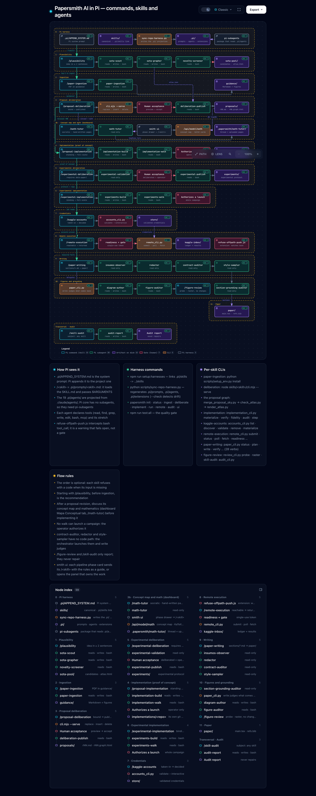](docs/diagrams/papersmith-pi-flow.html)

1. **Nothing produced gets uploaded.** `proposals/`, `experiments/`, `paper/`,
   `implementations/` and `sota-pool/` travel to GitHub **as empty folders** and nothing more; `guidance/`
   versions its folders and never the PDFs or the Markdown inside. The scaffolding gets
   versioned, the content doesn't. A half-written paper is research material, and
   publishing it by accident is a leak.
2. **Each skill refuses before doing something half-done.** If an input is missing, it
   doesn't invent it or skip it: it exits with a rejection code that names what's missing. A
   `PAPER_ABSENT` or a `SECTION_CONTRACTS_UNREADABLE` names what the skill is missing, not an
   operator error.
3. **The operator closes the deliberation.** The two deliberation skills propose, discuss and
   prepare the edit, but neither publishes without the operator's acceptance. It is part of
   each one's contract, and the engine enforces it.

---

## Getting started

None of this requires keys or external services: the forge runs locally.

### 0. What your machine needs to have

Two runtimes, and both are mandatory: the forge uses Python for the CLI and Node
for the deliberation engine, and without the second one half the framework won't
start.

| Runtime | Version | What for | If it's missing |
| --- | --- | --- | --- |
| **Python** | ≥ 3.11 | the `smith` CLI and all the Python skills | there's no possible installation |
| **Node.js** | ≥ 21 | the deliberation engine (`jiti`, `typebox`) and the dashboard | `init` warns and `deliberate` refuses |
| `npm` | whatever Node ships | installing those two dependencies in the workspace | same as above |

Both are checked at once:

```bash
python3 --version && node --version && npm --version
```

If Node is missing, `smith init` doesn't fail: it warns with
`npm was not found; deliberate requires npm install for jiti/typebox` and moves
on, because the rest of the workspace can be created. But `proposal-deliberation`
and `experimental-deliberation` —the two skills that propose and discuss before
writing— don't run without those dependencies. To create the workspace without
them, `init --no-npm` does so explicitly.

The ingestion runtime from step 2 is separate and **is optional**: it's only
needed to extract PDFs with OCR.

### 1. Install the CLI and set up the environment

```bash
# 1a. The CLI, from the latest version published on PyPI
pipx install papersmith-ai
#     the same with pip, for setups without pipx
pip install papersmith-ai
#     or the tip of `main`, without waiting for a release
pipx install git+https://github.com/LIAUNAL/papersmith-ai.git

# 1b. Or from a clone of `main` (for framework development)
git clone https://github.com/LIAUNAL/papersmith-ai.git && cd papersmith-ai
pipx install .            # with pip: pip install .

# 1c. Update the CLI when a new release comes out
pipx upgrade papersmith-ai
#     `upgrade` doesn't see a git-URL install: reinstall
pipx install --force git+https://github.com/LIAUNAL/papersmith-ai.git
#     with pip, `--upgrade` over a git URL doesn't always re-clone
pip install --upgrade --force-reinstall "papersmith-ai @ git+https://github.com/LIAUNAL/papersmith-ai.git"

# 1d. Bring existing workspaces up to that version
smith upgrade --plan-migrations ~/papers/sparse-ae  # which artifacts are missing, without writing anything
smith upgrade ~/papers/sparse-ae                    # syncs the files and migrates the artifacts
smith status ~/papers/sparse-ae                     # drift and pending migrations

# 2. Isolated ingestion runtime (micromamba: Python 3.12, PyTorch, Surya OCR, llama-server)
python3 scripts/setup_env.py install

# 3. Node dependencies and projection of skills to the harnesses
npm install
npm run setup:harnesses
```

**The command is `smith`.** Installing `papersmith-ai` puts `smith` on `PATH`,
and every command in this README uses it (`smith init`, `smith upgrade`,
`smith status`, …). The older `papersmith` entry point is still installed as a
compatibility alias for existing scripts; it runs the same CLI and reports itself
as `smith`.

**The package is published on PyPI.** `pipx install papersmith-ai` brings the
latest release, which `pipx upgrade papersmith-ai` in **1c** updates. The git URL
in **1a** brings the tip of `main`, for framework development. The neighbouring
name `papersmith` —without the `-ai`— is also on PyPI, but it's **another
project** (Word document generation), so `pip install papersmith` doesn't install
this forge.

`main` is the only branch that's maintained, and each release also gets its tag,
so an exact build is frozen by pinning it in the URL — for example
`pipx install --force "git+https://github.com/LIAUNAL/papersmith-ai@v0.23.0"`.
**1b** takes the clone as it is, including uncommitted changes; a reproducible
build comes from **1a** or a tag. The changelog is in [CHANGELOG.md](CHANGELOG.md).

Updating is two steps and they're two different objects. **1c** reinstalls the
CLI from `main`; `smith --version` confirms the installed version. **1d**
moves each **workspace** that already exists, and it isn't optional: a release
can change the shape of an artifact a workspace has already produced —the graph
pool's `atlas.html`, for example—, so syncing the framework files without
migrating the artifacts leaves the new scaffolding reading old state.

`smith upgrade` syncs the workspace with the installed version and applies
that version's artifact migrations. The version the workspace records doesn't
advance until those migrations are done, so `smith status` may report that
it hasn't yet reached the release just installed. `--plan-migrations` reports
what's pending and finishes without writing anything; it isn't called
`--dry-run`, because it doesn't preview the kit copy. `--no-migrate`
syncs the files and leaves the artifacts as they are, with the version marker
where it was.

**Which workspaces can be upgraded.** Re-initializing a live workspace is never
the answer: `smith init` in a fresh directory leaves behind every ledger,
receipt, seal, managed revision and lock the paper has accumulated. Workspaces
recorded at 0.12.0 or later are supported, and since 0.14.0 every release that
changes the shape of something a workspace already has ships its migration in
the same release (or a compatible read that keeps reading the old shape). A
workspace older than 0.12.0 also upgrades —the files are synced and the
convergence migrations run—, but shape changes from before 0.12.0 shipped no
migration and leftovers may remain (the `.antigravity/` folders of 0.8.0 are not
removed). With no recorded version, the version-gated migrations stay
`undetermined` and are not applied; a version that cannot be ordered, or one
newer than the kit, is refused unless you pass `--allow-downgrade`. The
maintainer-side policy is in
[`docs/releasing.md`](docs/releasing.md#workspace-support-policy).

The two `upgrade`s are separate: neither one touches the other.
`smith upgrade` refuses to take a workspace to a version older than the one
it records, unless `--allow-downgrade` is passed.

`scripts/setup_env.py install` provisions **the whole** ingestion stack in a
separate micromamba environment (CPU or CUDA, depending on what it detects),
including the `llama-server` binary that the OCR needs — it is **not** Ollama
nor a Homebrew installation. The micromamba it bootstraps is a pinned release
whose SHA-256 is checked before it runs; the comment above `MICROMAMBA_VERSION`
in `scripts/setup_env.py` is the procedure for moving the pin.
`npm run setup:harnesses` symlinks the canonical
`skills/` tree into `.claude/skills`, `.pi/skills`, `.opencode/skills`
and `.agents/skills`, with relative, idempotent symlinks (see
[Harnesses and skill projection](#harnesses-and-skill-projection)). The first
run of `smith ingest` downloads ~1.5 GB of Surya weights if the
environment wasn't pre-provisioned.

### 2. Create a workspace

```bash
smith init ~/papers/sparse-ae \
  --title "Sparse Autoencoder Audit" \
  --topic "mechanistic interpretability" \
  --remote kaggle

cd ~/papers/sparse-ae
smith status
smith status --json          # machine-readable snapshot
```

The workspace stays decoupled from the framework checkout: the scaffolding is
synced with `smith upgrade`, and the research artifacts are protected by
contract. What `init` creates exactly —and what gets versioned— in
[Inside the workspace](#inside-the-workspace).

### 3. Ingest literature

```bash
smith ingest https://arxiv.org/abs/2309.08600    # arXiv, OpenReview or URL
smith ingest ~/Downloads/reference-paper.pdf     # local PDF
smith ingest ~/Downloads/scan.pdf --ocr       # scanned: balanced OCR mode
```

Each loose PDF ends up in its own folder, next to its Markdown (text + LaTeX +
tables, with the bibliography stripped) and the images of its figures. The
pipeline's details, in the `paper-ingestion` section of the
[Anatomy](#anatomy-of-each-skill).

### 4. Deliberate, implement and run

```bash
smith deliberate . --action status                                   # state of the managed proposal
smith implement . --action verify --target implementations/my-repo   # over an already materialized repo
smith run smoke_and_invariants --dry-run                             # plans; dispatches nothing
```

Inside a harness, the same capabilities are requested by skill name:
`/paper-ingestion`, `/proposal-deliberation`, `/experimental-deliberation`,
`/proposal-implementation`, `/experimental-implementation`, `/paper-writing`.
The ones that don't depend on a domain — `/kaggle-accounts`,
`/remote-execution`, `/skill-audit` — act as gatekeeper, memory and auditor of
what is sent out.

---

## How it works — the order

### Step 1 — Check that the idea is plausible (`plausibility`)

Before there is anything to ingest there is an idea, and this is the step that
tests it. It needs no PDFs, which is why it comes first: all three stretches work
from the idea and from what can be found about it.

| Stretch | Runs as | Ends at |
| --- | --- | --- |
| **Scout** | the `sota-scout` agent | the pool — 25 candidates with abstracts, in 3 to 5 families, plus the provisional plausibility note |
| **Constellation** | the `sota-grapher` agent | the single `atlas.html` beside `atlas.json`, with the checker's green run |
| **Screen** | the `novelty-screener` agent | the plausibility report — graded claims, a ranked top 5, and one closing paragraph on where the proposal stands |

Everything lands in `sota-pool/`, which is ignored like `guidance/`.
**Nothing here files into `guidance/`**: this step reads the literature, it does
not collect it. The pool it leaves behind is what `proposal-deliberation` shows
alongside the mathematics, and its ranked top 5 is what tells the ingestion step
which PDFs are worth having.

An idea stated in fewer than two sentences is refused before the search starts:
scouting an unstated idea invents its own question. A claim with no abstract
passage behind it does not become a planet — a quoteless planet is a drawing.

### Step 2 — Put each PDF in the folder according to its role

| Folder | What goes here |
|---------|------------|
| `guidance/paper-guide/` | **Guide papers** — the methodological / style references. `proposal-deliberation` loads them as context at the start of each deliberation. |
| `guidance/reference-papers/` | **Reference corpus** — supporting papers, ingested to Markdown for consultation. They aren't loaded automatically into the deliberation. |
| `guidance/data-paper/` | **Data paper — mandatory for `experimental-deliberation`.** It describes the research's database and is the **ceiling**: it bounds what can be claimed. A claim the data doesn't support isn't an experiment. Without this folder populated, `CREATE_INITIAL_REVISION` can't start. |

**All three folders travel empty.** Each one arrives in a clone with its `.gitkeep` and nothing more: `guidance/*/*` is ignored, with `!guidance/*/.gitkeep` as the only escape hatch. The scaffolding is versioned, the PDFs and their Markdown are not. `tests/test_forge_scaffolding.py` derives both halves —what the `profile.ts` declare as source against what git actually tracks— and goes red if a declared folder stops travelling.

### Step 3 — Ingest the PDFs (PDF → Markdown)

In **Claude Code**, the skill is invoked:

```
/paper-ingestion
```

(or, in Spanish: *"ingiere los papers"*). For each **loose** PDF, it creates a
folder with the paper's name, moves the PDF inside and writes a lightweight
`<name>.md` (text + LaTeX + tables, with the bibliography stripped) together
with the images of the figures:

```
guidance/reference-papers/computers-13-00176-v2-1/
├── computers-13-00176-v2-1.pdf
├── computers-13-00176-v2-1.md
└── _page_4_Figure_2.jpeg   (figures that the .md references)
```

A **loose PDF** (directly in a source root folder) is pending; a paper that's
already inside its folder is skipped. Re-ingesting means deleting the paper's
folder (leaving the PDF loose) and running the skill again. The configuration
lives in `papersmith.yaml` (`source_roots`, `mode`, `strip_references`,
`force_ocr`). If a PDF's tables come out scrambled because its text layer is
bad, `--force-ocr` (or `force_ocr: true`) rebuilds every page by OCR instead of
reading that layer.

### Step 4 — Deliberate over a proposal (`proposal-deliberation`)

In **Claude Code**, the skill is invoked:

```
/proposal-deliberation
```

On the first turn it automatically loads the Markdown from `guidance/paper-guide/`
as context and acts as a mathematics tutor. The available actions:

- describe an idea and ask for a first version,
- ask for edits to a managed proposal,
- run the lifecycle of managed revisions.

Proposals live in `proposals/`, one per managed revision
(`research-concept-rNN.md`).

Each published revision travels with its own constellation: the SOTA's with the
proposal inside, in `proposals/research-concept-rNN.graph.html`, drawn by the
same 3D viewer as the atlas and named from the revision. The deliberation's
publication stretch produces it, from the `proposals/research-concept-rNN.sky.json`
overlay written during the discussion: there the main idea, the topics the
proposal takes from the SOTA papers, its novelty, the problem it would solve and
three to five concepts remain as nodes and edges instead of as sentences. If
that overlay doesn't exist, the stretch reports it as pending instead of drawing
relationships nobody agreed on.

### Step 5 — Take the proposal to code (`proposal-implementation`)

In **Claude Code**, the skill is invoked:

```
/proposal-implementation
```

It takes the current revision and materializes it in a target repository, which
lives in `implementations/` with its own git and its own virtual environment. The
flow has two separate phases:

1. **Structure.** If the repo comes with content, it moves it to the layout and
   verifies —without running anything— that notebooks, paths and references
   still resolve. It doesn't audit or validate the code that was already there:
   it's what's there, tidied up.
2. **Materialization.** Only then does it implement the mathematics and subject
   it to the validation ladder.

```
<repo>/
├── <Name>/            Notebooks/  Data/  Results/  Models/
├── src/<Package>/     one implementation per mathematical object
├── tests/             smoke · invariants · synthetic · audit · remedies
└── pyproject.toml
```

The ladder has five levels, from the cheapest to the most expensive: **smoke**,
**invariants** (each claim of the proposal anchored to a test), **synthetic**
(deterministic, fixed seed), **audit** (findings about the mathematics, measured
over 200 random configurations) and **remedies** (each proposed fix validated
with the same rigour). A finding without a validated remedy isn't reported.

That is all that is needed to use the forge. **What goes on inside** each
skill —its steps, its pieces, how they connect to each other and what
limitations each one has— is detailed in [Anatomy of each
skill](#anatomy-of-each-skill). For the literal contract, each one's
`SKILL.md`.

---

## Inside the workspace

`smith init` creates a self-contained directory —with no git initialized and
without touching the framework checkout— with this shape:

```
my-paper/
├── .papersmith/                 # workspace state (config, manifest, ledger)
│   ├── config.json              #   active target and profile, ledger paths
│   ├── manifest.json            #   hashes of everything the framework generated
│   ├── runs_ledger.jsonl        #   every dispatched run, in order
│   └── version                  #   framework version that created it
├── .claude/agents/              # the twenty-four subagents (single source of truth)
├── skills/                      # the kit copy: the skills + _core
│   └── _core/                   #   the two shared engines (deliberation, implementation)
├── sections/                    # the ten section contracts (they travel WITH content, like skills/)
├── guidance/
│   ├── reference-papers/        # drop-zone: reference PDFs go here
│   ├── paper-guide/             # guiding papers for method and style (optional but recommended)
│   └── data-paper/              # data paper (mandatory for experimental-deliberation)
├── proposals/                   # managed revisions, flat: research-concept-rNN.md
├── paper/                       # the paper's LaTeX (paper-writing writes it here)
├── experiments/                 # the managed experimental protocol
├── implementations/             # destination repos; each one with its own git
├── kaggle-inbox/                # what comes back from the remote workers
├── CLAUDE.md / OPENCODE.md / .agents/AGENTS.md   # harness routing
├── .pi/APPEND_SYSTEM.md         # harness routing (Pi appends it to the system prompt)
├── papersmith.yaml              # workspace configuration (editable)
├── package.json                 # workspace Node dependencies (jiti, typebox), editable
├── requirements.txt
├── scripts/setup_env.py         # ingestion runtime provisioning
└── README.md                    # brief description of the workspace
```

Every research folder (`guidance/*/`, `proposals/`, `paper/`, `experiments/`,
`implementations/`) arrives empty, with its own `.gitkeep`: the workspace's
`.gitignore` applies the same rule this repository applies to itself —the
folder is versioned, the content never is.

### `papersmith.yaml` — the configuration you will actually touch

The file comes with three example targets and three execution profiles. The
targets declare **where** the work runs; the profiles, **what** runs and how
it is split up:

```yaml
compute_targets:
  default: "kaggle-gpu-pool"
  targets:
    local-workstation: { provider: "local", device: "cuda:0" }
    kaggle-gpu-pool:   { provider: "kaggle", accelerator: "GPU_T4_X2", ... }
    slurm-cluster:     { provider: "remote-ssh", host: "hpc.university.edu", ... }

execution_profiles:
  smoke_and_invariants:  { target: "local-workstation", entrypoint: "{target_python} -m pytest {target}/tests/test_invariants.py" }
  sweep_training:        { target: "kaggle-gpu-pool", sharding: { … }, artifacts: { … } }
  benchmark_evaluation:  { target: "kaggle-gpu-pool", entrypoint: "papermill …/benchmark.ipynb" }

paper_ingestion:
  engine: auto          # route each page: pypdfium2 fast path, Docling only where needed
  mode: fast            # fast (route pages) | balanced (every page through Docling)
  strip_references: true
  source_base: guidance
```

The active target and profile live in `.papersmith/config.json`; `papersmith
target set` changes them. The `paper_ingestion` block is owned by the ingestion
skill and the orchestrator treats it as opaque (it is edited with the skill, not
by hand).

### What is versioned and what is not

`smith upgrade`'s preservation contract is explicit: it never touches
`guidance/`, `proposals/`, `paper/`, `experiments/`, `implementations/`,
`kaggle-inbox/`, `papersmith.yaml`, `package.json`, `README.md`
nor the `.env*` files. Everything else is framework scaffolding and `upgrade`
syncs it —with `--force` if needed— leaving the artifacts intact.

In this repository the same rule holds for Git: the scaffolding is versioned,
the content is not. Research folders travel with their `.gitkeep` and nothing
else; `guidance/` versions the folders and never the PDFs nor the ingested
Markdown. `sota-pool/` follows the same contract: the folder travels, and
`candidates.json`, `atlas.json` and `atlas.html` —which inlines the full 3D
viewer— stay on the machine that produced them.

Preserving is not migrating. Not touching an artifact protects it while
its shape does not change; the day a release changes that shape, something is
needed to carry it up to it. That is the job of [artifact
migrations](#artifact-migrations), and it is also the reason
`.papersmith/version` stopped advancing just because files had been copied.

### The state: `.papersmith/`

- **`manifest.json`** stores the hash of every generated file. `papersmith
  audit --check-drift` compares against the disk and names what drifted; the
  repair is `smith upgrade`, never a hand edit.
- **`runs_ledger.jsonl`** is append-only: every `smith run` that gets
  dispatched is recorded with its target, its profile and its result.
- **`config.json`** stores the active target, the active profile and the ledger's
  configuration paths.
- **`migrations.json`** records which version-tied artifact migrations have
  already been applied, so that `upgrade` does not repeat them. Convergence
  ones are never recorded: they never end. If the file gets damaged,
  `upgrade` refuses and `status` reports it; it must not be edited by hand.
- **`version`** is the version the workspace declares for its **artifacts**,
  not for its files. Of the two markers it is the one that lags behind when
  a migration fails, and that is why `status` can say the workspace has not
  yet reached the installed release.

---

## Harnesses and skill projection

`skills/` at the repository root is the **single source of truth**. Each
harness reads skills from its own folder, so the projection script symlinks
the canonical tree into each one with **relative** and idempotent symlinks:
running it again converges to the same layout and the checkout stays
relocatable.

```bash
npm run setup:harnesses      # = bash scripts/setup-harnesses.sh
```

| Harness | Where it reads skills from | Routing document (workspace) |
|---------|----------------------------|-------------------------------|
| Claude Code | `.claude/skills/` | `CLAUDE.md` |
| Pi | `.pi/skills/` | `.pi/APPEND_SYSTEM.md` |
| OpenCode | `.opencode/skills/` | `OPENCODE.md` |
| Google Antigravity | `.agents/skills/` | `.agents/AGENTS.md` |

### What each harness wires

`smith init` and `smith upgrade` generate, for each harness the
workspace declares, what this table shows. It is the same matrix as
`HARNESS_CAPABILITIES` in `src/papersmith/generators.py`, and a test
(`tests/test_harness_parity.py`) verifies that both match. `wired` is what
gets generated; `unsupported` is what does not get generated; `opt-in` is
only documented, and it is enabled manually.

<!-- harness-capabilities:start -->
| Harness | Skills | Comandos | Agentes | Plugins / guards |
|---------|--------|----------|---------|------------------|
| Claude Code | wired | wired (`.claude/commands`) | wired (`.claude/agents`) | opt-in (ver [guard-hooks](docs/guard-hooks.md)) |
| OpenCode | wired | wired (`.opencode/commands`) | wired (`.opencode/agents`) | wired (`.opencode/plugins/refuse-offpath-push.js`) |
| Pi | wired | wired (`.pi/prompts`) | wired (`.pi/agents`) | wired (`.pi/extensions/refuse-offpath-push.js`) |
| Google Antigravity | wired | unsupported — vía skills (workflows deprecados) | wired (`.agents/agents`) | unsupported |
<!-- harness-capabilities:end -->

When it finishes, `init` and `upgrade` print one line per active harness with
the state of each capability (`wired`, `unsupported`, `failed` or `blocked`) and
add the `wiring` key to its result. If a skill symlink could not be created, or
there is a real directory where the symlink would go, they report it as a warning
(`failed` / `blocked`) instead of silently omitting it.

Pi's agents use the web tools `web_search` and `fetch_content` from the
[`pi-web-access`](https://www.npmjs.com/package/pi-web-access) package. The
workspace declares it in `.pi/settings.json`, which Pi reads once you trust the
project and installs from there; nothing needs installing by hand. `init` writes
that file, `upgrade` adds it to an older workspace that lacks it, and neither
touches an existing one (add packages to it with `pi install -l <source>`).

What the table does not promise:

- **Pi:** the agents in `.pi/agents` are only read by the third-party package
  `pi-subagents`; the Pi core has no subagents. Without that package, the
  files exist but remain unused.
- **Claude Code:** the guard is opt-in. Papersmith never writes or merges
  `.claude/settings.json`; the snippet to enable it is in
  [`docs/guard-hooks.md`](docs/guard-hooks.md).
- **Antigravity:** there is no guard until its hooks' input schema is obtained
  (`.agents/hooks.json`).
- **Antigravity, commands:** no command files are generated. Its only
  slash-command mechanism, workflows, is deprecated in favor of skills
  (retirement 2026-11-01) and the workflows' workspace path is not verified
  (`.agents/workflows` is an assumption). Skills already work as
  `/<skill-name>` through `.agents/skills`, so all of them stay invocable
  as commands.
- **Antigravity, documented locations only:** `.antigravity/rules.md` and
  `.antigravity/skills` are no longer generated. Antigravity uses `.agents/skills`,
  `.agents/agents/` and `.agents/AGENTS.md` (plain text, no frontmatter). Existing
  workspaces are not migrated: `smith init` must be run in a new workspace.

#### Verified support matrix

Summary of [`docs/harness-support-matrix.md`](docs/harness-support-matrix.md),
read against each tool's documentation on 2026-10-02. It is what the
tool documents, not what Papersmith generates (that is the table above).
`unverified` means no primary source was read.

| Harness | Skills | Commands | Agents | Plugins / hooks | MCP / config | Sources (2026-10-02) |
|---------|--------|----------|--------|-----------------|--------------|----------------------|
| OpenCode | supported: `.opencode/skills` | supported: `.opencode/commands` | supported: `.opencode/agents` | supported: `.opencode/plugins/` | supported: `opencode.json` | <https://opencode.ai/docs/skills/>, <https://opencode.ai/docs/commands/>, <https://opencode.ai/docs/agents/>, <https://opencode.ai/docs/plugins/>, <https://opencode.ai/docs/config/> |
| Pi | supported: `.pi/skills`, `.agents/skills` | supported: `.pi/prompts/*.md` | unsupported in the core; third-party only (`.pi/agents`, `pi-subagents`) | supported: `.pi/extensions/` | supported: `.pi/mcp.json` | <https://github.com/badlogic/pi-mono/blob/main/packages/coding-agent/docs/configuration.md>, <https://github.com/badlogic/pi-mono/blob/main/packages/coding-agent/docs/prompt-templates.md>, <https://github.com/badlogic/pi-mono/blob/main/packages/coding-agent/docs/extensions.md>, <https://github.com/badlogic/pi-mono/blob/main/packages/coding-agent/docs/mcp.md>, <https://github.com/nicobailon/pi-subagents/blob/main/docs/agents.md> |
| Google Antigravity | supported: `.agents/skills` | supported but deprecated (workflows); path `.agents/workflows` unverified | supported: `.agents/agents` | supported: `.agents/hooks.json` (input schema unverified) | supported: `.agents/mcp_config.json` | <https://antigravity.google/docs/skills>, <https://antigravity.google/docs/ide/workflows>, <https://antigravity.google/docs/subagents>, <https://antigravity.google/docs/hooks>, <https://antigravity.google/docs/mcp> |
| Claude Code | supported: `.claude/skills` | supported (legacy format): `.claude/commands` | supported: `.claude/agents` | supported: `.claude/settings.json` (Papersmith never writes it) | supported: `.mcp.json` (Papersmith registers only the lab's `banco-lia` server and Kaggle's official `kaggle` server there) | <https://code.claude.com/docs/en/skills>, <https://code.claude.com/docs/en/sub-agents>, <https://code.claude.com/docs/en/hooks>, <https://code.claude.com/docs/en/mcp> |

- `.antigravity/skills` and `.antigravity/rules.md`: unsupported (no source found)
  and no longer generated; Antigravity uses `.agents/skills`, `.agents/agents/` and
  `.agents/AGENTS.md`.
- Antigravity deprecated workflows in favor of skills (2026-11-01, source:
  <https://antigravity.google/docs/ide/workflows>).
- Pi: the tool names `mcp` and `mcpScript` have no source
  (unsupported, no source found).
- The docs of these tools change fast; a cell should be re-verified before
  being relied on after that date.

The sources of each cell are in
[`docs/harness-support-matrix.md`](docs/harness-support-matrix.md).

Inside a generated **workspace**, the behavior is slightly different:
the workspace ships the full `skills/` tree and the agent
tree (`.claude/agents/`), and its routing docs point at the canonical tree
`skills/*/SKILL.md`. The routing documents are generated projections: the
real source of each agent is `.claude/agents/*.md` and the source of each skill is its
`SKILL.md`. The projections must not be edited by hand; they regenerate (and
`smith audit --check-drift` warns if one drifted). `init` and `upgrade` generate one slash command per skill
in `.claude/commands/`, `.opencode/commands/` and `.pi/prompts/`; Antigravity does not
receive command files and reads skills through its symlinks. Agents are
projected from `.claude/agents/` to `.opencode/agents/`, `.pi/agents/` and
`.agents/agents/`. For a harness to
list the skills as `/` commands, `npm run setup:harnesses` must be run inside
the workspace: it symlinks the shipped tree into `.claude/skills`,
`.pi/skills`, `.opencode/skills` and `.agents/skills`, just as relative and
idempotent as in the checkout. In this checkout, the slash command projections
(`.claude/commands/`, `.opencode/commands/`, `.pi/prompts/`), the agent projections
(`.opencode/agents/`, `.pi/agents/`, `.agents/agents/`) and the OpenCode and Pi guards
are synced with `python scripts/sync-repo-harness.py` (`--check` for CI; it
has no script in `package.json` because the kit ships it and the script is
repo-only).

---

## The agents

A workspace ships **twenty-four subagents** in `.claude/agents/`. They are short
bursts of work that a harness launches (for example, with the Task tool) on
request, not replacements for the CLI. The shape is always the
same — **one burst between two operator gates**: the agent decides
nothing, asks nothing, and ends up reporting what it found and how much it cost
to establish it. The operator opens and closes the gates.

| Agent | What it is for | Skill it loads |
|-------|----------------|----------------|
| `implementation-build` | From the approved object→module map to the findings report: materializes the scaffolding, writes one module per object with its provenance and its invariant tests, and validates the admitted remedies. | `proposal-implementation` |
| `implementation-walk` | Walks the declared flow act by act, in order: runs the local steps, records each product and stops at the rehearsal before launch. It has no path to submit a campaign. | `proposal-implementation` |
| `paper-replicator` | The `fidelity` stage for a comparison or baseline paper: it first searches for the paper's published code; when it exists, it adopts it pinned to a commit with its license and audits correspondence with the paper (match, deviation, unspecified) and implementation correctness; otherwise it reimplements the method from the ingested Markdown. It ends at code in the target layout, a `REPLICATION.md` table, invariant tests and a toy-set smoke run, and never launches a remote run. | `proposal-implementation` |
| `dataset-scout` | From a research question or paper to ranked dataset candidates with their source licenses decided: it searches the paper's official repository and the dataset hosts (`search`) and records a `license` decision per candidate. It never downloads what it cannot license and never uploads anything. | `datasets` |
| `dataset-curator` | From a dataset need to its arrival: the seeded toy set, a licensed source measured with `qc`, the one official subject-wise preparation (`prepare`), and `publish` run for real only with the operator's own consent tokens. | `datasets` |
| `deliberation-publish` | From the moment you accept a change until the successor revision is published and in force — the only way the mathematics travels. The deliberation itself is not here: only you close it. | `proposal-deliberation` |
| `experimental-publish` | The same as `deliberation-publish`, over the experiments document. | `experimental-deliberation` |
| `experimental-validation` | The `validated` stage: it looks for the area's evaluation protocol —metrics, baselines, dataset, seeds, significance test—, verifies each baseline against its repo and its venue, and dates every URL it uses. | `experimental-deliberation` |
| `experiments-build` | From the approved map of protocol steps to executable commands: materializes whatever is needed, wires each step and instruments each measurement so that it can be run and read. | `experimental-implementation` |
| `experiments-walk` | The walk of the protocol, with the same gates and the same stop at the rehearsal. | `experimental-implementation` |
| `experiments-reviewer` | From an instrumented implementation to a findings report read before any rehearsal or launch: reviews the code against the experiments protocol for code quality, the simulation and data path, remote GPU use and the declared statistical tests. It runs only the target's own tests and linters; it never repairs nor launches. | `experimental-implementation` |
| `math-tutor` | One turn of the Socratic tutor from the dashboard's math panel: reads the hand-drawn page back as LaTeX, gives one hint, asks one question and assesses understanding quoted from your own words, always tied to why the novelty holds. It never writes the workspace. | `math-tutor` |
| `paper-ingestion` | Turns a paper into the form in which it can really be used: LaTeX equations, tables as tables, figures as files. Stages: `filed`, `extracted`, `readable`. It asks nobody anything. | `paper-ingestion` |
| `contract-auditor` | Reads the `## Disqualifiers` of a contract, literally, and judges a draft block against each one: `fires`/`clear`/`undecidable`, with the passage quoted in each `fires`. | `paper-writing` |
| `redactor` | Writes the LaTeX of a block from exactly four inputs (the contract's prose, its evidence set, its mode and its style set) and returns a binding map: where each sentence comes from. | `paper-writing` |
| `style-sampler` | Resolves the equivalent block, complete, in each style folder of `guidance/` and returns it verbatim, never trimmed. It is the only material an overlap check can compare. | `paper-writing` |
| `diagram-author` | Writes a standalone TikZ diagram (`<id>.tex` + `<id>.diagram.json`) and compiles it in its own loop, up to the repair budget. It never draws a chart from measured numbers — that is the `place` verb. | `paper-writing` |
| `figure-auditor` | Compares the components declared in the manifest against the section's prose and the pipeline steps; reports a structured verdict. | `paper-writing` |
| `section-grounding-auditor` | Reads a block's own bound source section, verbatim, and judges each subject sentence against it: `supported` — with the quoted span that carries it —, `unsupported` or `undecidable`. No code path invokes it, and `write` re-derives both sides independently rather than trusting its account. | `paper-writing` |
| `insumos-observer` | Reads the paper's four declared input sources —`proposals/`, `experiments/`, the destination repo's code and its own run outputs— and reports, for each observable fact, whether it holds and with what evidence. It never decides a value nor runs `declare`. | `paper-writing` |
| `novelty-screener` | Discusses the hypothesis against the pool's abstracts, grades novelty and plausibility with an exact citation —all provisional— and ranks the top-5 for later ingestion, closing with a plausibility paragraph. Dialogue with a report at the end; it does not publish, does not write, does not ingest, does not deliberate. | `plausibility` |
| `sota-scout` | Tracks the idea across the open literature —25 references with abstracts, each in its family (3 to 5 in the pool)— as `sota-pool/candidates.json`. It ends in the pool; it does not ingest nor finally grade anything. | `plausibility` |
| `sota-grapher` | Maps the pool to its constellation —one solar system per paper grouped by family, 20 planets maximum, edges between sibling systems— as `atlas.json` plus the single `atlas.html`, running checker and renderer until green. | `plausibility` |
| `audit-report` | Audits a subject that enumerates a closed set —operations, subcommands, codes, assets— looking for the gap between what its code accepts and what its documentation promises. It reports; it never repairs. | `skill-audit` |

Three rules that order everything else:

- **The source of truth is `.claude/agents/`.** Each harness's routing docs
  (`CLAUDE.md`, `.pi/APPEND_SYSTEM.md`, `OPENCODE.md`,
  `.agents/AGENTS.md`) list
  all twenty-four, and they are generated: an agent is changed
  there, not in the projection.
- **Each agent declares the skill it loads** (`skills/<name>/SKILL.md`), and that
  binding is verified: an agent that points at a skill the workspace does not
  ship does not get there.
- **Some agents are not invoked by any code path**
  (`contract-auditor`, `redactor`, `style-sampler`): they are launched manually, and
  it is the `write` verb that judges what they return — it never trusts the
  operator's account nor the draft on their own.

---

## Anatomy of each skill

The sections above describe **what you do**. This one describes **what happens
inside**. It is written for someone who has never seen the project: each skill is
explained from nothing and **in full** — its steps, its parts, its connections to
the others, its known limits and its diagram — without sending the reader
elsewhere in the document.

Two things before the first skill.

**What a skill is here**, because it is not a program that runs once and stops.
Each one has two halves that do different jobs:

| Half | What it is | Who runs it |
| --- | --- | --- |
| `SKILL.md` | A prose contract: when to activate, what to ask, what never to do. It is not code; it is the instruction of conduct. | **The agent** reads it and behaves according to it. |
| The engine (`scripts/`, `engine/`) | Deterministic code: same input, same output. No model, no network, no keys. | **The machine** runs it and returns a verdict the agent cannot negotiate. |

That division is the forge's central idea: **the agent decides, the engine
verifies**. The agent proposes a change; the engine checks that the change broke
nothing and refuses when it did. An agent can be wrong. A deterministic engine does
not change its mind.

**How they chain.** The twelve are not islands: each one receives something
specific from another and hands something specific to the next. This is the map,
and each skill explains its own seam in detail in its own section. The arrows state
**what** crosses the seam rather than merely that a seam exists, and every label
below is read from the declaration of the skill that receives it, not inferred from
the folder name.

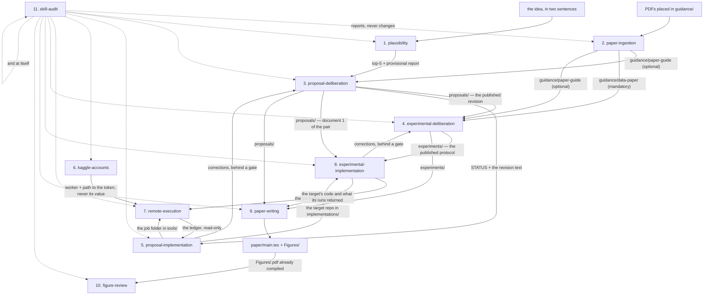

**Three things the map states.**

*The two upward loops are the forge's core.* The mathematics goes down to code and
what the code discovers goes back up to the document; the same holds between the
experimental protocol and its implementation. In both cases the return passes
through a gate the operator opens: the code proposes a correction and never
publishes one.

*The four in the middle are two pairs over two engines.* Skills 3 and 5 share a
deliberation engine; 4 and 6 share an implementation engine. The only thing that
differs between the two hosts of a pair is their `profile.ts` or their
`impl_profile.py`, which is why a defect in one engine appears in two skills at once
and why the engine's limits are recorded in both.

*Skill 9 is the only one that reads everything before it at once*, and 11 is not in
the chain: it stands aside and looks at any of them, itself included.

The map draws the eleven skills that take part in the flow. Skill 12,
`upgrade-project`, is not a stage: it operates on the workspace the flow runs
inside, and its own section below explains it.

---

### 1. `plausibility` — map the territory before collecting it

Before any PDF is ingested there is an idea, and this is the skill that tests it.
It needs no PDFs, which is why it runs first: all three of its stretches work from
the idea and from what can be found about it.

**The three stretches.**

| Stretch | Delegated to | Begins after | Ends at |
| --- | --- | --- | --- |
| Scout | `sota-scout` | the idea is stated in at least two sentences | the pool: 25 candidates with abstracts, in 3 to 5 families |
| Constellation | `sota-grapher` | the pool holds its 25 candidates | one `atlas.html` beside `atlas.json`, with the checker green |
| Screen | `novelty-screener` | the hypothesis is stated and the pool holds its candidates | the plausibility report: graded claims, a ranked top 5, and one closing paragraph on where the proposal stands |

What moves between the stretches is execution, never doctrine. The rules for
scouting and mapping live in the skill; the rules for screening live in the
agent's own section; and each agent's first instruction is to load the skill.

**The slot contract.** Every system in the constellation carries exactly these
slots, and the 20-planet limit per system is absolute.

| Slot | Planets | What it holds |
| --- | --- | --- |
| `sun` | exactly 1 | the paper: title at the center |
| `branch` | 0 to 2 | research branches the paper claims |
| `topic_app` | exactly 1 | the topic as the application domain states it |
| `topic_ai` | exactly 1 | the same topic framed as an AI problem |
| `problem` | exactly 1 | the problem the paper faces, in one claim |
| `application` | exactly 1 | where it lands in the world |
| `family` | exactly 1 | the group this system belongs to: one per paper, 3 to 5 families per pool |
| `novelty` | exactly 1 | what the paper adds over those families |
| `contribution` | 0 to 5 | concepts argued beyond the one novelty claim |
| `result` | 1 to 3 | punctual results, one claim per planet |
| `conclusion` | 1 to 2 | conclusions, one claim per node |

**What leaves it.** Nothing is ingested, nothing is filed into `guidance/`, and
nothing is published. Everything lands in `sota-pool/`, which travels gitignored
like `guidance/`. The pool is what `proposal-deliberation` shows beside the
mathematics, and the ranked top 5 is what tells the ingestion step which PDFs are
worth having.

**The acceptance gate.** The report is not handed on until the operator accepts
it. The gate is narrow: it approves the reading and not the idea, it publishes
nothing and it files nothing. Every re-screen is a new reading and carries its own
gate, because an acceptance of a previous report is not an acceptance of this one.

**Its refusals.** An idea under two sentences is refused before the search starts.
Fewer than 25 resolvable candidates is reported short, with what was tried, and is
never padded with unquoted entries. More than 5 families means keeping the 5 the
abstracts lean on hardest and naming the ones left out. A claim with no abstract
passage behind it does not become a planet: a quoteless planet is a drawing.

**What it never does.** It never writes a planet whose quote was not read in the
same pass from the abstract its evidence names, and never grades a claim whose
abstract was not read in the same reply. An invented quote reads as a finding and
is acted on as one.

### 2. `paper-ingestion` — from PDF to Markdown

**What it is for.** Papers arrive as PDFs, and for an agent a PDF is a closed box:
the text is mixed with the layout, the equations are drawings and the tables are
loose lines. This skill turns each PDF into clean Markdown —equations in LaTeX,
tables in Markdown, figures as separate image files— so that the rest of the forge
can **read** the paper instead of trying to decipher it. Everything runs locally:
no keys, no external service.

**What it receives and what it hands on.** It is the start of the chain: the only
thing it receives is the PDFs left in `guidance/`. What it hands on has a
consequence that matters before it is used:

- `guidance/paper-guide/` — what lands here is what `proposal-deliberation` loads
  **automatically**, from the `GUIDE_DIRECTORY = "guidance/paper-guide"` constant in
  its engine. But it loads it **only once in the entire life of the proposal**: at
  the creation of v1, and never again.
- `guidance/reference-papers/` — a consultation corpus. **It is never loaded on its
  own.** It is there for the operator or the agent to read when needed.

> **The order matters.** If a guide paper is ingested **after** the v1 of the
> proposal has been created, that paper no longer enters by that route: the load is
> unrepeatable by design. Ingestion comes first, deliberation after.

**What it needs first.** A single per-machine preparation: running
`./.claude/skills/paper-ingestion/setup.sh`. It is idempotent and provisions the
`papersmith` environment with `pypdfium2` (the fast path), `docling` (the heavy
pages) and, on Apple Silicon, `mlx-vlm` (the formula model on the GPU). The first
page that needs Docling downloads its models (about 1 GB) and caches them; from
then on it works offline. A paper with no heavy page loads no model at all.

**Page routing, and why it is fast.** Most pages of a paper are prose with an
exact digital text layer. The default engine, `auto`, probes every page without
loading a model — characters, fonts, images — and reads prose pages with
**pypdfium2** in milliseconds. Only pages with a display equation, a table or no
text layer go to **Docling**, through its page range: equations become LaTeX
(Granite-Docling-258M on MLX on Apple Silicon, CodeFormulaV2 on CUDA), tables
become Markdown (TableFormer, run only on pages with a table), scanned pages are
OCR'd (RapidOCR). Every page is cached by the PDF's SHA-256, so the same PDF never
converts twice. Measured on two arXiv papers (Apple Silicon, warm models):
21.5 s and 28.6 s, against 6.8 s and 28.2 s for Marker, with more display
equations as LaTeX (6 and 30, against 1 and 23); a cached re-ingestion takes 0.2 s.

**Licenses.** Every default engine is license-unrestricted — no copyleft, no
revenue or user threshold: pypdfium2 (Apache-2.0/BSD-3), Docling (MIT) and its
models (Apache-2.0, CDLA-Permissive-2.0), RapidOCR (Apache-2.0), MLX (MIT).
`engine: marker` stays as an explicit opt-in (`pip install marker-pdf==2.0.0`):
its weights are free only below USD 5M in funding or revenue, and the run says so.

**The stages it declares.** The flow is not the list of commands: it is what each
stage establishes, and when it can be considered passed. This table is read
from `OBJECTIVE_FLOW` in the script, which a test keeps equal to the `SKILL.md`.

| Stage | What it establishes | It is passed when |
|---|---|---|
| `filed` | The PDF sits inside a topic folder of its own — that is what turns it into a paper and not a download | it stops appearing among the loose ones |
| `extracted` | The Markdown exists beside it, with its figures written as files instead of staying inside the page | the paper folder holds the document and its images |
| `readable` | The equations are LaTeX and the tables are Markdown, so a later reader can **cite** a formula instead of describing a photo of one | it is the arrival; it is behind no one |

**Arrival:** a document that a person can read and a later session can cite — which
a PDF is not. Its equations are drawings and its tables are ink.

**A declared tension, not a defect.** The `humanStops` field of this skill is **empty**: no
*stage* stops to wait for a person. But its Activation Contract says
*"Never ingest without asking first"*, and the Phase 2 confirmation is
mandatory. The two things coexist because the confirmation happens
**before** the flow starts, and the script has no consent mechanism of its
own — the rule lives in the `SKILL.md` and the agent enforces it.
`kaggle-accounts`, which also writes, does declare *"consenting to
validate at all"* as a stop that belongs to a person: the two skills do not
describe the same consent in the same way.

**The flow, step by step.** It is **two commands, not one**, and that split exists
so that there is a moment of consent.

*Phase 1 — Discover (free, touches nothing):*

1. The agent runs the script with `--list`. This reads `papersmith.yaml`, validates
   the configuration, discovers the source folders and looks for loose PDFs. **It
   loads no model and moves no file**: the code stops before that.
2. The list is printed: relative path and page count of each PDF.
3. If there are PDFs lying directly in `guidance/` —outside any topic folder— they
   are reported separately, together with the existing topics as options.

*Phase 2 — Confirm (mandatory):*

4. The agent asks **which** ones to ingest, as a multiple selection. This rule lives
   in `SKILL.md`, not in the script: the script has no consent mechanism. The split
   into two commands is what makes the approval step possible.
5. If nothing is approved, it ends there. Nothing moved.

*Phase 3 — Execute:*

6. The agent runs the script again with exactly the approved paths. Each path is
   validated **before** the engine loads: that it exists, that it is a `.pdf`, that
   it is still loose. That way a misspelled argument does not cost a model load.
7. The engine is built locally and keyless — no LLM service. With `auto`, each page
   is probed and routed; Docling loads only when a page needs it.
8. For each paper, the conversion is **transactional**: everything is staged in a
   temporary directory beside the PDF, and only when the `.md` and the figures are
   complete is the final folder created, the files moved, and **the PDF moved last**.
   Until that happens, the paper stays loose and retrying is simply running again.
9. If a paper fails, it is reported and **the batch continues** with the others. If
   it fails halfway, the folder is deleted only if this run created it.

*Re-ingest:* there is no "force" flag and no state file. Idempotence is purely
structural: a PDF is *loose* when the name of its parent folder does not match its
own name. Once it lives in `<name>/<name>.pdf`, it has stopped being loose and
nobody touches it again. **Re-ingestion means deleting the paper folder** and the
PDF becomes loose again for the next run.

**The modules.**

| File | What it does and why it exists |
|---------|---------------------------|
| `SKILL.md` | The behavioral contract: run `--list` first, ask for approval per paper, how to handle an unfiled PDF. The script says none of this — it only returns exit codes. |
| `setup.sh` | Environment provisioning, idempotent: a thin wrapper over `scripts/setup_env.py`. |
| `requirements.txt` | Pins `docling==2.141.0` and `mlx-vlm==0.7.10` (Apple Silicon), and lists each engine's license. Without the pin, a new version could change the converter API and break extraction silently. |
| `scripts/extract_pdf.py` | The orchestration: config validation, discovery, listing, filing, engine selection, transactional conversion, reference stripping and capture, figure writing, the `.json` page map, and the exit-code contract. |
| `scripts/pdf_pipeline.py` | The page probe and router, the pypdfium2 fast path, the Docling adapter (page ranges, formula model by hardware, OCR only for scans) and the verified per-page cache. |
| `scripts/pdf_fragment.py` | One page, heading section, equation or search hit of an ingested paper, never the whole document; also the MCP tool `papersmith.ingest_fragment`. |

The functions that matter, if the code is going to be read: `is_loose()` —the whole
idempotence check, in one line—, `discover_source_roots()`, `find_loose_pdfs()`,
`resolve_single_target()` (the validation before loading the engine),
`build_engine()`, `RoutedEngine.render()` (routing, cache and the page map),
`ingest_loose()` (the transaction) and `file_into()` (the filing of a PDF with no topic).

**What it writes to disk.**

```
guidance/reference-papers/<name>/
├── <name>.pdf                the original PDF, moved here at the end
├── <name>.md                 text + LaTeX + tables, no bibliography; <!-- page N --> per page
├── <name>.json               page map: routes, engines, offsets, headings, equations, references by page
└── _page_4_Figure_2.png      the figures that the .md references
```

Keys it honors from `papersmith.yaml`, under the `paper_ingestion:` block: `engine`
(`auto` by default, `pdfium`, `docling`, or the opt-in `marker`), `mode` (`fast` or
`balanced`), `strip_references` (bool, default `true`), `force_ocr` (bool, default
`false`; same as the `--force-ocr` flag), `cache` (bool, default `true`),
`formulas_on_cpu` (bool, default `false`), `source_base` (default `guidance`) and
`source_roots`.

**The safeguards.**

- **It never converts without having been asked.** `SKILL.md` protocol, enabled by
  the split into two commands.
- **It fails closed on invalid configuration.** A malformed `papersmith.yaml` exits
  with code 2 without touching anything — chosen over reporting "there is nothing to
  do", which would be indistinguishable from a healthy case.
- **It never merges with an existing folder.** If content is already there, it refuses.
  The only route to re-ingest is deleting it: explicit, and destructive on purpose.
- **It never guesses the topic of an unfiled PDF.** Converting it where it is would
  permanently turn it into a "topic folder" of its own.
- **It reverts only what it created.** A folder that already existed is never deleted.

**Known limitations.** None open today. The one that used to appear here
—`.claude/agents/paper-ingestion.md` described an interface the script does not have:
`--output-dir`, `--force`, a versioned manifest and extraction with PyMuPDF— **no longer
applies**: that definition was corrected and today it only names the skill and delegates
the contract to it. Measured: the script exposes `--list`, `--file` and `--into`, does not import
PyMuPDF and writes no manifest; the only appearance of the word *manifest* in the agent
definition is the note explaining that it stopped restating the contract. A rule written
twice is two copies that drift apart, and the old one reads as authoritative as the new one.

**Diagram.**

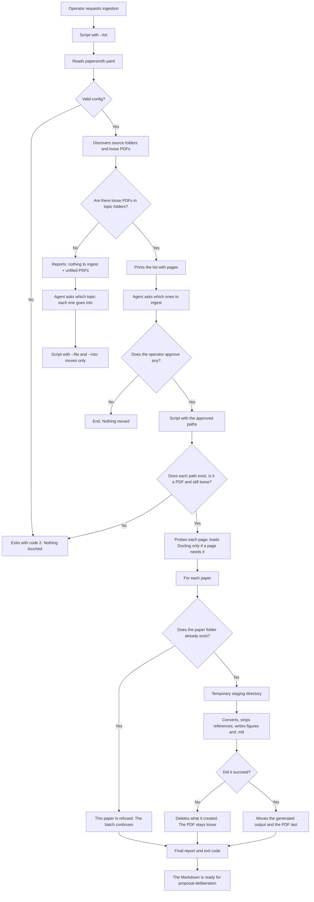

---

### 3. `proposal-deliberation` — discuss the mathematics and publish revisions

**What it is for.** Writing a mathematical paper proposal is a long back-and-forth:
an idea is discussed, an equation is corrected, a section is reordered. The risk is
that during that back-and-forth a model rewrites an equation in passing, without
anyone noticing. This skill does two things at once: it turns the agent into a
mathematical tutor that discusses the proposal, and it places a deterministic engine
between that discussion and the file, so that **nothing changes except what was
approved**.

**What it receives and what it hands on.**

*It receives from `paper-ingestion`:* the Markdown files in `guidance/paper-guide/`,
and **only on the creation of v1**. The engine loads them itself in that single
operation; the agent does not pass them in. For any revision that already exists,
that load **is not repeated** — the `SKILL.md` states it without qualification: that
ingest is spent only once, at the true creation of v1.

*It receives from `proposal-implementation`:* corrections. When the implementation
finds a defect in the mathematics and validates it, it comes back here to publish it.
But **it enters through the normal door**, with no shortcut: it locates the section,
builds the replacement, and passes through the same preview, the same mathematical
integrity gate and the same audit as any other change. That the correction comes from
a measurement exempts it from nothing.

*It hands to everything else:* two things. The published file
(`proposals/research-concept-rNN.md`) and —just as important— the `STATUS` operation,
which is where **the whole forge** gets the answer to which revision is current.
Nobody inspects the directory by eye. That is a hard rule, and it exists because the
directory listing can show files the engine considers invalid.

**What it needs first.** Nothing but Node. It uses no API keys and calls no model:
the engine is keyless. The "model" of this skill is the agent already in the
conversation — which is why the engine needs no model of its own.

**The stages it declares.** Read from the `objective` field of its own
`profile.ts`, which a test keeps equal to the `SKILL.md`. `STATUS` reports them
above the inventory, and both of the engine's error paths carry them too.

| Stage | What it establishes | It is passed when |
|---|---|---|
| `bound` | Which revision is current and which entry of it the change touches | `STATUS` named the latest and the target resolved to an entry |
| `deliberated` | The change was **argued through**, not typed | **the user said so** — nothing here measures it, and nothing may |
| `composed` | The replacement exists written AS mathematics —the equation, with its tag— and not as a description of it | a block exists carrying the equation and the tag it lands on |
| `published` | The successor exists carrying the artifact marker and is the current revision | it is the arrival; it is behind no one |

**Arrival:** the successor revision published and current, which is the only form the
mathematics travels in.

**`deliberated` is a person's stop, and being unmeasurable is deliberate.** The
engine can check that a block exists; it cannot check that the change was argued
through. That is why that stage advances only when the user says so.

**The flow, step by step.**

1. **Start.** The first thing the agent does is ask the engine for `STATUS` —a
   read-only operation— to learn which revision is current. It does not open
   `proposals/` on its own.
2. **Branch.** If no managed revision exists, the path is *create v1*. If one already
   exists (`r01`, `r05`, `r17`…), the path is *edit*.
3. **Create v1.** The agent asks the user for the idea and sends the initial creation.
   **The idea needs at least two sentences**: the engine takes the title from the
   first and the section heading from the second, and with only one the two come out
   byte-identical — which would leave the document impossible to edit afterwards,
   because every query that names a place would be ambiguous. With a single sentence
   it refuses on the spot (`INITIAL_IDEA_SINGLE_SENTENCE`) and writes nothing. A
   sentence ends in `.`, `!` or `?`; a line break is not enough. The engine loads the
   papers from `guidance/paper-guide/` **only once** —here and never again—, renders
   the document from the idea, takes a single project lock (so that two parallel ideas
   cannot create two v1s) and writes `proposals/research-concept-r01.md`. v1 is
   published directly: there is nothing previous to protect.
4. **Deliberate.** With an existing revision, the discussion happens **in the
   conversation**, not in the engine. The agent proposes, refutes, and demands
   mathematical necessity before formalizing. The engine learns nothing of this, and
   that is how it should be: the state of the conversation lives where it can be seen.
5. **Locate the change.** When something is approved, the engine has to be told
   *where* it applies. It is named with words from the heading, and the engine scores
   them against the document's real structure. If the two best candidates are too
   close, **it blocks and asks** instead of choosing. It never guesses.
6. **Preview.** The agent builds the concrete decision —`replace`, `insert`, `delete`,
   `move` or `copy`— and asks for the successor. Here the engine **does not publish**:
   it compiles the candidate document by pasting the approved bytes at the exact
   offset, revalidates the whole of it, and returns a single-use token together with
   —the important part— the list of **what mathematics would disappear**.
7. **The gate.** The agent shows the operator, in plain language, every equation,
   every `\tag` and every `(Ec. N)` citation that would be lost. The operator
   confirms. Only then is the same operation resent with the token and with each loss
   acknowledged by name. If even one is missing, it is refused and nothing is written.
8. **Publish.** The engine reads the source file again, verifies that its hash has not
   changed since step 6, applies the patches, validates the result, verifies the
   source **a second time** just before writing, and only then writes
   `research-concept-r<N+1>.md` atomically.
9. **Accounting.** It rebuilds the derived indexes and writes a **receipt** with the
   document's sha256 before and after.
10. **Audit.** After every publication *all* revisions are reread and each file is
    checked to still match its receipt byte for byte. If something does not add up,
    the result is downgraded to `blocked` even though the bytes are already written —
    and that is intentional: the work is not finished until the accounting closes.

A **revision lifecycle** also exists: withdrawing a revision copies it to an immutable
quarantine, moves the public artifacts, marks the operation as pending audit and
confirms it only if the audit passes; restoring is the exact mirror. `r01` can never
be withdrawn, nor can a revision that has descendants.

**The modules.** The engine is about 50 TypeScript files. Grouped by job:

| Group | Files | What it does and why it exists |
|-------|----------|---------------------------|
| Entry point | `engine/cli.mjs` | The only access point to the engine. It handles `STATUS` and target resolution itself, and dispatches the rest. It starts once per deliberation so as not to pay the startup cost on every call. |
| Public router | `proposal-workspace.ts` | Registers the tool the agent calls and decides which stage each request goes to. It also contains the primitives for safe writes to disk. |
| Coordinator | `orchestrator.ts` | The state machine: resolves, previews, accepts and publishes. Its `publish()` is the **only** place in the system through which a write can pass. |
| Location | `target-resolver.ts`, `ambiguity-gate.ts`, `document-index.ts` | They turn "the normalization section" into an exact byte range. `ambiguity-gate` is the one that refuses when there is a tie. |
| Byte application | `patch-compiler.ts`, `successor-composite-engine.ts`, `ambient-supplied-planner.ts` | They paste the approved text at the exact offset and verify, separately, that everything left outside the change remains identical. |
| Preservation gate | `preservation.ts` (neutral) + `proposal-deliberation/preservation-math.ts` (mathematical extractor) | It enumerates the atoms the domain profile recognizes (for mathematics: equations, `\tag`, macros and citations) before and after. It reports what was lost, and **blocks on its own** on canonical-form violations: unbalanced `$$`, `\(...\)` delimiters, a Unicode math symbol placed inside a `$...$`. |
| Candidate validation | `candidate-validator.ts` | Re-parses the whole resulting document: well-formed Markdown, unique tags, references that resolve, symbols with no conflict, untouched outside bytes. |
| Audit | `consistency-audit.ts`, `self-audit.ts` | They recompute the sha256 of each revision and cross-check it against its manifest and its receipt. `RECEIPT_SHA_MISMATCH`, `ORPHAN_STATE` and company come out of here. |
| Receipts and state | `revision-receipt.ts`, `derived-state-store.ts`, `derived-state-builder.ts` | They write and reread the accounting: what was published, from what, with which hash. |
| Lifecycle | `revision-lifecycle-store.ts`, `revision-lifecycle-transaction.ts` | Transactional withdrawal and restoration, with reverse-order rollback if something fails halfway. |
| Concurrency | `mutation-lock.ts` | Prevents two simultaneous publications on the same file. |
| Acceptance token | `successor-acceptance-registry.ts` | Ties a preview to its acceptance. It lives in memory, is single-use and dies with the process: a preview from today cannot be accepted tomorrow. |
| Delegated agent | `.claude/agents/deliberation-publish.md` | The **terminal** stretch, and it starts only after the change has been accepted: it resolves the entry, composes the replacement substituting **inside** it instead of returning a bare block, and publishes. `Read`, `Bash`, `Glob`, `Grep` — **no `Write` or `Edit`**, because only the engine writes. The deliberation itself is not in its stretch and cannot be: nobody but the operator closes it. |

**What it writes to disk.**

```
proposals/research-concept-rNN.md           the revision, with an artifact marker at the top
.proposal-deliberation/
├── state/research-concept-rNN.md.json      derived indexes + hashes
├── receipts/research-concept-rNN.md.json   the receipt: sha before, sha after, which patches
├── withdrawn/<uuid>/                       immutable quarantine of a withdrawn revision
└── locks/initial-revision.lock             v1 creation lock
```

**The safeguards.**

- **Nothing is lost silently.** An equation that disappears requires the operator to
  acknowledge it by name before publishing.
- **It blocks before guessing.** An ambiguous target asks; it does not pick the most
  likely one.
- **The audit is byte for byte.** Manually editing a published revision breaks its
  receipt, and the engine says so on the next operation.
- **No keys.** No engine operation goes out to the network.
- **It fails closed.** An unknown operation is refused; it does not fall through to
  the default path.

**Known limitations.** They come in three groups, and they are deliberately not
counted here: a number written by hand next to a list ages the first time someone
adds one, and this document has already had three such cases. First those of the
**editing engine** —what happens, what can still be done, what cannot, and how it
would be fixed—; then those of the **scope of the guarantees**, that is, what this
skill, measured, cannot assert; and finally those of the **shared engine**, which
apply equally to the other domain that uses it.

*The query that locates a change is sensitive to how it is written.* To apply a
change, the section it points at has to be named. That query is compared **by
substring against the heading line**, and that has two edges. **Accents count**:
`Normalizacion terminos adaptacion` does not find `## 5. Normalización de los términos
de adaptación`, even though it is the same phrase. It only matters when the accented
word is exactly the one that distinguishes: if other distinctive unaccented words
remain, it still resolves. And the query is **cut at the first punctuation mark**, so
`Sección 3. Formulación…` reduces to `3` before searching for anything. **What can be
done:** write the query as **distinctive words from the heading**, without
punctuation, without the section number, and with the accents exactly as they are
written. `Normalización términos adaptación` works; the full sentence with
punctuation does not. Stopwords (`de`, `los`, `la`) are filtered out on their own.
**How it is fixed:** by comparing without accents on both sides, and by keeping the
full query instead of cutting it at punctuation.

*Moving or copying by naming a section can be ambiguous.* In a `move` or a `copy`,
the section is searched with a different scorer than normal edits: that one looks at
the **whole body** of each entry, not only its heading. Since a section's paragraphs
contain the same words as its title, the section and its own paragraphs tie and the
operation blocks, asking for disambiguation. **What can be done and what cannot:** it
blocks, it does not err — a different piece from the one requested is never moved
without notice. To disambiguate, name the concrete block to be moved instead of the
whole section. **How it is fixed:** by making `move`/`copy` score the heading line,
as normal edits already do.

*A change is applied over the whole section.* The smallest unit that can be targeted
is a `##` section. To correct a single equation, the skill returns the entire
section rewritten. Nothing inside that section is protected byte for byte: the
identical-bytes guarantee covers what remains **outside** the change. **What can be
done and what cannot:** what does protect the inside is the mathematical integrity
gate — before publishing, the skill lists every equation, every symbol, every `\tag`
and every `(Ec. N)` citation that existed before and is now gone, and **does not
publish** until that disappearance is explicitly acknowledged. An equation cannot be
lost silently; prose around it can change with no one pointing it out. **How it is
fixed:** with finer loci — being able to target a paragraph or a concrete equation,
not only the section that contains it.

*Moving content to the wrong place is detected by no one.* The mathematical
integrity gate compares what was there before and what is there after. A `move` that
takes the wrong block **does not lose** mathematics: it relocates it intact. Since
nothing is missing, the gate has nothing to object to. **What can be done and what
cannot:** the real risk dropped considerably —today an ambiguous query blocks instead
of resolving to what it was not— but even so, the result of a `move` should be
reviewed before continuing to build on top of it. **How it is fixed:** by also
comparing **where** each block is, not only whether it still exists.

*Editing a published revision by hand breaks the audit.* Open
`proposals/research-concept-r14.md` in the editor, correct one word, save. The next
operation of the skill reports `auditStatus: FAIL` and does not allow continuing.
**Why:** every publication leaves a receipt in `.proposal-deliberation/receipts/`
with the document's sha256. Before any operation, the audit rereads the file, hashes
it again and requires it to be byte-identical to what the engine published
(`consistency-audit.ts`, `RECEIPT_SHA_MISMATCH`). A different word changes the hash
and the receipt stops backing anything. **It is not a defect: it is the guarantee
working.** Without receipts the engine cannot assert that a revision is what it says
it is, and the byte-exact lineage is left without backing. Removing them is not an
option. **What can be done:** today, either revert the manual edit until the file
matches again, or reconcile the receipt by hand. The second is delicate and is best
avoided: a receipt updated without care leaves the lineage asserting something no one
checked. **How it is fixed:** with an authorized re-base operation —something like
`ADOPT_MANUAL_EDIT`: *"I edited this revision on purpose, adopt the current bytes as
the new baseline"*— that updates the receipt after explicit confirmation. With that,
a manual edit would stop being a break and become a declared act.

*No manual edit is prevented; at best it is detected afterwards.* There is no
barrier in the forge that stops someone —or an agent— from opening a managed file and
writing it outside the engine. `.claude/settings.json` has **a single** `PreToolUse`
hook (`refuse_offpath_push.py`, with matcher `Bash`, and it belongs to
`remote-execution`, not to this skill), and its `permissions` key **has no `deny`
entry**. **What it means:** everything this skill opposes to a manual edit arrives
after the fact — the audit of the previous point warns on the next operation, with
the bytes already written. **What it does not cover:** the moment of the write, nor
anything that happens between that write and the next time someone invokes the
engine. **How it is fixed:** with a `deny` rule over `proposals/` and over
`.proposal-deliberation/`, so that writing outside the engine does not occur.

*The persisted index is a cache that heals itself, not a guard.* It is tempting to
read `.proposal-deliberation/state/<file>.json` —a manifest with the whole document's
`documentSha256` and, for each entry of the structure, its own `textSha256` over a
byte range— as a defense against a manual edit. **It is not.** `loadDocumentState`
**always** rebuilds the state from the bytes on disk, and uses the stored one only if
it validates against that same document; if it does not validate —which is exactly
what happens after a manual edit— it **silently overwrites** it with the fresh
reconstruction. No error, no report, nothing that reaches the caller. **What it
means:** the stored state does not contradict a manual edit; it accommodates to it.
**What it does not cover:** `consistency-audit.ts` has a `MANIFEST_SHA_MISMATCH`, but
there is no operation that can be invoked to ask it, and by the time the audit runs
the cache has already healed. What does notice a manual edit is the **receipt** —the
limitation above—, not the index. **What contains it:** the neighboring skill. The
position block of `proposal-implementation` stores the `sha256` of the revision it
was derived from, so changing a proposal's bytes raises `POSITION_STALE` in `gate`
and in `close` —verified by execution—. The deliberation engine does not detect it;
the implementation does. **How it is fixed:** by making the cache, when it does not
validate, say so before healing.

*State does not survive a clone.* `.proposal-deliberation/` is a `.gitignore` entry
(line 40), so nothing inside it —neither the indexes, nor the receipts, nor the
quarantine— travels in a fresh clone. **What it means:** a fresh clone starts without
accounting and rebuilds it from the bytes it finds in `proposals/`, accepting them as
they are. If those bytes were manually edited, the clone has nothing against which to
notice it: for the clone that is the document, and the audit closes. **What it does
not cover:** byte-for-byte verification is a property **of the machine where the
publication happened**, not of the repository. A lineage verified here does not
arrive verified there. **How it is fixed:** it is not decided. It would be necessary
to separate which half of that accounting is project history and which is machine
state, and to version only the first. For now it is noted, not resolved.

*Nothing proves who decided.* The engine records what was published, against what
base and with which hash. What it does not record —nor can it— is that the gate's
confirmation was given by a person: the acceptance token is single-use and ties a
preview to its approval, but it is consumed by whoever calls the engine, and the
agent that built the preview can call it. **What it means:** a recorded decision
proves that it reached the record, never that someone made it. An agent can open the
question and answer it itself, and no one later in the chain can distinguish that
case from the other. **What it does not cover:** any reading of the record as "this
was approved". What it says is "this was recorded". **How it is fixed:** not with
more record. The confirmation would have to come in through a channel the engine
cannot originate, and today none exists.

**Maintenance debt.** It does not limit whoever uses the skill; it limits whoever
modifies it. *The name of the state directory is repeated.* The
`.proposal-deliberation/` folder holds the accounting —`receipts/` and `state/`— at
the repository root, and its name is written as literal text in **21 places spread
across 7 files** of the engine (`consistency-audit.ts` alone has 7). All 21 say the
same thing, so the folder is always found. **What does work:** two different
proposals coexist without a problem, because both the receipts and the state are
stored in **one file per revision, named with the proposal's file**
(`state/research-concept-r01.md.json`). Different names, different files, zero
collision. **What cannot be done:** having the **same document under two independent
deliberations** —two isolated states over the same files, to explore two paths in
parallel— or moving the state outside the repository root. Both things need the
location to be configurable, and today it is not. **And the failure mode is ugly:**
if someone renames the folder and forgets one of the 21 places, nothing fails — half
of the accounting keeps being written to the old folder, silently, until someone
notices that receipts are missing. **How it is fixed:** with a single
`stateRoot(root)` from which the 21 derive. It is a small refactor and it unblocks
both things above.

*Resolved.* `proseReferenceText` was mandatory at the engine level with no reader in
the core —its only real reader was always the mathematical side
(`preservation-math.ts`)—, and the other host declared it because it had to, without
ever invoking it. It is now optional in `domain-profile.ts`; `preservation-math.ts`
requires its own need locally (it fails with `PROSE_REFERENCE_TEXT_REQUIRED` if
absent), and the experimental profile stopped declaring it. In the same entry file,
`cli.mjs` imported `pathToFileURL` without using it except for a closing
`void pathToFileURL;`; both were deleted.

**Diagram.**

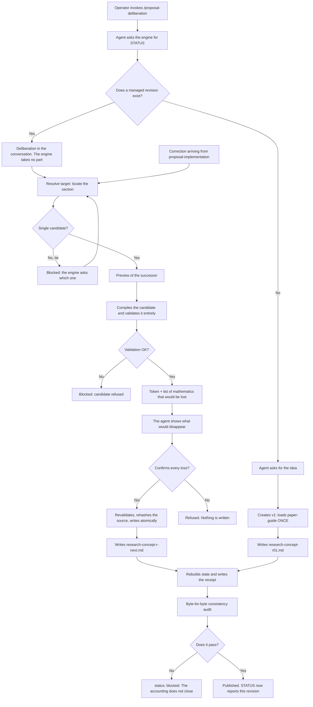

---

### 4. `proposal-implementation` — from the mathematics to code that tests itself

**What it is for.** A published proposal is a document. This skill turns it into a
working Python repository, and then **proves mechanically** —not by assertion— that the
code is faithful to the mathematics: that it runs, that its invariants hold, that the
defects it reports are real, that the corrections it proposes are validated, and that
its reports say what the numbers say.

#### The connection with `proposal-deliberation`

It is the most important seam of the forge, it runs in both directions, and **it behaves
differently in each of the two flows**.

**From deliberation to here, three different things enter:**

1. **Which revision is current.** Step 1 of **both** flows, without exception:
   `node .claude/skills/proposal-deliberation/cli.mjs '{ "operation": "STATUS" }'`
   → `latest` is taken. The skill **never guesses the base and never reads `proposals/`
   by eye**.
2. **The text of the revision.** The engine does read the file: `revision_source()`
   lifts it from the proposals directory. It uses it to judge **admissibility**: each
   finding declares which notation it *uses* —which has to appear verbatim in the
   revision— and which notation it *introduces*. A correction that cites an equation
   that does not exist, or that rests on notation the document never defined, is not a
   defect to validate with a sweep: it is a decision that belongs to deliberation, and
   the skill is forbidden to report it as resolved. (The path is configurable by
   environment with `IMPLEMENTATION_PROPOSALS`, and the reason is written in the code:
   *a paper forge must not have its test suite depend on one paper*.)
3. **The provenance seal.** Each module written declares which revision it was written
   against, and that string has to equal `latest`. That seal is what makes drift
   **measurable** rather than a matter of opinion.

**From here to deliberation, a single route, and gated:** when the audit finds a real
defect in the mathematics and validates it, the correction returns to the document.
Behind an explicit authorization, this session **drives the deliberation engine**:
`handoff` sizes each finding, the entry is located, `compose` assembles the replacement
text by matching on the equation's `\tag{n}`, and the successor is published. It is
gated because **publishing advances the real lineage**. There is no shortcut: the
correction goes through the same preview, the same mathematical-integrity gate and the
same audit as any other change.

**And now what distinguishes the two flows.** The skill routes by **existence, not by
fidelity**: it looks at whether `src/` has an implementation, and nothing more. That is
deliberate — asking about fidelity here would send a repository bound to `r14`, with
`latest` at `r16`, into a full first pass, reimplementing from scratch something that
only needs to be brought up to date. **Drift is the fourth step of flow B, not a reason
to start over.**

| | **Flow A — first pass** | **Flow B — every later pass** |
|---|---|---|
| When | `src/` has no implementation | `src/` already has one, bound to whatever revision |
| What it does with `latest` | **Binds**: it is stamped as provenance in each module written | **Measures**: `verify` crosses what is declared against what is current and reports the distance |
| The return to deliberation | Step 14, gated: the corrections that came out of the audit are published | Step 5, if there are differences, and it first asks whose they are |
| How it ends | Step 16: if it is faithful, **it does not stop** — it continues at step 3 of flow B | In `probe`, which says what is next |

**Flow A leads into flow B.** Ending at A would make the answer depend on how the
operator arrived rather than on what the repository holds.

**And the most important gate of the whole skill is in flow B**, when fidelity does not
hold: the question is **whether those changes are the operator's**.

- **The changes are the operator's** → the code runs *ahead* of the proposal. The
  operator is reminded to update the mathematics and handed the prompt that does it.
  **The operator's code is never edited to match an old proposal.**
- **The changes are not the operator's** → the code drifted. It is corrected and
  revalidated, with a cap of three passes.

A fine distinction avoids invented work: the drift report crosses which sections
actually changed against which sections each module declares. A module bound to an old
revision **whose own sections never moved** needs **re-binding, not rewriting** —
bookkeeping, not mathematics. Saying "nine modules are old" when one equation changed
reports that there is work and nothing about where.

#### The connection with `remote-execution`

Much narrower and one-way: **read only**. The skill imports by path exactly two
modules —the ledger and the entry gate— and **never** the adapter or anything under
`adapters/`, which is the only place in that skill that names a service. With that it
folds the ledger and reports what was sent, what came back and what stayed in
quarantine. **It never sends, never reconciles**: reconciling is the territory of a
human running that skill's command, never of `verify`. And it never names a worker: it
reports only a count. The `poll-first` rung comes out of that fold.

**What it needs beforehand.** A published revision, and a target repository under
`implementations/` that is already a git repository.

**The flow, by stages.** This section had none. The stages are read from
`OBJECTIVE_FLOW`, which a test holds equal to the `SKILL.md`, and they are
deliberately **independent of what is on disk**: they have to read the same in an
empty repository as in one mid-campaign. They exist for the moment something breaks
— a session that hits an error locates itself here, resolves what blocks it and
rejoins, instead of improvising forward.

| Stage | What it establishes | Behind the operator when |
|---|---|---|
| `standing` | A repository to write the mathematics into: isolated under `implementations/`, with an interpreter of its own, laid out the way this skill expects, the kit's destinations materialized, and **the map** from mathematical object to module **approved** | `structure` reports no scaffold gaps and the benchmark declaration carries the revision and the premises with which the map was approved — which is what `materialize --stage objects` refuses to do without them |
| `fidelity` | The code says what the bound revision says, and every claim carries an invariant with its test | `fidelity` is clean and the target's own suite is green under its own interpreter |
| `audit` | What the formulation gets wrong, established over the declared sweep, **each remedy judged admissible before it is measured** and validated afterwards | `audit` is no longer `incomplete` |
| `declaration` | What the experiment compares, over which statistical unit, by which metric, and what it produces | the benchmark declaration is answered rather than sitting at its scaffolded empty value |
| `rehearsal` | The declared flow runs end to end with its own notebooks, and the document a person reads agrees with the run | the pilot is complete and `report` gives `ok` |
| `full-scale` | Every step routed to where it was decided it should run, and executed there at the scale the protocol declares | this is the arrival; it is behind nobody |

**Arrival:** complete runs at the declared scale, local or remote as each step declares,
with the record they leave. **Not** a green verification, **not** a rehearsal that
passed.

**Four stops belong to a person, and none is a defect to repair.** Two stand in the
first stage and a session that starts from zero meets them before anything else:
**authorizing that code be written**, without which nothing below that gate can begin,
and **approving the map** from mathematical object to module, with the revision and the
premises recorded beside it. The other two stand at the end: **publishing the commit** a
worker would clone, and **authorizing a launch**. An agent that reads any of them as a
blocker will stall on it or skip it — both are wrong.

**The commands.** All with the same form:
`python3 .../implementation_cli.py <command> --target implementations/<repo> [--name <Name>] [--revision research-concept-rNN.md]`.
**That `python3` has to be 3.10 or newer** — and it is not enforced: under an older one,
`verify` reaches the `remote-execution` adapter, which evaluates `tuple[int, int] | None`
at import, and the command dies with a `TypeError` instead of refusing. Worse: `main()`
records that exception as an open defect, and an open defect denies eight other commands
until someone closes it. They are not counted here on purpose: a number written by hand
beside a roster the machine publishes ages the first time someone adds a command, and
this table said nine when it was already twenty.

| Command | What it does |
|---------|----------|
| `env` | Creates and verifies the virtual environment **of the target repository** (it refuses if run from a forge interpreter). It also reports the state of the Git LFS pointers — here, because it is the first command after a clone, just when a repository full of markers looks complete. |
| `name` | Pure function, no repository. It normalizes what was typed to the folder form `<Name>/` and the importable form `src/<Package>/`. **It rejects any character that is not ASCII alphanumeric** (`NAME_NOT_ALPHANUMERIC`, naming the character): before, those characters fell silently and the name came out mutilated — `Ñandú` gave `And`. Separators and camelCase still work the same. |
| `plan` | **Read-only** migration plan: what is renamed, what is moved, which directories are missing, which references have to be rewritten, which conflicts exist and which files it cannot classify. It refuses on a dirty tree. |
| `apply` | Runs an **already approved** plan as a single atomic commit. It revalidates that the plan has not gone stale; on any failure it reverts hard and reports. It never leaves a half-migrated tree. |
| `admit` | Decides the **admissibility** of a correction before measuring whether it works: it checks against the text of the revision that the notation it cites really exists. The verdict is written in the target; the text of the proposal stays in the forge. |
| `handoff` | Measures how much reach each finding has within the document and decides whether it can be resolved on the spot or deserves its own deliberation session. |
| `compose` | Assembles the replacement text to take a correction back to the proposal, matching on the equation's `\tag{n}`. |
| `probe` | Read-only report of what is missing to be able to run the benchmark. The `nextStep` ladder lives here. |
| `verify` | The great static reader: layout compliance, fidelity to the revision, integrity of prior work, agreements, stale prose, search declarations, remote-execution state, report contract, audit and validation ladder. All in a single JSON. |

**The two phases.** They are separated on purpose:

1. **Structure.** `plan` → `apply`: purely mechanical. Renames, directory creation,
   reference rewriting, one commit. **It does not touch the semantics of the code.** And
   if the reorganization needs more decisions than someone can actually read, it refuses
   to apply it directly and hands it over as work for a separate session — because a list
   that long gets approved without being read, and an approval without reading is not an
   approval. What counts is the decisions the operator reads, not the files dragged
   along: renaming a folder of two hundred files is **one** line to read and **one**
   command to undo.
2. **Materialization.** Only then is the mathematics written, with human approval at each
   hinge: the object-to-module map, the name, and the authorization to implement.

**The `nextStep` ladder.** `probe` answers a single question: *what is next?* The base
rungs, in order:

1. `nothing-to-compare` — there is no baseline. And without a baseline the backend is
   nobody's concern: numpy is where the mathematics is tested —without autograd, without
   a device, without an optimizer that hides a wrong formula— and for a proposal nobody
   is going to train, that is where it belongs and where it can stay. It is a legitimate
   state, not an error.
2. `convert` — there is a baseline but the implementation computes in numpy, that is, it
   is not trainable, that is, the comparison cannot happen. Proposing the benchmark first
   would mean asking for approval of a run that cannot pass.
3. `piloted` — there are results, but only at pilot scale. **It never reads as "ready"**,
   and no three-button menu is offered either: the pilot exists precisely so that someone
   looks, adds a test, moves a proportion and runs it short again.
4. `already-benchmarked` — there is a complete and current record.
5. `benchmark` — the default case when everything else is clean.

Over that, four blockages apply, and **the order among them is argued, not a
preference**:

- `wiring-first` — an arm declares mathematics it never calls. It goes first because any
  number produced under broken wiring is answering the wrong question from the start.
- `poll-first` — there is already a submission out, on a remote worker, with nothing
  terminal recorded. It exists so that a duplicate is not sent, burning real quota for a
  question already in flight. It goes *after* `wiring-first` (waiting does not fix broken
  wiring) and *before* `search-first` (the in-flight submission may be precisely the
  search that this rung would send the operator to repeat).
- `search-first` — the declared search has no record on disk: a run whose governing scalar
  has not yet been chosen has no configuration with which to start.
- `report-first` — the report does not agree with the run. It goes last because it is the
  narrowest failure —it describes a healthy run badly, it is fixed with a sentence— but it
  still blocks, because a wrong sentence printed with the authority of thirty repetitions
  behind it is worse than no sentence.

**The validation ladder, five levels.** From the cheapest to the most expensive, and that
order **is** the design: each level fails more cheaply to diagnose than the next, so money
is spent only when the cheap part is already clean.

| Level | What it tests | Why it is where it is |
|-------|------------|-------------------------|
| 1. Smoke | Does it start? Only that the package imports and that each module declares its provenance. | It asserts nothing mathematical. It costs zero and catches scaffold breaks before anything serious is attempted. |
| 2. Invariants | One test per mathematical claim of the proposal, bound by name to the module's declared provenance. | Deterministic and cheap. `verify` crosses that every declared invariant has its test. |
| 3. Synthetic | Deterministic, fixed seed, truth known by construction. The expectation is written in the docstring **before** the claim. | That way a passing test cannot be mistaken for a hypothesis fitted after seeing the result. |
| 4. Audit | That every declared finding is a real defect: a sweep of **200 configurations** independent per finding, shifted per run so that two runs audit disjoint configurations. | The first genuinely expensive step. It runs only once it is known that the code at least imports and does what it declares. |
| 5. Remedies | Every correction validated with the same rigor, and required to show **both poles**: that the remedy meets the criterion *and* that the original formulation does not. | Closed behind `admit`: nothing expensive is measured on an inadmissible remedy. Without the control pole, a remedy test would be measuring itself. |

And there is a rule that `verify` cannot replace: **running the suite and verifying are
two different questions**. `verify` *reads* —that each module declares its revision, that
each invariant has a test, that no claim is unfalsifiable, that the notebook really was
executed—; what it cannot say is whether any of those tests **passes**. Skipping the run
is exactly how a repository reaches a benchmark with a broken invariant: all the
provenance intact, all the ids matched, fidelity clean, and one claim failing below. That
gap is wider than ever just after a backend change, which rewrites how every number is
computed while leaving every declaration the same.

**The modules.**

| File | What it does and why it exists |
|---------|---------------------------|
| `scripts/implementation_cli.py` | The whole engine. Standard library only, keyless, offline. **It never imports or runs the target code**: it reads declarations statically with `ast`. |
| `scripts/materialize.py` | **The forge's own** scaffolder, not a step of Flow A: the agent fills the gaps by reading step 5, and this script does the same so that the suite can examine a freshly scaffolded target. It copies the kit substituting the markers, and writes only the templates that can already be written: those of step 9 wait for the object map. It accepts an alternative kit, and the reason is written in its docstring: *a paper forge must not carry one paper's content*. |
| `references/usage.md` | Real, copyable invocations of each command, with example output and the table of refusal codes. It exists so that the agent does not invent flags. |
| `assets/pyproject.template.toml` | The isolation marker. Without its `pythonpath` configuration, the target's suite cannot import its own package offline. |
| `assets/requirements-dev.txt` | What gets installed in the **target's** `.venv`, never in the forge's. |
| `assets/kit/src/module.py` | Template of a module: docstring, declared provenance (revision, sections, equations, invariants) and a stub. Provenance is what makes drift against the revision detectable. |
| `assets/kit/tests/*` | The complete five-level ladder, plus its shared fixtures and the admissibility gate. Each missing file removes exactly one rung. |
| `assets/kit/nb/benchmark.py` | Trains both implementations under the same bounded reduction. It refuses to run under a foreign interpreter —because wall time and peak memory **are** the measurement— and refuses to run without declared wiring. |
| `assets/kit/nb/verdict.py` | The judging logic: it grants a winner only when the means differ by more than the pooled standard error, and below three repetitions **it gives no verdict**, it prints only a point estimate. |
| `assets/kit/nb/report_digest.py` | Hashes all of `src/` into a seal that the report prints and that `verify` recomputes, so that a report can be proved to be bound to the exact code that produced it. |
| `.claude/agents/implementation-build.md` | The stretch **between two of the operator's gates**: from the approved object-to-module map to the findings report the operator decides on. It materializes the scaffolding, writes one module per mathematical object with its provenance and its invariant tests, sweeps the declared configurations, and **fails on the admissibility of each remedy BEFORE measuring it**. `Read`, `Write`, `Edit`, `Bash`, `Glob`, `Grep`. It decides nothing and asks nothing: it ends by reporting what it found and what it cost to establish. |
| `.claude/agents/implementation-walk.md` | The stretch **from the placements already decided to the launch the operator has to authorize**: it walks the declared flow act by act in its own order, runs the local steps, commits each one's product, refreshes the position, and generates the working folders a remote step needs. `Read`, `Bash`, `Glob`, `Grep` — no `Write`. **It stops at the launch and has no path to submit a campaign**, nor to run a rehearsal: no engine act performs a rehearsal, and `walk` stopped promising it — it stops there and tells the operator to run it by hand, which is what the doctrine always prescribed. |
| `walk` | Walks the declared flow toward the rung the position header points at. It runs the local steps, commits each one's product and generates the working folders a remote step needs. **It stops at the launch**, and at a rehearsal too: no engine act performs one. |
| `step` | Runs **one** declared local step, isolated, under the target's own venv. Never the forge interpreter. |
| `position` | The only writer of the position section of `<Name>/AGREED.md`. It marks what was measured, what is missing and what went unmeasured, and binds each mark to the revision and its sha256 — because a revision can be rewritten in place under the same file name, and only the hash detects it. |
| `discuss` | Discussion as an operation with a return value: it publishes a question and returns the bucket it falls into, instead of leaving it in the conversation. |
| `settle` | Places **one** settled agreement, and only one, under a label that names the caller. |
| `close` | The closing precondition: it writes the position and leaves the cycle closed. A second call does not close again. |
| `propose` | The campaign proposal: which jobs, with which workers, with which justification. It records, it does not send. |
| `gate` | The launch authorization record. It is the gate that separates "ready to run" from "running", and a person opens it. |
| `offer` | The action menu derived from the state: a closed set of what can happen next, computed and not offered from memory. |
| `defect` | Declares that some forge file is broken right now. While it stays open, eight commands refuse with `FORGE_DEFECT_OPEN`; `probe`, `verify`, `position`, `plan`, `compose`, `handoff`, `discuss` and `propose` remain reachable. `main()` also records it on its own, when any other exception reaches it. |
| `materialize` | Writes the scaffolding approved by stages (`scaffold`, `objects`, `harness`). `--plan` is an approval given by a person, and `--seed` the number the experiment draws from: no skill chooses that for a repository. |

**What it writes to disk.**

```
implementations/<repo>/           its own git, its own .venv, ignored by the forge
├── <Name>/                       Notebooks/  Data/  Results/  Models/
├── src/<Package>/                one implementation per mathematical object, each with its provenance,
│                                 plus __implementation__ (revision/premises) and the flow's own
│                                 declarations (__levels__/__steps__/__records__)
├── src/<Package>_Benchmark/      the comparison harness — it exists only once accepted
├── tests/                        the five-level ladder
├── tools/                        only if needed: it operates runs, it does not implement equations
└── pyproject.toml
```

`src/<Package>_Benchmark/` is **not** a destination of the initial scaffolding (`materialize
--stage scaffold`): a freshly scaffolded target does not have that directory. It is written
only by `materialize --stage harness`, and only after a comparison is accepted —never if it
is rejected, and never by running the single-arm validation rehearsal in its place—. It
declares which sections and equations each arm exercises. **It declares no provenance on
purpose**: it implements no equation, and stamping one on it would falsify precisely the
check that binds code to mathematics. The agent writes it when wiring; `verify` and `probe`
read it, always statically. Which revision the method was built against, and under which
premises, lives apart, in `__implementation__` inside `src/<Package>/__init__.py` —these are
facts about the METHOD, not about the comparison.

**The safeguards.**

- **It never runs the target code** to inspect it. Everything is read with `ast`.
- **Path guard.** The target has to resolve inside `implementations/` and already be a git
  repository.
- **It never migrates a dirty tree.** Nor does it apply a plan that has gone stale.
- **Isolated environment.** It refuses to build the target's venv from a forge
  interpreter.
- **A finding without a validated remedy is not reported.** This is enforced
  structurally: the audit stays `incomplete` while there are findings without a remedy or
  without a test that validates it.
- **It never writes to `proposals/`.** Publishing is the exclusive territory of
  `proposal-deliberation`, and it is reached only through the gate described above.
- **It never names a remote worker.** It reports only a count.

**Limitaciones conocidas.**

*Files under Git LFS arrive empty.* A cloned repository that uses Git LFS looks complete:
every path is there, every file exists. But each file under LFS weighs a few hundred bytes
— it is a text marker, not the file. The first code that opens it as data fails with an
error about the **file format**, which resembles the real cause in nothing. **Why it is on
purpose:** the clone skips the filter that materializes those files, and the skip is fixed
in the clone's local configuration. The markers are enough to reorganize the repository and
read the code, and downloading gigabytes only to move them between folders spends an LFS
quota that does not come back. **What the forge does:** `env` reports them as soon as the
clone finishes —the moment the illusion is strongest— and `verify` repeats it on every
later pass, because the only thing worse than not knowing it is forgetting it. Each marker
declares the size of the real file, so the report carries **a total, not a warning**. In
this repository, for example: 18 markers, **5.09 GiB** if they were downloaded. Nothing in
the flow reads them, no test or notebook is written against them, and **the download never
happens on its own**: the command is printed instead of run. **The shortcut that does not
exist:** downloading them from the GitHub page with the download button **costs exactly the
same**. GitHub counts every download against the repository owner's bandwidth, by any
route — the command, the browser, and even the source-code zip if it contains those
objects. The free allowance is 1 GiB per month. There is no route that avoids it, and
believing there is one is the most common way to spend the month without meaning to.
**What can be done before spending it:** look at what `probe` reports under `acquisition`
— material that the repository downloads, clones or unpacks **on its own** costs no quota,
and what came out of a training run is produced again by training. Quota is spent only on
what genuinely does not exist anywhere else. **What it does not do:** it cannot stop a
hand-written wiring from trying to load one —if that happens, the error speaks of the
format and the `env` report is where the reason is— and it does not distinguish a marker
from a genuinely corrupt file: both read as absent material, which is the conservative
reading.

*A long run on this machine is invisible while it runs.* `probe` can tell that there is a
submission out whose answer has not returned —it is the `poll-first` rung— and it can tell
because `remote-execution` keeps an append-only record that the forge reads. A query
mid-submission returns the answer, and the operator moves on to something else. **Why the
same does not happen locally:** a run on the operator's own machine leaves what the target
repository decided to leave —a partial, a checkpoint, a lock— under a name only that
repository knows, and looking at it would mean wiring a paper's vocabulary inside a tool
that has to serve everyone. **What happens then:** an operator launches a search or a long
campaign, queries while it runs, and `verify` reads that the declared record does not exist
— it reports the work as not started and `probe` offers to launch it again. **What can be
done meanwhile:** look at whether the record the declaration names in `record` already
exists, or whether a partial was left beside it; two `ls` answer the question. **What it
does not do:** it erases nothing and it does not overwrite the run in progress, and if the
target repository knows how to resume from its partial, the second launch skips what was
already measured. What is missing is not the protection: it is the notice, which is
precisely what one queries for. **What it would need to close:** that the fact be
**declared and not guessed** —just as today the location of the record is declared— and
that it distinguish *nothing is running* from *this repository does not declare it*,
because a fact whose empty value does not separate those two cases is good for triggering
nothing. It is the same reason `smokeReady` is reported and never decides.

*`verify` compares revision names, not content.* The provenance seal each module declares
is checked against the current revision with a single comparison:
`module["stale"] = bool(revision) and module["revision"] != revision`. It is a comparison
**of strings**, and the module's `__provenance__` carries no hash of the text it was
written against. **What it means for the operator:** if a revision is rewritten **under its
same name** —an equation is corrected and the file keeps its name—, `verify` sees nothing:
no module is marked old and the pass comes out clean. The drift appears only later, in
`gate` or in `close`, as `POSITION_STALE` —"bound to a revision whose bytes no longer
match"—, which does compare bytes. **What it does not cover:** a clean `verify` **does not
mean the mathematics held**. It means that no module names a revision other than the
current one. **How it is fixed:** by having the seal also carry the content hash, so that
the comparison is against the bytes and not against the label.

*A witness proves that the test exists, never that it passes.* An agreement can declare
which test backs it, with a `test_<id>` token. The CLI **runs no suite**: to resolve that
token it walks `tests/` with `ast` and collects the function names. Finding the name proves
that such a function exists, and nothing more. **What it means for the operator:** a
well-formed witness whose test exists is reported `unmeasured`, and `unmeasured` is a
**terminal** state — the only thing that can take it out of there is the test disappearing,
and only then, with the item ticked, it becomes `disagrees`. Crossing a witness against the
result of a run does not exist. **What it does not cover:** a test that exists and fails, or
that exists and does not prove what it says. Both read the same as one that passes. **How it
is fixed:** with a cross-check against the real result of the suite, which today has no way
in.

*No hand edit is prevented, and here it is not even detected.* The same observation holds
as in `proposal-deliberation` —a single `PreToolUse` hook, which belongs to
`remote-execution`, and no `deny` entry—, but the difference between the two skills
matters. There a manual edit breaks a receipt and shows up in the next operation; here
there is no receipt to break. This skill's `SKILL.md` says it plainly about the witness
token: hand-typing it is unsupported doctrine, **not** a technical prevention — the parser
cannot distinguish, and does not distinguish, a token written by the skill from a hand-typed
one, and `verify` and `close` evaluate both exactly the same way. **What it means for the
operator:** a mark or a witness placed by hand in the agreements file is indistinguishable
from the ones the tool placed. **What it does not cover:** neither the moment of writing nor
any later read that would separate them. **What contains it:** the launch does not depend on
that file. `gate` reads the position ladder, the authorization, the campaign proposal and
the election — the agreements file, **zero times**. An agreement edited by hand corrupts the
record of what was decided, but **it cannot cause a launch or a cost**: it does not reach
the action. **How it is fixed:** with a `deny` rule over the agreements file, or with a
byte-for-byte bookkeeping, like the one the other skill does have.

*The ledger does not travel in a clone.* `.implementation/` is a required entry of the
target repository's `.gitignore` (in this forge's reference target, line 61). For one half
of what it holds that is correct: a launch authorization that shows up in a clone is an
authorization nobody in that clone gave. For the other half it is not: the deliberation
—what was asked, what was answered, and why the agreements say what they say— is project
history, and the clone receives none of it. **What it means for the operator:** a fresh
clone starts without a ledger and takes the agreements file as it is, with nothing to check
it against. **What it does not cover:** everything that depends on having seen the prior
deliberation. **How it is fixed:** by splitting the two halves, which is a change in what
every reader of the ledger expects to find in a single place. It is noted in the skill's
`SKILL.md`, not resolved.

*Nothing proves who decided.* The precondition that an agreement was discussed before being
placed is satisfied by **any** answered discussion event. Nothing verifies that the answer
came from a person. **What it means for the operator:** the same holds as on the other side
of the seam — a recorded agreement proves it reached the record, never that someone decided
it. An agent can open the question and answer itself, and nobody further down the chain can
distinguish that case from the other. **What it does not cover:** any reading of the ledger
as proof of consent. **How it is fixed:** a confirmation channel the skill cannot originate
is needed, and today none exists.

**Maintenance debt.** *The `SKILL.md` inventory names 5 of the 9 commands.*
In its references section, the line describing `implementation_cli.py` lists `env`,
`plan`, `apply`, `admit` and `verify` — `name`, `handoff`, `compose` and `probe` were left
out. It breaks nothing, and the line immediately above already points to
`references/usage.md`, which does document them all with examples. But it is a list that
aged without warning, and the next one added will age the same way. **How it is fixed:**
by completing it, or by deleting the enumeration and leaving only the pointer to
`references/usage.md` — an inventory that maintains itself is better than one that has to
be remembered and updated.

*Resolved: an absence no longer reads as "not stale".* Under two documents,
the staleness check of `admissibility_record` did `continue` when the entry of a declared
document was missing or when its source could not be read, and the incomplete record fell
to the return below as current. Now each of those two cases answers `unknown` with its
detail. The shape of the failure is the one this repository repeats most:
**an absence that inherits the good value**.

*The "no position" branch returns one key fewer, and the lock that claims to hold the shape
cannot see it.* `position_state` returns 13 keys when there is no position and 14 when
there is: `unmeasurable` is missing. A consumer that reads it directly blows up with
`KeyError` — `sequence_block_detail` already defends itself with `.get`, which is the clue.
The docstring says the shape is held by an agreement rule between returns, but that helper
only reads returns that are **literal dictionaries**, and this branch returns a name. **How
it is fixed:** make the absent branch return the key, or make the lock able to read a
`return <name>`.

*Resolved: `__benchmark__` has a single reader again.* `resolve_benchmark_declaration`
called itself "the one place every reader gets `__benchmark__` from" while
the `INTROSPECT` script, which runs inside the target interpreter, read it from the
imported module's attribute. A declaration that lived in `config.py` without being
re-exported was real for the resolver and nonexistent for `INTROSPECT`: one fact, two
readers, opposite verdicts. `INTROSPECT` now follows the same `__init__` → `config` order
as the resolver.

*"The one place" where `accelerator`/`localBudget` are read was false at birth.*
`cmd_gate` assembles them on its own from its own `run_config` and passes them to the same
classifier. Both sites cite the same design change, so it is not drift: the quantifier was
never true. Today they read the same file the same way, and nothing binds them.
**How it is fixed:** one reader, or a test that fails if they separate.

*Resolved: the kit's three loose pieces, each with its own answer.*
`ruled_revision` **was wired in**, because it closed a real window: `require_admissible`
looked at the verdict and never at the revision, so an old failure passed at measurement
time and appeared only in `verify`. `resolve_device` **was deleted**: zero references in the
whole forge, including the notebooks. And the `rng` fixture **was wired in where it
belongs** —`test_synthetic.py`, which is indeed an item pytest collects— leaving
`sweep.py`'s local generator with the reason written down: it is a flat function, it cannot
receive a fixture, and it needs a seed per index. Wiring, deleting and separating with a
reason are three different answers to the same shape, and choosing only one would have been
the error.

*Resolved: six dead justifications and six dead imports.* Four engine docstrings
justified a pattern by appealing to `raised_refusal_codes`, a sweep that did not see a
refusal hidden inside a helper — and which had already been replaced by
`reachable_refusal_codes`, which does see it. The location of the pattern was right; the
reason written beside it was dead. **A false comment is a defect with a life of its own**,
because the next person who passes believes it. One piece remains, and it is of the same
class: the test that keeps `latest_revision` alive justifies itself with "Five unit tests
**and one production caller**", and that caller no longer exists.

*Six dead imports, and a test that keeps a symbol alive by citing a caller that does not
exist.* Three import lines in the engine bring seven names it does not use. And
`latest_revision` is dead in production since a change replaced its only caller with
`revision_discovery` — nothing calls it, and no dynamic dispatch reaches it. It is kept
alive on purpose, by a spec and eight unit tests; the defect is in the pin itself: the test
that holds it up justifies itself by saying *"Five unit tests **and one production caller**
read it as `str | None`"*. That caller is gone. It is prose that outlived its mechanism
**inside the test that keeps the symbol alive**. **How it is fixed:** correct the pin's
justification —or withdraw the pin— and delete the imports.

**Diagram.**

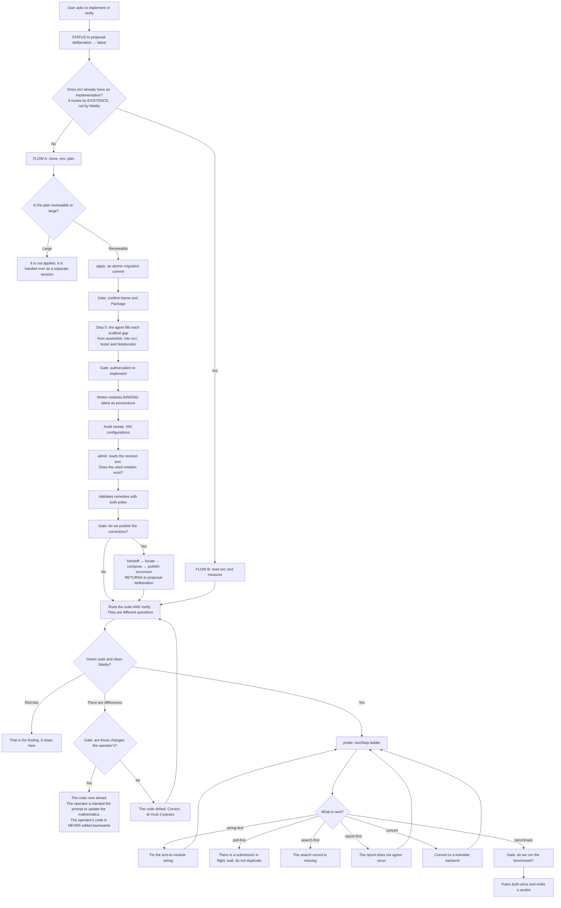

---

### 5. `experimental-deliberation` — discuss the experimental design and publish the plan, never the result

**What it is for.** A mathematical paper needs experiments that support its claims,
and that design has a temptation of its own: a model writing "the adapted term beats
the baseline" before anyone has run anything, or inventing a repository URL because
it sounds plausible. This skill is the **second** domain on the same engine as
`proposal-deliberation` — it turns the agent into an experimental-design tutor and
applies the agreed changes through the same deterministic, byte-exact engine. They
share the entire writing scaffold: resolve a locus, patch, preview, acknowledge,
publish. What they do **not** share is what makes a change "sufficient". For
mathematics, deriving it and closing it inside the document is enough — a proof does
not expire. For an experiment, only what a real and current source still says is
enough — a repository moves, a baseline is superseded, a protocol changes. That
difference is the reason this skill exists, and it is why its central stage is called
`validated`, not bare `deliberated`: the one place where the sibling engine has no
equivalent at all.

**What it receives and what it hands on.**

*It receives from three sources, two of them required:*

- **`guidance/data-paper`** (required) — the data paper. It is the **ceiling**: it bounds what
  may be claimed, and a claim the data does not support is not an experiment, it is a wish.
- **`proposals`** (required) — the managed directory of `proposal-deliberation`, read here and
  never written. But the engine only requires that the directory **exist**; the content never
  enters through the engine, because managed revisions are loose `.md` files and the loader
  descends only one level inside each source. The proposal's claims reach the document because
  **the author carries them**, in the idea that is written and in the deliberation that follows.

*It hands to `experimental-implementation`:* the published file
(`experiments/experiments-<slug>-vNN.md`) is, measured, the document 0 that skill reads as its
"declared protocol" — that is what it is called in its own profile (`impl_profile.py`). No engine
operation pushes that file to the other side; `experimental-implementation` fetches it when it
runs.

*It hands to everything else:* the `STATUS` operation, which is where the answer to which
revision is current comes from. Nobody opens the directory by eye.

**What it needs first.** Nothing but Node. The engine is keyless — it calls no model and uses
no `ANTHROPIC_API_KEY` — because the "model" of this deliberation is the agent already in the
conversation.

**The stages it declares.** Read from the `objective` field of its own
`profile.ts`. This domain does **not** state the mathematical sibling's north, and the
proof is structural: it has a stage, `validated`, of which the sibling has no
equivalent at all.

| Stage | What it establishes | Behind the operator when |
|---|---|---|
| `bound` | Which revision is current and which entry of it the change touches | `STATUS` named the latest and the target resolved to an entry |
| `validated` | The protocol, the metric, the baseline, the dataset and the scheme are stated and **came from a search, not a guess** | a URL with no dated tag, a baseline with no repository or no venue year, a `**Dataset:**` line not given or given twice, or a scheme that shows no test, seeds or repetitions stops this stage |
| `deliberated` | The change was discussed, not typed | **the user said so** — nothing here measures it, and nothing can |
| `composed` | The replacement exists written **as the experiment**, not as a description of it | a block exists that carries the experiment and what it must meet |
| `published` | The successor exists with the artifact marker and is the current revision | it is the arrival; it is behind nobody |

**Arrival:** the successor revision published and current, which is the only form in
which the experiments travel.

**`validated` is the stage that justifies this skill existing separately.** A
protocol invented from memory reads the same as one that was searched for; the
difference appears only when someone asks for the source. That is why external
validation runs **before any draft**, not after.

**The flow.**

1. **Start-up.** `STATUS` over `experiments/`, read-only. The directory is never inspected by
   hand.
2. **Branch.** Zero managed revisions → create v1. One already exists → edit.
3. **Create v1.** The engine loads the three sources once, includes them verbatim under
   `## Reference Sources` (a heading of this domain's own; the shared engine wrote
   `## Paper Guide Reference` for any domain until this profile declared its own,
   finding L6), and composes the document from the idea text. **The idea
   needs at least two sentences.** The title comes from the first and the section heading from
   the second; with a single sentence the two compute the same text, `# X` and `## X` come out
   byte-identical, and every later locus query stays ambiguous forever.
   `CREATE_INITIAL_REVISION` refuses this on the spot with `INITIAL_IDEA_SINGLE_SENTENCE`,
   writing nothing — there is no later repair, because the engine cannot write a heading the
   author did not write. And since v1 has no skeleton and fills in nothing, the `**Dataset:**`
   and the `**Validation scheme:**` lines the document requires must already be in the idea or
   in a required source, or v1 is refused as well, by the same canonical-form gate that runs on
   every successor — never a second gate.
4. **Validate** (delegated to the `experimental-validation` agent). It searches the web for the
   area's standard protocol, the accepted metrics, the current baselines with repository, venue
   and year, and the validation scheme the area expects. **The search is bounded to the three
   years before today**, computed from the run's date, never from memory. The bound is on what is
   **searched**, not on what may be cited: a protocol fixed earlier is still the one the area
   uses, as long as the citation says which year fixed it.
5. **Deliberate**, in the conversation, never in the engine. The agent proposes, refutes, and
   demands the baseline a reviewer will ask for.
6. **Locate the change** with `RESOLVE_TARGET`: distinctive words from the heading, without
   punctuation, without the section number.
7. **Preview** with `CREATE_SUCCESSOR`. The engine compiles the full candidate, validates it
   against the canonical form, and returns a single-use token together with what would be lost
   (`preservationDelta`) and which source conflict it detected (`ACHIEVED_RESULT`, see **The
   safeguards**).
8. **The gate.** The agent shows in plain Spanish what disappears and which phrase it read as an
   achieved result. Each one is acknowledged by name.
9. **Publish** (delegated to the `experimental-publish` agent, which starts only after the
   change was accepted). It resends the same operation with the token, `acknowledgedRemovals`
   and `acknowledgedSourceConflicts`. It writes `experiments-<slug>-vNN+1.md` atomically.
10. **Audit.** A receipt with sha256 before and after, and a byte-for-byte reread of every
    revision.

**The modules.**

| File | What it does and why it exists |
|---------|---------------------------|
| `SKILL.md` | The complete contract of this deliberation: a five-stage north, what it delegates and to whom, the external-validation gate, the canonical-form rules. None of this lives in the shared engine. |
| `references/usage.md` | Request/response examples and a worked transcript. Backed by its own drift guard (`tests/experimental-deliberation-usage-doc-drift.test.mjs`): every `../SKILL.md#anchor` link has to resolve to a real heading, and the worked example is extracted from the document and **actually run**, comparing the response against what the engine returns today. |
| `profile.ts` | The domain profile: directory `experiments`, revision label `v` (not `r`), the `ACHIEVED_RESULT` detector, the three sources with their requiredness, and the five-stage objective (`bound` → `validated` → `deliberated` → `composed` → `published`). The engine under `_core/` gained not one line to admit this second domain. |
| `preservation-experimental.ts` | `extractAtoms`/`violations`: the six atoms that may not vanish in silence (table, baseline, success criterion, figure, URL, dataset) and the hard form rules — verification tag, empty cell, baseline with URL and year, dataset/scheme declared exactly once. |
| `reference-experimental.ts` | `declares`/`cites`: an experiment declares `[exp:E1]`; a claim cites `[tests:E1]` or `(Exp. E1)` in prose. It makes visible, mechanically, both the claim with no experiment and the experiment that supports none. |
| `cli.mjs` | 13 lines. It sets `DELIBERATION_DOMAIN_PROFILE` to this `profile.ts` and delegates the entire rest — arguments, stdin mode, exit codes — to the shared engine's `cli.mjs`. |
| `.claude/agents/experimental-validation.md` | The `validated` stretch: it searches and verifies, never composes. It ends when no finding depends on memory instead of a search from this same run. |
| `.claude/agents/experimental-publish.md` | The terminal stretch: it starts where the operator has already accepted the change and ends with the successor published and current. It has no `Write` or `Edit` — only the engine writes. |
| `_core/deliberation/engine/` (~50 TS files) | The engine shared with `proposal-deliberation`, with no changes to admit this domain. See the full breakdown in the `proposal-deliberation` section; a single file — `revision-lifecycle-store.ts` — still writes the artifact marker as a literal, on purpose, for a Python cross-language guard (see **Known limitations**). |

**The safeguards.**

- **The verification tag is required, and its absence is the violation.** Every external URL
  carries `[pending-verification]` or `[verified: YYYY-MM-DD]` immediately after it. The bytes
  cannot know whether someone searched; that is why silence is what is refused.
- **No number in a report-table cell.** A report table is a promise about a future run; a number
  in it is a result nobody measured. Baselines tables are exempt — they are reference, not
  promise — and they are recognized only because their first header cell reads
  `Baseline`/`Baselines`.
- **The achieved-result detector is a warning, not a hard block.** `ACHIEVED_RESULT` searches for
  `outperform`, `beats`, `state-of-the-art`, etc. It blocks the accept turn, not the preview —
  and acknowledging the conflict in writing is available, for when the document legitimately
  cites somebody else's published result.
- **Dataset and validation scheme, exactly once each.** Zero and two-or-more are refused alike —
  two lines are an ambiguity about what the plan runs, and the engine does not choose for the
  operator.
- **A single-sentence idea does not become v1.** See step 3 of **The flow**.
- **A repository, a URL, a venue or a year is never invented.** What did not come from a search
  in this run is marked `[pending-verification]`; a plausible URL is worse than an absent one,
  because it looks verified.

**Known limitations.** The three below were open and have already been resolved.

*Resolved: the artifact marker is no longer duplicated without cause.* `patch-compiler.ts` and
`draft-materialization.ts` wrote `<!-- proposal-workspace:artifact:v1 -->` as a literal constant
instead of reading it from `DOMAIN.artifact.marker` — the second one, moreover, with no reader
at all: the constant was dead. The first now reads `artifact.marker` like the other engine
sites; the second lost the constant entirely. Only `revision-lifecycle-store.ts:19` still writes
the literal, and on purpose: a Python cross-language guard reads it by regex.

*Resolved: the domain-profile loader no longer accepts entirely empty sections.*
`domain-profile.ts` checked that `REQUIRED` had no top-level `undefined` keys, and rechecked
`artifact.*`/`objective.*` explicitly, but the same lesson did not reach `vocabulary`,
`preservation`, `references` or `sources`, and the check of `stages[].establishes`/
`.behindWhen` only tested `=== undefined` (an empty string went through). Now the eight
`vocabulary` fields, the `preservation`/`references` functions, a `sources` list that is
non-empty and well formed, and non-empty strings in
`objective.arrival`/`.purpose`/`.humanStops`/`stages[].*` are checked just as explicitly, with
the same error code naming the nested field. This skill never suffered from it — it declares
the eight `vocabulary` fields filled in — but the engine already demands it of the next one.

*Resolved (decision taken): the seven self-audit counters that started at zero were retired.*
`runtime-metrics.ts` defined `recordScientificMetric`, with zero production callers and zero
tests — the only occurrence of the symbol was its own definition. The seven counters it fed
travelled unchanged into the `metrics` block that every self-audit returns, indistinguishable
from a real measurement. They were retired (`scientificMetrics`, `recordScientificMetric` and
the type that declared them) instead of inventing call sites for them: deciding WHERE to
instrument each one is a real design question that this fix cannot answer by guessing, and a
wrong placement would still be false signal, only no longer visibly at zero.
`recordLifecycleMetric` (two real call sites, two tests) stands as the pattern to follow if real
producers for these seven are ever designed.

**Diagram.**

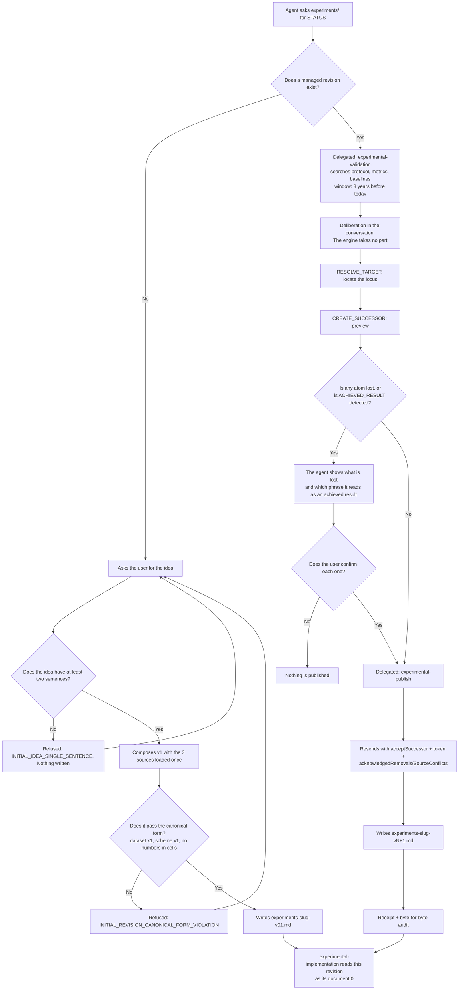

---

### 6. `experimental-implementation` — the second host, two documents, one engine left untouched

**What it is for.** A published experiments protocol (`experiments/experiments-<slug>-vNN.md`)
is also a document. This skill turns it into a Python repository that runs, and
proves —does not assert— that this code does what the protocol says and that its complete
runs leave a record that agrees with what the protocol declares. Up to that point it would be
a clone of `proposal-implementation`. What distinguishes it is that it **verifies two declared
documents, each under its own claim vocabulary**: `documents[0]` is
`experiments/`, with keys `experiments`/`remedy_experiments`; `documents[1]` is
`proposals/` —the mathematics that protocol answers— with keys `equations`/
`remedy_equations`, the same nomenclature the sibling already uses. `impl_profile.py`
itself writes it in its comment: document 1 declares its complete overlay
(`claim_key`, `locus_key`, `remedy_locus_key`, `notation_keys`,
`citation_pattern`) **never inheriting** document 0's `experiments` values.

**What it receives and what it hands on.** It receives a protocol published under
`experiments/` and, through it, the mathematical proposal that protocol cites. On
`remote-execution` the seam is identical to the sibling's: read only, two modules by
path —the ledger and the entry gate— never the adapter. And toward `experimental-deliberation`
it hands local findings over by `handoff`, never publishing itself: the correction returns to
the document through the same gate as any other change.

**What it needs first.** A published experiments protocol, and a target repository
under `implementations/` that is already a git repository. No virtual environment of the
forge's own: the `.venv` is always the target's.

**The stages it declares.** Read from `OBJECTIVE_FLOW`, with the same property
as `proposal-implementation`'s north: independent of what is on
disk, so that a session that hit an error can locate itself and rejoin.

| Stage | What it establishes | Behind the operator when |
|---|---|---|
| `standing` | A repository set up the way this skill expects, with an interpreter of its own and **the protocol's declared steps laid out as runnable commands** | `structure` reports no scaffold gaps and the protocol the run answers to is named and readable |
| `binding` | The code that runs says what the bound experiments revision says, with every declared step traced to a runnable command | `fidelity` is clean against that revision and the target's own suite is green under its own interpreter |
| `instrumentation` | **Every measurement the protocol declares has a place to land** — a metric, a record, a check that can fail | every declared measurement resolves to something that can be run and read back |
| `rehearsal` | The declared flow runs end to end at a small scale, and the record it leaves agrees with the document a person reads | the rehearsal is complete and its own report is `ok` |
| `full-scale` | Every step routed to where it was decided to run, and executed there at the scale the protocol declares | this is the arrival; it is behind nobody |

**Arrival:** complete runs at the scale the protocol declares, with a
record **checkable against the experiments revision**. Not a green
verification, not a passing rehearsal.

**Four stops are a person's, and none is a defect to repair:**
authorizing that code be written, approving the map from declared steps to runnable
commands, publishing the commit a worker would clone, and authorizing a
launch — which is hours of somebody's quota.

**The flow.** This skill **is** almost entirely the shared engine under
`_core/implementation/engine/` —some 21,000 lines across 12 files, the same base that
holds `proposal-implementation`— and what it adds is small and its own: a
domain profile (`impl_profile.py`), a byte-for-byte copy of the sibling's
launcher (`scripts/implementation_cli.py`), this `SKILL.md`, two agents and its
own sealed corpus under `tests/`. No line of the engine changed to admit this
second host.

It routes the same way as the sibling: by **existence**, not by fidelity. If `src/` has no
implementation, Flow A; if it already has one, Flow B, which now measures drift against **both**
documents before deciding anything.

*Flow A — first pass.* This skill ships no `assets/kit/`: `materialize --stage
scaffold` is unavailable, so the target's scaffold is written by hand. The rest
follows the sibling's shape: clone, `env`, ask for the name, authorization gate,
present the object-to-module map **for both documents** —which module implements which
experiment section and which module implements which equation of the proposal that
experiment answers— write code with the corresponding provenance claim key
(`experiments`, `equations`, or both), and hand off to its own two agents when the time comes.

*Flow B — every later pass.* It reads `src/` and takes the newest revision of **each**
declared document separately —never a single name assumed for both—. It runs the
target's suite and then `verify`. A difference in fidelity **in either of the
two documents** opens the sibling's same gate ("did the user make this change?"), without
waiting for the other document to disagree as well. With both clean, `agree` —available
only because this skill always declares more than one document— names every cross-citation
one document makes and the other does not recognize, in both directions, and never issues a
verdict on which side should change. Only with `agree` free of pending discrepancies,
`handoff` sizes the open findings toward `experimental-deliberation`.

**The modules.**

| File | What it does and why it exists |
|---------|---------------------------|
| `impl_profile.py` | The entire domain profile: two documents, each with its own vocabulary overlay. Every path is derived from the location of **this** file, never from the engine's —so the same shape the sibling uses resolves to this profile without a single domain-specific line. |
| `scripts/implementation_cli.py` | The launcher, byte-for-byte identical to the sibling's. It implements no command: it sets `IMPLEMENTATION_DOMAIN_PROFILE` to this profile before handing control to the shared engine, and before that it refuses (`IMPLEMENTATION_DOMAIN_PROFILE_SIBLING`, exit 2) if the environment already carries another skill's profile. Every remaining argument, subcommand and exit code is the engine's. |
| `SKILL.md` | This skill's doctrine: the two documents, their vocabulary, its own flows A and B, and what is unavailable (`materialize --stage scaffold`) and why. |
| `tests/test_experimental_implementation.py`, `tests/test_experimental_implementation_mutation.py` | The skill's own sealed corpus, outside this folder (it lives in the repository's `tests/`), which anchors the two-document behavior against the shared engine. |

**The commands.** Twenty-one, measured with `implementation_cli.py -h`: `walk`, `env`,
`name`, `plan`, `apply`, `admit`, `handoff`, `compose`, `probe`, `verify`, `position`,
`discuss`, `propose`, `gate`, `offer`, `close`, `step`, `settle`, `defect`, `materialize`,
`agree`. The sibling serves exactly the same twenty and this skill adds the twenty-first,
`agree`, enabled only when the profile declares more than one document —which
this skill always does and the sibling never does.

**The safeguards.**

- **It never runs the target code** to inspect it. Everything is read with `ast`,
  exactly as in the sibling —it is a property of the engine, not of this profile.
- **Non-negotiable isolation.** Every run works inside `implementations/<repo>/`
  and uses that repository's `.venv`, never the forge's or the system's.
- **`Data/` is demandable per product, not per root.** If the experiments revision
  declares a `**Dataset:**`, `verify` demands `{Name}/Data` exactly as it already demands
  `Notebooks/`, `Results/` and `Models/` —but bound to the method (`--name`), never to the
  whole repository, because the same clone may host another method without that data.
- **A finding without a validated remedy is not reported.** Structural, shared with the
  engine: the audit stays `incomplete` while anything remains unmeasured.
- **`agree` never issues a verdict.** It names the two directions of discrepancy and
  leaves the decision of which side to correct to the conversation, never to the machine.

**Known limitations.**

*The two-document vocabulary does not reach four consumers of the shared engine —
`cmd_admit`, `finding_impact`, `cmd_handoff` and `verify`'s audit rows.* These
four read a finding under document 0's keys regardless of which document it
named: a finding from `documents[1]` citing `equations: ['99']` was looked up under
`experiments`, found nothing, and an absence read as "no objection" —admitting
false findings and rejecting legitimate ones with invented reasons. **It is already
fixed**, in three commits dated the same day as this section: `e88afec` extracted the
correct reader (`finding_locus_scopes`/`finding_named_source`) that already existed in
`remedy_compatibility` and made `cmd_admit` call it; `5e8d277` did the same for
`finding_impact`, with a nuance the first attempt lacked —reading the document's own key
**when the finding declares it**, and `remedy_loci` in the general case—; and the
same pair of readers now feeds `cmd_handoff` and `verify`'s audit rows.
It is documented here as the current mechanism, not as history.

*`walk` no longer promises a `rehearse` act that nothing executed.* Its roster included
`rehearse` among the acts it "performs", but dispatch had only two command forms
—one for local steps, another for generating job folders— and the second never
passed `--regenerate`, so in the only state `rehearse` exists for
(the folder is already created and is not ready to run) the command refused itself.
**Fixed** in `7fdec85`: the act moved from "what `walk` performs" to "what `walk`
stops to ask for", and the `experiments-walk` agent already describes it that way —"generate
the job folders a remote step needs and stop at the rehearsal, which no act
here performs and the doctrine leaves to a person". The rehearsal is done by hand, as
the doctrine always prescribed; what changed is that the tool no longer promises to
automate it.

*`-h` no longer introduces itself with the sibling's name.* The engine reads its own module
docstring to build the `argparse` help, and that docstring was written for
`proposal-implementation` —so this skill's front end introduced itself with the wrong
name and described 4 of its 21 subcommands. **Fixed** in `8e92d40`: the name
now comes from the root of the loaded profile (`kit.root`), so a future third host
receives its own name the day it is written, with nothing to update by hand; and the command
list was retired rather than corrected, because a hand-made copy of a roster that
`argparse` already builds on its own can only be right by accident.

*`admit` can still admit a finding whose cited notation does not appear in the
document it names, if that notation belongs to another valid document.* Measured: the
engine shares with `proposal-implementation` the check that the cited notation
exists in the text, but that check does not distinguish the correct document from the
incorrect one except by the keys already fixed above; a well-formed finding that cites
the real notation of a document other than the one it names still has no dedicated
cross-check beyond the ones that already exercise the fixed path. **How it is
fixed:** a test that pins down, with two real and distinct documents, that a citation valid in
one and absent in the other is rejected by naming which one.

*The "sealed corpus untouched" safeguard compares against git's index, not against what is
written on disk.* As in the sibling, the tests that protect `tests/seal/` run
`git diff --exit-code`, so a file planted and never added to the index, or an
edit already staged, passes unmarked. Since this host shares the same engine
and the same test pattern, it inherits the same window. **How it is fixed:** change the
check to `git status --porcelain` (or `git diff HEAD` plus an untracked
check), exactly as is noted for the sibling.

*Resolved: the foreign-interpreter guard can now be turned red.*
`require_non_forge_interpreter` —the doctrine both `SKILL.md` files call "Non-negotiable
isolation"— had a single production call site and no test capable of failing: its
condition could be retargeted, leaving the `raise` intact in the source code so the
roster sweeps would not notice, and it silently accepted a forge `sys.prefix` with
every suite green. There is now a test that mutates exactly that and turns red.

*The reference-rewriting module can become a no-op and no suite notices.*
`scan_reference_updates`, `scan_stale_references` and the reference pattern
can be emptied simultaneously without any of the suites that exercise this host
turning red. Under that mutation, `apply` would stop rewriting references after a
rename and a migrated repository would silently keep broken imports, and
`verify`'s `structure.staleReferences` would stay permanently empty. Since the module
lives in the shared engine, this host inherits the same blind window as the sibling.
**How it is fixed:** a test that mutates each of the three pieces separately and
verifies that some suite breaks.

*Resolved: that refusal can now fire, and what it fixed was worse than publishing it
in excess.* `NAME_NOT_ALPHANUMERIC` sat behind a pattern that only emitted already
alphanumeric tokens, so it could not be reached. The damage was not the decorative
refusal: the characters no pattern captured **fell silently**, and the name came out
mutilated — `Ñandú` became `And`, `münchen` became `M-Nchen`, `test@here` became
`Testhere`. It was made reachable instead of being retired, because losing letters without
warning is worse than rejecting the name. With a detail that without it fixed nothing: `str.isalnum()`
is Unicode-aware and accepted `é`, so the check needed `isascii()` as well.

**Diagram.**

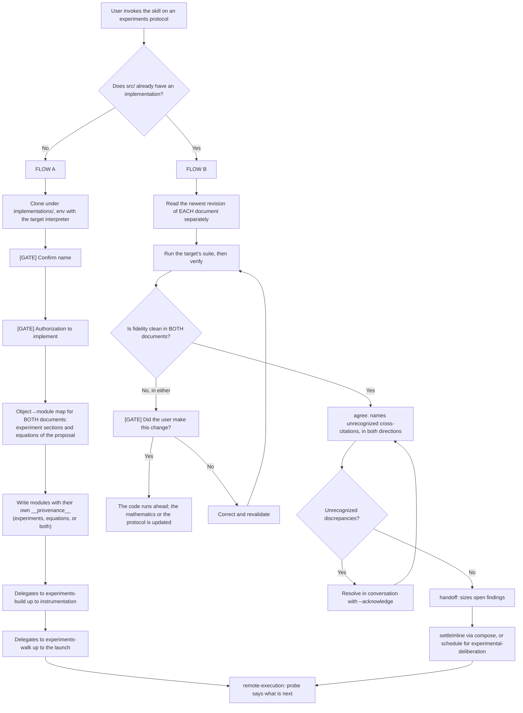

---

### 7. `kaggle-accounts` — the gatekeeper of the credentials

**What it is for.** Kaggle tokens expire and rotate without warning: an account that
worked yesterday can fail today in the middle of a run. This skill answers the one
question the machine can truly verify —**does this credential still
authenticate?**— and keeps a small store, ignored by git, with the ones that pass.

**What it receives and what it hands on.** It receives files the user leaves in
`kaggle-inbox/`: a `kaggle.json`, or a `.txt`/`.md` with one credential per line. It
hands `remote-execution` two things, and only two:

- **Worker identity**, through its `list` command, which returns **nothing but
  usernames**. The output dictionary is rebuilt from scratch with only that field, so
  a key cannot reach it even by accident.
- **A path to a token file**, never the value. Its handoff command writes the
  token as a loose file with `0600` permissions in a `0700` directory and prints **the
  path**.

On the other side, `remote-execution` never opens that store: it runs these two commands
as child processes and reads their output. It is a one-directional seam with a single
shape.

**What it needs first.** Python 3.10+ and a network connection. **Nothing else**: there is
no virtual environment, no `pip install kaggle`. Everything is done with the standard
library and a raw HTTPS call.

**The stages it declares.** Read from `OBJECTIVE_FLOW`, held equal to `SKILL.md` by a
test. `list` answers *where am I*; this answers *what is this for*, which no listing
implies: an account is in the store because somebody put it there, not because it works.

| Stage | What it establishes | Behind the operator when |
|---|---|---|
| `taken-in` | What the user handed over is in the store, **one row at a time**, so a bad row never costs the ones around it | the inbox gave up everything it held and was consumed, or it stayed because rows are still in it |
| `proven` | Each stored account was asked of the service, under whichever of the two token schemes it actually uses | every account carries a verdict **from this run** |
| `decided` | What happens to the ones that stopped working — which is the user's decision and never a side effect of asking | this is the arrival; it is behind nobody |

**Arrival:** every account with a **current** verdict, and the ones that fail
answered, not merely reported. A verdict expires: tokens are rotated and
expire, so *"it authenticated once"* is not arrival either. A session that runs
`validate`, sees a failure reported and stops, **has not arrived**.

**Two stops are a person's:** consenting to validate at all, because it writes — it
stores credentials and consumes the inbox — and deciding what happens to an
account that stopped working. A dead credential is reported and **is never deleted
on its own**, on purpose: deleting it is the user's other option, not a consequence of
asking.

**The flow.** When activated it runs `list` silently to learn what is stored, and
then asks **a single question**: validate or remove. The remove option appears only
if there is something to remove.

*Validate:*

1. It loads the store. If it is corrupt it **fails closed** and writes nothing — it never
   treats it as "empty", because that would let a later write overwrite
   credentials that are still good.
2. It re-checks **every stored account** against the real API. Each one gives its own
   pass or fail line.
3. It decides where the new ones come from: by default, whatever is in `kaggle-inbox/`.
4. It parses each file. A `kaggle.json` yields one credential; a `.txt` or `.md` yields one per
   line, and a bad line is flagged without ruining the others.
5. It validates each one: basic authentication first and, **only if a 401 comes back**, it
   retries as a bearer token. A network timeout retries nothing: a network failure is not
   evidence about the credential.
6. The one that passes is stored or has its key replaced; the one that fails is reported by
   line number.
7. It writes the store atomically, and only if the file is effectively
   ignored by git.
8. An inbox file is deleted **only if it went in whole**. If any row was left out, the
   file is kept and tells the user how many.
9. An account that stopped authenticating is **reported, not deleted**. Deleting is a
   separate decision of the user's.

*Remove:* the real accounts are listed, the user chooses from a list —never typing a name
by hand— and if any of the chosen ones does not exist **the entire batch is refused**. A
partial deletion caused by a typo is worse than deleting nothing.

**The modules.**

| File | What it does and why it exists |
|---------|---------------------------|
| `SKILL.md` | The behavior contract: when to ask, what never to read, how to report. Without this, the agent would have no reason to ask before writing. |
| `scripts/accounts_cli.py` | The entire implementation, with no external dependencies. Subcommands: `list`, `discover`, `validate`, `remove` and `materialize`. The first four are for a person; **`materialize` is for code**: it writes a worker's stored credential to a plain-text file and returns **where**, never **what**. That is the contract that lets `remote-execution` use a token without any skill reading or printing it. |
| `store/accounts.json` | The store. Permissions `0600`, atomic writes. |
| `store/.gitignore` | Ignores **all** the contents of `store/` by rule, not by name — so it also covers the temporary file of an atomic write and any future file. It is committed so that the rule exists *before* the first credential is written. |
| `store/workers/<username>/token` | Created only on the first handoff. It contains only the token, with no JSON wrapper: it is the shape the Kaggle client expects. |

**The safeguards.**

- **The credential never crosses as a value.** `list` returns only usernames; the handoff
  returns only a path.
- **There is no flag for passing the key.** A secret as an argument would remain in the
  process list and in the shell history. The interactive input uses hidden input and
  **refuses if there is no real terminal** — which is exactly how it detects an agent
  trying to do it on the user's behalf.
- **It does not write if git does not ignore it.** It verifies the ignore rule *before*
  creating any directory, so a refusal leaves not even the scaffold.
- **Atomic writes always**, with permissions set before the first byte.
- **It never reads the store to answer "which accounts exist".** For that there is `list`.

**Known limitations.**

*The auditor looks at it, but only from one side.* Validation touches the real API, so what
it reports is evidence and not inference, and the weak point of the chain is on the other
side of the seam, in `remote-execution`'s adapter (see its section). This skill already has
its `accepted-operations` recipe in `skill-audit`, which derives its five operations from
the CLI's own refusal. What it does not yet have is the other half: its `SKILL.md` declares
that set in prose and not in a closed table, so the auditor answers
`comparison: not-run` — it derives what the code accepts and cannot compare it against what
the document promises. **How it is fixed:** a closed table in `SKILL.md`, like the one
`remote-execution` already has.

**Diagram.**

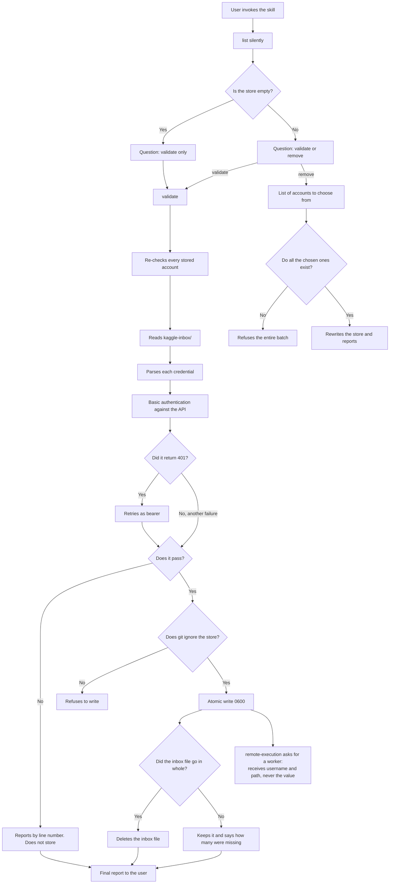

---

### 8. `remote-execution` — the record of what was sent out

**What it is for.** Sending a training run to a remote machine is done today by copying
a command, running it by hand and **remembering** whether it went out, whether it came
back, and whether what came back still corresponds to the code that produced it. This
skill replaces that human memory with a durable, append-only record: what was sent, what
came back, whether that result is still reliable against the current code, and how many
jobs a worker can accept at once.

**What it receives and what it hands on.**

*It receives from `kaggle-accounts`:* the identity of the workers and the path to the
credential, through the two seams described in that section. The value of the token
lives in the store of `kaggle-accounts`; the handoff writes it as a loose file; this
skill reads **only the path** from that child process's output; that path travels inside
a frozen handle; and its only destination is an environment variable in the child
process that runs the service client. **The value of the secret never enters the memory
of this skill or of the agent.**

*It receives from `proposal-implementation`:* the job folder, which lives under
`<destination>/tools/<service>/<job>/` inside the implementation repository.

*It hands to `proposal-implementation`:* the record. That skill folds it read-only,
reusing **this same** fold code instead of reimplementing it — two definitions of "this
result is no longer current" would be one silently derived from the other. That fold
yields its `poll-first` rung.

**What it needs first.** Python 3.10+, the standard library, no virtual environment. To
talk to a real service, a registered adapter and a credential are required.

**The flow, by stages.** This section did not have one either. Read from
`OBJECTIVE_FLOW`, independent of any ledger, job folder or result on disk:
`status` answers *where am I* by folding what happened, this answers *what is this
for*. The fourteen refusal paths of this CLI carry it, and that required creating
the single place through which all of them reach a reader.

| Stage | What it establishes | Behind the operator when |
|---|---|---|
| `reachable` | A job folder **pinned to a commit the declared remote can actually serve**, which is what a worker clones | `generate-job` wrote the folder — it proves the pin against the remote **before writing a byte**, so a folder that exists is a pin that was published |
| `wire` | That this worker, at this pin, carries current — paid in minutes rather than in the hours a campaign costs | `readiness` says ready, from a verdict **derived from a rehearsal's evidence**, never asserted |
| `authorized` | A launch bound to this commit, this entrypoint and this unit list, with a token minted for it and consumed once | a `gate` record matches; a bound fact that moved makes it stale, which is not the same as time passing |
| `sent` | The submission is out and the ledger knows it, so no second one answers a question already being answered | the ledger holds it with a terminal state |
| `returned` | The result is on disk, current, and not quarantined | this is the arrival; it is behind nobody |

**Arrival:** the result on disk and verified as the current one — the only thing
anybody can read a number out of. **Not** the accepted submission: a submission
the service took is a receipt, not a result.

**`reconcile` is not a stage and never advances one.** It is the way back when
the ledger and the service stop agreeing —`drift`, or a line that could not be
read— and it returns to `sent`.

**Two stops are a person's:** **publishing the commit** a worker would clone,
without which `generate-job` refuses and names it precisely, and **authorizing
the launch**, which is hours of somebody's quota.

**The commands.**

| Command | What it does | When it is used |
|---------|----------|---------------|
| `generate-job` | Builds the job folder: run configuration, executor notebook and the service metadata file. It is built in a partial directory and renamed atomically when it finishes — **a half-written folder cannot exist**. | Once, before the first submission. |
| `submit` | The complete submission path, in fixed order: path guard → resolve the product → fresh digest of the source → capacity clamp → real submission → **and only then** record it in the ledger. Recording last means that something which never went out is never recorded. `--smoke` marks the run as a rehearsal and sends it to the rehearsal record. | Every time work is submitted. |
| `status` | Folds the record and shows the state per entrypoint: pending, returned, errored, quarantined, in flight for too long. **It accepts no adapter**: it is structurally incapable of resolving anything, it only reports. | When the current position has to be known. |
| `poll` | Asks about one submission and **re-validates** that the returned state is inside the seam's five-value vocabulary. A defence against an adapter that misbehaves. | While waiting. |
| `fetch` | Brings the result back. It evaluates currency **before** writing anything; if the result no longer corresponds to the current code, it is redirected to quarantine. It materializes in a partial directory, verifies that it is complete, renames, and only then records the return. | When the run has finished. |
| `reconcile` | Compares what the service says it has against what the record believes, in both directions. It reports orphans; it never adopts them or cancels them on its own. | When something does not add up. A human always runs it. |
| `smoke record` | Records a rehearsal's verdict, and that verdict comes from **the evidence of the artifact brought back**, not from somebody saying that it worked. | After the rehearsal is brought back. |
| `readiness` | Reports —it never submits— whether a job is ready for its full run. It binds the last rehearsal to three things: that it passed, the same commit, the same worker. **It reads no clock**: a rehearsal expires because the commit or the worker changed, never because time passed. | Before spending a large run. |

**The record and its fold.** The record is a file of one JSON line per event,
append-only. It is written with a raw descriptor in append mode, checking that the
number of bytes written is the expected one, with a cap per event. Nothing is stored as
"mutable current state": the state is **derived** by re-reading the log in two passes —
the first resolves which is the latest submission of each entrypoint, the second decides
whether each returned result is still current. Two passes are needed because **a result
that was current when it arrived stops being current the instant a later resubmission
lands**.

**The capacity clamp.** The packer reads the cap directly from the adapter —it never
receives it as a parameter and never has it written by hand—, starts from what is
pending according to the record, and refines it by asking the service what it has
active. The count is `granted = max(0, min(requested, cap) - in_flight)`, and it is
reported as four different numbers so that nobody confuses "asks for five and receives
two because the cap is two" with "asks for exactly two".

**The modules.**

| File | What it does and why it exists |
|---------|---------------------------|
| `scripts/adapter.py` | The seam: an abstract class with exactly six operations, the frozen shapes that cross it, and a name-to-class registry. Because of this, everything above is blind to which service is below. A new backend enters without touching anything else. |
| `scripts/ledger.py` | The record: the reliable write path and the fold that derives state, including currency. It is the module `proposal-implementation` imports. |
| `scripts/packer.py` | The capacity clamp. The only place that combines what the repository knows with what the service knows. |
| `scripts/remote_cli.py` | The front door. Also the path guard, which resolves symbolic links **before** checking containment and admits exactly two path shapes. |
| `scripts/credentials.py` | The only producer of a credential handle. It imports nothing but `subprocess`, `json`, `pathlib` and the seam: **it structurally cannot read a secret**. |
| `scripts/jobfolder.py` | Generates and reads the job folder, and computes the only staleness condition: that the source has moved beyond the pinned commit, inside the declared paths. |
| `scripts/shard_io.py` | A single evidence-completeness predicate, shared by the rehearsal record and by the later merge step. One definition, zero drift. |
| `scripts/adapters/kaggle.py`, `colab.py` | The service adapters authorized to name a backend. They invoke the corresponding official CLI (`kaggle` or `google-colab-cli`); they never import private packages or read secrets directly. |
| `assets/runner_bootstrap.py` | Cell 0 of every generated notebook: it validates the configuration, clones the pinned commit, puts `src/` on the path and imports the declared modules, verifying that they resolve **inside the clone**. It runs on the remote machine, before any of the user's code. |
| `assets/runner_invoke.py` | Cell 1: it chooses the normal block or the rehearsal one and calls the declared entrypoint. |
| `distribute` | Spreads the declared units across the available workers and returns the distribution, **without submitting anything**. It is the answer to "how many pieces does this go into and who runs each one?", kept separate from `submit` on purpose: deciding the distribution and spending quota are two different acts. |

**What it writes to disk.**

```
<destination>/<Product>/.remote-execution/
├── ledger.jsonl              the main record
├── smoke.jsonl               the rehearsals: a physically separate file
└── quarantine/<id>/          results that arrived no longer current
<destination>/tools/<service>/<job>/
├── run-config.json           what is run, with which arguments, at which commit
├── runner.ipynb              the notebook that clones the pinned commit and executes
└── <service metadata>
```

Rehearsals go to a separate file and not to a fourth kind of event in the main
record, and the reason is concrete: a rehearsal submission would become the "latest
submission" of the entrypoint and **would silently mask a real run that is still
pending**.

**The safeguards.**

- **Append-only.** A submission is a fact once it happened; a resubmission adds a new
  line and never deletes the one it supersedes.
- **It fails closed.** A child process that exits with an error or times out is a
  refusal, never an invented state.
- **Quarantine cannot be forgotten.** A result out of currency is written structurally
  outside the only tree the result reader walks: there is no filter somebody could
  forget to apply.
- **Readiness is proven, not declared.** A rehearsal's verdict comes from the evidence
  brought back, and no clock is involved anywhere.
- **Only the adapters name a service.** `scripts/adapters/kaggle.py` and
  `scripts/adapters/colab.py` are the only authorized places; there are guards at
  source-code level that verify that the rest of the skill is blind to the backend.

**Known limitations.**

*The Kaggle adapter was never tested against a real service.* It is verified against the
driver's source —today `kagglesdk==0.1.37` with a Bearer token, not the CLI's Basic-auth
path, which the skill retired— and against a fake binary in the tests, but **no test in
this skill touches the network or a real account**. That last point is not an oversight: a
tripwire test fails if a module-level network call appears, and it proves itself against a
poisoned module. **What it means in practice:** everything *above* the seam —the record,
the fold, currency, the clamp, quarantine— is tested, and those are the parts whose
failure would be silent. What is not
tested live is the file below, whose failures are loud: a malformed command fails and is
visible. **What can be done:** if something fails live for the first time, start looking
there and not in the seam. **How it is fixed:** with a real rehearsal —that is what
`submit --smoke` exists for—, which is exactly the cheapest path to discover it before
spending a large run.

*Resolved: the nine print sites carry a net.* `status` crashed with
`TypeError: Object of type PosixPath is not JSON serializable` on every invocation,
because somebody added a nested sub-block and nobody checked the print sites. The fix
—`json.dumps(..., default=str)`— reached four of the nine: **exactly the four that had a
regression test**. The other five stayed bare, and three of them were proven crashable by
mutation. Now all nine carry a net and all nine have their test. The defect was never
"three commands can crash": it was **a fix applied where there was coverage instead of
where the shape repeats**.

**Diagram.**

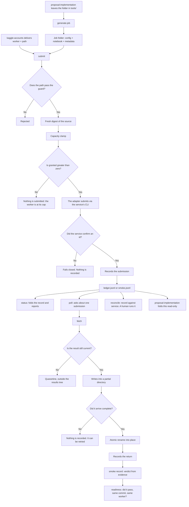

---

---

### 9. `paper-writing` — from the section contracts to the PDF, with nothing assumed

**What it is for.** Writing a paper by hand has a silent problem: a sentence
outlives the datum that supported it, a citation stays unresolved, a diagram is
declared "compiled" without ever having compiled. This skill takes `paper/` from an
empty scaffold to a rendered document in which every block, every decision and
every citation is recorded and verifiable — never assumed. It is the reverse of
`paper-ingestion`: that skill pulls papers *inward* as readable Markdown; this one
pushes prose *outward* as LaTeX that compiles, with the same underlying rule
(`no-claim-without-a-source-that-holds-it`) applied from the other side.

**What it receives and what it hands on.** It reads three things it does not
write: the section contracts in `sections/*.md` (versioned JSON front matter, ten
files), what `proposals/` and `experiments/` declare, and the code of a target
implementation repository. From these it resolves citations against OpenAlex,
Crossref and arXiv, and hands the operator a `paper/main.tex` with every block
substituted, its `refs.bib` rebuilt from cached metadata, and a PDF compiled
through `latexmk`. There is no skill "after" it — `verify` is the last step before
the document leaves the repository.

**What it needs first.** Python 3.10+ with the standard library only — no
`pip install` for anything in the CLI. `render`/`place` need `latexmk` installed
(measured: `/Library/TeX/texbin/latexmk`, present). `resolve` needs network access
to `api.openalex.org`, `api.crossref.org` and `export.arxiv.org` — no API key, no
secret: OpenAlex asks only for a courtesy contact (`papersmith.yaml`,
`paper_writing.contact`), never sent as a credential. Verified live:

```
$ paper_cli.py resolve --identifier 10.1038/nature14539 --resolver crossref
{"status": "ok", "title": "Deep learning", "doi": "10.1038/nature14539", ...}
```

**The flow, by groups of verbs.** This skill declares no stage table: it declares
**nineteen verbs behind a single door** (`scripts/paper_cli.py`), and the flow is
the order in which those groups enable one another.

| Group | Verbs | What it establishes |
|---|---|---|
| The document exists | `scaffold`, `status` | `paper/main.tex`, `refs.bib`, `Figures/`. `scaffold` is idempotent: a second run **never touches an existing byte**, hand edits included |
| The section contract | `contract`, `readiness`, `order` | What every section has to satisfy. The contract is **data, not code** |
| The paper's own decisions | `declare`, `observe`, `plan` | What the paper decides about itself. `observe` validates a report from `insumos-observer` against the schema **before** a person runs `declare` |
| The supporting evidence | `resolve`, `bib build`, `validate` | Citation resolution, a sourced bibliography, and the verdict/placement gate: **no claim without a source that holds it** |
| Writing and drawing | `write`, `render`, `place`, `figure optimize`, `figure audit` | Drafting bound to evidence, contract audit and the style-leak proof. TikZ optimization and semantic figure audit. `render`/`place`: a diagram that compiles or says why, with its repair budget |
| Checking | `verify` | Read-only coupling verification, citation integrity, semantic figure consistency and contract currency |

**The substitution engine is four of those nineteen** — `scaffold`, `status`,
`open`, `substitute` — and they carry one rule: **there is no `--force`**. Nothing
here ever discards a person's on-disk text in favor of an incoming body. The only
exit from a hand-edited block is `--adopt`, which re-baselines the digest and
**leaves the body untouched**.

**And it never claims the document compiles.** A successful `substitute` always
adds `"rendering": "unproven"`: this engine has no LaTeX toolchain and makes no
claim about how the page comes out.

**The flow.** Seven stages, declared in `paper_objective.OBJECTIVE_FLOW` and read
by the agents' tests, not by loose prose: `scaffold` creates `paper/main.tex`,
`refs.bib` and `Figures/` idempotently, never overwriting a hand edit; `plan`
reports read-only the class of every `guidance/` folder, the state of every
declaration and fact, and the provenance of every block already written; `declare`
fixes those declarations and fact resolutions — always a human decision, never
inferred from evidence; `cite` resolves, rebuilds and validates every citation a
block requires; `write` substitutes every writable block, in the order `order`
derives from the block graph, but never invoking an agent itself — that is done by
a shuttle procedure that runs outside the CLI (see The safeguards);
`render`/`place` prove that the document actually compiles, not that it "should";
and `verify` closes with a read-only report on couplings, citation integrity and
contract currency, run again after any `substitute`, `render`, `place` or
`declare`. The declared arrival: a rendered, decision-complete document in which
nothing was asserted without a run having checked it.

**The modules.**

| File | What it does and why it exists |
|---------|---------------------------|
| `SKILL.md` | The conduct contract: the 19 verbs, their refusals, the shuttle procedure to the 6 agents. |
| `scripts/paper_cli.py` | The front door — 19 verbs: `scaffold, status, open, substitute, contract, readiness, order, declare, observe, resolve, bib, validate, plan, write, render, verify, place, figure optimize, figure audit`. No external dependencies. |
| `scripts/paper_scaffold.py` | Creates and re-enters `paper/` without clobbering — the same pattern as `proposals/`/`experiments/`. |
| `scripts/paper_block.py` | Marker grammar: delimits, locates, substitutes and refuses over named blocks inside `main.tex`, byte by byte. |
| `scripts/paper_region.py` | The shared grammar in which the `declarations`/`provenance` regions are written. |
| `scripts/paper_declarations.py` | The `declarations` region — operator values and fact resolutions, fixed once recorded, reopened only by name. |
| `scripts/paper_provenance.py` | The `provenance` region — contract digest and declaration generation with which each block was written, never reconstructed. |
| `scripts/paper_contract.py` | Front-matter grammar and schema validation over `sections/*.md`. |
| `scripts/paper_graph.py` | Assembles the corpus, the flat id namespace, resolves the `after` edges, derives the writing order. |
| `scripts/paper_readiness.py` | Per block: writable or blocked, given the facts and declarations already satisfied. |
| `scripts/paper_vocabulary.py` | The three closed vocabularies a contract header may use — no I/O, no state. |
| `scripts/paper_guidance.py` | Classifies every `guidance/` folder as `style-reference` or `evidence` by its own marker. |
| `scripts/paper_evidence.py` | The claim↔source record: a span quoted verbatim from an already-ingested `.md`, which makes a citation truth a measurement rather than an opinion. |
| `scripts/paper_bindings.py` | The redactor's input contract and its binding map — detects "nothing asserted outside the evidence set", rather than only instructing it. |
| `scripts/paper_audit.py` | Extracts `## Disqualifiers` verbatim and reconciles the auditor's account against the real draft. |
| `scripts/paper_style.py` | Resolution and recording of the equivalent block in every `style-reference` folder — the record, not the content. |
| `scripts/paper_leak.py` | The three-draft test (register distance + n-gram overlap) and the eight-token tripwire — separated by signature on purpose, so that adjusting the tripwire can never move the test. |
| `scripts/paper_write.py` | The `write` pipeline: readiness, gate, draft, evidence audit, contract audit, `substitute --contract` — with exactly one bounded re-draft, controlled by an on-disk ledger. |
| `scripts/paper_resolve.py` | Pure `urllib` client for resolving citations and metadata against OpenAlex, Crossref and arXiv. No key. |
| `scripts/paper_bib.py` | Rebuilds `paper/refs.bib` exclusively from cached, resolved metadata — "never by hand" is a checked property. |
| `scripts/paper_validate.py` | The only citation gate: verdict, placement by regime, and a search loop bounded to three rounds that never lets a half-cited block through. |
| `scripts/paper_obligation.py` | What a diagram has to contain, read from the contract's `figure:` declaration — never hardcoded against a section or block id. |
| `scripts/paper_figure.py` | Diagram source/manifest layout, the manifest's two-way cross-check, and the per-figure repair-budget ledger. |
| `scripts/paper_tikz.py` | TikZ code optimizer: prunes unused libraries, detects missing libraries and factors repeated styles into `\tikzset`. |
| `scripts/paper_figure_audit.py` | Semantic figure auditor: compares manifest nodes against the section's prose and the pipeline steps. |
| `scripts/paper_latex.py` | The only module this skill permits to import `subprocess` — toolchain discovery, the single `latexmk` call, log parsing, three-signal verdict. |
| `scripts/paper_coupling_evidence.py` | Every disk read `verify` needs, isolated here and nowhere else. |
| `scripts/paper_verify.py` | Eight pure checks over that evidence (including `figure-semantics`) — zero I/O of its own, read-only report. |
| `scripts/paper_objective.py` | The declared north: `OBJECTIVE_FLOW`, read by `tests/test_agents.py` via `ast.literal_eval` — pure literals, no calls and no imports. |
| `sections/*.md` | The ten real contracts, versioned: JSON front matter + prose. Real input, not a fixture. |
| `.claude/agents/insumos-observer.md` | Reads the paper's **four declared sources** — `proposals/`, `experiments/`, the target repo's code and what its runs returned — and reports, for each observable fact, whether it is satisfied and **with what evidence**. `Read`, `Glob`, `Grep`. **It never decides a value and never runs `declare`**: its report is what a person reads before running `declare`. The report is passed by file and `observe` validates it against the schema — an agent's own account is never trusted. |
| `.claude/agents/style-sampler.md` | Resolves the equivalent block, **whole**, from every `guidance/` folder the record classifies as `style-reference`, and returns it **verbatim, never trimmed**. `Read`, `Glob`, `Grep`. What it returns is the only material against which a later overlap test can compare a styled draft: if it trimmed, the test would compare against something no one wrote. |
| `.claude/agents/figure-auditor.md` | Audits TikZ diagrams against their section's prose and the declared manifest; runs `figure audit` and reports the structured verdict. |

**The safeguards.**

- **The CLI never invokes an agent.** An AST scan (`NoSubprocessScanTests`)
  certifies that no module under `scripts/` imports `subprocess`, `os.system`,
  `os.popen`, `os.exec*` or `multiprocessing` — with one named exception, currently
  unused, reserved for `latexmk`. `write` cannot run unattended by construction: the
  orchestrating agent assembles the redactor's four inputs, delegates, writes the
  JSON to a file, and only then runs `write --draft <path> --audit <path>`.
- **A single re-draft, counted on disk.** `AUDIT_EXHAUSTED` refuses a third attempt
  under the same contract/evidence/mode — the count lives in a file ledger, not in
  the memory of a process that might restart.
- **The style test and its tripwire are separated by signature on purpose**
  (`paper_leak.py`, Decision D6): adjusting the eight-token tripwire can never move
  the three-draft test. An all-`noEquivalent` style channel reports `unmeasured`,
  not a silent pass.
- **`paper_verify.py` is pure:** zero `Path(`, `open(` or `.read_` in the file —
  confirmed by direct grep, not by trusting its docstring.
- **Citation discovery fails by name, not silently.** With
  `paper_writing.roles.discovery: []` in `papersmith.yaml` and
  `.mcp.json`→`"mcpServers": {}`, any discovery attempt is refused
  `DISCOVERY_UNAVAILABLE`; an empty resolution role is refused `RESOLVER_ROLE_EMPTY`.
  It never degrades to "found nothing" indistinguishable from "did not search".
- **Citation resolution works today:** `resolution` in `papersmith.yaml` ships
  `openalex`, `crossref` and `arxiv` wired in — verified live above, not merely
  declared.

**Known limitations.**

*`SKILL.md` states a count that is no longer true about its own shipped data.*
`SKILL.md:453-454` says today: *"A header declaring neither is
schema-valid — none of the ten shipped contracts carry `mode` yet"*. Measured
directly: 10 of 10 `sections/*.md` already carry `mode` in the exact form the same
document describes two paragraphs earlier (`rg -n '"mode"' sections/*.md`
returns ten matches). The drift comes from two commits (`d99ee93`, `9986e11`) that
took coverage to 10/10 before a later commit explicitly focused on "stale
`SKILL.md` content" (`eab6496`) touched that same file without correcting this
sentence.
**How it is fixed:** correct the sentence to "the 10 shipped contracts already
carry `mode`" and, if it is not to drift again, have a test read the real count
from `sections/*.md` rather than have `SKILL.md` repeat it by hand.

*The build accumulates symbols with no production caller, and the count of how
many there are is no longer reliable even by citing the commit history itself.*
Four recent cases (`Verdict.__post_init__`, `register_distance_holds`,
`relative_overlap_holds`, `RedactorInput`) were audited and **are not defects**:
they are mechanism tests or shape contracts for a fixture, documented as such in
their own code. The pattern is real and has a history: commit `eab6496` recorded
`paper_contract.install_header` as *"the eleventh instance of that shape"* — yet
that same function had already been **deleted** in commit `ab10c21`, earlier than
the one that cited it as live. The number "eleven" was left fossilized in a commit
message that was already out of date the day it was written.
**How it is fixed:** stop citing a count from a commit message; a sweep by
identifier occurrence (top-level `def`/`class` that does not appear outside its own
definition line, over the 27 scripts + the `tests/test_paper_*.py`) gives the real
number at the moment it is run, and that is the only number worth writing.

**Diagram.**

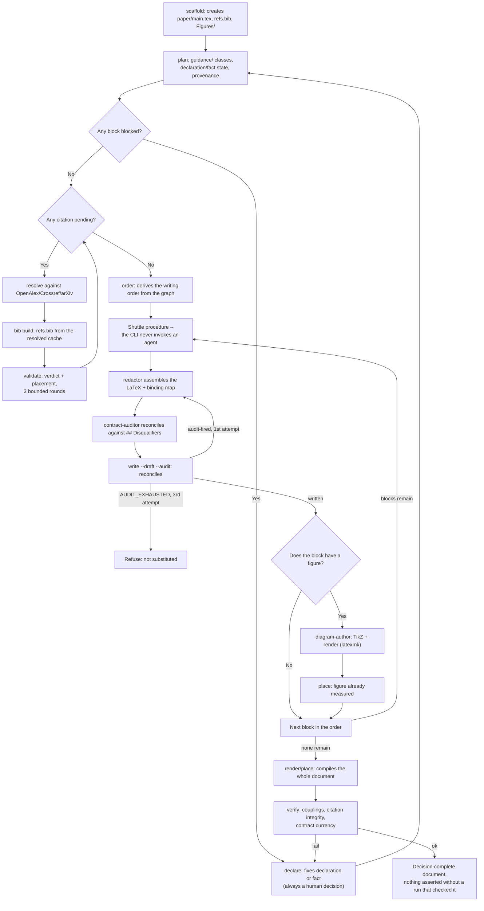

---

### 10. `figure-review` — what a raster can settle, and what it cannot

`render` compiles a diagram source to a PDF and stops. `figure audit` checks that
PDF's declared manifest against the prose describing it. Between the two, nothing
looks at the picture, so every visual dimension is reported `unmeasured` —
honestly, because nothing ever rasterized it. This skill closes that gap and only
that gap.

**Answerable from pixels alone, with a computed verdict:**

- Whether non-background ink sits inside the outermost pixel row or column — ink
  running off the canvas.
- Whether two ink regions' bounding boxes collide, reported by coordinates only
  and never by a component's name, because a raster carries no names.

**A number worth reporting, with no verdict attached:** how much of the canvas
each band occupies. A canvas that is a third blank is a fact; deciding whether
that is too much is a composition judgement this skill does not make.

**Never answerable from pixels, and never claimed to be:** legibility,
arrow or connection correctness, style, aesthetics, legend quality, and which
declared component an overlap belongs to. Each stays an announced silence —
`unmeasured` with a reason naming why — rather than a guess dressed as a
measurement. A `pass` on any of them would be worse than the silence.

**The front door is a command, not a session claim.**

```bash
python scripts/review_cli.py probe [--json]
python scripts/review_cli.py raster --pdf <path/to/example-figure.pdf> [--dpi 150] [--out <dir>]
```

`probe` names the first tool its fallback chain finds, in order `pdftoppm`,
`pdftocairo`, `gs`, `sips`, and exits 2 naming all four it probed plus the exact
`PATH` it searched when none resolves. That refusal is never reported as an
`unmeasured` dimension: an absent tool is an unreadable invocation, not a
dimension this skill declined to judge.

`raster` writes a PNG and its provenance — which tool produced it, at what DPI,
and whether that DPI was requested or derived — beside the figure it rasterized.
It reads no ledger and writes no ledger, so a full pass leaves `render`'s repair
budget byte-identical: rasterizing a picture that already exists is not a compile.

**What it never does.** It never invokes a LaTeX toolchain and never opens a
repair-budget ledger, under any code path including a failed rasterization. It
never repairs or redraws a figure. It imports no other skill's scripts and no
other skill imports its own; the two sides meet through a plain-data file on
disk. It never reports a judgement as a measurement. And `raster.py` is the only
module in the skill permitted to spawn a process, always as a list of arguments
never a composed shell string, with the figure path resolved to an absolute path
before it reaches argv.

### 11. `skill-audit` — the auditor that derives both halves of a closed set, and reads neither

**What it is for.** Any skill or CLI that declares a closed set —the
subcommands it accepts, the error codes it can return, the files it says it
ships— runs the same risk: that the set is restated by hand in more than one
place and that, over time, those restatements drift from each other and from
what the code actually accepts. This skill looks for exactly that, and only
that. It does not read the code to guess what it accepts, nor read the
documentation to trust what it says: it **derives** the code side by driving the
subject as a real process and taking the roster from its own refusal message,
and derives the documented side by parsing a table. It compares the two halves
and **stops there** — the report is the deliverable, and the repair belongs to
whoever owns the audited subject.

**Where it receives from and what it hands to.** It receives a named subject
—a skill, a CLI, anything that enumerates a closed set— and a probe recipe
(`--probe-spec`) that tells it how to drive it and where to read its doctrinal
table. The real work runs in the `audit-report` agent, delegated in a context of
its own: the reason is methodological, not cosmetic. A context that already
loaded the subject has seen one of the two halves before deriving it, the same
as a fixture written and read by one hand. The agent loads `SKILL.md` in full
before moving, has `Read`, `Write`, `Bash`, `Glob`, `Grep` and **has no
`Edit`** — so "reports; never repairs" stops being a sentence and becomes a
fact about what it can reach. It hands the report to whoever asked for the
audit; it does not touch the subject again afterwards.

**What it needs first.** A real shell. Without `Bash` the skill **refuses** —
it names the missing capability and emits no report, finding, candidate or
partial verdict. There is no virtual environment: everything runs on the
standard library. It touches no network, with one declared exception: the
optional `driver` step of `structure`. The refusal without a shell is not a
failure of the audit, it is its correct output — an audit whose claims are pure
readings tells the user nothing they could not have read on their own.

**The flow, by stages.** A differential audit against a second subject runs in
**six stages, from cheapest to most expensive**. Each one is a row of a table,
never a numbered heading, and **every report carries all six rows**, whether
differential or not.

| # | Stage | Models spent | What it demands |
|---|---|---|---|
| 0 | Freeze the subject | 0 | `frozen` |
| 1 | Decide by tool | 0 | `undecidable` |
| 2 | Drive it from ignorance | 1 | `user-drive` |
| 3 | Two blind readings, over that list only | 2 | `reading-diff` |
| 4 | Differential drive: one box with the skill and one without | 2 | `drives` |
| 5 | Partition the two transcripts | 1 | `found-by` |

**Six model runs in total**, and only if every stage after the first three
actually runs. The first two spend none: the order exists so that whatever a
tool can decide never costs a model.

**Stage 2 is not differential.** It demands that the subject be driven from
ignorance whenever there is something reachable to drive — it is what separates
*"the documentation says X"* from *"the code does X"*.

**The flow.** `roster` is the central verb and the one that reconstructs both
halves: `probe_code_side` (`audit_cli.py:308-372`) runs the subject's own argv
with a nonce it cannot accept (`__AUDIT_NONCE__`), and takes the roster from the
text of its own refusal by regex — it never opens or parses a source file of the
subject for this. `doctrine_side` (`audit_cli.py:92-135`) does the symmetric
thing on the other side: it parses a Markdown table named by its heading and
returns one column, without running any process. The result compares `code`
against `doctrine` and publishes `unregistered`, `phantom`, `duplicated`,
`numeralMismatch`. The other eight subcommands —measured via `--help`, see the
table below— cover different dimensions of the same problem: `structure`
compares what is declared, what is on disk and what a from-zero scaffold
produces; `walkthrough` drives a recipe step by step up to the index where it
stalls; `reading-diff` compares two given readings of the same prose surface;
`sensitivity` varies a declared input and measures whether the output moves;
`inversion` inverts a fact guarded by a lock and observes whether the lock
fires; `exits` drives, for each state a recipe declares, the published act that
corresponds to it; `enumeration-reach` classifies whether the iteration source of
each declared check is bounded or derives from the subject.

**The modules.**

| File | What it does and why it exists |
|---------|---------------------------|
| `SKILL.md` | The complete doctrine: the nine subcommands, their exit codes, the shipped-files table and the decision gates. The agent loads it in full before moving. |
| `scripts/audit_cli.py` | The entire implementation of the nine verbs, with no external dependencies. `doctrine_side` and `probe_code_side` are the two derivations that are never read against each other. |
| `references/usage.md` | One worked invocation per subcommand. |
| `references/example-report.md` | A report that `check-report` accepts as valid — the shape against which any new report is validated. |
| `references/probes/skill-audit.*.json` (eight files) | The self-audit recipes: `subcommands`, `structure`, `first-run`, `reading-a`/`reading-b`, `sensitivity`, `self-guarded-facts` (for `inversion`), `exits`, `enumeration-reach`. `skill-audit` is the only subject with all nine dimensions covered. |
| `references/probes/proposal-deliberation.accepted-operations.json`, `proposal-implementation.accepted-operations.json` | `roster` recipes against foreign subjects, with their own doctrinal table as the documented side. |
| `references/probes/remote-execution.accepted-operations.json`, `remote-execution.smoke-subcommands.json` | `roster` recipes against `remote-execution`, top-level and nested in `smoke record`. The only two that declare `minInterpreterVersion` (see The guarantees). |
| `.claude/agents/audit-report.md` | The agent that runs the stretch. No `Edit`; no `stretch:` in its frontmatter, because this skill declares no north an agent could tie a stage to — that is legitimate, not an oversight, and the file itself says so. |

**The guarantees.**

- **No shell, refusal, no degradation.** There is no "read the code and
  describe it" mode when `Bash` is missing; that would produce a document with
  the appearance of an audit and none of an audit's authority.
- **An extraction that matches nothing raises.** `roster` never turns
  "found nothing" into an empty set — returning empty would turn every
  documented row into a phantom finding, a broken probe disguised as a result.
- **The inability to look never shares an exit code with an empty finding.**
  Each of the nine subcommands explicitly separates its exit `2` reasons (it
  could not look) from its exit `0` verdicts (it looked and reports, even when
  the report is that nothing was found).
- **The agent has no `Edit`.** "Reports; never repairs" is a tool restriction,
  not a promise of conduct.
- **An interpreter floor, named instead of failing silently.** The two
  recipes against `remote-execution` ran with a bare `argv[0]="python3"`; on
  this machine that resolves to 3.9.6, and `adapter.py:373` of the subject needs
  ≥3.10 on import, so it died before reaching its own refusal and `roster`
  answered `{"status": "unprobeable"}` without saying why. Commit `0275fa6`
  resolved it with a declared field, `minInterpreterVersion`, which
  `probe_code_side` uses to look on `PATH` for the name and its version-suffixed
  variants and substitute the first one that satisfies the floor — or fail
  **naming** which version was needed and which it found. The roster was never
  wrong; only the interpreter selection.

**Known limitations.**

*One of nine skills is audited whole; the other eight, halfway.* Measured on
2026-09-13 by driving each recipe: only `remote-execution` answers
`comparison: run` —nine code operations against nine from its table, with no
leftovers and no phantoms—. The other eight answer `comparison: not-run` and
name the reason, `no-closed-roster`: their documents declare the roster **in
prose**, and prose is exactly where the documented side cannot be read from. The
`unregistered: []` that appears beside it **is not a clean verdict**, it is an
empty field of a comparison that never ran. The auditor is honest; what is
missing is the subject's other half. **How it is fixed:** each `SKILL.md`
publishing its roster in a closed table — work inside each skill, not in the
auditor.

*One recipe ties a mutation to an exact line number.*
`references/probes/skill-audit.self-guarded-facts.json` pins the `inversion`
mutation at line 3873 of `audit_cli.py` (`REPORT_SCHEMA_VERSION = 1` →
`= 97`). Any edit above that line moves the real number and breaks the recipe
without touching the fact it says it guards — it has already happened once:
commit `0275fa6`, by adding eighty lines further up, shifted the pin and left
two tests red until someone corrected it by hand. The fragility is real and
still stands; the commit names it explicitly as "left standing because
redesigning it is not this change". **How it is fixed:** the recipe anchoring by
content (the literal `REPORT_SCHEMA_VERSION = 1` searched in the file) instead
of by line number, or `inversion` resolving the line by searching for the
literal before mutating.

**Diagram.**

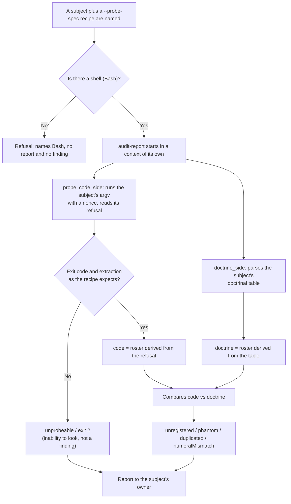

**Known limitations.** The audit skill does not prove containment by
content: two commands were left out for budget and remain out — `manifest --root
<dir> [--baseline <f>]` (a per-file `sha256` fingerprint over a declared folder
and, against a previous snapshot, what was added, deleted and changed) and
`counts --before <f> --after <f>` (a test count before and after, **separately
in the two suites**, with a number that does not rise treated as a finding).
While they are absent, the proof that a working folder was left clean and that
`implementations/Domain_Adaptation` was not touched rests on `git status`, which
over an ignored directory comes out empty **by construction**: it does not prove
containment, it only looks as though it does; and "the suite stayed green" still
passes as evidence of added coverage, when what it proves is that the count
rose. The decision to defer them is recorded in the archived change
`the-skill-that-audits-the-others` and is explicit: *"The budget decision is
made — do not reopen."* The follow-up change that was going to collect them was
never created, and that note pointed at nothing; this paragraph replaces it.

---

### 12. `upgrade-project` — the upgrade, reachable from inside the workspace

A workspace is not a checkout. `smith init` copies a release's skills, renders
its slash commands and agents for every harness, and records which release the
workspace received in `.papersmith/version`. None of that is live: when the
installed distribution moves ahead, the workspace keeps the release it was born
with until someone upgrades it.

This skill is the in-workspace surface for that upgrade. It exists because the
work was reachable only from a terminal, so an agent working inside a workspace
could see that it was stale and could not act on it.

**It performs no upgrade of its own.** Every byte written is written by
`smith upgrade`, and that is deliberate: the upgrade is not a file copy. It is
a kit copy, a symlink repair, a re-derivation of every projection, an orphan sweep
over previously baselined dynamic paths, and an ordered run of artifact migrations
-- with the version marker written last, and only when the artifacts actually
reached that version. A reimplementation here would be a second answer to all of
that, and two answers that can disagree are worse than one that can be wrong. So
the skill decides whether to call the CLI and with which arguments, and reports
what it said. It also never decides to upgrade on its own: a stale workspace is a
fact to report, and moving it is the operator's call.

**Preflight, before anything is written.** Two conditions, both of which fail
better before a write than during one.

- **Is this a workspace?** `.papersmith/manifest.json` must exist. The CLI checks
  it too, but checking here lets the refusal name the directory the user is
  actually in. When it is absent, the answer is that this directory was not
  created by `smith init`, and `smith init .` is what creates one.
  Running `init` as a recovery is not offered: initializing a directory somebody
  believed was already a workspace is how a misunderstanding becomes a tree of
  files.
- **Is the CLI reachable?** `smith --version`, then
  `python -m papersmith.cli --version`. The module path matters: it is
  `papersmith.cli`, not `papersmith`, because the package ships no `__main__.py`,
  and `python -m papersmith` fails with a message that looks like a broken install
  and is not one.

**The verbs.** `plan` runs `smith upgrade . --plan-migrations` and writes
nothing. It previews migrations only, and the flag is deliberately not called
`--dry-run` for that reason: the kit copy, the projections and the orphan sweep are
not previewed and have no preview at all. `apply` runs `smith upgrade .` with
the flags that matter — `--tools` replaces the active harness set, `--force`
rewrites kit files whose hashes already match, `--no-migrate` syncs files and leaves
the version marker where it was, and `--allow-downgrade` installs an older kit over
a newer workspace and is deliberately separate from `--force`. `status` reports the
recorded version against the installed one, and is preferred over reading
`.papersmith/version` directly, because the marker is a claim about artifacts and
`status` is where that claim is interpreted.

**What is never overwritten.** The upgrade preserves authored work by pattern. Read
the set from `PRESERVE_PATTERNS` in `src/papersmith/core/manifest.py` rather than
from a list restated here: a roster copied into prose is a roster that drifts the
first time the real one changes. When asked whether an upgrade is safe, state the
limit: there is **no backup and no dry run for files**. A hand-edited file outside
those patterns is replaced by the release's own copy, so the answer for such edits
is to commit them first.

**Reading the result.** The report names the workspace, the version and the count
of changed files, then four warnings rather than failures: a kit file that could
not be written, an orphan that could not be deleted, a blocked harness `skills`
symlink, and a recorded version that did not advance. Exit codes are `0` success,
`1` a user error, `2` a source error, `4` a migration failure. An upgrade that
printed a migration failure and exited 4 did not succeed, and a summary that calls
it done is the outcome this skill must never produce.

## The CLI commands

Every command runs as `papersmith <command> [options] [<dir>]`. `<dir>` defaults
to the current directory and has to point at an initialized workspace, except for
`init`. Global flag: `--version`.

| Command | What it does |
|---------|----------|
| `init` | Creates a standalone research workspace |
| `upgrade` | Syncs the framework's scaffolding while preserving the research |
| `status` | Reports workspace health, proposals, runs and inbox |
| `ingest` | Ingests a literature PDF or URL into Markdown |
| `deliberate` | Talks to the `proposal-deliberation` engine |
| `implement` | Delegates to the `proposal-implementation` harness |
| `run` | Runs a compute profile (local / Kaggle / Slurm) |
| `remote` | Packs, pushes and follows remote jobs directly |
| `target` | Lists, selects and checks compute targets |
| `audit` | Audits the structure and detects drift in what was generated |
| `ui` | Serves the local Paper Command Center (DAG, gates, sections, wiring) |
| `mcp` | Exposes the orchestrator and the paper verbs over Model Context Protocol |

### `smith init [<dir>]`

```bash
smith init ~/papers/sparse-ae \
  --title "Sparse Autoencoder Audit" \
  --topic "mechanistic interpretability" \
  --remote kaggle
```

| Flag | Effect |
|------|--------|
| `--title TEXT` | Paper title, written into the workspace documents |
| `--topic TEXT` | Research topic |
| `--tools TEXT` | Runtimes to provision, comma-separated |
| `--remote {kaggle,local,slurm}` | Default compute target (default: `kaggle`) |
| `<dir>` | Where the workspace goes; omitted, it is the current directory (`smith init` alone sets up the folder you are in, on every operating system) |
| `--import-existing` | Explicitly initialize a nonempty directory while preserving existing files: keeps its `README.md`, merges papersmith's block into its `.gitignore`, and refuses any other file or symlink collision before copying |
| `--no-npm` | Skips the best-effort `npm install` (offline/hermetic use) |
| `--no-env` | Skips provisioning the workspace's Python environment; `smith ui` refuses until `python3 scripts/setup_env.py install` is run |
| `--progress` | Forces a plain-text progress log with an estimate of the time left; useful in CI, where the bar is noise and the log is what matters |
| `--no-progress` | Draws no progress even when the output is a terminal |
| `--allow-dirty-kit` | Initializes even when the kit has uncommitted changes in its distributed paths, or when its git state cannot be read; the workspace records that it came from such a kit (see [Kit provenance](#kit-provenance)) |

By default `smith init` refuses a nonempty destination. For a directory with
existing research files, use `smith init <dir> --import-existing` (or
`smith init --import-existing` from inside it): it scaffolds alongside them.
Two root files nearly every repository has are not collisions: an existing
`README.md` is kept as it is, and an existing `.gitignore` keeps every line and
gains papersmith's managed block on top (the same merge `smith upgrade` does).
Any other existing generated path (`CLAUDE.md`, a `.gitkeep`, `package.json`…)
is refused rather than replaced. It is not an upgrade of an existing
Papersmith workspace; use `smith upgrade` for that. The merge requires filesystem
support for no-follow, directory-relative operations and fails closed if it is
unavailable. A failed merge attempts to remove only scaffold paths it can still
identify; concurrent directory moves or later npm/environment provisioning may
leave new artifacts requiring manual cleanup. Filesystem races and external
installers mean this is not an atomic transaction or a guarantee against other
processes changing the destination.

The step that dominates the run is environment provisioning, and until 0.9.0 it
ran with its output captured: several minutes with no signal at all. `init` now
draws a bar with an estimate of the time left on a terminal, and prints the log of
the two child processes it runs. The estimate starts from declared values and
recalibrates against the pace the run itself measures; a step that overruns its
share moves the number up rather than contradicting itself. When the output is not
a terminal — a pipe, the MCP server, the suite — nothing is printed, so a stream
another program is reading stays clean.

Creates `.papersmith/`, `guidance/{paper-guide,reference-papers,data-paper}/`,
`proposals/`, `paper/`, `experiments/`, `implementations/`, `kaggle-inbox/`,
plus the kit copy and its manifest. The full shape of the tree is in
[Inside the workspace](#inside-the-workspace).

### `smith upgrade [<dir>]`

```bash
smith upgrade ~/papers/sparse-ae
```

| Flag | Effect |
|------|--------|
| `--tools TEXT` | Replaces the active runtime generators |
| `--force` | Forces framework files to be written |
| `--allow-downgrade` | Allows installing a framework version older than the one the workspace records |
| `--no-migrate` | Syncs the framework files without migrating artifacts; the recorded version does not advance |
| `--plan-migrations` | Reports the pending artifact migrations and exits without writing anything |
| `--allow-dirty-kit` | Syncs even when the kit has uncommitted changes or an unreadable git state; the workspace records it |

It only touches files the framework manages — never `guidance/`,
`proposals/`, `paper/`, `experiments/`, `implementations/`, `kaggle-inbox/`,
`papersmith.yaml`, `package.json`, `README.md` or the `.env*` files.
Against a kit checkout without reinstalling:
`PAPERSMITH_KIT_ROOT=/path/to/papersmith-ai smith upgrade <dir>`.

#### Kit provenance

Since 0.14.0, `init` and every `upgrade` write `.papersmith/kit-source.json`:
the framework version, the commit the kit came from, whether it had uncommitted
changes (`dirty`) and where the CLI resolved it from (`checkout`, `bundled` or
`override`). `smith status` shows it on the `Kit source:` line. A workspace
created before 0.14.0 does not have it and `status` says
`unknown (recorded before 0.14.0)`; the next `upgrade` writes it, so no
migration is needed.

With an editable install (`pipx install -e`) the kit is the live checkout,
uncommitted edits included. That is why `init` and `upgrade` refuse, before
writing a byte, when the paths the kit distributes (`skills/`, `sections/`,
`.claude/agents/`, the provisioning scripts, `requirements.txt` and
`src/papersmith/`) have changes or untracked files, and also when the kit's git
state cannot be determined (no `git`, the tree is not a repository): unknown is
treated as dirty, not as clean. Commit or stash the changes, or repeat with
`--allow-dirty-kit`; the record then carries `allowedDirty: true`. The bundled
kit of a wheel install records the commit `scripts/build-kit.py` captured when
it was built; a kit built from a dirty tree is refused too. If that kit carries
no provenance (it was built before 0.14.0 or without git), it is admitted with
the commit unknown, because its bytes are a frozen copy, not live edits. The
variable `PAPERSMITH_ALLOW_DIRTY_KIT=1` is equivalent to the flag; it exists for
the test suite, which runs from a checkout that is almost always dirty.

#### Artifact migrations

Syncing files is not enough. A release can change the shape of an artifact the
workspace already produced, and the new scaffolding is then left reading old
state with nothing to notice. That is why `upgrade` runs artifact migrations in
a single place: after copying the kit, because a migration may need the scripts
and assets of the release that just arrived, and before writing
`.papersmith/version`.

One rule with no exceptions follows from that order. **The recorded version
advances when that version's migrations are done.** If one fails, the marker
stays where it was, the command exits non-zero and the next run retries.
`--no-migrate` does not move the marker either when something was left pending:
advancing it there would turn the flag into a way of recording a release the
artifacts never reached, and `status`'s `version_match` would report that as
agreement.

The manifest is the opposite case and is written every time. It describes files,
and the files did move; withholding it would make `status` report everything it
had just synced as drift.

There are two classes of migration. One is **version-bound** and runs once, when
the workspace sits below its gate and the installed kit at it or above; it is
recorded in `.papersmith/migrations.json` and does not repeat. The other is a
**convergence** migration: it has no gate, asks the file system through a
read-only probe and is evaluated on every run, because the next release can
change what there is to converge on. A workspace that already satisfies it writes
nothing.

The current version ships two convergence migrations:

- **`sota-pool-scaffold`** creates `sota-pool/.gitkeep` in workspaces older than
  the release that began scaffolding the graph pool.
- **`atlas-render-refresh`** re-renders `sota-pool/atlas.html` when its atlas,
  its renderer or the viewer bundle it inlines changed. The decision is taken
  from hashes stored in `sota-pool/.atlas-render.json`, not from modification
  dates: the mtime of a copy says when the file was written, and `upgrade`
  rewrites it for reasons that have nothing to do with the page.

When the recorded version cannot be ordered — the marker was lost, or it says
something without a number — a version-bound migration cannot be placed on
either side of its gate. It is reported as `undetermined` and never applied:
migrating artifacts under a relation nobody established is exactly the silence
the downgrade guard already removes on the file side. Convergence migrations are
unaffected, because they ask the disk.

`--plan-migrations` is not called `--dry-run` on purpose. That name would suggest
it also previews the kit copy, the per-harness projections and the orphan sweep,
and it does not: a flag should not overstate its scope.

A damaged `.papersmith/migrations.json` makes `upgrade` refuse before writing a
byte, alongside the downgrade guard and for the same reason. Reading it as empty
would re-apply every migration it was recording. `status` answers differently on
purpose: it reports it as a warning, because a command that only informs and
also crashes leaves the workspace with no way to ask what is wrong with it.

### `smith status [<dir>]`

```bash
smith status --json
```

| Flag | Effect |
|------|--------|
| `--json` | Machine-readable snapshot (versions, proposals, runs, inbox) |
| `--verbose` | Also prints the projection notes (`note: ...`) to stderr |

The projection notes (for example `agent 'x': tool 'WebSearch' has no Pi tool;
not granted`, a Claude tool another runtime cannot grant) are emitted by `init`
and `upgrade` when they write the projections. `status` no longer repeats them
as a `UserWarning` on every call: they go into `framework.generator_notes` in
the JSON and are printed only with `--verbose`.

It includes the kit provenance the workspace recorded (`Kit source:`; see
[Kit provenance](#kit-provenance)).

The proposal stage (`Proposal: <file> (<stage>)`) is derived from the engine's
state for the latest managed revision: `published` when its publication receipt
(`.proposal-deliberation/receipts/<file>.json`) is committed and its
`documentShaAfter` is the document's current digest, `edited-after-publication`
when the bytes changed afterwards, and `draft` when there is no committed
receipt. The legacy `proposals/deliberated/` and `proposals/accepted/` folders
are still read first, for old workspaces.

Reports the drifted files by name; the exit code stays `0` while drift is
reported (a non-zero code is a known gap, recorded as a follow-up).

### `smith ingest <file_or_url> [<dir>]`

```bash
smith ingest https://arxiv.org/abs/2309.08600
smith ingest ~/Downloads/reference-paper.pdf --ocr
```

| Flag | Effect |
|------|--------|
| `--ocr` | Balanced OCR-oriented extraction mode (heavier, for scans) |

Downloads/classifies the reference, extracts it to Markdown with LaTeX equations
and figure files (one folder per paper) and refreshes the index. The first run
downloads ~1.5 GB of Surya weights when the environment was not pre-provisioned.

It accepts only PDFs (a local `.pdf` or an arXiv/OpenReview/PDF URL); any other
source is refused, and the message names the two routes for material that is
already text, both owned by `proposal-deliberation`: Markdown to seed a new
proposal goes in `guidance/paper-guide/` (read by `CREATE_INITIAL_REVISION`),
and an existing draft that must become v1 as it stands goes in `proposals/` and
is adopted with `ADOPT_INITIAL_REVISION`.

### `smith deliberate [<dir>]`

```bash
smith deliberate . --action status
smith deliberate . --action init --instruction "First sentence. Second sentence."
smith deliberate . --action adopt --revision draft.md --instruction "Adopt as v1."
smith deliberate . --request-file request.json
```

| Flag | Effect |
|------|--------|
| `--action ACTION` | The engine's real operation (`status`, `init`, `adopt`, successors…) or a supported alias |
| `--request JSON` / `--request-file FILE` | Raw JSON object / the file holding it |
| `--serve` | Persistent JSON-lines mode |
| `--revision FILE` | Managed source file the operation applies to |
| `--instruction TEXT`, `--query TEXT` | Instruction / query payloads |
| `--selected-entry-id ID`, `--decisions JSON` | Resolved edit decisions, for mutation operations |
| `--accept`, `--acceptance-token TOKEN` | Accept a `CREATE_SUCCESSOR` preview |
| `--withdrawal-operation-id ID`, `--withdrawal-reason TEXT` | Withdraw a published revision |
| `--prior-conclusion TEXT` | Prior conclusion for follow-up operations |

Runs the deterministic, AST-verified deliberation engine, keyless and local (no
state operation calls a model).

`--action adopt` is `ADOPT_INITIAL_REVISION`: it turns an unmanaged `.md` in
`proposals/`, named with `--revision`, into v1, and like every operation except
`status` and `resolve` it requires `--instruction`. The bridge has no
`--dry-run`; a preview of `init` or `adopt` is requested with `--request` and
`"dryRun": true`, which the bridge passes to the engine unchanged:

```bash
smith deliberate . --request '{"operation":"ADOPT_INITIAL_REVISION","sourceFilename":"draft.md","instruction":"Adopt as v1.","dryRun":true}'
```

### `smith implement [<dir>]`

```bash
smith implement . --action verify --target implementations/demo
smith implement . --action probe --target implementations/demo
```

`--action` is required. The bridge runs only these actions: `env`, `name`,
`plan`, `apply`, `admit`, `handoff`, `compose`, `probe` (alias `benchmark`) and
`verify`. Supporting flags: `--target`, `--name`, `--plan`, `--finding`,
`--entry-text`, `--python`, `--shards`, `--revision`; whatever follows the known
flags is forwarded as `extra` to `implementation_cli.py`.

`--action materialize` still works, but it is an alias of `apply` (the layout
migration approved with `--plan`), **not** of the engine's `materialize`
(`--stage`/`--authored`/`--adopt`). Every use prints a note to stderr; write it
as `--action apply`.

The rest of the engine's commands do not go through the bridge and are run
directly with the skill's launcher, which sets the domain profile:

```bash
python3 skills/proposal-implementation/scripts/implementation_cli.py materialize \
  --target implementations/demo --name Demo --stage scaffold --plan plan.json --seed 7
```

Direct: `walk`, `materialize`, `adopt`, `position`, `discuss`, `propose`,
`gate`, `offer`, `close`, `step`, `settle`, `defect` (and `agree` in
`experimental-implementation`, with its own `implementation_cli.py`). Asking the
bridge for one of them (except `materialize`, the alias above) refuses and names
this route. If you set `IMPLEMENTATION_DOMAIN_PROFILE` by hand, it must be an
absolute path (a relative one is refused with
`IMPLEMENTATION_DOMAIN_PROFILE_NOT_ABSOLUTE`). The commands that write the
ledger (`position`, `propose`, `gate`, `offer`, `close`, `step`, `settle`,
`defect`, `walk`) require `--session <id>`; what that id is is in
`skills/proposal-implementation/references/usage.md`, "Session ids".

### `smith run <profile> [<dir>]`

```bash
smith run smoke_and_invariants --dry-run
smith run sweep_training --target kaggle-gpu-pool --consent <token>
```

| Flag | Effect |
|------|--------|
| `--target NAME` | Overrides the profile's compute target |
| `--dry-run` | Plans only — records the command, dispatches nothing |
| `--shard VALUE` | Runs a single shard of the campaign |
| `--consent TOKEN` | Consent token for remote submission (forwarded, enforced downstream) |
| `--implementation NAME` | The `implementations/` directory that `{target}` and `{target_python}` name (default: the only one there is) |

Profile placeholders: `{paper_slug}` (the workspace folder name), `{job_id}`,
`{shard_value}`, and since 0.14.0 `{target}` (`implementations/<name>`) and
`{target_python}` (the interpreter of the target's own `.venv`, created by the
implementation skill's `env` command). The default `smoke_and_invariants`
profile runs `{target_python} -m pytest {target}/tests/test_invariants.py`,
never a `pytest` from the PATH. If the target cannot be resolved (none or
several in `implementations/` without `--implementation`, or no `.venv` when the
profile names `{target_python}`), `run` refuses before dispatching or recording
anything; `--dry-run` does not refuse and reports it in `target_resolution`. A
pre-0.14.0 profile that names `implementations/{paper_slug}` keeps working
while that directory exists; if it does not, `run` refuses and says which lines
to change (`papersmith.yaml` is yours: `upgrade` does not rewrite it).

Dispatches per provider (local subprocess / Kaggle submit / `sbatch` over ssh)
and appends each job to `.papersmith/runs_ledger.jsonl`. The Python processes it
launches on the local machine (the local job and the Kaggle submit) run with
`PYTHONDONTWRITEBYTECODE=1`, as do the skill scripts the CLI invokes: they leave
no `__pycache__` inside the workspace.

### `smith remote {pack,push,status,pull,sync} [<dir>]`

```bash
smith remote pack --target kaggle-gpu-pool --entrypoint train.py
smith remote status --job <job-id>
smith remote pull --job <job-id> --dest ./results
```

Key flags: `--target`, `--entrypoint`, `--backend`, `--account`, `--job`,
`--submission-id`, `--dest`, `--consent`, `--smoke`, `--unit` (campaign scope,
repeatable), `--force`, `--resolve`, plus the job-definition flags (`--service`,
`--job-name`, `--product`, `--commit`, `--repo-url`, `--repo-ref`,
`--run-module`, `--run-function`, `--clone-path`, `--regenerate`). Extra tokens
are forwarded to `remote_cli.py`. A real submission spends quota: prefer
`--smoke` and `--dry-run` first (see
[Remote compute, carefully](#remote-compute-carefully)).

### `smith target {list,set,check}`

```bash
smith target list
smith target set kaggle-gpu-pool
smith target check
smith target check slurm-cluster
```

- `list [<dir>]` — configured targets, marking the active one with `*`.
- `set <name> [<dir>]` — persists the default target in `.papersmith/config.json`.
- `check [<name>] [<dir>]` — connectivity test: `local` looks for Python, `kaggle`
  goes through the accounts helper, `remote-ssh` tries
  `ssh -o BatchMode=yes -o ConnectTimeout=5 <host> true`.

### `smith audit [<dir>]`

```bash
smith audit --check-drift
```

| Flag | Effect |
|------|--------|
| `--check-drift` | Also reports drift in generated files as findings (never repairs) |
| `--verbose` | With `--check-drift`, also prints the projection notes to stderr (the same as `status --verbose`) |

Audits the workspace's structure and consistency. It is bound to the `skill-audit`
subject today; drift is reported, not fixed.

> **Note:** `kaggle-accounts` (validate/remove/list/discover/materialize) has no
> `smith` subcommand yet — it runs as
> `python3 skills/kaggle-accounts/scripts/accounts_cli.py …` or indirectly
> through `target check`.

### `smith ui [<dir>]`

```bash
smith ui --port 8080
smith ui ~/papers/sparse-ae --no-browser
smith ui --export-static ./dashboard-static
```

| Flag | Effect |
|------|--------|
| `--host HOST` | Bind address (default `127.0.0.1`) |
| `--port PORT` | Preferred port; if it is taken, the next free one |
| `--no-browser` | Does not open the browser |
| `--export-static <dir>` | Copies the dashboard build to `<dir>` and exits |
| `--allowed-host HOST:PORT` | Also accepts that `Host` header (repeatable); only forwarded to the backend when supplied |
| `--no-terminal` | Does not offer the dashboard's support terminal (it is only ever offered on a loopback bind) |

Serves the **Paper Command Center**: a local dashboard inside the workspace with
its two flows, the four quality gates, the ten-section matrix and the health of
the harness wiring. It updates live over Server-Sent Events, with a 300 ms
debounce on `sections/`, `openspec/`, `experiments/` and `papersmith.yaml`.

The backend lives in `skills/_core/command_center/` (part of the kit, so it
travels with every workspace) and runs standalone without Node/npm:

```bash
python -m skills._core.command_center.server --port 8080
```

**The two flows.** The *Pipeline* tab draws the overall flow: the twelve stages of
the architecture diagram, in order, plus the audit path across them where the four
gates land. Each stage lights up from what is on disk — `sota-pool/`, `guidance/`,
`proposals/`, `implementations/`, `.experimental-deliberation/`, `experiments/`,
the credentials store, the inbox, `paper/Figures/` and `sections/` — and a stage
with no artifact is reported inactive saying what is missing, never with an
invented progress. The *Writing* tab draws the writing flow: one section per node,
in render order, each with its state, its words and its blocks. The edges do not
live in the frontend: the extractor sends them in the payload (`pipeline_chain`
and `gate_links`), so the dashboard cannot contradict the diagram.

Endpoints: `/api/state`, `/api/health/wiring`, `/api/health/run-wiring-smoke`
(POST) and `/api/events` (SSE); the dashboard build is served at `/`. The frontend
is built once with `npm run setup:ui` (it installs from the lockfile) and then
`npm run build:ui`, which emits into `skills/_core/command_center/static/`;
`npm run dev:ui` starts the Vite server with a proxy to the backend for work on
the interface. The install step uses `npm ci` and not `npm install` on purpose:
`install` rewrites the lockfile with the local npm's metadata, and that noise does
not belong to any dependency change. The end-to-end smoke is
`bash scripts/command-center-smoke.sh`.

**Light theme.** The dashboard uses a single light theme, defined by colour tokens
in `ui/src/styles.css`; a Vitest test rejects any literal colour outside `:root`
and checks the contrast (WCAG AA) of the token pairs.

**Clickable diagram and deep links.** Every node (stage, gate, section) and every
edge of the pipeline diagram can be selected with the mouse or the keyboard
(Enter or Space on the focused element, Escape to close) and opens a detail panel
with its data, its connections and its history. The selection goes into the URL
(`#pipeline?el=gate%3Awriting-readiness`), so a link opens that element directly.

**History in memory.** The *History* tab shows what changed since the dashboard
started: section state and blocks, word counts, gates, stages, wiring health and
the smoke. It lives in memory (a ring of 1,000 entries per process; nothing is
written to disk), so it is lost when the server restarts.
`GET /api/history?boot_id=<id>&after_seq=<n>` returns pages of entries oldest
first (`element`, `kind` and `limit` are optional; an invalid `element` or `kind`
answers 422); the response carries `has_more`, `reset` (another process: a reload
is needed) and `gap` (older entries were dropped). New entries arrive over SSE as
`history_append`.

**Allowed-host list.** On a loopback bind the server only accepts the `Host`
headers `127.0.0.1:<port>`, `localhost:<port>` and `[::1]:<port>` and answers 421
to any other, which stops DNS-rebinding pages. Another host (when forwarding a
port, for instance) is accepted with the repeatable flag
`smith ui --allowed-host HOST:PORT`. With `npm --prefix ui run dev` the Vite
proxy keeps the `Host` `localhost:5173`; the backend is started like this (the
module accepts the same flag):

```bash
python -m skills._core.command_center.server --port 8080 --allowed-host localhost:5173
```

**A new workspace starts clean.** `smith init` copies only the framework (the
kit's skills, section contracts, agents and setup scripts) into an empty folder
and seeds `papersmith.yaml`; it never copies artifacts, graphs or data from
another project. The dashboard draws every part of the *Mapa Conceptual &
Modelo* tab — novelty pillars, hypotheses, concept-map layers, proof-of-concept
experiments, equations — from the workspace itself, and shows a neutral "pending
deliberation" state until its own proposal and experiments exist. A workspace may
provide `.papersmith/model_spec.json` and `.papersmith/novelty_graph.json` to
draw its own model and novelty graph; nothing project-specific ships with the
framework (`tests/test_clean_init.py` scans the kit and a fresh workspace's
dashboard for traces of earlier projects).

**Math panel and Socratic tutor.** *Mapa Conceptual & Modelo → Matemática &
Tutor* shows the paper's own mathematics as LaTeX rendered by KaTeX 0.16.22
(vendored, offline): a lema, then one card per equation (heading, display
equation, a one-line *Conexión*, variables), beside a compact *Idea y novedad*
card (central idea, novelty, problem, contributions, key equation).
`GET /api/model/math` builds it from the latest
`proposals/research-concept-<slug>-rNN.md` (every `$$`-fenced block with its
`\tag{N}`, the heading above it and the first sentence after it) and its
`.sky.json` overlay, else from `.papersmith/model_spec.json`; an empty
workspace says so instead of inventing equations. The **tutor** beside it is
the `math-tutor` skill: drop, paste or pick photos of your hand-written pages
(PNG/JPEG/WebP, up to 8 MiB, at most 6 per turn), write, choose *Preguntar*,
*Explícame* or *Evalúame*, and each turn runs the `math-tutor` agent headless
with your own agent CLI — `claude -p` with only the `Read` tool, the turn's JSON
schema, no MCP and only local settings, or `pi -p` as a fallback — so no API key
lives in the dashboard. The tutor reads the image back as LaTeX and parts, asks
one question at a time, rates understanding 0–4 (*reconoce*, *explica*,
*deriva*, *justifica*) with evidence quoted from you, and ties every step to the
paper's novelty. Uploads and the thread live in `.papersmith/math-tutor/`. Routes
(behind the terminal's secret cookie and origin guards):
`GET|DELETE /api/terminal/tutor/thread`, `POST /api/terminal/tutor/images`,
`GET /api/terminal/tutor/images/<id>` and `POST /api/terminal/tutor/turn`.

**Graph toolbar and cross-panel links.** The *Atlas* tab keeps its three graph
switches and adds **⚡ Regenerar grafo** (the SOTA atlas through
`POST /api/atlas/build`, same as `smith atlas build`; on the novelty graph it
rebuilds the view) and **🧩 Disposición de grupos**, which asks the atlas frame to
rearrange its systems by family cluster and back. The dashboard and the
sandboxed atlas frame talk through `postMessage`: the dashboard sends
`{type: 'atlas-command', command: 'group-layout' | 'sky-layout' | 'toggle-layout' | 'reset' | 'pause' | 'resume' | 'view-2d' | 'view-3d'}`
(`pause` while another tab is shown, so the atlas stops drawing; it loads the
first time its tab opens, and it also stops while the browser hides the page) and the atlas answers `{type: 'atlas-layout', mode}` and, on a click,
`{type: 'atlas-planet-selected', key, label, slot, system: {id, title}}`. A
selected node shows **📄 Ver en PDF** (finds the node's label, or its system's
title, in the compiled PDF's text and jumps to that page) and **🗂️ Ver
artefacto** (opens `sota-pool/atlas.json` in the artifact viewer).

**Smith CLI assistant ("CLI de apoyo").** The round button at the bottom right,
with Smith's face, opens a floating xterm.js console (780×520, maximizable;
closing it only hides it, the session keeps running) bound to a pseudo-terminal
in the workspace root. The agent picker offers **herdr** (default: it focuses or
creates the herdr workspace labelled after the project, so the console mirrors
your herdr panes), `claude`, `opencode`, `pi` and a login shell; binaries are also
found in `~/.local/bin`, `~/.npm-global/bin`, Homebrew and `~/.cargo/bin`, and the
choice is remembered. **🖥️ Ghostty** (or WezTerm) opens herdr on the project in a
native terminal. The footer shows the agent and project path, a *Comandos smith…*
menu (`smith status`, `smith atlas build`, `smith audit` in the shell; the projected
slash commands in an agent) and *Limpiar*. The server answers the terminal
capability queries full-screen TUIs send (DA1, OSC 10/11, `?u`, `?996n`, `16t`) on
the PTY itself and strips them from the output, keystrokes are coalesced, and the
console refits and repaints when the tab regains focus. Each phase card has
**⌨️ Enviar a CLI**, which types that phase's command and waits for your Enter;
**▶ Ejecutar** keeps its own path. Routes: `GET /api/terminal/agents`,
`GET /api/terminal/tools`, `POST /api/terminal/launch-external`,
`POST /api/terminal/sessions`, `GET /api/terminal/sessions/<id>` (agent and
liveness, for a reload to reattach), `POST /api/terminal/sessions/<id>/input` (`data`, or
`cols`/`rows` to resize), `DELETE /api/terminal/sessions/<id>` and
`GET /api/terminal/sessions/<id>/stream` (SSE, base64 `output` frames then `exit`;
it waits for output and pings every 15 s). A closed console drops its stream
unless a phase is running, and reattaches when opened again.
At most four live sessions; they close with the server. The console is a shell
with your privileges, so it is only offered on a loopback bind
(`smith ui --no-terminal` turns it off). Each server start creates a secret: the
browser it opens (or the `dashboard login URL` it prints, for `--no-browser`) goes
through `GET /api/terminal/login?token=…`, which sets an HttpOnly, SameSite=Strict
cookie, and every terminal route requires it, so another local user or a `curl`
without the token gets `403`. Every call must also be same-origin: a foreign
`Origin` or `Sec-Fetch-Site`, a missing `X-Papersmith-Terminal: 1` header or a
non-JSON body answers `403`.

**Branding.** The LabIA UNAL logo appears once, centred in the footer on a white
badge; the header carries Smith's avatar and the laboratory line only. The footer
names the framework version the workspace was last initialized or upgraded to
(`/api/status` → `framework_version`).

**Live PDF preview.** The *Previsualización PDF* tab renders `paper/main.pdf`
with pdf.js 3.11.174, vendored in `skills/_core/command_center/static/vendor/`
(no network). `GET /api/pdf` answers with an `ETag` and `Cache-Control: no-cache`
(`304` when `If-None-Match` matches), and `/api/status` reports
`run_details.pdf_mtime`; when a recompile moves that token the open preview
reloads in place and keeps the page you were reading.

**Paper preview (read-only).** Two GET routes, no writes:
`GET /api/paper/preview` returns the sections in the same order and with the same
ids as `/api/state`, with the plain text of each block of `paper/main.tex`
(markers `%% paper-writing block <id> begin|end`), its `\cite{...}` keys, words,
`written` and the `truncated`/`duplicate` flags, plus the PDF state (`pdf.main`
with `stale` when `main.tex` is newer than `main.pdf`, and the list of figures;
both carry `mtime` in milliseconds, which the UI appends as `?v=` to reload the
PDF and the thumbnails on recompile) and `sections_dir` (`status`: `ok`, `absent`,
`unsafe` when `sections/` is a symlink pointing out of the workspace, and
`truncated` when there are more than 100 non-canonical sections; the canonical
ones always resolve by name). The declarations and provenance regions are
ignored; a block with no closing marker is dropped, and with repeated ids the
first one wins (marked `duplicate`). `GET /api/paper/file?name=<n>` serves only
`main.pdf` (`paper/main.pdf`) and `figures/<id>.pdf|png` (the real directory is
`paper/Figures/`, with a capital F). Id rule: a single segment `[A-Za-z0-9._-]`,
no separators, no NUL and no leading dot, up to 100 characters (stricter than
`paper_figure.py`). Responses: 400 for a malformed name, 404 for absent or not
allowed, 413 above 25 MiB; fixed headers `Content-Type` by extension, `nosniff`,
`inline`, `X-Frame-Options: SAMEORIGIN` and `no-store`. It carries no CSP
`sandbox` (it would break the PDF viewer) and does not accept `Range` (the whole
file is sent). Read limits: `main.tex` 2 MiB (above that, status `too_large` and
no content), each section contract 256 KiB, 32 KiB of text per block and 200 KiB
of text in total (with `truncated`). Every read resolves the path, requires it to
stay inside the workspace (a symlink that escapes gives `unsafe`/404) and
requires it to be a regular file. papersmith does not generate `main.pdf`: the
file not existing is normal. The `Host` protection (421) covers these routes only
on a loopback bind; on a non-loopback bind there is no `Host` filtering.

**The *Preview* tab.** Shows the text of the written blocks and the compiled PDF
in one view. On the left the sections appear in order with their state; each block
is painted as escaped plain text (never as HTML: a `<b>` or a `<script>` in
`main.tex` is shown literally), the `\cite{...}` keys come out as chips, unwritten
blocks show a marker with their id, and every truncation or duplicate id is
reported, along with `main.tex` absent, too large, unsafe or unreadable, and
"Preview truncated" when the response ceiling is reached. On the right, if
`paper/main.pdf` exists it is embedded in an `<iframe>` with a *stale* badge when
`main.tex` is newer than the PDF; when it does not exist, the text explains that
papersmith does not compile the full paper and that it has to be built
separately. Below, the figures of `paper/Figures/` are listed with an *Open* link
(PNGs with a thumbnail). It loads when the tab is opened (`#preview`) and is
requested again when the workspace state changes over SSE, without overlapping
requests; a failure shows the error with *Retry*.

**SOTA atlas (read-only, backend).** Two GET routes over `sota-pool/atlas.json`
and `sota-pool/atlas.html` (the `plausibility` skill writes them; the dashboard
never writes or regenerates them). `GET /api/atlas` returns `json` and `html` with
their status (`ok`, `absent`, `too_large`, `unsafe`, and for the JSON also
`unreadable` or `invalid`) and size, `stale` (`atlas.json` newer than
`atlas.html`; `null` when either is missing), `mtime` in milliseconds (the UI
appends it as `?v=` to the iframe to reload it), `validation` (`ok`, `failed` with
`errors`, up to 50, or `unavailable` with `detail`) and `summary` (systems with
id, title, number of planets and families; number of links; count by `rel`;
evidence with system, planet, origin and date, up to 100) or `null`. An invalid
JSON gives `json.status: invalid` and `validation.status: failed`, never a 500.
`GET /api/atlas/view` serves the bytes of `atlas.html` (404 when it is missing,
unsafe or not a regular file; 413 above 2 MiB) with
`Content-Type: text/html; charset=utf-8`, `Content-Security-Policy:
sandbox allow-scripts; default-src 'none'; script-src 'unsafe-inline'; style-src
'unsafe-inline'; img-src data:`, `nosniff`, `no-store`,
`X-Frame-Options: SAMEORIGIN` and `Referrer-Policy: no-referrer`. Every read
resolves the path, requires it to stay inside the workspace (a symlink that
escapes is `unsafe`) and requires it to be a regular file, and checks the size
(2 MiB per file) before reading. **Workspace Python execution:** to validate, the
server loads `skills/plausibility/scripts/check_atlas.py` from the workspace
itself (a fixed path, never derived from the request) and calls its validator
inside the server process, writing no bytecode; it is a code-execution surface, so
the dashboard should not be pointed at a workspace you do not trust. If the script
is missing, cannot be loaded or fails, `validation.status` is `unavailable` with
the reason. The `Host` protection (421) covers these routes only on a loopback
bind; on a non-loopback bind there is no `Host` filtering.

**The Atlas tab.** `#atlas` consumes the routes above. On the left, a native
summary (text always escaped): a table of systems with planets and families, the
number of links and a breakdown by `rel`, a bounded evidence list ("showing N of
evidence_total"), and a validation chip (`valid`; `failed` with the first errors
and "N more"; `unavailable` with the reason). On the right, the constellation:
`atlas.html` inside an `<iframe src="/api/atlas/view" sandbox="allow-scripts"
referrerpolicy="no-referrer">`, without `allow-same-origin` (the HTML runs in an
opaque origin and cannot read the dashboard). The states are explained on screen:
no atlas ("No atlas yet. Run the plausibility skill..."), `atlas.json` too large,
unsafe, unreadable or invalid, "JSON present, HTML missing" (`scripts/render_atlas.py`
is needed), HTML without JSON, and a STALE badge when `atlas.json` is newer than
`atlas.html`. The atlas files are not watched: they are requested when the tab is
opened and with the *Refresh* button (without overlapping requests; a failure
shows the error with *Retry* and keeps the previous data). Note: Chromium does not
paint an isolated iframe that falls outside the viewport in `--full-page` captures
(at 700x900 it comes out blank); inside the viewport it is complete.

**Decisions line (read-only, backend).** `GET /api/decisions` mixes, when asked,
normalized events `{ts, source, kind, summary, ref}` from records the workspace
already keeps; it writes nothing and stores no snapshots. Sources: `declarations`
(the `%% paper-writing declarations` region of `paper/main.tex`; `ts` is
`recorded`, and that region only keeps the CURRENT state: earlier values cannot be
recovered), `proposal` and `experiment` (`receipts/*.json` and
`lifecycle/v1/transitions/*.json` in `.proposal-deliberation/` and
`.experimental-deliberation/`) and `remote-execution` (the `ledger.jsonl` under
`implementations/<repo>/<Name>/.remote-execution/`, discovered exactly two levels
down, without recursion; `kaggle-inbox/` is never read). Edit receipts carry no
timestamp: their events have `ts: null`, come after the dated ones (by file name)
and the mtime is never used; the initial-revision receipt
(`CREATE_INITIAL_REVISION`) does carry `createdAt`, used as `ts` ("Created initial
revision r01"). Transitions use `committedAt`; every outcome (`COMMITTED`,
`ALREADY_COMMITTED`, `REJECTED`, `INCONSISTENT`, `RECOVERY_REQUIRED`) has its
summary. Everything is read as plain JSON without repeating the lifecycle's hash
and consistency checks, so those events carry `verified: false` (the UI marks them
as *unverified*). Order: dated ones newest first, with a stable tie-break by
source; an unreadable `ts` counts as `null`. Each source returns `status` (`ok`,
`absent`, `unreadable`, `too_large`) and `count` in `sources`, so a broken source
does not break the response. Ceilings: 500 events per source and 1000 in total
(`truncated` and `total`), `main.tex` 2 MiB, 256 KiB per receipt or transition,
500 files per sidecar directory, 20 ledgers of up to 2 MiB and 2000 lines each
(the most recent 2000 lines are kept and `detail` counts the older ones ignored;
malformed lines are skipped and counted in `detail`). Optional filters: `source=`
(comma-separated list; 422 on an unknown name) and `limit=` (1 to 1000). Every
read resolves the path, requires it to stay inside the workspace and to be a
regular file, and checks the size before reading. There is no author field: it is
never recorded. The `Host` protection (421) covers the route only on a loopback
bind.

**The Decisions tab.** `#decisions` consumes `/api/decisions` when it opens and
with the *Refresh* button (the sources are not watched; without overlapping
requests; an inline error with *Retry*, keeping the previous data). It shows the
events as they arrive (dated ones newest first; then, under the *Undated*
subheading, the edit receipts with no timestamp). Each row carries the date as UTC
text (`YYYY-MM-DD HH:MM:SS UTC`), a source label (declarations, proposal,
experiment, remote ledger), the kind, the summary and the `ref` path as text (it
is not a link). Rows with `verified: false` show *unverified* with the title "Read
from the lifecycle files without hash or consistency checks.", and rows carrying
`note` show it in grey (declarations only keep the current value). Above, a status
chip per source (`ok`, `absent`, `unreadable`, `too_large`, with its count,
`detail` and the *truncated* mark), checkboxes to filter by source in the client
and, when the response was truncated, "Showing N of total". All text is escaped.
There is no link to the Sections tab: the tab has no per-element anchors and a
declaration's id does not allow deriving the section without heuristics, so it is
omitted on purpose.

**Visual checker.** `scripts/command-center-visual-check.mjs` opens the dashboard
in Chromium, captures every tab at 1280x800, 1600x1000 and 700x900 (bottom sheet)
and fails on console errors:

```bash
node scripts/command-center-visual-check.mjs --out /tmp/shots --full-page --click-check --drag-check
```

| Flag | Effect |
|------|--------|
| `--out <dir>` | Capture directory (required) |
| `--url <url>` | Dashboard to check (default `http://127.0.0.1:8099/`) |
| `--tabs a,b` / `--viewports 1280x800,...` | Narrows tabs or sizes |
| `--full-page` | Captures the whole page, not only the viewport |
| `--drag-check` | Checks that dragging the canvas does not open the panel |
| `--click-check` | Clicks a stage, a gate, a section and an edge, and tries the keyboard |
| `--timeout <s>` / `--chromium <path>` | Time limit and Chromium executable |

It is a development tool (it needs Chromium); it does not run in CI. The UI tests
(`npm --prefix ui test`) do run in CI.

### `smith atlas build [<dir>]`

```bash
smith atlas build
smith atlas build ~/papers/sparse-ae --json
```

| Flag | Effect |
|------|--------|
| `--json` | Prints the result object instead of one line |

Regenerates the SOTA atlas page, the same action as the dashboard's
**⚡ Regenerar grafo** button (`POST /api/atlas/build`). It runs the workspace's
own `skills/plausibility/scripts/check_atlas.py` on `sota-pool/atlas.json` (with
`--pool sota-pool/candidates.json` when the pool exists) and, only when the
checker is green, `render_atlas.py` to `sota-pool/atlas.html`. A failing atlas
never replaces a good page. Exit `0` when the page was written, `1` otherwise.
The route answers `200`, `404` (no `atlas.json` or no scripts), `422` (the
checker or renderer refused) or `504` (timeout), always with
`{ok, stage, detail}` plus the system, planet and link counts on success.

### `smith mcp {serve,inspect,print-config,kaggle}`

```bash
smith mcp serve --workspace ~/papers/sparse-ae
smith mcp inspect
smith mcp print-config --workspace ~/papers/sparse-ae
```

Exposes the workspace orchestrator and the `paper-writing` verbs to any Model
Context Protocol client over `stdio` (JSON-RPC 2.0).

- `serve --workspace <dir>` — starts the MCP server over `stdio`, bound to a single workspace.
- `inspect` — prints the capability catalogue as JSON (the source of truth).
- `print-config [--workspace <dir>]` — emits the configuration fragment for the host being configured (Claude Code, OpenCode).

- `kaggle activate [--token-stdin] [--no-verify] [--replace] [--workspace <dir>]` — activates Kaggle's official MCP server (`https://www.kaggle.com/mcp`, registered as `kaggle` by `init` and `upgrade`). It reads a `KGAT_` token (kaggle.com/settings → Account → API → Generate New Token) from a hidden prompt, verifies it with a read-only `get_accelerator_quota` call, and stores it where Kaggle's own client reads it, `~/.kaggle/access_token` (directory `0700`, file `0600` on POSIX), so the same token serves the `kaggle` CLI and `kagglesdk`. A different token already there is kept unless `--replace`. A token the official client left in `access_token` or `access_token.txt` is used as is, and the location 0.20 used (`$XDG_CONFIG_HOME/papersmith/kaggle-mcp-token`) still reads. The dashboard injects it as `KAGGLE_API_TOKEN` into the sessions its CLI assistant starts, unless that variable is already exported; on POSIX a stored file that is a symlink or readable by others is never used.
- `kaggle status [--verify]` — reports where the token comes from, never its value, plus the detected environment (macOS, Linux, WSL or Windows; zsh, bash, fish or PowerShell) and the exact command and profile file to export it outside the dashboard.
- `kaggle deactivate` — removes the stored token files (the official client reads the same file, so this signs out the `kaggle` CLI too).

`smith init` and `smith upgrade` print one offline line about the activation state (no network call) and warn when Pi or Antigravity are wired but `npx`, which their `mcp-remote` bridge needs, is missing. `pip install` runs no post-install step, so nothing is checked there.

The dashboard's Experimentos tab shows the activation state and runs `smith mcp kaggle activate` in the CLI assistant.

The full catalogue of 38 tools (15 read-only and 23 mutating), the
`papersmith://` resources and the security model are documented in detail in
**[docs/mcp.md](docs/mcp.md)**.

---

## Remote compute, carefully

Before a job touches a real worker, the forge offers a ladder of cheap
rehearsals, worked down in order and not skipped:

1. `smith target list` — which targets exist and which one is active.
2. `smith target check [<name>]` — does that target answer?
3. `smith run <profile> --dry-run` — plans and records the command in the
   ledger; **dispatches nothing**.
4. `smith remote … --smoke` — a real rehearsal against the backend, without
   spending a campaign.
5. Only then, the real run (`--consent <token>` where applicable).

The targets and profiles are those of the workspace's `papersmith.yaml` (see
[Inside the workspace](#inside-the-workspace)). The ledger
`.papersmith/runs_ledger.jsonl` is append-only: every dispatched run is recorded
with its target, its profile and its outcome. And `smith remote status` /
`pull` is the memory of what was sent out and what came back — the detail of that
contract lives in the `remote-execution` section of the
[Anatomy](#anatomy-of-each-skill).

**Credentials and backends.** `remote-execution` supports several backends (`kaggle`, `colab`):
- **Kaggle**: runs against the configured worker pool. Its credentials live in the `kaggle-accounts` store (`skills/kaggle-accounts/store/accounts.json`), never leave the disk and are never printed: `materialize` writes a worker's token to a text file and reports **where**, never **what**. `/kaggle-accounts` validates or removes accounts, and `smith target check kaggle` tests them from the side. A `papersmith accounts` subcommand does not exist yet (recorded follow-up): it is invoked as `python3 skills/kaggle-accounts/scripts/accounts_cli.py {list,discover,validate,remove,materialize}`.
- **Colab**: runs against sessions managed by `google-colab-cli` (`smith remote push --backend colab ...`). It is not a workspace target (it is not passed to `init --remote` or to `target check`), but a direct backend of `remote-execution`. It requires `google-colab-cli` on `PATH` and the token resolved in `~/.config/colab-cli/token.json`.

**Real quota.** A real submission spends quota and GPU hours. The house rule is
simple: everything that can be rehearsed with `--dry-run` and `--smoke` is
rehearsed; what is left after that is a decision for the operator.

---

## Architecture

```
papersmith-ai/
├── docs/                       # supporting documentation (MCP server)
├── src/papersmith/             # the orchestrator CLI (Python) and its runtime bridges
│   ├── core/                   # init, status, ingest, upgrade, executor, ledger
│   ├── bridges/                # Node, Python, deliberation, remote execution
│   └── mcp/                    # stdio Model Context Protocol server
├── skills/                     # canonical skill tree, projected to the harnesses
│   ├── _core/                  # shared deliberation and implementation engines
│   ├── paper-ingestion/        # Marker + Surya OCR + llama-server
│   ├── proposal-deliberation/  # TypeScript engine: AST verification and state machine
│   ├── proposal-implementation/# reproducible code generation and its tests
│   ├── experimental-deliberation/   # second domain; same engine, a different aim
│   ├── experimental-implementation/ # second implementation host; two documents, one engine
│   ├── paper-writing/          # section contracts → PDF, assuming nothing
│   ├── remote-execution/       # dispatch to distributed compute (Kaggle T4/P100 / local)
│   ├── kaggle-accounts/        # credentials gatekeeper: identities, never values
│   └── skill-audit/            # meta-auditor of surfaces and promises
├── guidance/                   # reference papers and domain guidelines
├── tests/                      # Node.js + pytest suites (meta-audits included)
└── scripts/                    # environment provisioning and harness setup
```


### `smith team {list,add,remove}` and `smith colab {login,status}`

```bash
smith team add --owner ana --name "Ana" --kaggle-username ana_k --colab --colab-tier pro --attest
smith team list
smith colab login --owner ana
smith colab status
```

Several remote accounts are supported as a **team**: one account per person per service. `team add` records an owner in `.papersmith/team.json` (git-ignored, no secrets) and refuses without `--attest`, the person's confirmation that they own and operate exactly one account per listed service, and refuses an account already listed under someone else. Google's Colab FAQ disallows "using multiple accounts to work around access or resource usage restrictions", and on free runtimes without compute units "running distributed computing workers"; Kaggle's terms could not be read, so the same rule applies. A Colab owner on the `free` tier may run interactive or proof-of-concept work in one session, never a worker of a split campaign.

`colab login --owner <slug>` runs the official `google-colab-cli` (pinned `0.6.0`) consent for that owner under a private `HOME` of its own (`~/.config/papersmith/colab/<owner>/`, mode `0700`): the CLI keeps its token under `HOME`, so a private `HOME` is what isolates one person's account from another's, and papersmith never opens a file inside it. `colab status` reports, per owner, the CLI version, whether the sign-in still answers, the tier and whether the owner may take part in a split campaign. `smith init` and `smith upgrade` also register Google's official Colab MCP server (`colab`), which drives a notebook the person has open in the browser.

### Engineering guarantees

- **AST invariants and boundaries**: equations and sections are tracked by stable
  IDs and immutable revision chains. There are no unauthorized deletions,
  relocations or boundary merges.
- **Keyless and local-first**: ingestion runs fully offline and locally, with
  Marker and `llama.cpp`.
- **Harness-agnostic projection**: the canonical `skills/` tree is projected to
  `.claude/skills`, `.pi/skills`, `.opencode/skills` and
  `.agents/skills`.

---

## Development and testing

There are **two suites**, not one. Running a single one and giving a verdict is a
mistake this repository has already made, so both are here with their exact
invocation:

```bash
npm test                                  # shared deliberation engine
.venv/bin/python -m pytest                # everything else
npm run test:all                          # both, in order
```

**A fast loop, not a gate.** `npm run test:fast` (`python3 scripts/fast_tests.py`)
runs the tests that touch the uncommitted work (staged, unstaged and untracked;
non-code files such as `.md` or `.json` select nothing) plus a fixed set of
guards. The guards alone take about 40 seconds and the selection adds to that.
Three measured slow tests are deselected by default (`--with-slow` includes them;
the full gate always runs them). `--since REF` adds what is already committed
since REF, `--list` shows the selection, its base and why, and `--guards-only`
runs the guards alone. It is a textual heuristic that can miss tests exercising a
module indirectly: it does **not replace** `npm run test:all`, which remains what
is run before integrating.

**Python in parallel.** `npm run test:py:par` runs the same suite with
`pytest -n 8 --dist loadfile` (it needs `pytest-xdist`, which `setup_env.py`
already provisions). Measured on 2026-10-01: **5455 passed** in 5 min 9 s against
10 min 17 s in series. Only `loadfile` is safe: `load` and `loadscope` compete for
the shared `implementations/` directory. A single test (waiting for a killed
process, 120 s) sets the time floor.

`npm run typecheck` runs `tsc` over the deliberation engine and comes out clean.

**Two traps that look like repository defects and are not.**

*The npm script sets the domain profile.* `npm test` exports
`DELIBERATION_DOMAIN_PROFILE` before invoking `node --test`. Calling bare `node
--test` fails closed, because the engine serves no domain of its own and refuses
to start without one. It is the invocation that is wrong, not the engine. The same
holds on the Python side: the implementation engines require
`IMPLEMENTATION_DOMAIN_PROFILE`, which is why the CLI that launches them sets it —
and why `tests/domain_profile.py` seeds and restores it by import.

*`tests/` has no `__init__.py`.* The form one would write from memory,
`discover -s tests -t .`, dies with `ImportError: Start directory is not
importable`. The form that works is the one above, without `-t .`.

**What tests what.** `tests/` covers **the forge's tooling**: the two shared
engines, the twelve `SKILL.md` files and their scripts, the tie between each skill
and its agents in both directions, and a *from-scratch* series that generates a
workspace with the CLI and walks every command, every embedded skill and every
subagent inside it (`tests/test_workspace_{commands,skills,agents}_e2e.py`).
The tests of a materialized implementation live in its destination repository and
nowhere else; deleting it deletes its tests.

**One live rehearsal, opt-in.** Everything above is hermetic. To exercise the real
engines — `npm install`, environment provisioning, an ingestion and an agent —
there is `scripts/cli-paper-live-smoke.sh`, which refuses to run without
`PAPERSMITH_LIVE=1` (and accepts `PAPERSMITH_LIVE_INGEST=<pdf>` and
`PAPERSMITH_LIVE_AGENT=<name>` to extend the walk).

**Two sealed corpora.** `tests/seal/` and `tests/experiments_seal/` keep the exact
output of a battery of commands as golden digests. They are not unit tests: they
exist so that a change in the shared engine cannot silently alter what each host
produces. They are worth what they cost — during the last fix, four digests moved
and said the correction was wrong, in a direction no unit test was seeing.

`proposal-implementation` was also validated with its own scenario harness — the
situations a clone can fall into, plus the full cycle up to publishing the
revision that produces a finding — built to close v1.5 and retired when it closed.
It was scaffolding, not part of the forge. It stays in the history: the commit
that removes it says so, and `git revert` brings it back if it ever has to run
again.

---

## Troubleshooting

**"The skill refused to start."** That is the expected behaviour: each skill
declares what it needs first and exits with a refusal code that names what is
missing, rather than inventing it or skipping it. The code reads as a to-do list —
it says exactly which input is missing. It is not a mistake on the reader's part.

**"Bare `node --test` fails."** By design: the deliberation engine refuses to
serve without a domain profile. `npm test` sets it, and so does the skill's CLI.
The same holds for the implementation engines:
`IMPLEMENTATION_DOMAIN_PROFILE_REQUIRED` means they are being invoked directly
instead of through `implementation_cli.py`, which is what starts them with their
profile. If you invoke them directly on purpose, set the variable to an
**absolute** path: a relative one is refused with
`IMPLEMENTATION_DOMAIN_PROFILE_NOT_ABSOLUTE`.

**"The workspace has no `.claude/skills`."** That is the default state: a
workspace ships the whole `skills/` tree and `.claude/agents/`, and its routing
documents point at the canonical `skills/*/SKILL.md` tree; the agents read the
skills from there. For a harness to list them as `/` commands, run
`npm run setup:harnesses` inside the workspace: it creates the projections of the
four harnesses, relative and idempotent.

**"`smith audit` reports drift."** Some generated file changed with respect
to the manifest. It is not edited by hand: run `smith upgrade` (and `--force`
if needed) to return to the framework's version.

**"`papersmith accounts` cannot be run."** It does not exist yet (recorded
follow-up). Use
`python3 skills/kaggle-accounts/scripts/accounts_cli.py {list,discover,validate,remove,materialize}`.

**"`status` exits 0 even when there is drift."** A known, recorded gap: the exit
code is not strict today. For a CI gate, read the JSON (`--json`) rather than the
exit code.

**"The first ingestion downloads ~1.5 GB."** Those are the Surya weights when the
environment was not pre-provisioned. `smith init` already provisions the
environment unless `--no-env` was passed; in that case, run
`python3 scripts/setup_env.py install` before the first ingestion.

---

## Related documentation

- **Each skill, its literal contract**: `skills/<name>/SKILL.md` — the source of
  truth for what a skill accepts and promises.
- **Project context for agents**: `openspec/project-context.md`.
- **Domain guidelines**: `guidance/paper-guide/` — the drop-zone that
  `proposal-deliberation` loads as context at the start of each deliberation.
- **Environment and harness provisioning**: `scripts/setup_env.py` and
  `scripts/setup-harnesses.sh`.
- **Suites and gates**: `tests/` and the `package.json` scripts (`test`,
  `test:all`, `typecheck`).
- **MCP server and tool catalogue**: [docs/mcp.md](docs/mcp.md).
- **Flow diagram (commands, skills and agents in Pi)**:
  [docs/diagrams/papersmith-pi-flow.html](docs/diagrams/papersmith-pi-flow.html).

---

## License

Apache-2.0 — the full text is in [`LICENSE`](LICENSE).
